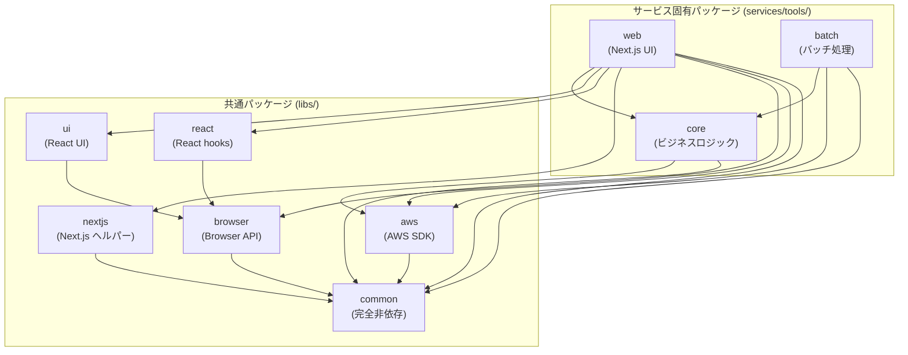

# 共通ライブラリ設計

## 目的

本ドキュメントは、プラットフォームにおける共通ライブラリの設計方針と利用ガイドラインを定義する。

## 基本方針

- **依存関係の明確化**: ライブラリ間の依存を一方向に保つ
- **責務の分離**: フレームワーク依存度によって分割
- **再利用性**: サービス間で共通コードを共有

## 共通パッケージと固有パッケージの関係

### パッケージの分類

本プラットフォームでは、以下の2種類のパッケージを使い分ける。

#### 共通パッケージ (libs/\*)

全サービスで共有可能なライブラリパッケージ。

- **対象**: `libs/common/`, `libs/browser/`, `libs/ui/`, `libs/react/`, `libs/nextjs/`, `libs/aws/`
- **責務**: フレームワーク・ブラウザAPI・React・Next.js・AWS SDKに依存した汎用機能の提供
- **バージョン管理**: 各ライブラリで独立したバージョン管理
- **パッケージ名**: `@nagiyu/common`, `@nagiyu/browser`, `@nagiyu/ui`, `@nagiyu/react`, `@nagiyu/nextjs`, `@nagiyu/aws`

#### 固有パッケージ (services/\*/xxx)

特定サービス専用のパッケージ。

- **対象**: `services/{service}/core`, `services/{service}/web`, `services/{service}/batch` など
- **責務**: サービス固有のビジネスロジック、UI、バッチ処理
- **バージョン管理**: 各パッケージで独立したバージョン管理
- **パッケージ名**: `{service}-core`, `{service}-web`, `{service}-batch` など

### パッケージ間の依存関係

固有パッケージは共通パッケージに依存することができるが、共通パッケージは固有パッケージに依存してはならない。

```
services/{service}/web   → 同サービスの core, libs すべて
services/{service}/core  → libs/common, libs/aws
services/{service}/batch → 同サービスの core, libs/common, libs/aws
```

詳細は「依存関係ルール」セクションを参照。

## ライブラリ構成

### ライブラリ分類

```
libs/
├── ui/           # Next.js + Material-UI 依存
├── browser/      # ブラウザAPI依存
├── react/        # React依存
├── nextjs/       # Next.js依存（APIルートヘルパー等）
├── aws/          # AWS SDK 依存
└── common/       # 完全フレームワーク非依存
```

### 依存関係ルール

#### 共通ライブラリ (libs/\*) 間の依存

```
ui → browser → common
react → browser, common
nextjs → common
aws → common
```

- **一方向のみ**: 上位から下位への依存のみ許可
- **循環依存禁止**: 下位ライブラリは上位を参照しない
- **独立性**: common のメインエクスポートは外部依存なし。外部依存は機能単位のサブパス (`@nagiyu/common/push` など) に限り許容する

#### 固有パッケージから共通ライブラリへの依存

固有パッケージは、その責務に応じて特定の共通ライブラリのみに依存可能。

| 固有パッケージ     | 依存可能な共通ライブラリ  | 理由                                                                                          |
| ------------------ | ------------------------- | --------------------------------------------------------------------------------------------- |
| `services/*/core`  | `libs/common`, `libs/aws` | 永続化 (DynamoDB 等) を持つため `libs/aws` を使う。Next.js / React / next-auth には依存しない |
| `services/*/web`   | `libs/` のすべて          | UI 実装にフレームワーク機能が必要                                                             |
| `services/*/batch` | `libs/common`, `libs/aws` | バッチ処理はフレームワーク非依存。永続化や AWS 連携に `libs/aws` を使う                       |

`services/*/core` と `services/*/batch` は、`libs/browser`・`libs/ui`・`libs/react`・`libs/nextjs` に依存しない。認証まわりなど Next.js に依存する処理は `web` に置く。

#### 依存関係の図



#### 禁止パターン

```
❌ libs/common → services/*/core          # 共通から固有への依存
❌ services/*/core → libs/ui, libs/react, libs/nextjs, libs/browser  # core からフレームワーク依存ライブラリへの依存
❌ services/*/batch → libs/ui, libs/react, libs/nextjs, libs/browser # batch からフレームワーク依存ライブラリへの依存
❌ services/{serviceA}/* → services/{serviceB}/*  # サービス間の直接依存
```

#### 共通ライブラリの外部依存の置き場所

共通ライブラリが持つ外部依存は、lock 上でリポジトリのルートの `node_modules` に置かれている必要がある。

- **理由**: バッチ・Lambda のコンテナイメージは、ルートの `node_modules` と各パッケージのビルド成果物だけをコピーし、`libs/*/node_modules` はコピーしない。外部依存がライブラリの下に入ると、イメージの中で解決できず、起動時に失敗する。Next.js の画面のイメージは、使うモジュールをビルド時に集めて同梱する (standalone 出力) ため、この制約を受けない。
- **検出できない**: CI のコンテナのビルド検証はイメージを作るだけで、イメージの中でモジュールを読み込まない。この失敗はデプロイして初めて分かる。
- **確かめ方**: 外部依存を足す・上げるときは、lock でそのパッケージが `libs/*/node_modules/` の下ではなく `node_modules/` の直下にあることを確かめる。ライブラリの下に入った場合は、lock を作り直してルートへ巻き上げる。その外部依存がさらに依存するパッケージがルートの別の版とぶつかる場合は、外部依存の下 (`node_modules/<パッケージ>/node_modules/`) に入るので問題ない。

## 各パッケージの責務

各パッケージの機能 (関数・コンポーネント・フックの使い方と振る舞い) は ライブラリの仕様 (`docs/platform/specs/lib/`) を参照する。ここには責務と、サービスに課す利用の規則だけを置く。

### libs/ui/

Next.js と Material-UI に依存する UI コンポーネント。パッケージ名は `@nagiyu/ui`。機能は ui の仕様 (`docs/platform/specs/lib/ui/`) を参照。

- 画面のエラー・ローディング表示は `@nagiyu/ui` のコンポーネントを使う。
- 各サービスは、ルートの app ディレクトリ直下に `not-found.tsx` / `error.tsx` / `global-error.tsx` を置き、`@nagiyu/ui` の 404・エラー画面を描く。新しいサービスを足すときも置く。Next.js 既定の英語の画面にはサービスのヘッダーもナビゲーションも無く、利用者が戻る手段を失うためである。
- 例外のログ出力は、部品ではなく各サービスの `error.tsx` / `global-error.tsx` で行う。サーバーへ例外を報告する仕組みを持つサービスは、そこにも送る。エラーバウンダリが捕捉した例外は window のエラーイベントにならず、window を監視する報告の仕組みでは拾えないためである。

### libs/react/

React に依存するユーティリティ。パッケージ名は `@nagiyu/react`。機能は react の仕様 (`docs/platform/specs/lib/react/`) を参照。

- Web Push の購読は、手続きを `@nagiyu/browser`、React からの入口を `@nagiyu/react` に置く。`@nagiyu/ui` は Push を持たない。
    - **分ける理由**: 呼び出し側が公開鍵の取得とサーバー送信を毎回つなぐと、サービスごとに同じ処理が重複する。また、ユーザー操作での購読と許可済みユーザーの再購読が別の層に分かれていると、「初回はここ、再購読はあそこ」という暗黙の役割分担が層をまたいで生まれ、片方の修正がもう片方に伝わらなくなる。
- 購読は hook (`usePushSubscription`) 経由で行い、呼び出し側で鍵取得や送信をつながない。
- layout には `@nagiyu/react` の `ServiceWorkerRegistration` を置く。許可済みユーザーの再購読はここが担い、各画面の購読 UI は初回の許可に専念する。

### libs/nextjs/

Next.js に依存するユーティリティ。パッケージ名は `@nagiyu/nextjs`。`@nagiyu/common` のみに依存する。機能は nextjs の仕様 (`docs/platform/specs/lib/nextjs/`) を参照。

- NextAuth の設定は、Auth サービスは `createAuthConfig()`、Consumer サービスは `createServiceAuthConfig()` で統一する。NextAuth の型定義 (`Session` / `User` / `JWT`) は `libs/nextjs/src/types/next-auth.d.ts` に集約し、各サービスに個別配置しない。
- 全サービスの Health ルートは `createHealthRoute` で生成する。
- Consumer サービスのミドルウェアは `createAuthMiddleware()` で、セッション取得は `createSessionGetter()` で統一する。セッションの戻り値は全サービスで `@nagiyu/common` の `Session | null` とし、サービス固有のセッション型への変換は行わない。
- API ルートのエラー報告は `createApiErrorReporting` で作ったラッパーで行う。どの層で報告するかの規約は [コーディング規約](./rules.md) の「3.3 エラーハンドリング」に従う。
    - AWS SDK の例外は、リポジトリ等でサービスのエラーに包んでから投げる。`handleApiError` は例外の名前に `NotFound` / `Invalid` / `AlreadyExists` を含むと 404 / 400 を返すので、素のまま投げると障害が利用者の誤りとして扱われて報告されない。
    - `withAuth` と合成するときはラッパーを外側に置く (`withApiErrorReporting(title, withAuth(...))`)。内側で 500 に変換すると、ラッパーに届かず報告されないため。
- Push 通知のルートはファクトリ (`createVapidPublicKeyRoute` / `createPushSubscribeRoute`) で実装する。購読を受け取る API は、サービス側で独自の検証を書かず、必ず `validatePushSubscription` を通す。検証が緩いと、送信時まで不正な購読に気付けないためである。購読をサービス固有の保存先へ書き込む場合も、ファクトリを書き写さず、保存のフック (`onSubscribe`) で保存だけを行う。
- `next.config.ts` の `transpilePackages` は、`configs/next.config.base.ts` の `createNextConfig` がサービスの package.json の `@nagiyu/` 依存から導く。サービス側で手書きしない。

### libs/browser/

ブラウザ API に依存するユーティリティ。パッケージ名は `@nagiyu/browser`。機能は browser の仕様 (`docs/platform/specs/lib/browser/`) を参照。

- Web Push の手続きは、React を使わないものとしてここに集約する。公開鍵の取得とサーバー送信は購読の中で済ませ、個別には公開しない。呼び出し側がつなぐ口を残すと、サービスごとの重複と、層をまたぐ暗黙の分担が再発するためである。

### libs/common/

完全にフレームワーク非依存の汎用ユーティリティ。パッケージ名は `@nagiyu/common`。メインエクスポートは外部依存なし (Node.js 標準ライブラリのみ可)。Web Push 送信は `web-push` に依存するため `@nagiyu/common/push` サブパスに分け、メインエクスポートから読み込まない。機能は common の仕様 (`docs/platform/specs/lib/common/`) を参照。

- DB 上のユーザー情報の型は `@nagiyu/common` の `User` を使い、各サービスが独自の `User` 型を定義しない。セッション上のユーザーは別の型 `SessionUser` で、`User` とは区別する。
- API ルートのレスポンス型は `@nagiyu/common` の共通型を使い、サービス側で同等の型を再定義しない。エラーレスポンスはフラット形式 `{ error, message, details? }` を標準とし、`{ error: { code, message } }` のようなネスト形式を新たに導入しない (API クライアント側の取り扱いを統一するため)。
- Web Push の送信は `@nagiyu/common/push` を使う。VAPID 設定は `getVapidConfig()` で取得し、サービス側で環境変数から直接読み込まない。サービス側で `sendWebPushNotification()` の薄いラッパーを作らず、複数の購読への一斉送信は送信ループを書かずに `sendWebPushNotifications` を使う。通知アイコンは `DEFAULT_NOTIFICATION_ICON` を使い、URL をハードコードしない。
- 無効な購読の扱いは呼び出し側が決める (購読の持ち方がサービスごとに違うため)。無効な購読はエラーとして数えない (端末側の都合で日常的に発生し、エラー数で動く仕組みが本来の目的以外で発火するため)。削除の失敗で後続を止めない (呼び出し元まで失敗させると、再試行で同じ通知が重複して届くため)。
- 購読を保存する ID は `createSubscriptionId(endpoint)` で endpoint から決まる値にする。登録のたびに乱数で ID を振ると、同じ端末で登録し直すたびに行が増え、同じ通知が重複して届くためである。既に保存されている購読の ID と互換を保つため、ID の形式は変えない。
- 日本時間の日・月の期間キーと、その記録の TTL の計算は `@nagiyu/common` のものを使い、サービス側で JST のずれの計算を個別に書かない。

### libs/aws/

AWS SDK の補助・拡張。DynamoDB の Repository パターンを実装するための共通機能を提供する。パッケージ名は `@nagiyu/aws`。AWS SDK を dependencies として持ち、エラーメッセージ変換などのために `@nagiyu/common` に依存する。機能は aws の仕様 (`docs/platform/specs/lib/aws/`) を参照。

- DynamoDB リポジトリは、`EntityMapper` で変換を担い、単一アイテムの CRUD を `EntityStore` に任せる (継承ではなく合成)。GSI を使う一覧などの独自のクエリだけを各リポジトリに書く。キー・属性名・時刻の形式の標準と、その理由は [データアクセス層](./data-access-layer.md) を参照。操作の振る舞いは [EntityStore](../platform/specs/lib/aws/entity-store.md)、キーの組み立ては [EntityMapper](../platform/specs/lib/aws/entity-mapper.md) を参照。
- DynamoDB・S3・Batch・Lambda を含むすべての AWS クライアントの初期化には、`@nagiyu/aws` のファクトリ関数 (`getDynamoDBDocumentClient()`・`getBatchClient()`・`getLambdaClient()` 等) を使う。各サービスで AWS クライアントのシングルトンキャッシュを個別に実装しない (コードが重複し、保守コストが増えるため)。
- DynamoDB のカーソル変換 (`encodeCursor` / `decodeCursor`) と 1 ページ分の Query / Scan (`queryPage` / `scanPage`) は共通のものを使い、サービス側で個別に書かない。各所で書くと、`count` の入れ方などページの意味論が箇所ごとにずれるためである。
- BatchWriteItem / BatchGetItem の分割と未処理分の再送は共通処理に任せ、サービス側で分割・再送のループを書かない。
- 利用回数の上限を数える部分は `UsageCounter` を使い、サービス側で条件付き更新の式を個別に書かない。記録の障害時に通すか止めるかは共通にせず、サービスによって違う (通す方が良いか、止める方が良いか) ので、呼び出し側が決める。
- `UpdateCommand` の `UpdateExpression` と名前・値の対応表は `buildUpdateExpression` で組み立て、サービス側で手書きしない。手書きは、使わない名前を表に残す、式に入れ忘れた値が残るといった不整合を起こしやすく、どちらも DynamoDB がエラーにするためである。
- Lambda ハンドラーと Batch エントリポイントの `try/catch → reportErrorEvent → re-throw/exit` は `withErrorReporting` で包む。握りつぶした例外は、`createErrorReporter` で `serviceId` を固定したレポーターを使ってその場で報告する。レポーターはサービスで 1 つにする (web はサービスの `lib/` で作って使い回す)。握った例外がない報告 (結果の失敗など) は、レポーターを使わず `reportErrorEvent` を直接使う。
- EventBridge から定期実行される Lambda は `createScheduledHandler` で包む。失敗時は 500 を返さず、例外を投げる。500 を返して正常終了すると Lambda としては成功扱いになり、インフラに用意した Errors アラーム・DLQ・非同期呼び出しの再試行が働かないためである。handler 側で catch して握りつぶさない。例外で失敗すると、EventBridge の再試行で、途中まで済んだ処理がもう一度実行されうる。Push 通知のように副作用がある処理は、二重に送られることを前提に設計する。対象 1 件ごとの失敗を数えて処理を続ける部分的な失敗を、最終的に Lambda の失敗にするかどうかは、handler が決める。
- 複数の必須環境変数の検証は `@nagiyu/common` の `requireEnv` を使う。
- DynamoDB Local を使った契約テスト向けのヘルパーは `@nagiyu/aws/testing` から import する。この specifier は package.json の `exports` に意図的に載せていない。解決するのは各サービスの `jest.contract.config.ts` の `moduleNameMapper` だけで、`exports` に載せると本番コードから到達できる公式な口を開くことになるため、契約テスト以外から使う経路を持たせない。宣言されていないサブパスの import は実装漏れではない。

## バージョン管理

### 基本方針

- **各ライブラリで独立管理**: ui, browser, common それぞれが独自のバージョン
- **セマンティックバージョニング**: 破壊的変更はメジャーバージョンアップ
- **初期バージョン**: 1.0.0 から開始

### 更新の影響範囲

各ライブラリの更新は、それを利用するサービスにのみ影響。

## ビルド順序

### 依存関係に基づくビルド順序

ライブラリ間の依存関係により、ビルドは以下の順序で実行する必要があります:

1. 並列実行可能（依存なし）:
   - `@nagiyu/common`
   - `@nagiyu/aws`
2. 並列実行可能（`@nagiyu/common` に依存）:
   - `@nagiyu/react`
   - `@nagiyu/browser`
   - `@nagiyu/nextjs`
3. `@nagiyu/ui` - `@nagiyu/browser` に依存

### 正しいビルドコマンド

**モノレポ全体をビルドする場合:**

```bash
npm run build:libs
```

`build:libs`（ルートの `package.json`）は、依存を満たす順に `--workspace` を並べて 1 つずつ実行する。npm は複数の `--workspace` を指定順に実行するため、並びがそのままビルド順になる。lib を追加したり依存を変えたりしたら、この並びを直す。

**重要**: `npm run build --workspaces` は依存関係ではなくワークスペースの定義順で実行するため、ビルドエラーが発生する可能性があります。

### CI/CDでのビルド

GitHub Actions などの CI/CD 環境でも、同じ順序でビルドを実行してください。

```yaml
- name: Build shared libraries
    run: npm run build:libs
```

詳細は [testing.md](./testing.md) の「GitHub Actions ワークフロー設計パターン」を参照してください。

## ライブラリ内部の実装ルール

### パスエイリアス禁止

ライブラリ内部では相対パスのみ使用。

```typescript
// ❌ 禁止
import { something } from '@/components/Button';

// ✅ 推奨
import { something } from '../components/Button';
```

### 理由

- ライブラリとして配布する際の一貫性
- ビルド設定の複雑化を回避
- 依存関係の明確化

## TypeScript設定の方針

### テストコードも型チェック対象に含める

ライブラリの `tsconfig.json` では、`tests/` ディレクトリを型チェック対象に含める。

### 理由

- **早期発見**: テストコードの型エラーを開発時に検出
- **品質向上**: Testing Library のマッチャー（`toBeInTheDocument` 等）の型補完が効く
- **一貫性**: プロダクションコードと同じ型安全性をテストコードでも維持

### 設計のポイント

- `include` に `tests/**/*` を追加
- `rootDir` は指定しない（TypeScript が自動的に共通の親ディレクトリを判断）
- ビルド出力は `dist/src/` と `dist/tests/` に分かれるが、`package.json` の `exports` で `dist/src/index.js` を指定
- テストファイル（`.test.ts`）は実行時のみ使用され、配布には影響しない

## 拡張性

### 将来の展開

- 他フレームワーク対応（Vue, Svelte等）の場合、新しいライブラリを追加
- 依存関係ルールは維持（一方向性）

### 新規ライブラリの追加基準

- 複数サービスで共通利用される
- 明確な責務を持つ
- 既存ライブラリと責務が重複しない

## 参考

- [rules.md](./rules.md): コーディング規約・べからず集
- [service-template.md](./service-template.md): サービステンプレート
- [architecture.md](./architecture.md): アーキテクチャ方針
- [shared-ui-components.md](./shared-ui-components.md): `libs/ui/` における共通 UI コンポーネントの設計方針・API 規約・開発フロー
