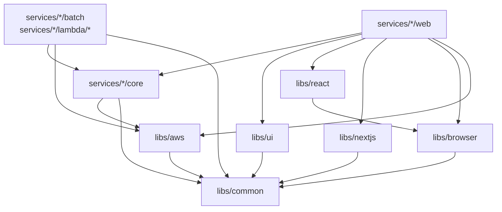

---
sources:
  - configs/eslint.config.core.mjs
sources_hash: 86d2b72623d0f5775456deaad0b6bdd9401f742efabb1bb16b0f4ad3cf3e3f42
---

# アーキテクチャの規約

サービスを core・web・batch に分ける形と、パッケージどうしの依存の方向の規約。依存のうち UI 系のライブラリへの依存は `configs/eslint.config.core.mjs` が止め、それ以外はレビューで守らせる。パッケージの置き場所と名前は [モノレポの規約](./monorepo.md)、libs へ切り出す基準は [共通ライブラリの規約](./shared-libraries.md) にある。

## パッケージの責務

### サービスは core・web・batch に分け、それぞれの責務を混ぜない

| パッケージ | 責務 |
|---|---|
| core | ビジネスロジックと、永続化などのデータアクセス。Next.js・React に依存しない |
| web | Next.js による UI と API ルート |
| batch | 定期実行・イベント駆動の処理。AWS Batch や Lambda のエントリポイント |

web と batch は同じ core を使う。core を分けておくと、画面と非同期の処理が同じロジックを共有でき、ロジックを UI なしでテストできる。

web だけのサービス (portal) や batch だけのサービス (dev-sync) は、core を作らない。core を作るのは、web と batch が共有するもの、または UI から切り離してテストしたいロジックがあるときである。

quick-clip の `lambda/*` は batch と同じ位置づけで、core に依存して Lambda のハンドラーを持つ。

### web の UI (`components/`、`app/`) とビジネスロジック (`lib/`) を分ける

ロジックを UI に混ぜると、画面を描かずにテストできず、ほかの画面から再利用できない。`lib/` の中の構成は、サービスの特性に合わせて決めてよい。

## 依存の方向



矢印は「依存してよい」向きを表す。web は図の libs のすべてに依存してよい (common への依存は図では省く)。

### 依存は下位 (汎用) のパッケージへ一方向に向け、循環させない

libs はサービスのパッケージに依存しない。サービスは、ほかのサービスのパッケージに依存しない。共通にしたいものは libs へ切り出す。サービスどうしが依存すると、一方の変更がもう一方を巻き込み、サービスを単独で変更・デプロイできなくなる。

libs どうしの依存の方向は [共通ライブラリの規約](./shared-libraries.md) にある。

### core と batch は UI 系のライブラリに依存しない

core と batch (`lambda/*` を含む) が依存してよい libs は、`@nagiyu/common` と `@nagiyu/aws` だけにする。永続化を core が持つため、`@nagiyu/aws` は許す。UI の部品を core に持ち込むと、Lambda などの UI を持たない実行環境へ UI の依存ごと運ぶことになるためである。

この制限は `configs/eslint.config.core.mjs` が lint で強制する。止めるのは `@nagiyu/ui`、`@nagiyu/browser`、`react`、`next`、`next/*` の import である。

- **止めないもの**: `@nagiyu/react`、`@nagiyu/nextjs`、`next-auth` は止めない。この 3 つに依存しない規則はレビューで守らせる。
- **継承**: core・batch・`quick-clip/lambda/*` は、それぞれの `eslint.config.mjs` でこの設定を参照するだけにする。禁止の設定をパッケージごとに書くと、書き忘れたパッケージで制限が効かなくなるためである。

## core のサーバー / クライアント境界

### サーバー専用の初期化をモジュールスコープで実行しない

DB クライアントの生成、環境変数の参照、外部サービスのクライアントの生成は、関数の中で行う。モジュールのトップレベルで実行すると、クライアントコンポーネントがバレルエクスポート (`index.ts`) 経由でそのパッケージを import したとき、トップレベルのコードが副作用として実行される。`sideEffects: false` を宣言していなければ、バンドラーはそのコードを取り除けず、サーバー専用のコードがクライアントのバンドルに入り、実行時エラーになる。

```typescript
// NG: import しただけで実行される
const client = createDatabaseClient();

// OK: 呼び出されたときに実行する
export function getItem(id: string) {
    const client = createDatabaseClient();
    return client.get(id);
}
```

## web から batch へ渡すジョブの入力

web が AWS Batch のジョブを起動し、batch が入力を環境変数で読むサービスの規則。

### 入力の定義は core に 1 つだけ置く

変数名と値の形 (型、web 側で環境変数の配列にする変換、batch 側で読んで検証する処理) を、web と batch が依存する core に置く。どちらかが直書きすると、変数名を変えたときに片側だけが変わり、型でもテストでも気づけない。入力の形はサービスごとに違うため、サービスに依存しない部品を置く libs ではなく、サービスの core に置く。

### 起動ごとに変わらない値は、infra のジョブ定義に任せる

テーブル名・バケット名・リージョンなどは、infra のジョブ定義の環境変数で渡す。web が起動時に渡すのは、ジョブ ID など起動ごとに変わる値だけにする。両方で同じ値を渡すと、どちらが効いているのかが読み手にわからなくなり、片方だけ直すずれも起きる。

### 同じ意味の値には、サービスをまたいで同じ変数名を使う

例: テーブル名は `DYNAMODB_TABLE_NAME`。
