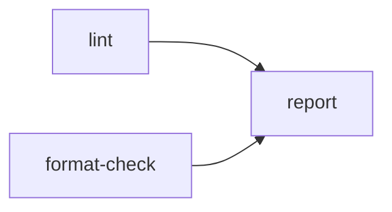

---
sources:
  - .github/workflows/all-verify.yml
  - .github/actions/setup-node/action.yml
  - .github/actions/report-verify-results/action.yml
  - .github/actions/report-verify-results/report.js
sources_hash: 5a8f9887b4c9ef35d0b5387467d8b8ba8554e6e9f006a47100e88b2d5d8163a2
---

# 全体の lint と format の検査

`develop` と `master` 向けの PR で、全ワークスペースの lint と format の検査を行い、結果を PR のコメントに書く。

## 起点

| きっかけ | 条件 |
|---|---|
| `pull_request` | 向き先が `develop` または `master`。変更したファイルでは絞らない (どのファイルの変更でも走る) |

同じ PR の古いコミットの run は打ち切る。

## 処理

| ジョブ | 内容 |
|---|---|
| `lint` | 共通イメージ (`base`) の上で、`setup-node` (`skip-setup-node: 'true'`) で依存を入れ、ルートで `npm run lint` を実行する |
| `format-check` | 同じ環境で、依存を入れ、ルートで `npm run format:check` を実行する |
| `report` | `lint` と `format-check` の結果を PR にコメントする (常に動く) |

- ルートの `lint` と `format:check` は、全ワークスペースの同名のスクリプトを呼ぶ (`npm run <名前> --workspaces --if-present`)。スクリプトを持たないワークスペースは飛ばす。
- 2 つのジョブは並列に動く。
- 共通イメージとタグは[CI 共通イメージのビルドと公開](./ci-image-build.md)にある。

### 報告 (`report-verify-results`)

`report` ジョブは、`report-verify-results` に `display-name: All Workspaces` だけを渡す。

- 同じ run の完了したジョブを API で集め、ジョブごとに結果を表にして PR にコメントする。`needs` に並べたジョブではなく、完了したすべてのジョブが対象になる。報告ジョブ自身は結果が未確定のため除く。
- `success`、`skipped`、`neutral` のジョブだけなら見出しを「Verification Passed」にし、それ以外 (`cancelled` と `timed_out` を含む) が 1 つでもあれば「Verification Failed」にする。
- `fast-full` を渡さないため、見出しは Fast と Full で出し分けない。`e2e-report-key` も渡さないため、レポートへのリンクの列もない。
- PR を伴わない起動では、コメントを飛ばす。

## 失敗したとき

| 場面 | 結果 |
|---|---|
| lint または format の検査が失敗 | そのジョブが失敗し、PR のコメントに「Failed」と書く。もう一方のジョブは続ける |

## 理由

- E2E と同じ OS と Node で検査するため、共通イメージの上で動かす。検査で通ったものが、環境の差で落ちることを避ける。
- 古いコミットに対する検査は不要なため、新しい run が来たら打ち切る。
