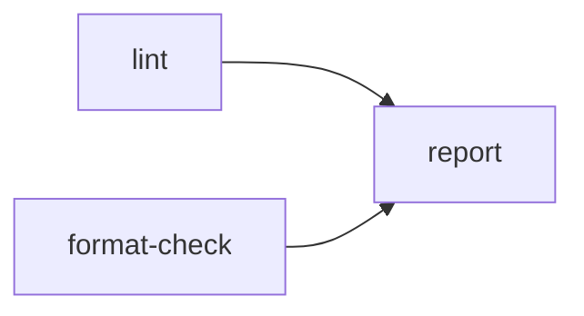

---
sources:
  - .github/workflows/all-verify.yml
sources_hash: 005d8b2a93191ae495ed1128105acfdfd52462e1624578fe3b658d106d68dc02
---

# 全体の lint と format の検査

`develop` と `master` 向けの PR で、全ワークスペースの lint と format の検査を行い、結果を PR のコメントに書く。

## 起点

| きっかけ | 条件 |
|---|---|
| `pull_request` | 向き先が `develop` または `master`。変更したファイルでは絞らない (どのファイルの変更でも走る) |

同じ PR の古いコミットの run は打ち切る。

## 処理

| ジョブ | 内容 |
|---|---|
| `lint` | 共通イメージ (`base`) の上で、`setup-node` (`skip-setup-node: 'true'`) で依存を入れ、ルートで `npm run lint` を実行する |
| `format-check` | 同じ環境で、依存を入れ、ルートで `npm run format:check` を実行する |
| `report` | `lint` と `format-check` の結果を PR にコメントする (常に動く) |

- ルートの `lint` と `format:check` は、全ワークスペースの同名のスクリプトを呼ぶ (`npm run <名前> --workspaces --if-present`)。スクリプトを持たないワークスペースは飛ばす。
- 2 つのジョブは並列に動く。
- 共通イメージとタグは[CI 共通イメージのビルドと公開](./ci-image-build.md)にある。

### 報告

`report` ジョブは、`report-verify-results` に `display-name: All Workspaces` だけを渡す。コメントの作り方は[サービスの PR 検証](./service-verify.md)の「PR への結果報告」と同じで、同じ試行の完了したジョブがすべて対象になる。`fast-full` と `e2e-report-key` を渡さないため、見出しは Fast と Full で出し分けず、レポートへのリンクの列もない。

## 失敗したとき

| 場面 | 結果 |
|---|---|
| lint または format の検査が失敗 | そのジョブが失敗し、PR のコメントに「Failed」と書く。もう一方のジョブは続ける |

## 理由

- E2E と同じ OS と Node で検査するため、共通イメージの上で動かす。検査で通ったものが、環境の差で落ちることを避ける。
- 古いコミットに対する検査は不要なため、新しい run が来たら打ち切る。
