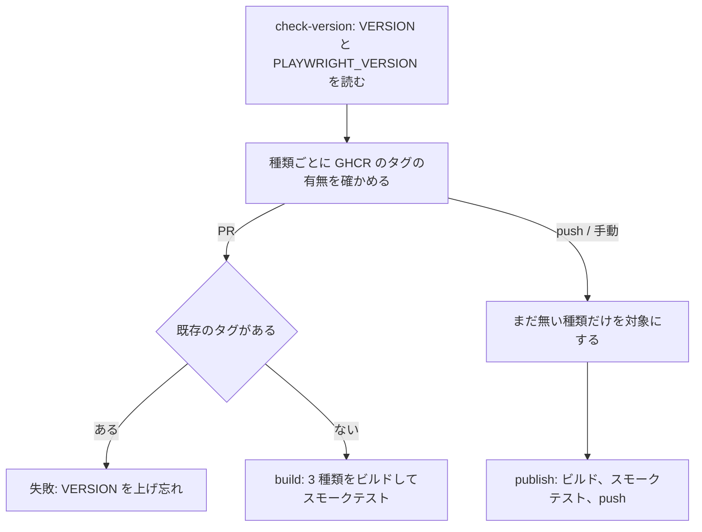

---
sources:
  - .github/workflows/ci-image-build.yml
  - .github/ci-image/Dockerfile
  - .github/ci-image/VERSION
  - .github/ci-image/smoke-test.sh
sources_hash: 94bdfb89ef6ef7f8c5276dcf6b1bdedd7dba91e388504c5782a450384868051e
---

# CI 共通イメージのビルドと公開

GitHub Actions のジョブを動かす共通イメージ (`base`、`chromium`、`webkit`) を、`.github/ci-image/Dockerfile` からビルドして GHCR (`ghcr.io/nagiyu/nagiyu-platform/ci`) に置く。ジョブは `container:` でこのイメージを指定し、Node、AWS CLI、git、docker のコマンド、ブラウザがそろった環境で動く。どのジョブがどのイメージに乗るかは、各ワークフローの `container:` にある。

## 起点

| きっかけ | 条件 | 行うこと |
|---|---|---|
| `pull_request` | 向き先が `develop` または `integration/**`。変更が `.github/ci-image/**` か `.github/workflows/ci-image-build.yml` にある | 版の確認、ビルド、スモークテスト。公開しない |
| `push` | `develop` への push。変更が同じパスにある | 版の確認、まだ無い種類のビルド、スモークテスト、push |
| `workflow_dispatch` | 手動。ref を問わず公開する | `push` と同じ |

同時実行は、PR では PR 番号、それ以外では ref を単位にする。PR の古いコミットの run は打ち切る。push を伴う run は、途中で打ち切るとタグが中途半端に残るため、実行中のものを打ち切らない。待機できる run はグループに 1 つで、さらに新しい run が来ると、待機中の run は取り消される。

## 処理

### 版の確認 (check-version)

1. GHCR にログインする。
2. `.github/ci-image/VERSION` (空白を除く) と、Dockerfile の最初の `ARG PLAYWRIGHT_VERSION=` の値を読む。どちらかが空なら失敗する。
3. `base`、`chromium`、`webkit` のそれぞれについて、`docker manifest inspect` でタグ `<種類>-v<VERSION>` があるかを確かめる。
    - 取得できれば「既にある」。
    - `manifest unknown`、`name unknown`、`no such manifest`、`not found` のいずれかを含むエラーなら「まだ無い」。パッケージが 1 つも無い初回もこれに当たる。
    - それ以外のエラーは、確認できないため失敗する。
4. PR では、既にある種類が 1 つでもあれば、`VERSION` を上げ忘れたとして失敗する。push と手動実行では、既にある種類を対象から外し、再実行しても壊れないようにする。

### ビルドとスモークテスト (build)

PR のときだけ動く。3 種類を並列にビルド (`docker build --target <種類> --build-arg PLAYWRIGHT_VERSION=...`) し、スモークテストを通す。タグは `<種類>-v<VERSION>` で、push はしない (`packages: write` を持たない)。ひとつの種類が失敗しても、ほかの種類は続ける。

### 公開 (publish)

push と手動実行で、まだ無い種類が 1 つ以上あるときだけ動く。まだ無い種類ごとに並列で、GHCR にログインし、ビルド、スモークテスト、push の順に行う。ひとつの種類が失敗しても、ほかの種類は続ける。

### スモークテスト (`smoke-test.sh`)

使い方は `smoke-test.sh <種類> <イメージ参照>`。

| 確認 | 内容 |
|---|---|
| Node | `node --version` が `v26.` で始まる。違えば失敗する |
| AWS CLI、git | `aws --version`、`git --version` が通る |
| docker | ランナーの docker のソケット (`/var/run/docker.sock`) を渡して `docker version` が通る。コマンドがあるだけでなく、デーモンと話せる (API の版が合う) ことを確かめる |
| ブラウザ (`chromium`、`webkit` のみ) | 一時のディレクトリに `playwright@<PLAYWRIGHT_VERSION>` を入れ、その種類のブラウザを起動して `about:blank` を開く |

### イメージ

ステージ名がそのまま種類の名前になる。

| 種類 | 中身 |
|---|---|
| `base` | `node:26-slim` (Debian)、ca-certificates、curl、unzip、git、AWS CLI v2、docker のコマンド (`docker-ce-cli`) |
| `chromium` | `base` に Playwright の Chromium とその OS 依存パッケージを加えたもの |
| `webkit` | `base` に Playwright の WebKit とその OS 依存パッケージを加えたもの |

- タグは `<種類>-v<VERSION>` (例: `base-v2`)。`VERSION` は `.github/ci-image/VERSION` の整数。
- 同じタグは上書きしない。Dockerfile を変えたら `VERSION` を上げる。
- ブラウザは `/ms-playwright` に置き (`PLAYWRIGHT_BROWSERS_PATH`)、実行時のユーザーやホームが変わっても同じ場所から見つかるようにする。
- Playwright の版は Dockerfile の `ARG PLAYWRIGHT_VERSION` で決める。ルートの `package.json` の `@playwright/test` と同じにする。イメージのブラウザは Playwright の版ごとに置き場所が決まり、ずれるとテストがブラウザを見つけられない。E2E のジョブは、ずれを先に確かめる ([E2E](./e2e.md) の「Playwright の版の確認」)。

## 失敗したとき

| 場面 | 結果 |
|---|---|
| PR で、同じ `VERSION` のタグが既に GHCR にある | `check-version` が失敗する。`VERSION` を上げる |
| タグの有無を確認できない (認証や通信のエラーなど) | `check-version` が失敗する |
| ビルドまたはスモークテストの失敗 | その種類のジョブが失敗する。PR ではマージ前に気づけ、push では公開されない |
| 公開した後の再実行 | 既にある種類を飛ばすため、何も起こらない |

## 理由

- ブラウザと OS の依存パッケージを実行のたびに apt で取ると、ランナーの置き場所によって取得が極端に遅くなり、ジョブが数十分止まる。前もってイメージに入れ、ジョブが外部からの取得に左右されないようにする。
- 検査・E2E・deploy で OS と Node をそろえる。検査で通ったものが、環境の差で deploy で落ちることを避けるため。
- ベースは Debian (`node:26-slim`) にする。本番の web は `node:26-alpine` だが、Playwright のブラウザは alpine では動かない。本番の batch の一部も `node:26-slim` で、同じ Debian 系である。
- ブラウザの種類ごとにイメージを分ける。E2E のジョブは 1 つにつきブラウザを 1 つしか使わないため、もう一方を抱えるとイメージが大きくなり、取得も遅くなる。
- docker はコマンドだけを入れ、デーモンはジョブのコンテナに渡されるランナーのものを使う。コマンドは Debian のパッケージではなく Docker の配布元から取る。デーモンは古い API の版を順に受け付けなくなり、リリース時点で版が止まる Debian のパッケージでは、ランナーのデーモンと話せなくなるため。
- Node はメジャーだけを指定する (`node:26-slim`)。イメージは作った時点のパッチを抱える。パッチを追うときは `VERSION` を上げて作り直す。
- PR で既存のタグを失敗にするのは、既にある版には Dockerfile の変更が反映されないため。push で既存のタグを飛ばすのは、公開済みのイメージを上書きせず、再実行しても壊れないようにするため。

## 手順

### Playwright や Node を上げる

2 本の PR に分ける。

1. 1 本目で、イメージを作る。
    - `.github/ci-image/Dockerfile` の版 (Playwright なら `ARG PLAYWRIGHT_VERSION`、Node ならベースイメージのメジャー) と `.github/ci-image/VERSION` を上げる。
    - Node のときは、`.node-version` と全 Dockerfile のメジャーも一緒に上げる。[Node のメジャー版の一致の検査](./node-version-verify.md)が、これらの食い違いで落ちるため。サービスの Dockerfile が替わるので、この PR は dev へのデプロイも伴う。
    - Node のときは、`smoke-test.sh` の `^v26\.` (Node のメジャーの直書き) も直す。直さないと、上げた版のイメージがスモークテストで落ちる。
2. 2 本目で、イメージを使う側を替える。
    - Playwright のときは、ルートの `package.json` の `@playwright/test` を、Dockerfile の `PLAYWRIGHT_VERSION` と同じ版にする。
    - ワークフローの `container:` のイメージのタグ (`ci:<種類>-v<VERSION>`) を、新しい `VERSION` に替える。deploy のワークフローのタグも替わるため、この PR は dev へのデプロイを伴う。
    - タグは、`ci:base-v2` のように直書きされたものと、式で組み立てたもの (`reusable-e2e.yml` の `ci:${{ ... }}-v<N>`) がある。種類を含めた文字列 (`base-v2`、`chromium-v2` など) で探すと、式の中のものは当たらない。`nagiyu-platform/ci:` で探し、式の末尾の `-v<N>` も確かめる。
    - docs に直書きされたタグ (`docs/platform/specs/ci/*.md` の `ci:base-v2` など) も替える。

1 本目を `develop` まで入れ、`develop` への push でイメージを公開してから、2 本目に着手する。手動実行は `develop` で行う。公開は `develop` への push か手動実行だけで、`integration/**` で手動実行すると、`develop` に入っていない中身で上書きできないタグができる。そのタグは、`integration/**` から `develop` への PR では既存のタグとして検査が落ちる。1 本にまとめると、イメージができる前にジョブが走り、存在しないタグを取りに行って落ちる。
