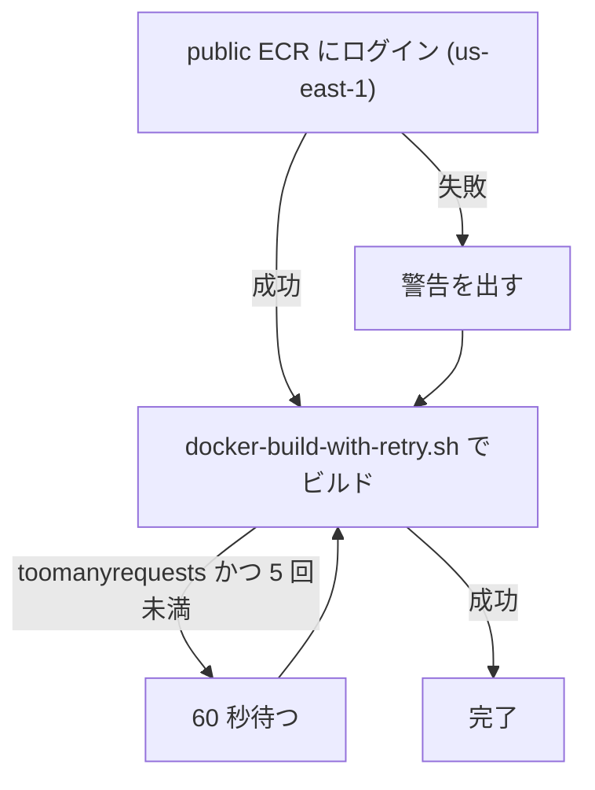
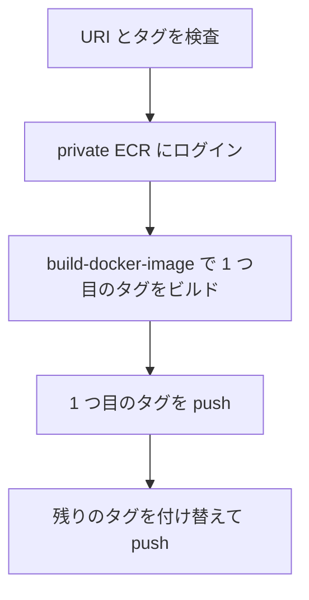

---
sources:
  - .github/actions/build-docker-image/action.yml
  - .github/actions/push-ecr-image/action.yml
  - .github/actions/build-web-app/action.yml
  - .github/actions/setup-node/action.yml
  - .github/scripts/docker-build-with-retry.sh
sources_hash: 767618722b3fd422d1dc8a3f68251ad0980bfc75d7fa51344601c6fe1370e5e5
---

# イメージのビルドと ECR への push

ワークフローが Docker イメージをビルドし、ECR に push するための部品。public ECR への認証とリトライを持つ `build-docker-image`、private ECR へ push する `push-ecr-image`、Web アプリをビルドする `build-web-app`、依存を入れる `setup-node` の 4 つの composite action と、ビルドを再試行するスクリプト `.github/scripts/docker-build-with-retry.sh` からなる。

## 起点

どの部品も、ワークフローのステップから `uses: ./.github/actions/<名前>` で呼ばれる。単独では起動しない。

| 部品 | 呼ぶワークフロー | push |
|---|---|---|
| `build-docker-image` | サービスの verify の Docker ビルド確認、`push-ecr-image` | しない |
| `push-ecr-image` | サービスの deploy のイメージのビルドと push | する |
| `build-web-app` | verify のビルド確認、E2E、deploy のビルド | しない |
| `setup-node` | verify、deploy、全体の lint・format、定期の npm 検査 | しない |

- verify は、`build-docker-image` でビルドが通ることだけを確かめる。ECR には何も置かない。
- deploy は、`push-ecr-image` でビルドし、そのまま push する。`push-ecr-image` は中で `build-docker-image` を呼ぶため、verify と deploy は同じ action でビルドする。
- ECR リポジトリの作り方と環境の切り替えは[デプロイ先](../deploy.md)にある。サービスごとのデプロイの流れは各サービスの `docs/services/<service>/specs/deploy.md` にある。
- ビルドとデプロイに必要な IAM の権限は[デプロイの権限](../resource/deploy-policies.md)にある。

## 処理

### build-docker-image

| 入力 | 必須 | 内容 |
|---|---|---|
| `dockerfile` | 必須 | Dockerfile のパス |
| `image-tag` | 必須 | ビルドするイメージのタグ |
| `build-args` | 任意 | 改行区切りの `KEY=VALUE`。空行は無視する |

- ログインは `aws ecr-public get-login-password --region us-east-1` で取ったトークンを `docker login public.ecr.aws` に渡す。リージョンは呼び出し側の `AWS_REGION` に依存させず、`us-east-1` に固定する。ECR Public の認証トークンは `us-east-1` でしか取得できない。
- ログインに失敗すると、警告 (`::warning::`) を出して匿名 pull のまま次へ進む。ジョブは失敗しない。
- ビルドは環境変数 `DOCKER_BUILDKIT=0` で行う。ビルドの引数は環境変数 `DOCKER_BUILD_ARGS` でスクリプトに渡す。
- ビルドのコンテキストはリポジトリのルート (`.`) になる。

### docker-build-with-retry.sh

引数は `<image-tag> <dockerfile>` の 2 つで、どちらかが空なら使い方を出して失敗する。`docker build` の標準エラー出力を一時ファイルに取り、失敗したときだけ表示する。

| 項目 | 既定値 | 上書きする環境変数 |
|---|---|---|
| 最大リトライ回数 | 5 | `DOCKER_BUILD_MAX_RETRIES` |
| 1 回の待ち時間 | 60 秒 | `DOCKER_BUILD_RETRY_WAIT_SECONDS` |

- 失敗した出力に `toomanyrequests` が含まれるときだけ、待ってからビルドをやり直す。ほかのエラーは、待たずにそのときの終了コードで失敗する。
- 既定では最長 5 分 (5 回 × 60 秒) の遅延が加わる。
- リトライを使い切っても `toomanyrequests` なら、「最大リトライ回数を超えました。」を出して、最後のビルドの終了コードで失敗する。

### push-ecr-image

| 入力 | 必須 | 内容 |
|---|---|---|
| `repository-uri` | 必須 | push 先の `<registry>/<repository>`。タグは含めない |
| `dockerfile` | 必須 | Dockerfile のパス |
| `tags` | 必須 | push するタグ。改行区切りで複数指定でき、空行は無視する |
| `build-args` | 任意 | `build-docker-image` と同じ |

| 出力 | 内容 |
|---|---|
| `image-uri` | 1 つ目のタグを付けたイメージの URI (`<repository-uri>:<1 つ目のタグ>`) |

- 検査では、`repository-uri` が空、または `/` を含まないときと、有効なタグが 1 つもないときに失敗する。タグは行ごとに CR と前後の空白を落として読み、最初の空でない行を 1 つ目のタグにする。
- ログインは `aws-actions/amazon-ecr-login@v2` で行い、呼び出し側が設定した AWS の認証情報を使う。
- 1 つ目のタグでビルドして push し、2 つ目以降は同じイメージに `docker tag` で付けて push する。1 つ目と同じタグと空行は飛ばす。

### build-web-app

次の順に実行する。

1. Node.js のセットアップ (`skip-setup-node` が `'true'` でないとき)。`.node-version` の版を入れ、npm のキャッシュを使う。
2. npm のキャッシュの設定 (`skip-setup-node` が `'true'` のとき)。キャッシュの場所を `npm config get cache` で調べ、キーを `<OS>-node-<package-lock.json のハッシュ>` にして `actions/cache` で保存する。
3. `npm ci`
4. `npm run build:libs` で共有ライブラリをビルドする。ライブラリ間の依存順は `build:libs` が持つため、呼び出し側では並べない。
5. `shared-workspaces` (カンマ区切り) のワークスペースを、書かれた順にビルドする。空の要素は飛ばす。
6. `workspace` のワークスペースをビルドする。

| 入力 | 必須 | 内容 |
|---|---|---|
| `workspace` | 必須 | ビルドする web のワークスペース名 |
| `shared-workspaces` | 任意 | web より先にビルドするワークスペース (core など) |
| `skip-setup-node` | 任意 (既定 `'false'`) | `'true'` なら `actions/setup-node` を使わず、実行環境にある Node を使う |

### setup-node

`build-web-app` の 1 から 3 と同じ動作で、ビルドは行わない。

| 入力 | 必須 | 内容 |
|---|---|---|
| `cache-dependency-path` | 任意 (既定 `./package-lock.json`) | キャッシュのキーにするロックファイル |
| `skip-setup-node` | 任意 (既定 `'false'`) | `build-web-app` と同じ |

`skip-setup-node` が `'true'` のときのキャッシュのキーは `build-web-app` と同じ形で、ロックファイルが同じなら両者でキャッシュを共有する。共通イメージの上で動くジョブは Node がイメージに入っているため、このオプションを付ける。

## 失敗したとき

| 場面 | 結果 |
|---|---|
| public ECR へのログイン失敗 | 警告だけ。匿名 pull で続行する |
| `toomanyrequests` | 最大 5 回まで待ってやり直す。使い切ると失敗する |
| `toomanyrequests` 以外のビルドの失敗 | すぐに失敗する |
| `push-ecr-image` の URI またはタグが不正 | ビルドの前に失敗する |
| push の失敗 | ステップが失敗する (`set -euo pipefail`) |

## 理由

- verify と deploy は同じ action でビルドする。`APP_VERSION` も同じ取り方 (各サービスの `package.json` の `version`) で `build-args` に渡す。verify を通ったビルドが deploy でも同じになる。
- public ECR の匿名 pull のクォータは送信元 IP 単位である。共有ランナーでは他者に枠を消費され、`Data limit exceeded` で失敗する。この失敗は転送量の上限超過で、待っても戻らないことが多い。認証するとクォータの単位が認証済みアカウントになるため、ビルドの前にログインする。
- ログインに失敗しても警告にとどめる。必要な IAM 権限の反映は dev と prod で時期が異なりうるため、ログインの成否でビルド全体を止めない。
- リトライは認証を補う保険である。認証後もアカウント単位のクォータはあり、一時的な集中で `toomanyrequests` が出うる。手動で流し直す手間をなくすため、最長 5 分の遅延を許す。対象を `toomanyrequests` だけにするのは、設定ミスや権限エラーなどを待たずに知らせるためである。
- 同時に走るビルドの数は絞らない。認証後のレート制限は同時実行数が原因ではないため、絞っても抑止にならず、待ち時間だけが増える。また、既存の数を確かめてから自分の分を置く方式は原子的でなく、同時に取りに行くと上限を超えて通るため、上限を守れない。
