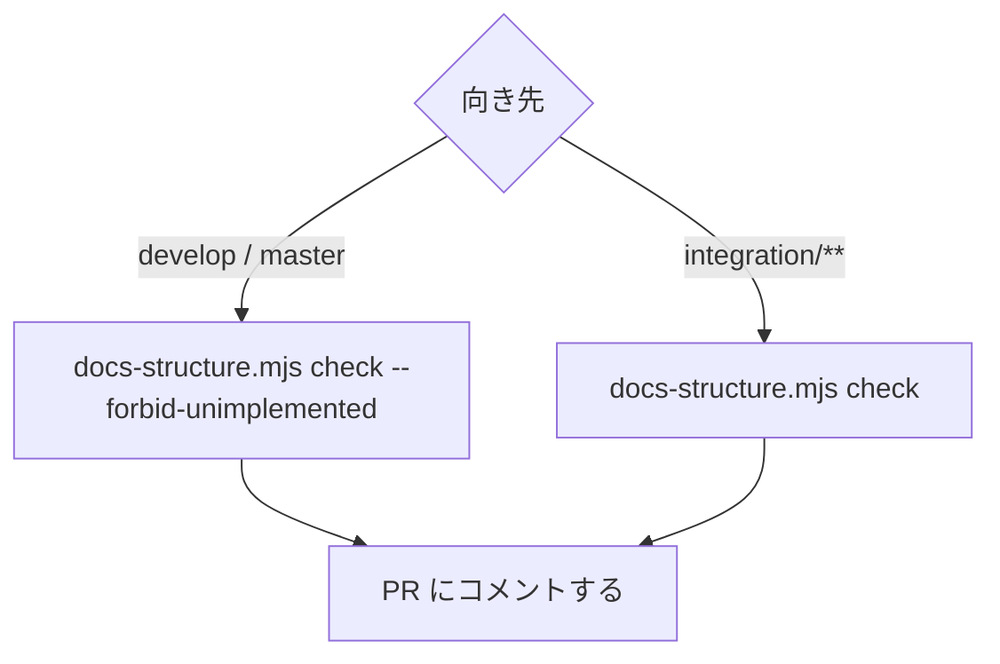

---
sources:
  - .github/workflows/docs-structure-verify.yml
  - .github/workflows/docs-verify.yml
  - .github/workflows/docs-pages-deploy.yml
  - .github/workflows/scripts/docs-structure.mjs
  - .github/workflows/scripts/check-doc-links.py
sources_hash: 71ef8917d169d09a7933f98c310b9005d03cfc438486862a9496021200fadd59
---

# docs の検査と公開

`docs/` の文書を、PR で 2 つのワークフロー (配置と出典の検査、リンクとサイトのビルドの検査) で確かめ、`develop` と `integration/**` への push で公開サイトを GitHub Pages に載せる。検査の内容 (frontmatter、出典のハッシュ、配置、未実装) は[docs の書き方](../../rules/docs.md)にある。ここには、ワークフローとしての起点、ジョブ、報告を書く。

## 起点

| ワークフロー | きっかけ | 条件 |
|---|---|---|
| `docs-structure-verify.yml` | `pull_request` | 向き先が `develop`、`master`、`integration/**`。変更したファイルでは絞らない (毎回走る) |
| `docs-verify.yml` | `pull_request` | 向き先が同じ。変更が `docs/**`、`docs-site/**`、`.node-version`、`check-doc-links.py`、このワークフローのいずれかにある |
| `docs-pages-deploy.yml` | `push` | `develop` と `integration/**` への push。変更が `docs/**`、`docs-site/**`、`.node-version`、このワークフローのいずれかにある |
| `docs-pages-deploy.yml` | `workflow_dispatch` | 手動 |

検査の 2 本は、同じ PR の古いコミットの run を打ち切る。公開は打ち切らない (後述)。

## 処理

### 配置と出典の検査 (`docs-structure-verify.yml`)

| ジョブ | 内容 |
|---|---|
| `check` | ランナーの Node で `node .github/workflows/scripts/docs-structure.mjs check` を実行する。向き先が `develop` か `master` のときは `--forbid-unimplemented` を付け、`unimplemented: true` の文書もエラーにする |
| `report` | 結果を PR にコメントする (常に動く) |

未実装の仕様 (`unimplemented: true`) は、実装の前に `integration/**` の上で書くため、その向きの PR では許す。`develop` と `master` には入れない。

依存を足さずランナーの Node で動かすため、`setup-node` も共通イメージも使わない。スクリプトは Node の標準モジュールだけで書かれている。`docs-structure.mjs` は `check` のほかに、出典のハッシュを書き戻す `update` を持ち、文書を直すときに手元で使う。

### リンクとサイトのビルドの検査 (`docs-verify.yml`)

| ジョブ | 内容 |
|---|---|
| `link-check` | ランナーの `python3` で `python3 .github/workflows/scripts/check-doc-links.py` を実行する |
| `site-build` | 共通イメージ (`base`) の上で、`npm ci --workspace=docs-site --include-workspace-root` で依存を入れ、`npm run test -w docs-site` と `npm run build -w docs-site` を実行する |
| `report` | 2 つのジョブの結果を PR にコメントする (常に動く) |

- `check-doc-links.py` は、`docs/` の Markdown の相対リンクを読み、リンク先がない (リンク切れ) か、リンク先が `docs/` の外にあるものを全件報告する。コードブロックとコード表記の中は対象外。1 件でもあれば失敗する。
- `site-build` は、`docs/` の書き方が VitePress で通ること (壊れたリンクや、Vue と衝突する記法がないこと) を確かめる。
- `link-check` は python3 を使い、共通イメージには入っていないため、ランナーで動かす。`site-build` は Node の依存を入れるため、npm のキャッシュを `actions/cache` で保つ。ルートと `docs-site` の依存だけを入れ、ほかのワークスペースの依存は入れない。

### 報告

検査の 2 本の `report` ジョブは、`report-verify-results` を使わず、`actions/github-script` でコメントを書く。

- 見出しは、すべてのジョブが `success` なら「Verification Passed」、そうでなければ「Verification Failed」。
- ジョブごとの結果を表にし、失敗したときは直し方の案内を添える。
- 実行へのリンクを末尾に付ける。

### 公開 (`docs-pages-deploy.yml`)

| ジョブ | 内容 |
|---|---|
| `build` | 共通イメージ (`base`) の上で、依存を入れ (`docs-site` とルートだけ)、`npm run build -w docs-site` でサイトをビルドし、`actions/configure-pages` を実行して、`docs-site/.vitepress/dist` を Pages の成果物としてアップロードする |
| `deploy` | `build` の後、同じイメージの上で、環境 `github-pages` に `actions/deploy-pages` で公開する。環境の URL に公開先の URL を出す |

- 公開の対象は、`develop` と `integration/**` のどちらの push でも同じ 1 つのサイトである。後から公開した内容が載る。手動実行も同じ。
- 権限は、`contents: read`、`pages: write`、`id-token: write`。
- 同時実行は `concurrency.group: pages` で 1 本ずつにし、`cancel-in-progress: false` で進行中の公開を止めない。

## 失敗したとき

| 場面 | 結果 |
|---|---|
| 配置、出典、未実装の検査が落ちる | `check` が失敗する。PR のコメントに、出典が変わった文書は本文を今のコードと突き合わせてから直すこと、配置に当たらない文書は `docs/layout.json` の配置に置くこと、未実装の文書は `develop` と `master` に入れられないことを添える |
| リンク切れ、`docs/` の外へのリンク、サイトのテストまたはビルドの失敗 | 該当のジョブが失敗する。PR のコメントに、`docs/` の外のファイルはコード表記のパスで書くこと、リンク切れを直すことを添える |
| 公開のビルドまたは公開の失敗 | その run が失敗し、サイトは前回の公開のまま残る |

## 理由

- 検査を `develop` と `master` 向けで強くするのは、未実装の仕様が今の挙動として読まれないようにするため。`integration/**` の上では、実装の前に仕様を置けるように許す。
- リンク検査は、`docs/` だけを公開する先 (GitHub Pages など) でもリンクが壊れないよう、`docs/` の中で閉じていることを確かめる。
- 公開を打ち切らないのは、進行中の公開を途中で止めると、サイトが壊れた状態になりうるため。
- 配置と出典の検査とリンク検査は、依存を足さずランナーの Node または `python3` で動かす。サイトのビルドと公開は、検査と同じ共通イメージの上で動かし、環境の差で公開だけが落ちるのを避ける。
