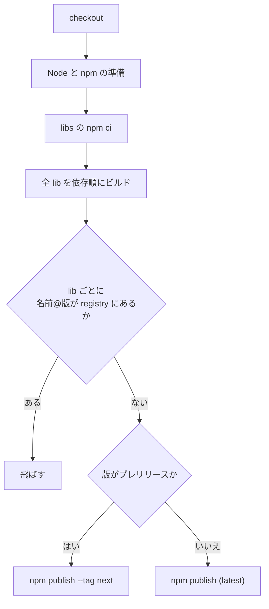

---
sources:
  - .github/workflows/lib-publish.yml
  - libs/package.json
  - libs/write-cjs-marker.mjs
  - libs/common/package.json
  - libs/common/tsconfig.cjs.json
  - libs/aws/package.json
  - libs/aws/tsconfig.cjs.json
  - libs/browser/package.json
  - libs/browser/tsconfig.cjs.json
  - libs/nextjs/package.json
  - libs/nextjs/tsconfig.cjs.json
  - libs/react/package.json
  - libs/react/tsconfig.cjs.json
  - libs/ui/package.json
  - libs/ui/tsconfig.cjs.json
sources_hash: ea72519617a978e8eab6aaff5e071b775c8142aa050773b64f1eaefad91e1833
---

# ライブラリの publish

共通ライブラリ (`libs/`) を npmjs.com に publish するワークフロー `lib-publish.yml`。版を上げた lib だけを出し、publish 済みの版は飛ばす。いつ起動するか、版をどう付けるかは [共通ライブラリの公開と版の規約](../../rules/lib-packages.md) にある。

## 起点

| 項目 | 内容 |
|---|---|
| イベント | `workflow_dispatch` (人が起動する)。入力は持たない |
| ブランチ | 起動するときに選んだブランチの内容を出す。lib の変更を確かめ終えた `integration/**` か `develop` を選ぶ |

push や PR では動かない。`master` へのマージでも出さない。

同時に起動されたときは、先の run が終わるまで後の run を待たせる。実行中の run は打ち切らない。途中で止めると、出た lib と出ていない lib が混ざったまま残るためである。

## 処理

| 段 | 内容 |
|---|---|
| 権限 | `contents: read`、`id-token: write`。`id-token: write` は trusted publishing (OIDC) の認証に要る |
| Node と npm | `.node-version` の Node を使い、registry に `https://registry.npmjs.org` を設定する。trusted publishing には npm CLI 11.5.1 以上が要るため、npm の版を確かめ、足りなければ上げる |
| install | `libs/` で `npm ci` する。ルートの install は行わない |
| ビルド | `libs/` で `npm run build` を流し、全 lib を依存される側から順に (`common`、`aws`、`browser`、`nextjs`、`react`、`ui`) ビルドする。各 lib の `build` が、ESM 版 (`dist/src`) と CJS 版 (`dist/cjs`) の両方を出し、`dist/cjs` に `{"type": "commonjs"}` の `package.json` を置く |
| 判定 | lib ごとに `package.json` の名前と版を読み、`npm view <名前>@<版>` で registry にあるかを確かめる。ある版は飛ばす。同じ版の再 publish は registry が拒むためである |
| publish | ない版を、依存順 (ビルドと同じ並び) に 1 つずつ `npm publish --workspace <lib> --access public` で出す。版に `-` を含む (プレリリース) ときは `--tag next` を付け、`latest` を動かさない |

- 依存の順に出すので、依存先の新しい版が、依存元より先に registry に載る。
- 認証は、secret `NPM_TOKEN` があればそれを使い、なければ OIDC を使う。`NPM_TOKEN` は、まだ npmjs.com に無い lib を初めて出すときだけ置く (下の「手順」)。
- OIDC で出すと provenance が自動で付く。

### パッケージに含めるもの

各 lib の `package.json` の `files` で、パッケージに入れるものを絞る。

| lib | 含めるもの |
|---|---|
| すべて | `dist/src` (ESM 版と型定義)、`dist/cjs` (CJS 版。`{"type": "commonjs"}` の `package.json` を含む)、`package.json` |
| `@nagiyu/nextjs` | 上に加えて、`exports` の `./types/next-auth` が指す `src/types/next-auth.d.ts` |

テストのビルド成果物 (`dist/tests`) とソースは含めない。provenance がリポジトリと突き合わせるため、各 lib の `package.json` の `repository` に、このリポジトリの URL と lib のディレクトリ (`libs/<name>`) を書く。

## 失敗したとき

| 失敗 | 原因と対処 |
|---|---|
| `403 OIDC permission denied for this action` | npmjs.com の Trusted Publisher の allowed actions に `npm publish` が付いていない。付けてから起動し直す |
| OIDC の認証が通らない | その lib に Trusted Publisher が登録されていないか、登録したリポジトリ・ワークフロー名がこのワークフローと一致しない。まだ npmjs.com に無い lib なら、下の「手順」で出す |
| 途中の lib で失敗した | それより前に出た lib は registry に残る。原因を直して起動し直すと、出た版は飛ばされ、残りだけが出る |

出した版は取り消さない。誤った版を出したときは、次の版を出して直す ([共通ライブラリの公開と版の規約](../../rules/lib-packages.md))。

## 手順

### まだ npmjs.com に無い lib を初めて出す

Trusted Publisher は、npmjs.com に存在するパッケージにしか登録できない。そのため初版だけは token で出す。作業は npmjs.com と GitHub の画面だけで行う。

1. npmjs.com の Access Tokens で、granular access token を発行する (Packages and scopes の権限は Read and write、対象は All packages。有効期限は最短にする)
2. GitHub のリポジトリの Settings → Secrets and variables → Actions に、secret `NPM_TOKEN` として登録する
3. Actions から `lib-publish.yml` を起動し、出すブランチを選ぶ
4. npmjs.com で、出した lib ごとに Settings → Trusted Publisher を開き、GitHub Actions を選んで次を登録する
    - Organization or user: `nagiyu`
    - Repository: `nagiyu-platform`
    - Workflow filename: `lib-publish.yml`
    - allowed actions: `npm publish` を付ける
5. GitHub の secret `NPM_TOKEN` を消し、npmjs.com の token を削除する

5 の後は、`NPM_TOKEN` が無いので OIDC で出る。lib を新しく足したときも、その lib の初版で同じ手順を踏む。

## 理由

- **人が起動し、master へのマージで出さない**: サービスが版を上げる前に registry にその版がある状態にする必要がある。master へのマージで出すと、サービスの切り替えを develop で確かめる時点で版が無い。
- **出し済みの版を飛ばし、版を上げた lib だけを出す**: 6 つの lib の版は独立している。1 回の起動で、上げた lib だけが出るようにし、lib ごとのワークフローを持たない。
- **libs だけを install する**: publish に要るのは libs のビルドだけで、ルートの依存はビルドの結果に関わらない。
