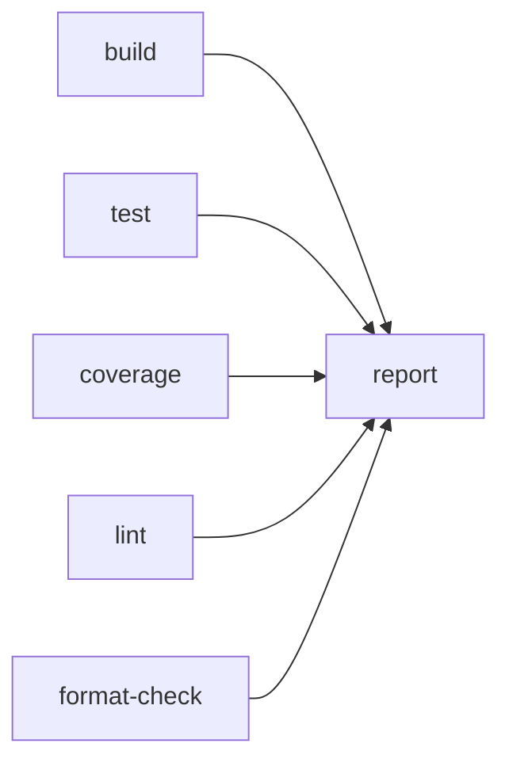

---
sources:
  - .github/workflows/reusable-lib-verify.yml
  - .github/workflows/common-verify.yml
  - .github/workflows/aws-verify.yml
  - .github/workflows/browser-verify.yml
  - .github/workflows/nextjs-verify.yml
  - .github/workflows/react-verify.yml
  - .github/workflows/ui-verify.yml
sources_hash: 7e5aaecce63ed5919d581a687d32731ad4c07336a792b6af5015b04bdae5d69c
---

# ライブラリの PR 検証

共通ライブラリ (`libs/`) の PR を検証するワークフロー。検査の本体は再利用ワークフロー `reusable-lib-verify.yml` が持ち、ライブラリごとの 6 本 (`common-verify.yml`、`aws-verify.yml`、`browser-verify.yml`、`nextjs-verify.yml`、`react-verify.yml`、`ui-verify.yml`) が、自分のトリガー (向き先のブランチと paths) を持ち、`workspace` と `display-name` を渡して呼ぶ。

## 起点

| 項目 | 内容 |
|---|---|
| イベント | `develop` または `integration/**` を向く PR |
| 絞り込み | 変更したファイルが、`libs/**`、`configs/**`、`.github/actions/**`、`.node-version`、`package.json`、`package-lock.json`、自分のワークフロー、`reusable-lib-verify.yml` のいずれかに当たると動く。`libs/**` は自分のパッケージではなく `libs/` 全体を指すので、どのライブラリを変えても 6 本すべてが動く |
| 同じ PR の古い run | 新しい run が来たら打ち切る |

`master` 向けの PR では動かない。

### 入力と呼び出し元

| 入力 | 内容 |
|---|---|
| `workspace` | 検証するワークスペース名 |
| `display-name` | PR コメントの見出しに出す名前 |

| ファイル | `workspace` | `display-name` |
|---|---|---|
| `common-verify.yml` | `@nagiyu/common` | Common Library |
| `aws-verify.yml` | `@nagiyu/aws` | AWS Library |
| `browser-verify.yml` | `@nagiyu/browser` | Browser Library |
| `nextjs-verify.yml` | `@nagiyu/nextjs` | Next.js Library |
| `react-verify.yml` | `@nagiyu/react` | React Library |
| `ui-verify.yml` | `@nagiyu/ui` | UI Library |

## 処理

5 つの検査ジョブは並列に動く。いずれも共通イメージ `ci:base-v3` の上で、`npm ci` と `npm run build:libs` を流してから検査する。依存する lib の `dist` が無いとビルドやテストが解決に失敗するため、全 lib を先にビルドする。

| ジョブ | 内容 |
|---|---|
| `Build Library` | `npm run build --workspace=<workspace>` |
| `Run Unit Tests` | `npm run test --workspace=<workspace>` |
| `Test Coverage Check` | `npm run test:coverage --workspace=<workspace>` |
| `Lint Code` | `npm run lint --workspace=<workspace>` |
| `Format Check` | `npm run format:check --workspace=<workspace>` |

カバレッジは、向き先 (`develop` か `integration/**` か) によらず毎回流す。[サービスの PR 検証](./service-verify.md)のような出し分けはない。

`report` ジョブは `if: always()` で、5 つのジョブの終了を待ち、`report-verify-results` で PR にコメントを投稿する。`fast-full` を渡さないので、見出しは `Verification` で、Fast と Full を出さない。表の作り方は[サービスの PR 検証](./service-verify.md)の「PR への結果報告」と同じである。

## 失敗したとき

検査ごとにジョブが分かれているので、PR のチェックの一覧で、落ちたジョブがそのまま検査の種類を表す。1 つが落ちても、ほかの 4 つは流れる。

`libs/**` を変えると 6 本とも動くので、変更したのとは別のライブラリの verify が落ちることがある。落ちた verify のワークスペースを確かめる。

## 理由

- **ライブラリごとにファイルを分ける**: PR のチェックとコメントをライブラリごとに分けて見せるため。ファイルは、トリガーと入力を渡すだけの薄いものにとどめ、検査は 1 つの再利用ワークフローに持つ。
- **検査をジョブに分ける**: 落ちた検査を PR のチェックの一覧から見分けられる。
