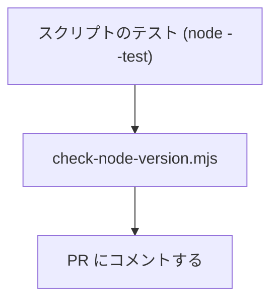

---
sources:
  - .github/workflows/node-version-verify.yml
  - .github/workflows/scripts/check-node-version.mjs
sources_hash: 7118554f9f14b38ee7d5d63e1b8aa2c34c0ff1e27e1e85e0af82965d09bd3f60
---

# Node のメジャー版の一致の検査

`.node-version` のメジャー版と、リポジトリの全 Dockerfile の Node のメジャー版がそろっているかを、PR で検査する。食い違いがあると PR が落ちる。結果は PR のコメントに書く。

## 起点

| きっかけ | 条件 |
|---|---|
| `pull_request` | 向き先が `develop`、`master`、`integration/**`。変更が `.node-version`、`**/Dockerfile`、`.devcontainer/**`、検査のスクリプトとそのテスト、このワークフローのいずれかにある |

同じ PR の古いコミットの run は打ち切る。依存を足さずランナーの Node で動かすため、`setup-node` は使わず、共通イメージの上でも動かさない。

## 処理

| ジョブ | 内容 |
|---|---|
| `check` | `node --test .github/workflows/scripts/tests/check-node-version.test.mjs` でスクリプトのテストを通し、`node .github/workflows/scripts/check-node-version.mjs` で検査する |
| `report` | `check` の結果を表にして PR にコメントする (常に動く)。失敗したときは、`.node-version` と全 Dockerfile のメジャーをそろえること、CI 共通イメージは `VERSION` を上げて作り直すことを添える |

### 何をそろえるか

基準は `.node-version` のメジャー版 (`26` または `v26.1.0` のような書き方から先頭の数字を取る)。`git ls-files` で `Dockerfile` という名前の全ファイルを集め、それぞれを次のとおり読む。

| 行 | 扱い |
|---|---|
| `FROM node:<タグ>`、`FROM public.ecr.aws/lambda/nodejs:<タグ>`、`FROM mcr.microsoft.com/devcontainers/javascript-node:<タグ>` で、タグが数字 (または `v` と数字) で始まる | タグの先頭の数字を Node のメジャーとして、基準と比べる |
| 同じ 3 つのイメージで、タグが数字で始まらない (`node:lts` など) | 版を読めないとして失敗する。同じ Dockerfile に `ARG NODE_VERSION=<版>` があっても、検査から外れない |
| `ARG NODE_VERSION=<版>` | 版の先頭の数字を、基準と比べる |
| 上のどれでもない外部イメージの `FROM` | その Dockerfile に `ARG NODE_VERSION=<数字で始まる版>` があれば検査から外す。なければ、版を読めないとして失敗する |
| 前のステージを指す `FROM` | 前のステージの `FROM` で検査済みのため飛ばす |

`ARG NODE_VERSION` は、Node を持たないイメージに公式のバイナリで Node を入れ直す Dockerfile が、入れる版を書くために使う。この行があれば、その版が検査の対象になり、上の 3 つ以外の外部イメージの `FROM` は検査から外れる。

## 失敗したとき

| 場面 | 結果 |
|---|---|
| Dockerfile のメジャーが基準と違う | 該当のファイルと行にエラーを出して失敗する |
| 外部イメージの `FROM` から版を読めない | 失敗する。Node の版をタグに持つイメージなら、スクリプトの `KNOWN_NODE_IMAGES` に足す。Node を入れ直しているなら、同じ Dockerfile に `ARG NODE_VERSION=<版>` を書く |
| `.node-version` からメジャーを読めない | 失敗する |
| Dockerfile が 1 つも見つからない | 検査の対象が空として失敗する |

## 理由

- Node のメジャーは、`.node-version` と各 Dockerfile のベースイメージのタグに別々に書かれている。片方だけ上げても、実行時まで食い違いに気づけない。マージの前に止める。
- 読み方を知らない外部イメージの `FROM` は、黙って通さず失敗にする。通すと、検査から漏れたまま気づけなくなる。
- Node を上げるときは、同じ PR で `.node-version` と全 Dockerfile のメジャーをそろえる。CI 共通イメージの Dockerfile だけを先に上げると、その PR が検査で落ちる。手順は [CI 共通イメージのビルドと公開](./ci-image-build.md)にある。
