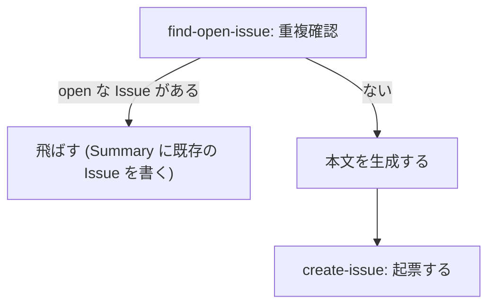

---
sources:
  - .github/workflows/weekly-blog-article.yml
  - .github/workflows/weekly-exploratory-test.yml
  - .github/workflows/weekly-npm-check.yml
  - .github/workflows/weekly-refactoring-check.yml
  - .github/workflows/stock-tracker-inspection.yml
  - .github/actions/find-open-issue/action.yml
  - .github/actions/create-issue/action.yml
  - .github/workflows/scripts/prepare-issue-body.sh
  - .github/workflows/scripts/prepare-npm-issue.py
  - .github/workflows/scripts/prepare-stock-tracker-inspection-issue.sh
  - .github/workflows/scripts/check-npm-outdated.sh
  - .github/workflows/scripts/check-npm-audit.sh
  - .github/workflows/scripts/check-duplicates.sh
  - .github/workflows/scripts/check-version-inconsistency.sh
  - .github/workflows/templates/weekly-blog-article-body.md
  - .github/workflows/templates/weekly-exploratory-test-body.md
  - .github/workflows/templates/weekly-npm-body.md
  - .github/workflows/templates/weekly-refactoring-body.md
  - .github/workflows/templates/stock-tracker-inspection-body.md
  - .github/workflows/templates/stock-tracker-inspection-mkt-section.md
  - .github/workflows/templates/stock-tracker-inspection-no-mkt-section.md
sources_hash: ff36f0780a5e299d8f8767c0ecf7dc0178e0afc961216ebd4fb07456cc2d16a9
---

# 定期の Issue 起票

決まった時刻に、調査や点検の作業を依頼する Issue を自動で起票するワークフロー 5 本。週次のブログ記事、探索的テスト、npm の管理、リファクタリングの調査と、月次の Stock Tracker の点検がある。どれも同じ骨格 (重複の確認、本文の生成、起票) で、起票のラベルと本文の作り方だけが違う。

## 起点

| ワークフロー | 起点 (cron) | 手動実行 |
|---|---|---|
| `weekly-blog-article.yml` | `17 18 * * 5` (毎週土曜 3:17 JST) | できる |
| `weekly-exploratory-test.yml` | 同上 | できる |
| `weekly-npm-check.yml` | 同上 | できる |
| `weekly-refactoring-check.yml` | 同上 | できる |
| `stock-tracker-inspection.yml` | `0 0 1 * *` (毎月 1 日 9:00 JST) | できる (入力 `include_mkt`、既定 `false`) |

権限は、どれも `issues: write` と `contents: read`。

## 処理

1. `find-open-issue` が、指定したラベルの open な Issue を 1 件探す。あれば `should_create` を `false` にし、Summary に既存の Issue の番号と URL を書いて、以降のステップを飛ばす。なければ `should_create` を `true` にする。
2. 本文を作る (ワークフローごとに違う。下の表)。
3. `create-issue` が、本文のファイルから `gh issue create` で起票し、Summary にタイトルと Issue の番号を書く。Assignee とマイルストーンは付けない (人が付ける)。

日付と月は、cron の時刻が UTC では前日や前月にあたることがあるため、JST で決める。

### ワークフローごとの違い

| ワークフロー | 重複確認のラベル | 起票のラベル | タイトル | 本文の作り方 | ラベルの作成 |
|---|---|---|---|---|---|
| `weekly-blog-article.yml` | `blog-article` | `blog-article` | `[Blog] 技術ブログ記事追加 (<日付>)` | テンプレートの置換 | する (色 `0075ca`) |
| `weekly-exploratory-test.yml` | `exploratory-test` | `exploratory-test` | `[Exploratory] 探索的テスト (<日付>)` | テンプレートの置換 | する (色 `5319e7`) |
| `weekly-refactoring-check.yml` | `code-consolidation` | `refactoring`、`code-consolidation` | `[Refactoring] コード共通化調査 (<日付>)` | テンプレートの置換 | しない |
| `weekly-npm-check.yml` | `weekly-check` | `dependencies`、`weekly-check` | `[NPM管理] <年>年第<週>週 パッケージ管理レポート (<日付>)` | 検査の結果をテンプレートに埋める | しない |
| `stock-tracker-inspection.yml` | `stock-tracker-inspection` | `stock-tracker`、`stock-tracker-inspection` | `[Stock Tracker 点検] <年>年<月>月 確度の定期点検`。Q-MKT を含むときは `(四半期: Q-MKT を含む)` を足す | テンプレートの置換と節の差し込み | しない |

- ラベルを作る 2 本は、起票の前に `gh label create` でラベルを作る。すでにあってもエラーにしない (`|| true`)。説明は、`blog-article` が「ブログ記事追加タスク」、`exploratory-test` が「週次の探索的テスト」。
- ラベルを作らない 3 本は、ラベルがすでにある前提で動く。
- 週のタイトルの `<週>` は `date +%U` (日曜始まりの週番号) の値。

### テンプレートの置換 (blog、exploratory、refactoring)

`prepare-issue-body.sh <テンプレートのパス>` が、テンプレートの `{{NEXT_DATE}}` と `{{CREATE_TIME}}` を置換して標準出力に書く。

| 置換する語 | 値 |
|---|---|
| `{{NEXT_DATE}}` | 次の土曜日 (JST。`date -d "next saturday"`)。環境変数が未指定なら `未定` |
| `{{CREATE_TIME}}` | 起票の日時 (JST、`<日付> <時刻> JST`)。環境変数が未指定なら今の JST |

起票後の Summary に「次回作成予定」として `NEXT_DATE` を書く。

### npm の管理 (`weekly-npm-check.yml`)

重複確認と、npm の検査を別のジョブに分ける。

| ジョブ | 内容 |
|---|---|
| `duplicate-check` | `.github/actions` だけを取得し、`find-open-issue` (`weekly-check`) で確認する。出力に `should_create` を持つ |
| `npm-check` | `duplicate-check` が `should_create == 'true'` のときだけ動く。ランナーの上で、`.node-version` の版の Node を入れる (`setup-node` の `skip-setup-node` は付けない) |

`npm-check` は、4 つの検査スクリプトを順に実行する。どれも 1 行の JSON を出力し、ワークフローはそれを Base64 にして次のステップに渡す。

| スクリプト | 出力 |
|---|---|
| `check-npm-outdated.sh` | 更新可能なパッケージの数 (`count`)、メジャー更新の数と名前 (`majorCount`、`majorPackages`) |
| `check-npm-audit.sh` | 脆弱性の深刻度ごとの数、`critical` と `high` のパッケージ名 |
| `check-duplicates.sh` | ルート以外の `package.json` の 3 か所以上で使われている `devDependencies` のパッケージの数 (`count`) |
| `check-version-inconsistency.sh` | 複数のバージョンが混在するパッケージの数 (`count`)。全 `package.json` の `dependencies` と `devDependencies` が対象 |

`prepare-npm-issue.py` が、これらをデコードして `weekly-npm-body.md` に埋める。本文は、検出のサマリー表、検出対象 (Critical、High、major 更新のパッケージ名。該当がなければ節ごと省略)、対応方針の行からなる。

- `npm outdated` と `npm audit` が実行に失敗した (出力が空か JSON として読めない) ときは、`error: true` を返す。本文の該当の件数は `取得失敗` と書き、対応方針に「一部のチェックが実行に失敗しています」を足す。0 件と区別するため。
- 脆弱性が Critical か High で 1 件以上あれば、対応を推奨する行を書く。なく、かつ取得の失敗もなければ、検出されていない旨を書く。
- 検査の結果は件数と名前だけを載せ、`npm outdated` や `npm audit` を流し直せば得られる詳細は載せない。

### Stock Tracker の点検 (`stock-tracker-inspection.yml`)

1. 範囲を決める。定期実行では、JST の月が 1、4、7、10 のときに Q-MKT を含め、それ以外の月は含めない。手動実行では、入力 `include_mkt` で選ぶ。
2. タイトルを組み立てる (上の表)。
3. 重複確認の後、`prepare-stock-tracker-inspection-issue.sh` が本文を作る。`INCLUDE_MKT` が `true` なら対象を `Q-DIR・Q-VOL・Q-MKT (四半期点検)`、それ以外は `Q-DIR・Q-VOL` にし、テンプレート `stock-tracker-inspection-body.md` の `{{CREATE_TIME}}` と `{{TARGETS}}` を置換する。`{{MKT_SECTION}}` の行は、Q-MKT を含めるなら `stock-tracker-inspection-mkt-section.md`、含めないなら `stock-tracker-inspection-no-mkt-section.md` の中身で置き換える。
4. 起票の Summary に、Q-MKT を含むかを書く。

## 失敗したとき

| 場面 | 結果 |
|---|---|
| 同じラベルの open な Issue がある | 起票を飛ばす。失敗ではない。Summary に既存の Issue を書く |
| 本文の生成、起票の失敗 | その run が失敗する。再実行は手動で行う |
| npm の検査の一部が失敗 | 失敗にしない。本文に `取得失敗` と書いて起票する |

## 理由

- 重複確認は、同じ作業の Issue が open のまま積み上がらないようにする。open な Issue が残っているうちは、新しく起票しない。
- `weekly-npm-check.yml` だけ重複確認を別のジョブに分けるのは、`npm ci` などの重い処理の前に判定し、既存の Issue があれば後続のジョブごと飛ばすため。
- 日付と月を JST で決めるのは、実行時刻 (UTC) が JST の日付と食い違うため。
- npm の検査が失敗したとき 0 件として報告しないのは、本文が「問題なし」に見えてしまうため。
- Assignee とマイルストーンを付けないのは、人が付けるため。
