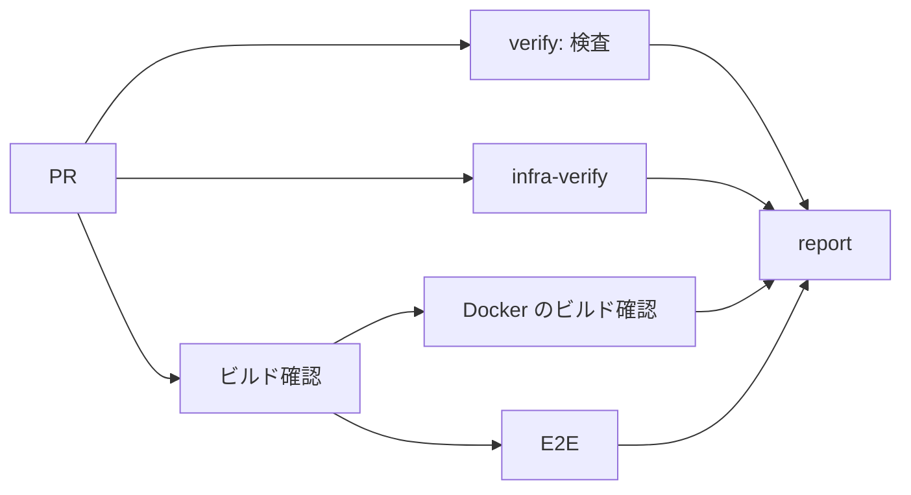
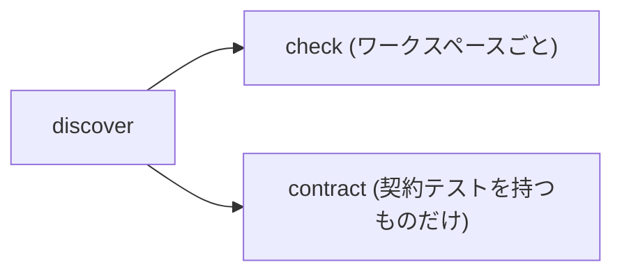

---
sources:
  - .github/workflows/reusable-service-verify.yml
  - .github/actions/list-service-workspaces/action.yml
  - .github/actions/list-service-workspaces/list.js
  - .github/actions/report-verify-results/action.yml
  - .github/actions/report-verify-results/report.js
  - .github/actions/build-web-app/action.yml
sources_hash: 5d9596ba41e29c313d273006d9f1f2d99d583f3c2c47d2a2e979f3b94fd1d756
---

# サービスの PR 検証

サービスの PR を検証するワークフロー群 (`.github/workflows/*-verify.yml` のうちサービスの 11 本) の共通の流れ。検査の本体は `reusable-service-verify.yml` が持ち、各サービスの verify は、それを呼ぶ `verify` ジョブのほか、infra の検証・ビルド確認・Docker のビルド確認・E2E・結果の報告を並べる。

インフラの検証は [infra の検証](./infra-verify.md)、E2E は [E2E](./e2e.md)、イメージの部品は `docker-image.md` に書く。

## 起点

| 項目 | 内容 |
|---|---|
| イベント | `integration/**` または `develop` を向く PR |
| 同じ PR の古い run | 新しい run が来たら打ち切る (concurrency はワークフローと PR 番号ごと) |

`master` を向く PR では、サービスの verify は走らない。

## 処理

各サービスの verify は、上の部品を並べる。どれを持つかはサービスの構成で変わり、呼び出し側が入力で変えられるのは次のとおり。

| 入力 | どこへ | 内容 |
|---|---|---|
| `dirs` | 検査 (`reusable-service-verify.yml`) | 検査をかけるディレクトリ。空白か改行で区切る |
| `coverage-exclude` | 検査 | カバレッジ検査から外すワークスペース名 (空白区切り) |
| `full` | E2E | 3 デバイスで流すか |
| `report-key` | E2E、報告 | E2E レポートの置き場所の名前 |
| `fast-full` | 報告 | 見出しに Fast / Full を出すか |

### 検査 (`reusable-service-verify.yml`)

`discover`、`check`、`contract` の 3 ジョブで動く。いずれも共通イメージ `ci:base-v2` の上で動く。

#### discover

`list-service-workspaces` が、`dirs` から検査の対象を決める。先に `list.test.js` を `node --test` で流す。

| 手順 | 内容 |
|---|---|
| 1 | ルートの `package.json` の `workspaces` を展開し、各ワークスペースの `package.json` を読む。`npm ci` の前でも動くよう、npm ではなくファイルから導く |
| 2 | `dirs` のいずれかと一致するか、その配下にある location のワークスペースを対象にする。区切りまで含めて比べるので、`services/admin` は `services/admin-tools` を拾わない。`dirs` がワークスペースそのものを指すときは、そのワークスペースだけを対象にし、配下は拾わない |
| 3 | npm scripts の有無で、検査の要否を決める |
| 4 | 検査を 1 つも持たないワークスペースを除き、location 順に並べる |
| 5 | テストの前にビルドが要るワークスペース (`prebuild`) を決める |

検査と npm scripts の対応。

| 検査 | npm script |
|---|---|
| lint | `lint` |
| 書式 | `format:check` |
| テスト | `test` |
| カバレッジつきのテスト | `test:coverage` (`coverage-exclude` に挙げたワークスペースは持っていても外す) |
| 契約テスト | `test:contract` |

`prebuild` は、location が `/core` で終わるワークスペースと、`infra/` 配下のワークスペースがあるのに `infra/common` が対象に入っていないときの `@nagiyu/infra-common`。web や batch が core のビルド成果物を、infra が infra-common のビルド成果物を参照するためである。

#### check

ワークスペースごとの matrix (`Check (<ワークスペース名>)`)。`fail-fast: false` で、1 つが落ちても他の結果が出る。1 ジョブの中で次の順に流す。

| 順 | 手順 | 流す条件 |
|---|---|---|
| 1 | 依存のインストール (`npm ci`) | 常に |
| 2 | lint | `lint` を持つ |
| 3 | 書式の検査 | `format:check` を持つ。lint が落ちても流す |
| 4 | ビルド (`npm run build:libs`、続けて `prebuild` の各ワークスペースの `build`) | `test` か `test:coverage` を持つ。ここまでが落ちても流す |
| 5 | カバレッジつきのテスト | `develop` 向けで、`test:coverage` を持つ。ビルドが落ちたら流さない |
| 6 | テスト | `test` を持ち、5 を流す対象ではない。ビルドが落ちたら流さない |

`develop` 向けで `test:coverage` を持つワークスペースは、`test` の代わりに `test:coverage` を流す。`integration/**` 向けでは `test` だけを流すので、`test` を持たず `test:coverage` だけを持つワークスペースは、`integration/**` 向けではテストが流れない。

#### contract

`test:contract` を持つワークスペースがあるときだけ流す。持つワークスペースごとの matrix で、DynamoDB Local (`amazon/dynamodb-local`) をサービスコンテナとして立てる。ジョブがコンテナで動くので、サービス名 `dynamodb-local` でポート 8000 に届く。

| 手順 | 内容 |
|---|---|
| 1 | `npm ci`、`build:libs`、`prebuild` のビルド |
| 2 | DynamoDB Local が応答するまで待つ (1 秒おきに最大 30 回) |
| 3 | `DYNAMODB_ENDPOINT=http://dynamodb-local:8000`、リージョン `us-east-1`、ダミーの認証情報を渡して `test:contract` を流す |

契約テストは `develop` 向けか `integration/**` 向けかによらず流れる。

### ビルド確認

サービスごとに、本番のビルドが通ることを確かめる。サービスの構成に応じて、web (Next.js など)、core、batch、Lambda を別のジョブで確かめる。

| 手段 | 内容 |
|---|---|
| `build-web-app` | `npm ci`、`build:libs`、shared-workspaces (core など。カンマ区切り) のビルド、対象ワークスペースのビルドを順に流す |
| 直書き | `npm ci`、`build:libs`、必要なワークスペースの `npm run build` |

どちらも共通イメージ `ci:base-v2` の上で動き、Node はイメージのものを使う。

### Docker のビルド確認

サービスの Dockerfile で、イメージが組み立てられることを確かめる。ECR へは push しない。

| 手順 | 内容 |
|---|---|
| 1 | PR 用のロール (`vars.AWS_PR_ROLE_ARN`) を引き受ける。リージョンは `us-east-1` |
| 2 | 対象の `package.json` の `version` を、ビルド引数 `APP_VERSION` に渡す (これを使うイメージだけ) |
| 3 | `build-docker-image` でビルドする。タグは `<サービス>-...-verify-...` 形式のローカルのタグ |

イメージの部品 (`build-docker-image` のログインとリトライ) は `docker-image.md` にある。

### E2E

E2E を持つサービス (dev-sync 以外の 10 本) は、`reusable-e2e.yml` を `full: ${{ github.base_ref == 'develop' }}` で呼ぶ。挙動は [E2E](./e2e.md) にある。web のビルドのジョブを `needs` に持つサービスと持たないサービスがある。

### infra の検証

`reusable-infra-verify.yml` を、サービスの infra ディレクトリを `dirs` にして呼ぶ。挙動は [infra の検証](./infra-verify.md) にある。ポータルだけは、ルートの infra ワークスペースだけを対象にするため `dirs: infra` を渡す。

### portal の内部リンク検査

ポータルだけが、`internal-links` ジョブを持つ。`npm ci` のあと、`check:internal-links` を流す。共通ライブラリをビルドせずに流すので、検査の入口は未ビルドの `@nagiyu/*` を import できない。

### PR への結果報告

`report` ジョブが、`report-verify-results` で PR にコメントを投稿する。`if: always()` で、ほかのジョブがすべて終わってから動く。

| 項目 | 内容 |
|---|---|
| 集めるジョブ | 同じ run、同じ試行の、完了済みのジョブすべて (Actions API で取る)。`needs` に挙げたジョブではなく、run のジョブを数える。報告ジョブ自身は未完了なので入らない |
| 成功扱い | `success`、`skipped`、`neutral`。`cancelled` と `timed_out` は失敗 |
| コメント | 表 (ジョブ名、状態) の末尾に run へのリンクを付ける。run ごとに新しいコメントを足す (既存のコメントは更新しない) |
| PR がない起動 | コメントを投稿せず終わる |
| 状態の絵文字 | `success` ✅、`failure` ❌、`cancelled` ⚠️、`skipped` ⏭️、それ以外 ❓ |

見出しは `## <✅ か ❌> [<サービス名>] Verification <Passed か Failed>`。`fast-full` を `'true'` で渡すと、`Verification` の前に Fast か Full が入る。base が `develop` なら Full、それ以外は Fast である。

`e2e-report-key` を渡すと、表に Report 列が付く。ジョブ名の括弧に `chromium-mobile`、`chromium-desktop`、`webkit-mobile` のいずれかがあり、状態が `success` か `failure` のジョブだけが、`<base>/<e2e-report-key>/pr-<PR 番号>/<run ID>/<デバイス>/` へのリンクを持つ。それ以外は `-`。`<base>` は `reports-base-url` で、空なら `https://reports.nagiyu.com`。末尾に、レポートが 3 日で消えることと再実行で作り直せることを書く。

E2E を持つ 10 本は、`reports-base-url` に変数 `E2E_REPORTS_BASE_URL` を渡す (値が無ければ prod の URL)。dev-sync は E2E を持たないので、`e2e-report-key` を渡さない。

## Fast と Full の出し分け

Fast と Full という名前の仕組みが 1 か所にあるのではなく、各ワークフローが `github.base_ref` を見て、それぞれ出し分ける。

| 項目 | `integration/**` 向け (Fast) | `develop` 向け (Full) | 決まる場所 |
|---|---|---|---|
| E2E のデバイス | `chromium-mobile` | `chromium-mobile`、`chromium-desktop`、`webkit-mobile` | 呼び出し側の `full` と、`reusable-e2e.yml` の matrix ([E2E](./e2e.md)) |
| E2E のイメージ | `chromium` | WebKit のデバイスだけ `webkit` | `reusable-e2e.yml` |
| ユニットテスト | `test` | `test:coverage` (持つワークスペース) | `reusable-service-verify.yml` の `check` |
| 契約テスト、ビルド確認、Docker のビルド確認、infra の検証 | 同じ | 同じ | 出し分けなし |
| PR コメントの見出し | `Fast Verification` | `Full Verification` | `report.js`。`fast-full` を渡すサービスの verify だけ |
| ライブラリのカバレッジ | 流す | 流す | 区別なし ([ライブラリの検証](./lib-verify.md)) |
| リポジトリ全体の lint と書式 | 流れない | 流れる | `all-verify.md` (`develop` と `master` 向けだけ) |
| 未実装の文書の禁止 | 許す | 禁止 | `docs.md` (`develop` と `master` 向けで禁止) |

`master` 向けの PR (リリース) では、サービス・ライブラリ・infra の verify は走らない。走るのは `all-verify.md`、`docs.md`、`node-version-verify.md` の検証だけである。

## 失敗したとき

| 症状 | 原因と見方 |
|---|---|
| `discover` が `dirs が指定されていません` または `検査をかけるワークスペースが見つかりません` で落ちる | `dirs` が空か、検査のスクリプトを 1 つも持たないワークスペースしかない。`dirs` と各 `package.json` の scripts を確かめる |
| `discover` の `list.test.js` が落ちる | `list.js` の変更が既存の期待と合わない |
| `Check` の lint が落ちる | 書式の検査とテストは続けて流れる。1 回の run で全部の結果が見える |
| `Check` のビルドが落ちる | テストは流れない。原因ではない失敗を増やさないため |
| `Contract Test` が落ちる | DynamoDB Local が 30 秒のうちに応答しなかった場合も、テストの失敗として現れる |
| Docker のビルド確認が `toomanyrequests` を出す | public ECR のレート制限。`build-docker-image` が待ってリトライする (`docker-image.md`) |
| Docker のビルド確認が通ったのに、デプロイ後にバッチや Lambda が起動で落ちる | Docker のビルド確認はイメージを作るだけで、イメージの中でモジュールを読み込まない。実行時の import の失敗は検出できない |

## 理由

- **PR で静的チェックを終える**: lint、書式、型、ビルド、ユニットテスト、synth は、マージの前に PR で終わらせる。マージ時のリスクを下げるためである。
- **ビルドは deploy と同じ action で行う**: verify のビルドと deploy のビルドが別の手順だと、verify が通ったのに deploy で落ちる。同じ composite action (`build-web-app`、`build-docker-image`) を使い、`APP_VERSION` も同じ取り方で渡す。
- **検査は npm scripts の有無で決める**: ワークフローごとに検査の対象を手で並べていたとき、並べ忘れたパッケージがあり、どこでもユニットテストが走らないパッケージが出た。ワークスペースを `dirs` から導き、スクリプトを持つ検査をかければ、パッケージを足してもワークフローを書き換えずに済む。スクリプトを用意しない検査は流れず、CI も赤くならないので、新しいパッケージには `lint`、`format:check`、`test`、`test:coverage` を揃える。
- **書式の検査をビルドより前に流す**: ビルド後の `dist/` を prettier が拾って落ちるため。
- **lint が落ちても後続を流す**: 1 回の run で全部の結果を見せるため。ジョブを分けて止めない。
- **ビルドが落ちたらテストを流さない**: 原因ではない失敗が増えるため。
- **カバレッジは `develop` 向けだけで流す**: `integration/**` 向けは Fast にとどめる。
- **報告はジョブの一覧から集計する**: `needs` を手で並べると、ジョブの追加と削除のたびに集計が実態とずれる。`skipped` を成功として扱うのは、`if` で意図して飛ばしたジョブを失敗と見なさないため。
