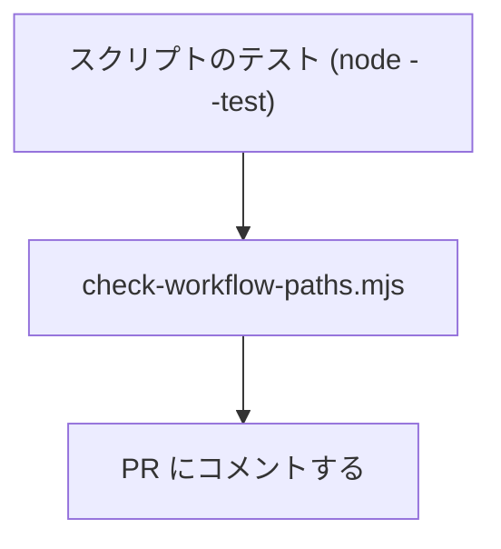

---
sources:
  - .github/workflows/workflow-paths-verify.yml
  - .github/workflows/scripts/check-workflow-paths.mjs
sources_hash: 4449a66f2e60e16beb48602dff21e99209285d9bc40874e090dd4384e462f842
---

# workflow の paths の漏れの検査

ワークフローの `paths` に、実行に要るファイルの漏れがないかを、PR で検査する。漏れがあると PR が落ちる。結果は PR のコメントに書く。

## 起点

| きっかけ | 条件 |
|---|---|
| `pull_request` | 向き先が `develop`、`master`、`integration/**`。変更が `.github/workflows/**`、`.github/actions/**`、`.github/scripts/**`、`**/tsconfig*.json`、`configs/**` のいずれかにある |

同じ PR の古いコミットの run は打ち切る。依存を足さずランナーの Node で動かすため、`setup-node` は使わない。

## 処理

| ジョブ | 内容 |
|---|---|
| `check` | `node --test .github/workflows/scripts/tests/check-workflow-paths.test.mjs` でスクリプトのテストを通し、`node .github/workflows/scripts/check-workflow-paths.mjs` で検査する |
| `report` | `check` の結果を表にして PR にコメントする (常に動く)。失敗したときは、検査のログに出た足すべきパスを `paths` に足すよう添える |

### 何を検査するか

`.github/workflows/` の全ワークフローのうち、`push`・`pull_request`・`pull_request_target` に `paths` を持つものを対象にする。ワークフローごと、イベントごとに、要るファイルを導き、`paths` のどのパターンにも当たらないものを漏れとして落とす。

| 導くもの | 導き方 |
|---|---|
| ワークフロー自身 | そのファイル |
| 使う composite action | `uses: ./.github/actions/<名前>` の参照から、その action のディレクトリ配下のすべてのファイル。action の中で使う別の action も、再帰して辿る |
| 呼ぶ再利用ワークフロー | `uses: ./.github/workflows/<名前>.yml` の参照から、そのファイル。その中の参照も辿る |
| スクリプト | ワークフロー・action・再利用ワークフローの本文にある `.github/scripts/` と `.github/workflows/scripts/` 配下のパスの参照 |
| `.node-version` | `node-version-file: .node-version` の参照 |
| tsconfig の継承元 | `paths` に `infra/<x>/**` または `services/<x>/**` の形のパターンがあるとき、そのディレクトリ配下の `tsconfig*.json` の `extends` (相対パスのもの) を辿った先のうち、そのディレクトリの外にあるファイル |

スクリプトが別のスクリプトを呼んでいても、その先は辿らない。シェルの呼び出しは変数展開や条件分岐で決まり、静的には正しく導けないためである。`libs/**` の tsconfig も辿らない。利用側のワークフローが `libs/**` をまとめて持つためである。

意図して `paths` から外すものは、スクリプトの定数 `EXCLUSIONS` に、ワークフローとパスと理由を持つ。今は空である。

## 失敗したとき

| 場面 | 結果 |
|---|---|
| 要るファイルが `paths` のどのパターンにも当たらない | ワークフローとイベントごとに、足すべきパスとそれが要る理由 (たどった参照) をエラーに出して失敗する |
| `EXCLUSIONS` の項目が不要 (該当するワークフローがない、または除かなくても当たっている) | 古い除外として失敗する |
| 参照した action・再利用ワークフロー、tsconfig の `extends` の先が存在しない | 失敗する |
| tsconfig を JSON として読めない | 失敗する |
| `paths` を読めない書き方 (1 行の書き方、否定パターン、`paths-ignore`、扱えないグロブ) | 検査から漏れないよう、黙って通さず失敗する |
| 検査の対象 (`paths` を持つワークフロー) が 1 つもない | 失敗する |

## 理由

- `paths` はワークフロー間で共有できず、各ワークフローが手で持っている。共有のファイルを入れ忘れると、そのファイルを変えてもワークフローが走らず、CI は赤くならないので気づけない。ワークフローの中身から要るファイルを導き、マージの前に止める。
- デプロイは、`paths` に当たらない変更では動かない。検証はデプロイの手順を動かさず成果物も出さないので、共有のファイルの変更がデプロイを壊していても、検証では気づけず、次に別の変更でデプロイされたときに初めて表に出る。この検査が、その漏れを防ぐ。
- 辿れない参照は、誤検知のほうが害になるので辿らない。検査の対象外であることを承知して使う。
