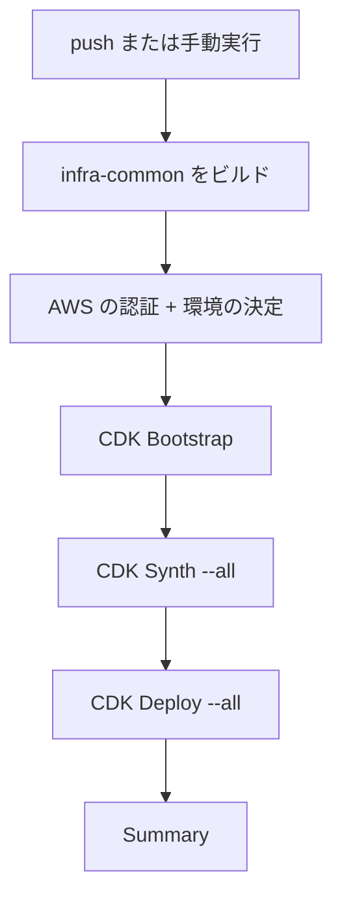
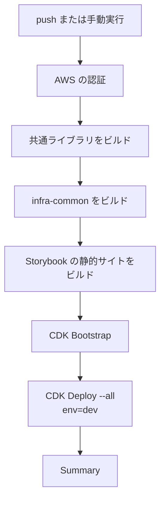

---
sources:
  - infra/common/src/utils/naming.ts
  - infra/common/src/stacks/cloudfront-stack-base.ts
  - infra/common/src/stacks/lambda-stack-base.ts
  - infra/common/src/cloudfront/function-url-origin.ts
  - infra/common/src/cloudfront/body-hash-edge-function.ts
  - infra/common/src/cloudfront/edge-handlers/body-hash/handler.ts
  - infra/common/src/grants/cloudfront-invoke.ts
  - infra/common/src/cloudfront/alias-record.ts
  - infra/common/src/utils/ssm.ts
  - infra/common/src/stacks/ecr-stack-base.ts
  - infra/common/src/constants/defaults.ts
  - .github/actions/setup-environment/action.yml
  - .github/actions/health-check/action.yml
  - .github/actions/health-check/health-check.sh
  - infra/shared/bin/shared.ts
  - infra/shared/lib/account-scope.ts
  - infra/shared/lib/stack-plan.ts
  - infra/shared/lib/route53-records-stack.ts
  - infra/shared/lib/route53-stack.ts
  - infra/shared/lib/reports-hosting-stack.ts
  - .github/workflows/shared-deploy.yml
  - infra/ui-storybook/bin/ui-storybook.ts
  - infra/ui-storybook/lib/storybook-stack.ts
  - .github/workflows/ui-storybook-deploy.yml
sources_hash: da3df677e2935cc279c383954e0565cb51c05458f0799d6e31984248232fdbd6
---

# shared と ui-storybook のデプロイ先

shared は、全サービスが使う基盤 (VPC、DNS、証明書、IAM、ECS クラスター、エラーイベントのテーブル、E2E レポートの置き場) を AWS に載せる。ui-storybook は、共通 UI ライブラリの Storybook を dev にだけ載せる。このほか、全サービスのデプロイ先に共通するしくみ (ホスト名の決め方、DNS レコードの作り方、環境の切り替え) もここに書く。

## ホスト名

| 対象 | dev | prod |
|---|---|---|
| E2E レポート (shared) | `reports.dev.nagiyu.com` | `reports.nagiyu.com` |
| Storybook (ui-storybook) | `storybook.dev.nagiyu.com` | なし (dev のみ) |

DNS レコードは、どちらも自分のスタックが ALIAS で作る (環境によらない)。

## 共通のしくみ

### ホスト名の決め方

ホスト名は `infra/common/src/utils/naming.ts` の `getCloudFrontDomainName(サービス名, 環境)` で決まる。

| 環境 | ルートドメイン | ホスト名 |
|---|---|---|
| prod | `nagiyu.com` | `<サービス名>.nagiyu.com` |
| dev | `dev.nagiyu.com` | `<サービス名>.dev.nagiyu.com` |

CloudFront の基底スタック (`CloudFrontStackBase`) は、`cloudfrontConfig.domainName` が指定されていなければこの関数でホスト名を決める。指定するスタックもあるが (ポータルはルートドメインそのもの、share-together と quick-clip は同じ関数の結果を渡している)、値は同じ規則に従う。

この関数を使わないサービスがある。codec-converter は SSM の `ACM_DOMAIN_NAME` (prod アカウントでは `nagiyu.com`、dev アカウントでは `dev.nagiyu.com`) から `codec-converter.<値>` を組み立てる。

### DNS レコードの作り方

DNS レコードの作り方は 4 通りある。サービスの文書は、どれに当たるかだけを書く。

| 通り | 内容 | 当たるもの |
|---|---|---|
| 基底スタック + shared の CNAME | dev は基底スタック自身が、dev のゾーンに CloudFront 向けの ALIAS (A) を作る。prod は、shared の `NagiyuSharedRoute53Records` が CNAME を持つ (サービスのスタックは prod のレコードを作らない) | CloudFront の基底スタックに乗るサービス (admin、auth、tools、quick-clip、stock-tracker、share-together、niconico-mylist-assistant) |
| 基底スタック + shared の apex の ALIAS | dev は基底スタックが ALIAS を作る。prod は、shared の `NagiyuSharedRoute53Records` が apex に ALIAS を持つ (apex には CNAME を作れない) | ポータル |
| 自分のスタックで ALIAS | 環境によらず、自分のスタックが ALIAS を作る | livetalk、ui-storybook、shared の E2E レポート |
| dev だけ自分のスタック | dev は自分のスタックが ALIAS を作る。prod は shared の CNAME | codec-converter |

ALIAS は `createCloudFrontAliasRecord` (`infra/common/src/cloudfront/alias-record.ts`) が作る。ゾーンは SSM から引く。

| SSM パラメータ | 値 |
|---|---|
| `/nagiyu/shared/route53/hosted-zone-id` | ホストゾーンの ID |
| `/nagiyu/shared/route53/hosted-zone-name` | ホストゾーンの名前 (呼び出し側がゾーン名を渡したときは引かない) |

これらは shared の Route53 スタックが書く。

基底スタックが dev に作る ALIAS は、ホスト名が `dev.nagiyu.com` そのものならゾーン頂点に、`dev.nagiyu.com` の配下ならゾーンからの相対名で作る。それ以外のホスト名は、誤ったレコードを作らないよう合成を失敗させる。

### prod の CNAME と apex

`infra/shared/lib/route53-records-stack.ts` (prod アカウントだけに作る) が、prod のゾーン `nagiyu.com` に次のレコードを持つ。CNAME の向き先は CloudFront のディストリビューションのドメインで、コードに直書きしてある (TTL は 300 秒)。

| 種類 | 名前 | 内容 |
|---|---|---|
| CNAME | `tools` `auth` `admin` `quick-clip` `stock-tracker` `share-together` `niconico-mylist-assistant` `codec-converter` | 各サービスの CloudFront |
| ALIAS (A) | apex (`nagiyu.com`) | ポータルの CloudFront (CNAME は apex に作れない) |
| NS | `dev` | dev アカウントのゾーン (`dev.nagiyu.com`) への委任。4 つのネームサーバー |
| CNAME | Google Search Console の所有確認用 | Google への向き先 |
| CNAME | ACM 証明書の DNS 検証用 | ACM への向き先 |

prod のレコードは、サービスの CloudFront を作り直してドメインが変わったとき、ここを手で直す必要がある。dev のゾーンを作り直してネームサーバーが変わったときも、NS の値を直す。

### dev と prod の切り替え

`.github/actions/setup-environment/action.yml` が、デプロイの環境を決める。

| 起点 | 環境 |
|---|---|
| 手動実行 | 入力した環境 (空なら dev) |
| `master` への push | prod |
| それ以外 (develop、`integration/**`) | dev |

出力は `environment` (`dev` / `prod`) と `stack-suffix` (`Dev` / `Prod`)。スタック名は、おおむね `Nagiyu<サービス名><役割><stack-suffix>` の形になる。例外は、suffix のない shared のスタック、`NagiyuE2eReportsHosting`、役割のない `NagiyuCodecConverterDev`、サービス名が `Root` になるポータルの `NagiyuRoot*` である。

ワークフローのジョブは、同じ規則で選んだ GitHub Environment (dev / prod。ui-storybook と dev-sync は常に dev) の変数 `AWS_ROLE_ARN` のロールで AWS に入る。dev と prod は別の AWS アカウントで、ロールがどちらのアカウントに入るかを決める。CDK のアプリは、環境を context の `env` で受け取る。livetalk (`infra/livetalk/bin/livetalk.ts`) とポータル (`infra/bin/nagiyu-platform.ts`) だけは、環境変数 `ENVIRONMENT` で受け取る。

### Function URL の配信 (OAC)

CloudFront は、Lambda の Function URL を OAC (Origin Access Control) つきのオリジンで呼ぶ。基底スタック (`CloudFrontStackBase`) に乗るサービスと、codec-converter が当たる。

| 部品 | 定義 | 内容 |
|---|---|---|
| OAC | `createFunctionUrlOrigin` (`infra/common/src/cloudfront/function-url-origin.ts`) | オリジンの種別は `lambda`、署名は常に行う (SigV4)。名前は `nagiyu-<サービス名>-lambda-oac-<環境>`。オリジンは 1 つで、配信の全 behavior が共有する |
| 本文のハッシュを付ける Lambda@Edge | `createBodyHashEdgeLambdas` (`infra/common/src/cloudfront/body-hash-edge-function.ts`)、ハンドラーは `infra/common/src/cloudfront/edge-handlers/body-hash/handler.ts` | origin-request で動き、本文を受け取る。Node.js 22、x86_64、メモリ 128MB、タイムアウト 5 秒。CloudFront と同じ `us-east-1` のスタックに作る |
| CloudFront から Function URL を呼ぶ許可 | `grantCloudFrontInvoke` (`infra/common/src/grants/cloudfront-invoke.ts`) | `cloudfront.amazonaws.com` に、`lambda:InvokeFunctionUrl` (AWS_IAM) と、Function URL 経由に限った `lambda:InvokeFunction` を許す |

Lambda に足す許可の `sourceArn` は、呼び出し側で決まる。

| 呼び出し側 | `sourceArn` |
|---|---|
| `LambdaStackBase` (Function URL を有効にしたとき)、stock-tracker と niconico-mylist-assistant の Lambda のスタック | このアカウントの全ディストリビューション。配信は Lambda のスタックより後に別スタックで作られ、配信の ARN を参照すると循環するため |
| codec-converter | 自分の配信の ARN。Lambda と配信が同じスタックにあるため絞れる |

この許可は、Function URL の公開アクセスの許可 (`AllowPublicAccess`) に足すもので、公開アクセスの許可と Function URL の `authType` (NONE) は変えない。

#### 本文のハッシュ

OAC で署名した Function URL は、POST / PUT の本文の SHA256 が `x-amz-content-sha256` に無いと要求を受けない。ブラウザの送信 (フォーム、Server Actions、認証のコールバック) はこのヘッダーを付けないため、CloudFront の署名より前に Lambda@Edge が計算して入れる。

| 条件 | 扱い |
|---|---|
| メソッドが GET などで、本文が無い | `x-amz-content-sha256` を付けない。ビューアーが付けていたら消す (署名に使われて不一致になるため) |
| 本文がある、またはメソッドが POST / PUT / PATCH | 本文の SHA256 (hex) を `x-amz-content-sha256` に入れる (本文が空でも入れる) |
| 本文が切り詰められている (`inputTruncated`) | オリジンへ送らず、その場で 413 (`text/plain`) を返す |

Lambda@Edge が受け取れる本文は 1MB までで、それを超えると切り詰められる。切り詰められた本文から正しいハッシュは作れず、署名が通らないまま不明瞭に失敗するため、413 で止める。したがって、Lambda@Edge を付けた behavior を通して送れる本文は 1MB までである。

Lambda@Edge を付ける behavior は次のとおり。

| 配信 | 付ける behavior | 付けない behavior |
|---|---|---|
| 基底スタック | 既定の behavior (全パス) | なし (behavior は既定の 1 つだけ) |
| codec-converter | 既定の behavior と `/api/*` | `/_next/static/*` と `/favicon.ico` (GET / HEAD だけで本文が無い) |

関数は Lambda@Edge の制約で環境変数と ARM64 を使えず、ハンドラーは他のモジュールを読み込まない。実行ロールは Lambda と Lambda@Edge の両方に信頼させる。

Lambda@Edge の複製は、配信から外したあとも数時間残る。その間は関数を消せないため、配信のスタックの削除や作り直しはすぐには終わらない。

### ヘルスチェック

`.github/actions/health-check/action.yml` が、呼び出し側が渡した URL (`base-url`) にパスを足して GET し、200 が返るまで再試行する。既定のパスは `/api/health`、最大 10 回、間隔 10 秒で、尽きたらジョブを失敗させる。再試行と失敗の扱いは `.github/actions/health-check/health-check.sh` が決める。URL が空のときも失敗させる。

叩く先はサービスごとに違う (ALB の DNS 名、CloudFront のドメイン)。Lambda の Function URL を CloudFront で配信するサービスは、Function URL ではなく CloudFront のドメインを叩く。署名つきの経路 (上の「Function URL の配信 (OAC)」) を含めて確かめるためである。サービスの文書は、どこを叩くか (またはヘルスチェックがないこと) だけを書く。

### ECR リポジトリ

サービスの ECR リポジトリは、`infra/common/src/stacks/ecr-stack-base.ts` の `EcrStackBase` が作る。サービスのスタック一覧は、ECR のスタックがあることだけを書く。

| 項目 | 既定 |
|---|---|
| 名前 | `nagiyu-<サービス名>-ecr-<環境>` (呼び出し側が名前を渡せば、それを使う) |
| プッシュ時のスキャン | する |
| 残すイメージの数 | 新しいものから 10 個 |
| タグの上書き | できる (`MUTABLE`) |
| スタックを消したとき | prod は残す、dev は消す |

## スタック

### shared

`infra/shared/bin/shared.ts` が、次の順に作る。`{Env}` は CDK の context `env` (既定は `dev`) で、`Dev` または `Prod`。リージョンは `us-east-1` (環境変数で変えられる)。

デプロイ先のアカウントは、`CDK_DEFAULT_ACCOUNT` が prod のアカウントと dev のアカウントのどちらかで決まる (どちらでもなければエラー)。認証情報がない合成では、context の `accountScope` (既定は prod) を使う。dev アカウントには dev の資材だけを置く (dev アカウントで `env=prod` はエラー)。

| 順 | スタック | 範囲 | 役割 | 含むリソース |
|---|---|---|---|---|
| 1 | `NagiyuSharedVpc{Env}` | 両方 | VPC | VPC、サブネット |
| 2 | `NagiyuSharedRoute53` | 両方 | ホストゾーン | Route53 のパブリックホストゾーン (prod は `nagiyu.com`、dev アカウントは `dev.nagiyu.com`)。ゾーンの ID と名前を SSM に書く |
| 3 | `NagiyuSharedAcm` | 両方 | 証明書 | ACM 証明書 (`us-east-1`) |
| 4 | `NagiyuSharedRoute53Records` | prod のみ | prod の DNS レコード | 「prod の CNAME と apex」の表のレコード |
| 5 | `NagiyuSharedIamCore`、`NagiyuSharedIamApplication`、`NagiyuSharedIamContainer`、`NagiyuSharedIamIntegration` | 両方 | デプロイ用の IAM ポリシー | IAM の管理ポリシー |
| 6 | `NagiyuSharedIamClaudeReadonly` | 両方 | Claude の閲覧専用ポリシー | IAM の管理ポリシー |
| 7 | `NagiyuSharedIamClaude` | 両方 | Claude 用のロール | IAM のロール (prod アカウントにはユーザーも) |
| 8 | `NagiyuSharedIamGitHubOidc` | 両方 | GitHub Actions のロール | OIDC プロバイダー、IAM のロール。prod のロールは prod アカウント、dev と PR のロールは dev アカウントに置く |
| 9 | `NagiyuSharedDevSyncSourceReader` | prod のみ | dev-sync の読み取りロール | IAM のロール |
| 10 | `NagiyuSharedEcsCluster{Env}` | 両方 | 共有 ECS クラスター | ECS クラスター |
| 11 | `NagiyuErrorEventsTable{Env}` | 両方 | エラーイベントのテーブル | DynamoDB テーブル。全サービスが書き、Admin が読む |
| 12 | `NagiyuE2eReportsHosting` | 両方 | E2E レポートの置き場 | S3 バケット、CloudFront、`reports` の ALIAS。ホスト名は `reports.<ゾーン名>` |

### ui-storybook

`infra/ui-storybook/bin/ui-storybook.ts` が、次の 1 つを作る。環境は dev のみで、dev 以外を指定するとエラーになる。リージョンは `us-east-1` 固定。

| スタック | 役割 | 含むリソース |
|---|---|---|
| `NagiyuUiStorybookDev` | Storybook の配信 | S3 バケット、CloudFront、`storybook` の ALIAS |

共有の ACM 証明書は SSM から参照する。

## デプロイの流れ

### shared

`.github/workflows/shared-deploy.yml` が行う。

| 項目 | 内容 |
|---|---|
| トリガー | develop・`integration/**`・master への push (`infra/shared/**`、`infra/common/**`、このワークフローが変わったとき)。手動実行 (dev か prod を選ぶ) |
| デプロイ先の環境 | 「dev と prod の切り替え」の規則 |
| 並行実行 | 環境ごとに直列化する。実行中の run は止めず、待機中は最新だけ残す |

ジョブは `deploy` の 1 つで、上の順に進む。シークレット `DOMAIN_NAME` を CDK に渡す。デプロイは `--all` で、承認を求めずに全スタックを更新する。ヘルスチェックはない。

### ui-storybook

`.github/workflows/ui-storybook-deploy.yml` が行う。

| 項目 | 内容 |
|---|---|
| トリガー | develop・`integration/**`・master への push (`libs/**`、`infra/ui-storybook/**`、`infra/common/**`、`package.json`、`package-lock.json`、`.node-version`、このワークフローが変わったとき)。手動実行 (選べる環境は dev だけ) |
| デプロイ先の環境 | 常に dev。master への push でも dev にデプロイする |
| 並行実行 | dev で直列化する。実行中の run は止めず、待機中は最新だけ残す |

ジョブは `deploy` の 1 つで、上の順に進む。ヘルスチェックはない。

## 理由

- dev アカウントに prod のロールを置かず、prod アカウントに dev と PR のロールを置かないのは、prod アカウントに dev や PR のロールがあると、dev の環境や pull_request の文脈から prod のアカウントを操作できてしまい、アカウントを分けた効果が薄れるため。
- IAM のデプロイ用ポリシーを 4 つのスタックに分けるのは、管理ポリシーのサイズに上限があるため。
- dev のゾーンを dev アカウントに置き、prod のゾーンからは NS で委任するのは、dev の DNS レコードと証明書の検証を dev アカウントの中で完結させるため。dev でサービスを足しても、prod の DNS は変わらない。
- サービスのスタックが prod の DNS レコードを作らないのは、prod のレコードを shared の CNAME で管理しているため。dev は基底スタックが ALIAS を作る。
