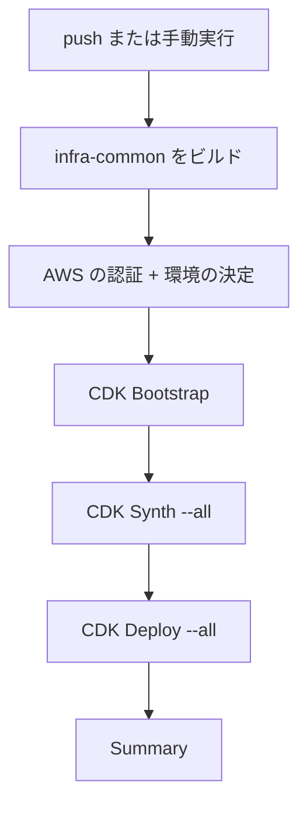
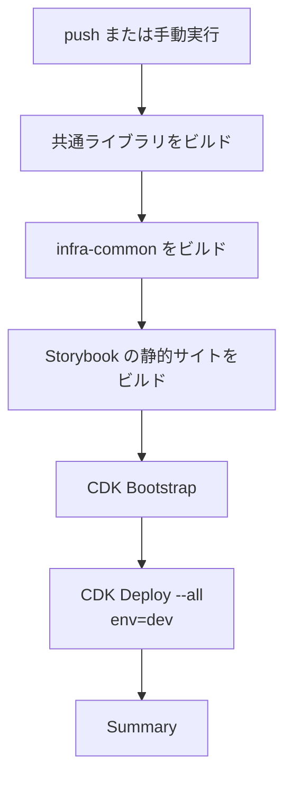

---
sources:
  - infra/common/src/utils/naming.ts
  - infra/common/src/stacks/cloudfront-stack-base.ts
  - infra/common/src/cloudfront/alias-record.ts
  - infra/common/src/utils/ssm.ts
  - .github/actions/setup-environment/action.yml
  - .github/actions/health-check/action.yml
  - infra/shared/bin/shared.ts
  - infra/shared/lib/account-scope.ts
  - infra/shared/lib/stack-plan.ts
  - infra/shared/lib/route53-records-stack.ts
  - infra/shared/lib/route53-stack.ts
  - infra/shared/lib/acm-stack.ts
  - infra/shared/lib/vpc-stack.ts
  - infra/shared/lib/ecs-cluster-stack.ts
  - infra/shared/lib/error-events-table-stack.ts
  - infra/shared/lib/reports-hosting-stack.ts
  - .github/workflows/shared-deploy.yml
  - infra/ui-storybook/bin/ui-storybook.ts
  - infra/ui-storybook/lib/storybook-stack.ts
  - .github/workflows/ui-storybook-deploy.yml
sources_hash: bfb6873eec65aa156021463f83a0af30490f08f77778c61f05416d4e79705c48
---

# shared と ui-storybook のデプロイ先

shared は、全サービスが使う基盤 (VPC、DNS、証明書、IAM、ECS クラスター、エラーイベントのテーブル、E2E レポートの置き場) を AWS に載せる。ui-storybook は、共通 UI ライブラリの Storybook を dev にだけ載せる。このほか、全サービスのデプロイ先に共通するしくみ (ホスト名の決め方、DNS レコードの作り方、環境の切り替え) もここに書く。

## ホスト名

| 対象 | dev | prod |
|---|---|---|
| E2E レポート (shared) | `reports.dev.nagiyu.com` | `reports.nagiyu.com` |
| Storybook (ui-storybook) | `storybook.dev.nagiyu.com` | なし (dev のみ) |

DNS レコードは、どちらも自分のスタックが ALIAS で作る (環境によらない)。

## 共通のしくみ

### ホスト名の決め方

ホスト名は `infra/common/src/utils/naming.ts` の `getCloudFrontDomainName(サービス名, 環境)` で決まる。

| 環境 | ルートドメイン | ホスト名 |
|---|---|---|
| prod | `nagiyu.com` | `<サービス名>.nagiyu.com` |
| dev | `dev.nagiyu.com` | `<サービス名>.dev.nagiyu.com` |

CloudFront の基底スタック (`CloudFrontStackBase`) は、`cloudfrontConfig.domainName` が指定されていなければこの関数でホスト名を決める。指定するスタックもあるが (ポータルはルートドメインそのもの、share-together と quick-clip は同じ関数の結果を渡している)、値は同じ規則に従う。

この関数を使わないサービスがある。codec-converter は SSM の `ACM_DOMAIN_NAME` (prod アカウントでは `nagiyu.com`、dev アカウントでは `dev.nagiyu.com`) から `codec-converter.<値>` を組み立てる。

### DNS レコードの作り方

DNS レコードの作り方は 3 通りある。サービスの文書は、どれに当たるかだけを書く。

| 通り | 内容 | 当たるもの |
|---|---|---|
| 基底スタック + shared の CNAME | dev は基底スタック自身が、dev のゾーンに CloudFront 向けの ALIAS (A) を作る。prod は、shared の `NagiyuSharedRoute53Records` が CNAME を持つ (サービスのスタックは prod のレコードを作らない) | CloudFront の基底スタックに乗るサービス (admin、auth、tools、quick-clip、stock-tracker、share-together、niconico-mylist-assistant)。ポータルの dev も |
| 自分のスタックで ALIAS | 環境によらず、自分のスタックが ALIAS を作る | livetalk、ui-storybook、shared の E2E レポート |
| dev だけ自分のスタック | dev は自分のスタックが ALIAS を作る。prod は shared の CNAME | codec-converter |

ALIAS は `createCloudFrontAliasRecord` (`infra/common/src/cloudfront/alias-record.ts`) が作る。ゾーンは SSM から引く。

| SSM パラメータ | 値 |
|---|---|
| `/nagiyu/shared/route53/hosted-zone-id` | ホストゾーンの ID |
| `/nagiyu/shared/route53/hosted-zone-name` | ホストゾーンの名前 (呼び出し側がゾーン名を渡したときは引かない) |

これらは shared の Route53 スタックが書く。

基底スタックが dev に作る ALIAS は、ホスト名が `dev.nagiyu.com` そのものならゾーン頂点に、`dev.nagiyu.com` の配下ならゾーンからの相対名で作る。それ以外のホスト名は、誤ったレコードを作らないよう合成を失敗させる。

### prod の CNAME と apex

`infra/shared/lib/route53-records-stack.ts` (prod アカウントだけに作る) が、prod のゾーン `nagiyu.com` に次のレコードを持つ。CNAME の向き先は CloudFront のディストリビューションのドメインで、コードに直書きしてある (TTL は 300 秒)。

| 種類 | 名前 | 内容 |
|---|---|---|
| CNAME | `tools` `auth` `admin` `quick-clip` `stock-tracker` `share-together` `niconico-mylist-assistant` `codec-converter` | 各サービスの CloudFront |
| ALIAS (A) | apex (`nagiyu.com`) | ポータルの CloudFront (CNAME は apex に作れない) |
| NS | `dev` | dev アカウントのゾーン (`dev.nagiyu.com`) への委任。4 つのネームサーバー |
| CNAME | Google Search Console の所有確認用 | Google への向き先 |
| CNAME | ACM 証明書の DNS 検証用 | ACM への向き先 |

prod のレコードは、サービスの CloudFront を作り直してドメインが変わったとき、ここを手で直す必要がある。dev のゾーンを作り直してネームサーバーが変わったときも、NS の値を直す。

### dev と prod の切り替え

`.github/actions/setup-environment/action.yml` が、デプロイの環境を決める。

| 起点 | 環境 |
|---|---|
| 手動実行 | 入力した環境 (空なら dev) |
| `master` への push | prod |
| それ以外 (develop、`integration/**`) | dev |

出力は `environment` (`dev` / `prod`) と `stack-suffix` (`Dev` / `Prod`)。スタック名は `Nagiyu<サービス名><役割><stack-suffix>` の形になる。

ワークフローのジョブは、同じ規則で選んだ GitHub Environment (dev / prod。ui-storybook は常に dev) の変数 `AWS_ROLE_ARN` のロールで AWS に入る。dev と prod は別の AWS アカウントで、ロールがどちらのアカウントに入るかを決める。CDK のアプリは、環境を context の `env` で受け取る。

### ヘルスチェック

`.github/actions/health-check/action.yml` が、デプロイしたサービスの Lambda の Function URL にパスを足して GET し、200 が返るまで再試行する。既定のパスは `/api/health`、最大 10 回、間隔 10 秒で、尽きたらジョブを失敗させる。サービスの文書は、この確認の有無だけを書く。

## スタック

### shared

`infra/shared/bin/shared.ts` が、次の順に作る。`{Env}` は CDK の context `env` (既定は `dev`) で、`Dev` または `Prod`。リージョンは `us-east-1` (環境変数で変えられる)。

デプロイ先のアカウントは、`CDK_DEFAULT_ACCOUNT` が prod のアカウントと dev のアカウントのどちらかで決まる (どちらでもなければエラー)。認証情報がない合成では、context の `accountScope` (既定は prod) を使う。dev アカウントには dev の資材だけを置く (dev アカウントで `env=prod` はエラー)。

| 順 | スタック | 範囲 | 役割 | 含む主なリソース |
|---|---|---|---|---|
| 1 | `NagiyuSharedVpc{Env}` | 両方 | VPC | VPC、インターネットゲートウェイ、パブリックサブネット 2 つ (1a と 1b)、ルートテーブル。ID を SSM に書く。CIDR は prod が `10.1.0.0/24`、dev が `10.0.0.0/24` (dev は 1b 用に `10.2.0.0/24` を足す) |
| 2 | `NagiyuSharedRoute53` | 両方 | ホストゾーン | パブリックホストゾーン (prod は `nagiyu.com`、dev アカウントは `dev.nagiyu.com`)。ゾーンの ID と名前を SSM に書く |
| 3 | `NagiyuSharedAcm` | 両方 | 証明書 | ドメインとそのワイルドカードの ACM 証明書 (`us-east-1`)。ARN とドメイン名を SSM に書く。dev アカウントは同じアカウントのゾーンで DNS 検証を自動で行い、prod は手動の DNS 検証 |
| 4 | `NagiyuSharedRoute53Records` | prod のみ | prod の DNS レコード | 「prod の CNAME と apex」の表のレコード |
| 5 | `NagiyuSharedIamCore`、`NagiyuSharedIamApplication`、`NagiyuSharedIamContainer`、`NagiyuSharedIamIntegration` | 両方 | デプロイ用の IAM ポリシー | ポリシーサイズの上限のため 4 つに分けた管理ポリシー |
| 6 | `NagiyuSharedIamClaudeReadonly` | 両方 | Claude の閲覧専用ポリシー | 閲覧専用の管理ポリシー |
| 7 | `NagiyuSharedIamClaude` | 両方 | Claude 用のロール | ロール `nagiyu-claude`。dev アカウントには、指定した Lambda 関数の実行を許すポリシーも付く。prod アカウントには、キーを持つユーザー `nagiyu-claude-key` も作る |
| 8 | `NagiyuSharedIamGitHubOidc` | 両方 | GitHub Actions のロール | OIDC プロバイダー、GitHub Actions が引き受けるロール。prod アカウントは `ProdRole` だけ、dev アカウントは `DevRole` と `PrRole` |
| 9 | `NagiyuSharedDevSyncSourceReader` | prod のみ | dev-sync の読み取りロール | dev アカウントの dev-sync が prod のテーブルを読むために引き受ける読み取り専用ロール |
| 10 | `NagiyuSharedEcsCluster{Env}` | 両方 | 共有 ECS クラスター | クラスター `nagiyu-shared-cluster-{env}` (キャパシティープロバイダーは FARGATE と FARGATE_SPOT、Container Insights は無効)。名前と ARN を SSM に書く |
| 11 | `NagiyuErrorEventsTable{Env}` | 両方 | エラーイベントのテーブル | DynamoDB テーブル `nagiyu-error-events-{env}` (GSI `AllByOccurredAt`、TTL、DynamoDB Streams)。全サービスが書き、Admin が読む |
| 12 | `NagiyuE2eReportsHosting` | 両方 | E2E レポートの置き場 | S3 バケット、CloudFront、`reports` の ALIAS。詳しくは下 |

`NagiyuE2eReportsHosting` は次のとおり。

| 項目 | 内容 |
|---|---|
| バケット | prod は `nagiyu-e2e-reports`、dev は `nagiyu-e2e-reports-dev`。非公開で、CloudFront から OAC で読む。作成から 3 日で削除する |
| CloudFront | 末尾が `/` の URL に `index.html` を足す CloudFront Function を付ける。セキュリティヘッダーと noindex を付け、フレームは同一オリジンだけ許す (Playwright のレポートが同一オリジンの iframe を使うため) |
| ホスト名 | `reports.<ゾーン名>` |
| dev の依存 | dev アカウントでは、ACM と Route53 のスタックの後に作る (どちらも SSM に値を書くため) |

### ui-storybook

`infra/ui-storybook/bin/ui-storybook.ts` が、次の 1 つを作る。環境は dev のみで、dev 以外を指定するとエラーになる。リージョンは `us-east-1` 固定。

| スタック | 役割 | 含む主なリソース |
|---|---|---|
| `NagiyuUiStorybookDev` | Storybook の配信 | S3 バケット `nagiyu-ui-storybook-s3-dev`、CloudFront (OAC、価格クラス 100)、ビルド済みの Storybook (`libs/ui/storybook-static`) の S3 への配置と CloudFront のキャッシュ削除 (`/*`)、`storybook` の ALIAS |

共有の ACM 証明書は SSM から参照する。CloudFront は、403 と 404 を `/index.html` の 404 として返す (5 分キャッシュ)。セキュリティヘッダーと noindex を付け、フレームは同一オリジンだけ許す (Storybook がストーリーを同一オリジンの iframe で描くため)。バケットは削除時に中身ごと消える。

## デプロイの流れ

### shared

`.github/workflows/shared-deploy.yml` が行う。

| 項目 | 内容 |
|---|---|
| トリガー | develop・`integration/**`・master への push (`infra/shared/**`、`infra/common/**`、このワークフローが変わったとき)。手動実行 (dev か prod を選ぶ) |
| デプロイ先の環境 | 「dev と prod の切り替え」の規則 |
| 並行実行 | 環境ごとに直列化する。実行中の run は止めず、待機中は最新だけ残す |

ジョブは `deploy` の 1 つで、上の順に進む。シークレット `DOMAIN_NAME` を CDK に渡す。デプロイは `--all` で、承認を求めずに全スタックを更新する。ヘルスチェックはない。

### ui-storybook

`.github/workflows/ui-storybook-deploy.yml` が行う。

| 項目 | 内容 |
|---|---|
| トリガー | develop・`integration/**`・master への push (`libs/**`、`infra/ui-storybook/**`、`infra/common/**`、`package.json`、`package-lock.json`、`.node-version`、このワークフローが変わったとき)。手動実行 (選べる環境は dev だけ) |
| デプロイ先の環境 | 常に dev。master への push でも dev にデプロイする |
| 並行実行 | dev で直列化する。実行中の run は止めず、待機中は最新だけ残す |

ジョブは `deploy` の 1 つで、上の順に進む。ヘルスチェックはない。

## 理由

- dev アカウントに prod のロールを置かず、prod アカウントに dev と PR のロールを置かないのは、prod アカウントに dev や PR のロールがあると、dev の環境や pull_request の文脈から prod のアカウントを操作できてしまい、アカウントを分けた効果が薄れるため。
- dev のゾーンを dev アカウントに置き、prod のゾーンからは NS で委任するのは、dev の DNS レコードと証明書の検証を dev アカウントの中で完結させるため。dev でサービスを足しても、prod の DNS は変わらない。
- サービスのスタックが prod の DNS レコードを作らないのは、prod のレコードを shared の CNAME で管理しているため。dev は基底スタックが ALIAS を作る。
