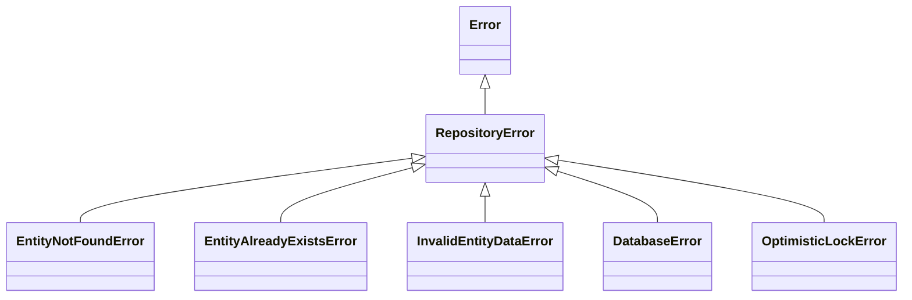

---
sources:
  - libs/aws/src/dynamodb/errors.ts
sources_hash: 34098887845b0774896ac0d26eb8ea60e4a98311e6db956cc82b93df31d5ec15
---

# リポジトリのエラー

DynamoDB のリポジトリが投げる共通のエラーと、DynamoDB の例外をそれに変換する関数。`@nagiyu/aws` から import する。

## 使い方

### エラーの階層



| エラー | コンストラクタの引数 | メッセージ | 意味 |
|---|---|---|---|
| `EntityNotFoundError` | `entityType`、`identifier` | `エンティティが見つかりません: {entityType}={identifier}` | 対象がない |
| `EntityAlreadyExistsError` | `entityType`、`identifier` | `エンティティは既に存在します: {entityType}={identifier}` | すでにある |
| `InvalidEntityDataError` | `message` | `エンティティデータが無効です: {message}` | 読めない、または書けないデータ |
| `DatabaseError` | `message`、`cause` (省略可) | `データベースエラーが発生しました: {message}` | データベース操作の失敗。`cause` に元の `Error` を持つ |
| `OptimisticLockError` | `entityType`、`identifier` | `他の更新と競合しました: {entityType}={identifier}` | 楽観ロックの条件 (`UpdatedAt` の一致) を満たさなかった |

各クラスの `name` はクラス名と同じ。

### 変換の関数

| 関数 | 引数 | 戻り値 |
|---|---|---|
| `isConditionalCheckFailed` | `error` | 条件付き書き込みの失敗 (`ConditionalCheckFailedException`) かどうか |
| `toDatabaseError` | `error` | `RepositoryError` |
| `mapConditionalCheckFailed` | `error`、`callbacks` (`onExists`、`onMissing`) | なし |

```ts
try {
  await docClient.send(command);
} catch (error) {
  mapConditionalCheckFailed(error, {
    onExists: () => {
      throw new EntityAlreadyExistsError('User', userId);
    },
  });
  throw toDatabaseError(error);
}
```

## 振る舞い

| 関数 | 内容 |
|---|---|
| `isConditionalCheckFailed` | `name` が `ConditionalCheckFailedException` のオブジェクトなら真。`Error` のインスタンスでなくてもよい |
| `toDatabaseError` | `RepositoryError` はそのまま返す。ほかの `Error` は、メッセージと元の `Error` を持つ `DatabaseError` にする。`Error` でない値は、文字列にして `DatabaseError` にする |
| `mapConditionalCheckFailed` | 条件付き書き込みの失敗のときだけ、コールバックを呼ぶ。`onExists` があればそれを、なければ `onMissing` を呼ぶ。どの条件で失敗したかは見分けない |

- `mapConditionalCheckFailed` のコールバックは `() => never` で、呼び出し側が投げる。コールバックを呼ばなかったとき (条件付き書き込みの失敗でない、または該当のコールバックがない) は何もせずに戻るので、呼び出し側が続けて投げ直す
- `mapConditionalCheckFailed` は、サービスからは使われていない

## 理由

- 条件付き書き込みの失敗を `name` で判定する。SDK の例外クラスが重複して読み込まれると `instanceof` が失敗するため
- `toDatabaseError` は `RepositoryError` をそのまま返す。包み直すと、メッセージの接頭辞が二重になるため
- `OptimisticLockError` を `RepositoryError` の下に置く。更新の競合も、呼び出し側が不在や重複と同じ分類で扱えるようにするため
