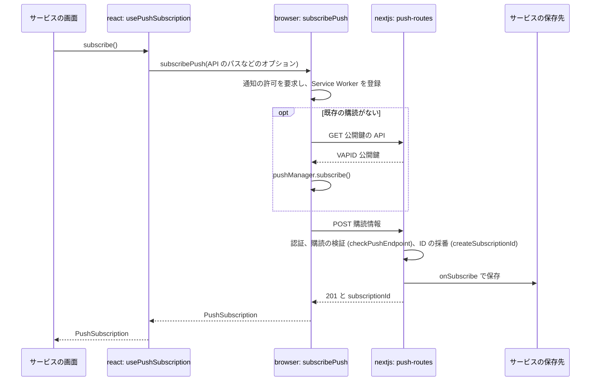
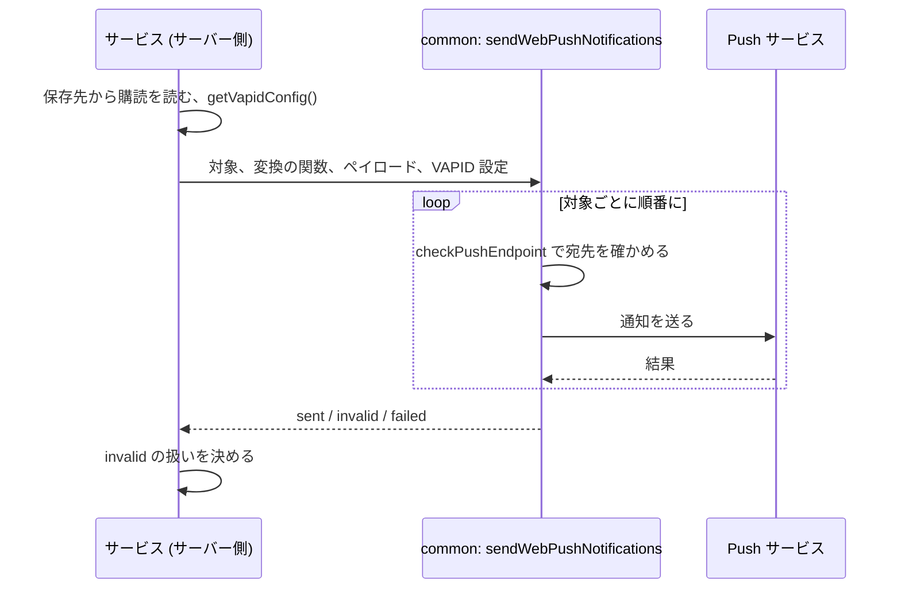

---
sources:
  - libs/common/package.json
  - libs/common/src/push/client.ts
  - libs/common/src/push/bulk.ts
  - libs/common/src/push/config.ts
  - libs/common/src/push/constants.ts
  - libs/common/src/push/types.ts
  - libs/common/src/push/vapid.ts
  - libs/common/src/push-subscription/endpoint.ts
  - libs/common/src/push-subscription/subscription-id.ts
  - libs/browser/src/push.ts
  - libs/nextjs/src/push.ts
sources_hash: 213089c0fe6439cbef0f249ef4c123c976618f90a775dabe5e3a132a58f796ef
---

# Web Push

Web Push の通知を送る側の部品と、購読の検証・ID の採番、通知の全体の流れ。送信の関数はサブパス `@nagiyu/common/push` から、そのほかはメインの `@nagiyu/common` から import する。

## 通しの流れ

Web Push は、ブラウザでの購読 (画面、react、browser)、サーバーでの購読の受け付け (nextjs)、サーバーからの送信 (common) の 3 つの段で成り立つ。

| 層 | 受け持つこと | 文書 |
|---|---|---|
| 画面 (サービス) | 購読の操作の入口。`usePushSubscription` の `subscribe()` を呼ぶ | 下の図 |
| `@nagiyu/react` | 購読の状態を持つ hook と、layout に置いて再購読する `ServiceWorkerRegistration` | [Push の購読](../react/push-subscription.md) |
| `@nagiyu/browser` | 通知の許可、Service Worker の登録、購読の作成、公開鍵の取得、サーバーへの送信 | [Web Push (ブラウザ)](../browser/web-push.md) |
| `@nagiyu/nextjs` | 公開鍵を返す API、購読を受け付ける API (認証・検証・ID の採番・保存のフック) | [Push のルート](../nextjs/push-routes.md) |
| `@nagiyu/common` | 購読の endpoint の検証、購読 ID の採番、VAPID 設定、通知の送信 | このページ |

### 購読

再購読の流れは購読と同じで、許可のダイアログを出さない点が違う ([Web Push (ブラウザ)](../browser/web-push.md))。

### 送信

### 層をまたぐ理由

- 購読の検証 (`checkPushEndpoint`) と ID の採番 (`createSubscriptionId`) は、`@nagiyu/common` が受け持つ。購読を受け付ける API (`@nagiyu/nextjs`) と、送信の前の確認が、同じ判定を使う

購読の手続きの関数ごとの違い (初回の購読と再購読、未ログインの扱い) は [Web Push (ブラウザ)](../browser/web-push.md) にある。

## 使い方

### 送信

`@nagiyu/common/push` から import する。

| 名前 | 引数 | 戻り値 |
|---|---|---|
| `sendWebPushNotification(subscription, payload, vapidConfig)` | `PushSubscription`、`NotificationPayload`、`VapidConfig` | 送れたら `true`。購読が無効 (404 / 410) か、endpoint が許可されないときは `false` |
| `sendWebPushNotifications(targets, toSubscription, payload, vapidConfig)` | 任意の対象の配列、対象を `PushSubscription` に変える関数、ペイロード、VAPID 設定 | `BulkSendResult<T>` |
| `getVapidConfig()` | なし | `VapidConfig` |
| `DEFAULT_NOTIFICATION_ICON` | | `/icon-192x192.png`。`NotificationPayload` の `icon` に入れる既定値の定数。送信の関数は自動では使わない |
| `normalizeVapidKey(rawKey, keyName)` | キーの文字列、`publicKey` または `privateKey` | 正規化した文字列 |

`normalizeVapidKey` と型 (`PushSubscription`、`NotificationPayload`、`VapidConfig`、`VapidKeyName`) は、メインの `@nagiyu/common` からも import できる。

### 購読の検証・ID

メインの `@nagiyu/common` から import する。

| 名前 | 引数 | 戻り値 |
|---|---|---|
| `checkPushEndpoint(endpoint)` | endpoint の文字列 | `PushEndpointCheckResult` |
| `createSubscriptionId(endpoint)` | 検証済みの endpoint | `sub_` で始まる ID の `Promise` |

### 型

| 型 | 項目 |
|---|---|
| `PushSubscription` | `endpoint`、`keys.p256dh`、`keys.auth` |
| `NotificationPayload` | `title`、`body`、`icon` (任意)、`data` (任意、`Record<string, unknown>`) |
| `VapidConfig` | `publicKey`、`privateKey`、`subject` |
| `BulkSendResult<T>` | `sent` (送れた対象)、`invalid` (購読が無効だった対象)、`failed` (例外で失敗した `{ target, error }`) |

## 振る舞い

### VAPID 設定

`getVapidConfig` は、環境変数から次の値を返す。

| 項目 | 値 |
|---|---|
| `publicKey` | `VAPID_PUBLIC_KEY`。未設定なら空文字 |
| `privateKey` | `VAPID_PRIVATE_KEY`。未設定なら空文字 |
| `subject` | `mailto:support@nagiyu.com` で固定 |

- 環境変数が無いときも例外にしない。空のままで例外を投げるのは、送信する関数の側
- 秘密鍵を含むので、サーバー側だけで使う。クライアントに渡してはならない

`normalizeVapidKey` は、保存された形が揺れても Web Push のライブラリへ渡せる文字列にする。

1. 前後の空白を取り除く
2. 全体が `"` または `'` で囲まれていれば、外す
3. `\"` を `"` に戻して、`{` で始まり `}` で終わる文字列なら、JSON として読み、`keyName` の項目 (文字列) を取り出して、前後の空白を取り除いて返す
4. JSON として読めない、または項目が無いときは、`WARN` のログを出して 2 の結果をそのまま返す

### `sendWebPushNotification`

次の順に処理する。

| 順 | 処理 | 失敗したとき |
|---|---|---|
| 1 | 公開鍵・秘密鍵を正規化し、`subject` の空白を取り除く | どれかが空なら、`VAPID キーが設定されていません` の `Error` を投げる |
| 2 | `checkPushEndpoint` で endpoint を確かめる | 許可されなければ、`WARN` のログを出して `false` を返す (送らない) |
| 3 | `web-push` で `JSON.stringify(payload)` を送る | 下の表 |

2 のログ (拒否したとき) には、拒否した理由と (ホストが許可されないときだけ) ホスト名を入れ、endpoint 全体は入れない。送信に成功したときの `INFO` のログには、ステータスコードと endpoint 全体が入る。成功すると `true` を返す。

3 の失敗は、次のように分ける。

| 失敗 | 動作 |
|---|---|
| ステータスコードが 404 または 410 | `WARN` のログを出して `false` を返す |
| ステータスコードが無く、メッセージに `404` または `410` を単語として含む | 同上 |
| 上のどれでもない | `ERROR` のログを出して、元の例外を投げる |

ステータスコードがあるときは、それだけで判定する。

### `sendWebPushNotifications`

- 対象を配列の順に、1 件ずつ送る。並行には送らない
- 1 件の例外で残りを止めない。例外は捕まえて、`failed` に `{ target, error }` で入れる。`toSubscription` が投げた例外と、VAPID が空のときの例外も、同じく対象ごとに `failed` に入る
- 戻り値の `sent` は `true`、`invalid` は `false` を返した対象
- 削除やログは行わない。結果を見て呼び出し側が行う

### `checkPushEndpoint`

endpoint が、https で、既知の Push サービスのホストを指すかを判定する。

| 判定 | 結果 |
|---|---|
| URL として解釈できない | 拒否 (`INVALID_URL`) |
| `https:` でない | 拒否 (`NOT_HTTPS`) |
| ポートの指定がある | 拒否 (`PORT_SPECIFIED`)。`:443` を明示した URL は、解釈の結果ポートが空になるので通る |
| ホスト名 (小文字にしたもの) が許可の一覧にない | 拒否 (`HOST_NOT_ALLOWED`)。結果にホスト名を持つ |
| 上のどれでもない | 許可。結果にホスト名を持つ |

許可するホスト名は、次のとおり。

| 種別 | 値 |
|---|---|
| 完全一致 | `fcm.googleapis.com`、`updates.push.services.mozilla.com`、`web.push.apple.com` |
| 末尾一致 | `.notify.windows.com` |

- Windows のサービスはリージョンごとにサブドメインが変わる (例: `wns2-par02p.notify.windows.com`) ので、末尾一致で許可する。先頭のドットを含めるのは、`evilnotify.windows.com` のような別のドメインを弾くため
- 新しい Push サービスが現れたら、この一覧に足す

### `createSubscriptionId`

endpoint の UTF-8 の SHA-256 を 16 進にした先頭 32 文字に、`sub_` を付けた文字列を返す。Web Crypto で計算するので `Promise` を返す。同じ endpoint からは、常に同じ ID になる。

## 理由

- **ID を endpoint から決める**。登録のたびに乱数で ID を振ると、同じ端末で登録し直すたびに行が増え、同じ通知が重複して届く。形式 (SHA-256 の先頭 32 文字に `sub_`) を変えてはならない。保存済みの購読の ID と合わなくなる
- **ID を Web Crypto で計算する**。メインの入口から公開していて、Edge ランタイムで動きうる middleware からも読み込まれる。`node:crypto` に依存すると、そこで壊れる
- **endpoint を既知のホストに限る**。`web-push` は endpoint のスキームを見ず、ホスト名とポートだけで常に https で送る。任意の URL を受けると、任意のホストへの送信 (SSRF) に使われる。送信の前にも確かめるのは、登録時の検証を通っていない保存済みの購読が、送信のたびに任意の宛先へ飛ぶのを防ぐため。`false` を呼び出し側が無効な購読として削除する場合に限り、データを移行しなくても、不正な購読が片付く
- **無効な購読の扱いを呼び出し側が決める**。購読の持ち方がサービスごとに違うため、一斉送信の関数は削除もログ出力もしない。購読を独立したレコードで持つなら削除できるが、ほかの設定の一部として持つなら、削除すると設定ごと失われる
- **送信をサブパス `@nagiyu/common/push` に分ける**。`package.json` の `exports` で、メインのほかに公開しているサブパスは `./push` だけで、`dependencies` に持つ `web-push` に依存する送信の関数 (`sendWebPushNotification`、`sendWebPushNotifications`) はここにだけ置く。メインの入口は、`web-push` を読み込まない `normalizeVapidKey` と型、購読の検証・ID の関数だけを出すので、メインを import しても `web-push` を引き込まない
