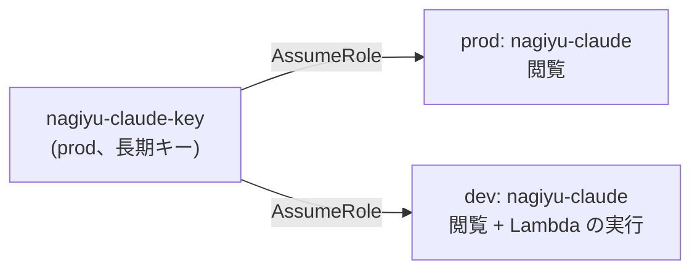

---
sources:
  - infra/shared/lib/iam/iam-claude-access-stack.ts
  - infra/shared/lib/iam/iam-claude-readonly-policy-stack.ts
  - infra/shared/lib/stack-plan.ts
  - infra/shared/lib/account-scope.ts
  - infra/shared/bin/shared.ts
sources_hash: f142494611e30a4bc73453548aaf71630436a02ab5fa3cfe2cedbbe4d5dcc463
---

# Claude の AWS アクセス

Claude Code on the web が、prod と dev の両アカウントを閲覧し、dev の一部の Lambda を実行するための IAM。キーを持つユーザー 1 つ (prod アカウント) から、両アカウントの同名のロール `nagiyu-claude` を引き受けて使う。デプロイの権限は一切付けない。



## リソース

| 名前 | 種類 | 置くアカウント | 用途 |
|---|---|---|---|
| `nagiyu-claude-key` | IAM ユーザー | prod | 長期キーの持ち主。引き受け以外の権限はない。キーは CDK では作らず、人が発行する |
| `nagiyu-claude` | IAM ロール | prod、dev | Claude が AWS を扱うときの身元 |
| `nagiyu-claude-readonly-policy` | 管理ポリシー (`NagiyuSharedIamClaudeReadonly`) | prod、dev | 閲覧の権限。両アカウントのロールに付く |
| `nagiyu-claude-dev-operations-policy` | 管理ポリシー (`NagiyuSharedIamClaude` の中) | dev | 指定した Lambda の実行 |

ロールとユーザーのスタックは `NagiyuSharedIamClaude`。dev アカウントには、ユーザーは作らない。

## 権限

| 誰が | 許可する操作 |
|---|---|
| `nagiyu-claude-key` | `sts:AssumeRole` を、両アカウントの `nagiyu-claude` に対してだけ |
| `nagiyu-claude` (両アカウント) | 閲覧ポリシーの Allow から Deny を除いたもの |
| `nagiyu-claude` (dev のみ) | 上に加えて、下の関数の `lambda:InvokeFunction` (バージョン・エイリアス付きの ARN を含む) |

`nagiyu-claude` を引き受けられるのは、prod アカウントのうち `nagiyu-claude-key` だけ (信頼先は prod アカウントで、`aws:PrincipalArn` の条件でユーザーに絞る)。ロールの最大セッション時間は指定しない。

### 閲覧ポリシー

Allow は `Resource: *` で、読み取り系の操作 (`Get*`、`List*`、`Describe*` が中心) に限る。

| 区分 | 対象 |
|---|---|
| 構成の閲覧 | CloudFormation、Lambda、ECS、Batch、ECR、CloudFront、API Gateway (GET)、EC2 と VPC、Route53、ACM、SNS、SQS、EventBridge、SSM、KMS (メタデータ)、IAM (`Get*`、`List*`、ポリシーのシミュレーション)、Application Auto Scaling |
| 内容の閲覧 | CloudWatch と Logs (検索・クエリを含む)、DynamoDB (`GetItem`、`BatchGetItem`、`Scan`、`Query`)、S3、X-Ray の読み取り、Cost Explorer |
| 調査 | CloudTrail のイベント履歴の参照 (証跡の作成・変更はしない)、`sts:GetCallerIdentity` |

次の Deny が、Allow より優先する。権限不足か保護かを見分けるのに使う。

| Deny | 対象 | 効果 |
|---|---|---|
| シークレットの値の取得 | `secretsmanager:GetSecretValue`、`GetRandomPassword` | シークレットの値を読めない |
| KMS のデータ操作 | `kms:Decrypt`、`Encrypt`、`ReEncrypt*`、`GenerateDataKey*`、`GenerateRandom`。DynamoDB 経由 (`kms:ViaService` が `dynamodb.us-east-1.amazonaws.com`) は除く | SSM の SecureString も復号できない |
| ユーザー情報のテーブル | `nagiyu-auth-users-*` (インデックスを含む) への `GetItem`、`BatchGetItem`、`Scan`、`Query` | 個人情報を持つテーブルを読めない |

DynamoDB の読み取りが KMS で暗号化されたテーブルに通るよう、DynamoDB 経由に限って `kms:Decrypt` を許可している。

### dev の Lambda の実行

`nagiyu-claude-dev-operations-policy` は、`lambda:InvokeFunction` だけを、次の関数に許す。コードや設定の変更、IAM、`PassRole`、`AssumeRole` は許さない。prod には、実行の権限を一切与えない (ポリシー自体を作らない)。

| 関数 |
|---|
| `nagiyu-stock-tracker-batch-daily-dev` |
| `nagiyu-stock-tracker-batch-temporary-alert-expiry-dev` |
| `nagiyu-stock-tracker-batch-summary-dev` |
| `nagiyu-stock-tracker-batch-forecast-dev` |
| `nagiyu-livetalk-batch-learn-user-activity-dev` |
| `nagiyu-livetalk-batch-acquire-dev` |
| `nagiyu-livetalk-batch-consolidate-dev` |
| `nagiyu-dev-sync-dev` |

関数は `infra/shared/lib/stack-plan.ts` の `CLAUDE_INVOKABLE_FUNCTION_NAMES_DEV` で決まり、ワイルドカードは使わない。

選ぶ基準は「実行は可、何が実行されるかの変更は不可」。

| 操作 | 可否 | 理由 |
|---|---|---|
| Lambda の実行 (関数を列挙) | 可 | デプロイ済みのコードを動かすだけで、権限は広がらない |
| Lambda のコード・設定の変更 | 不可 | dev-sync に任意のコードを載せると、prod のテーブルを直接読めてしまう (ユーザー情報の Deny も迂回される) |
| IAM の操作、`PassRole`、`AssumeRole` | 不可 | 権限昇格の入口になる |
| シークレットの取得、KMS の復号 | 不可 | 閲覧ポリシーの Deny を保つ |

- 手で実行する場面があるスケジュール起動のバッチに絞る。Web 系の関数や、画面の操作から呼ばれるハンドラは含めない。
- 外部への送信 (Web Push など) を伴う関数は含めない。
- `nagiyu-dev-sync-dev` は、dev に過去のデータを埋め直す場面があるので含める。読める prod のテーブルは複製元に限られ、いずれも prod の閲覧で元から読めるので、閲覧できる範囲は広がらない。書き込みも複製先の dev のテーブルに限る。
- OpenAI など有料の API を使う関数でも、改修の対象の中核のバッチ (`nagiyu-livetalk-batch-acquire-dev`、`nagiyu-livetalk-batch-consolidate-dev`) は、検証のために含める。

## 呼び方と AccessDenied

キーは環境変数 (`AWS_ACCESS_KEY_ID`、`AWS_SECRET_ACCESS_KEY`) に入っており、これは `nagiyu-claude-key` のキーである。このユーザーは `AssumeRole` しかできないので、**プロファイルを付けない呼び出しは、権限不足ではなく呼び方の誤りで AccessDenied になる**。

- AWS CLI には、必ず `--profile nagiyu-prod` か `--profile nagiyu-dev` を付ける。どちらのアカウントかを毎回明示させ、意図せず prod を操作するのを防ぐための作りで、既定のプロファイル (`[default]`) は作らない。
- 環境変数のキーが優先されるので、`AWS_PROFILE` を設定しても切り替わらない ([実行環境](../../../development/claude-environment.md)も同じ)。
- エラーの主体で見分ける。
    - `user/nagiyu-claude-key` が出ていれば、プロファイルの付け忘れ。
    - `assumed-role/nagiyu-claude/...` が出ていれば、ロールの権限の問題。メッセージが `explicit deny` なら上の Deny、`no identity-based policy allows` なら、そもそも許していない操作。

## 理由

- 長期キーを 1 本だけ持つのは、Claude Code on the web のコンテナには、クラウドに身元を示す手段 (OIDC のトークンなど) がなく、長期の秘密なしでは AWS に入れないため。次の案は採らない。
    - Identity Center などの一時認証情報を、人が毎回環境変数に入れる。失効が早く、運用が回らない。
    - IAM Roles Anywhere。証明書の秘密鍵が長期の秘密になるだけで、改善にならない。
    - GitHub Actions を中継して OIDC で読む。リポジトリが public なので、ログや成果物から閲覧結果が公開される。
- クラウドセッションが OIDC トークンを出せるようになったら、ロールの信頼先をそのプロバイダーに差し替え、ユーザーを消す ([anthropics/claude-code#81502](https://github.com/anthropics/claude-code/issues/81502))。信頼ポリシーだけを変えれば済むよう、身元 (ユーザー) と権限 (ロール) を分けている。
- 身元を prod に置くのは、届くアカウントのうち最も信頼できる側に置き、信頼を prod から dev への一方向にするため。dev に置くと、dev で IAM を操作できる主体が prod を閲覧できてしまう。たとえば dev の OIDC ロールは `iam:CreateAccessKey` を含み、PR からも引き受けられるので、PR のワークフローでキーを発行して prod を閲覧する経路ができる。
- ロールを両アカウントで対称にするのは、構造を 1 つにして、違いを dev だけの追加ポリシー 1 点に集めるため。prod は閲覧に徹する。
- ロールの信頼先を、ユーザーそのものではなく、prod アカウントと `aws:PrincipalArn` の条件にするのは、IAM が、存在しないユーザーを信頼ポリシーの Principal に書くと作成時にエラーにするため。dev のロールは prod のユーザーより先にデプロイされうる。
- 実行する関数を名前で列挙するのは、あとから足した関数が自動では許可されないようにするため。足すたびに上の基準で判断する。

## 手順

### キーを発行する

prod アカウントに、管理者権限 (Identity Center の `AdministratorAccess`) で入って行う。

1. IAM → ユーザー → `nagiyu-claude-key` → セキュリティ認証情報 → アクセスキーを作成する。用途は「サードパーティーサービス」を選ぶ。
2. アクセスキー ID とシークレットを、安全な場所に控える。
3. キーはユーザーあたり 2 本までなので、不要な古いキーは削除する。

### Claude Code on the web に登録する

登録先は、Claude Code on the web の環境設定にある Setup Script と環境変数で、リポジトリの外にある。形は次のとおり。

- 環境変数 `AWS_ACCESS_KEY_ID`、`AWS_SECRET_ACCESS_KEY` に、`nagiyu-claude-key` のキーを入れる。
- `~/.aws/credentials` に、同じキーをプロファイル `[nagiyu-claude-key]` として書く。
- `~/.aws/config` に、プロファイル `nagiyu-prod` と `nagiyu-dev` を書く。

    ```ini
    [profile nagiyu-prod]
    role_arn = arn:aws:iam::<prod のアカウント>:role/nagiyu-claude
    source_profile = nagiyu-claude-key
    role_session_name = claude-code-web
    region = us-east-1
    ```

    `nagiyu-dev` は、`role_arn` を dev のアカウントのロールにして、ほかは同じにする。アカウントの ID は `infra/shared/lib/account-scope.ts` の `ACCOUNT_IDS` にある。
- どちらのファイルにも `[default]` は作らない。

### 確かめる

新しいセッションで確かめる (実行中のセッションには、環境変数の変更が反映されない)。

```bash
aws sts get-caller-identity --profile nagiyu-prod
aws sts get-caller-identity --profile nagiyu-dev
```

どちらも `assumed-role/nagiyu-claude/claude-code-web` が返ること。保護が効いていることは、次が AccessDenied で失敗することで確かめる。

```bash
aws secretsmanager get-secret-value --secret-id <任意のシークレット> --profile nagiyu-prod
aws dynamodb scan --table-name nagiyu-auth-users-dev --select COUNT --limit 1 --profile nagiyu-dev
```

`--select COUNT` は、Deny が効いていなくても、中身が表示されないようにするため。dev の Lambda の実行は、関数を実際には動かさない DryRun で確かめる。許可した関数は StatusCode 204、それ以外は AccessDenied になる。

```bash
aws lambda invoke --function-name <許可した関数> --invocation-type DryRun --profile nagiyu-dev /dev/stdout
```

### キーをローテーションする

1. 上の手順で新しいキーを発行する (古いキーは、置き換えが済むまで残す)。
2. 環境変数と、Setup Script が書く `[nagiyu-claude-key]` を、新しいキーに差し替える。
3. 新しいセッションで、両プロファイルの `aws sts get-caller-identity` が通ることを確かめる。
4. 古いキーを削除する。
