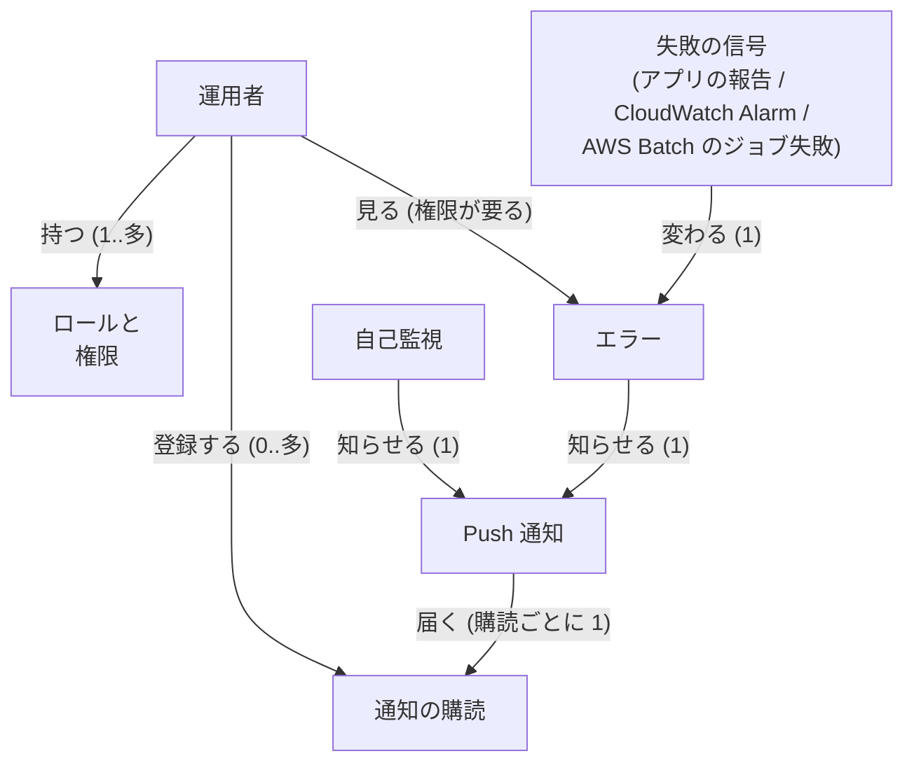

# ドメインモデル

運用者がログインし、各サービスの失敗を ErrorEvent として集めた履歴を見て、記録された失敗を Push 通知で受け取るまでに扱う概念。

## 概念

| 概念 | 意味 |
|---|---|
| 運用者 | Admin を使う管理者。`admin` ロールを持つ |
| ロールと権限 | 運用者に付く役割と、その役割が持つ操作の許可。Admin は、権限で使える機能を分ける ([権限とロール](../specs/term/permission.md)、[ロールと権限の定義](../../../platform/specs/lib/common/roles-and-permissions.md)) |
| エラー | プラットフォーム上で起きた失敗の 1 件の記録 (ErrorEvent)。一定期間で消える ([ErrorEvent](../../../platform/specs/term/error-event.md)) |
| 失敗の信号 | エラーを作るきっかけ。アプリの報告、CloudWatch Alarm、AWS Batch のジョブ失敗の 3 つがある |
| 通知の購読 | 運用者の端末が、Push 通知を受け取るために登録するもの ([Push 購読](../specs/term/push-subscription.md)) |
| Push 通知 | 購読している端末へ送る通知。エラーが記録されたときと、自己監視のときに送る |
| 自己監視 | 通知の仕組み自身の障害を、本流とは独立した経路で運用者に知らせること。エラーとしては記録しない |

## 関係

- 失敗の信号は、基本的に 1 つのエラーになる。信号の再送や再試行で、同じ信号が重なって記録されることがある。同じ失敗が、複数の信号 (アプリの報告と Batch のジョブ失敗など) で別のエラーとして記録されることもある ([エラーの収集](functional/error-collection.md))
- エラーが記録されると、Push 通知を作り、通知の購読すべてに送る。再試行で、同じエラーの通知が重なって届くことがある。通知をタップすると、そのエラーの詳細が開く ([Push 通知](functional/push-notification.md))
- 自己監視の Push 通知は、エラーを作らない。履歴には残らず、タップするとダッシュボードが開く ([自己監視](functional/self-monitoring.md))
- 通知の購読の登録と解除、エラーの閲覧は、それぞれ別の権限を持つ運用者だけが行える ([アクセス制御](functional/access-control.md))
