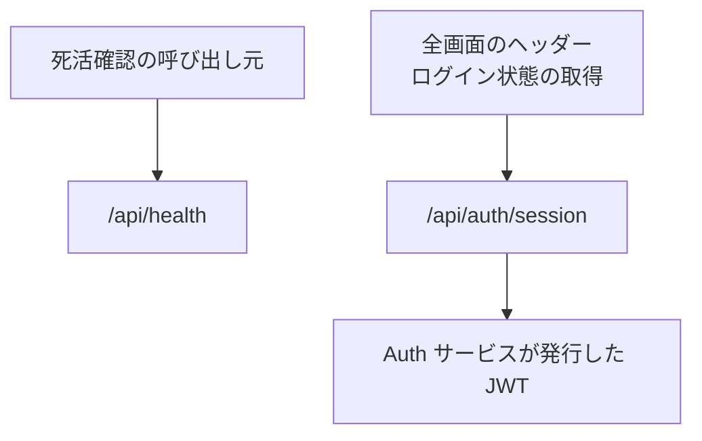

---
sources:
  - services/admin/web/src/app/api/health/route.ts
  - services/admin/web/src/app/api/auth/[...nextauth]/route.ts
  - services/admin/web/src/auth.ts
  - services/admin/web/src/middleware.ts
  - services/admin/web/src/lib/auth/session.ts
sources_hash: 56048bb4f87e91c04e72cfc22f6309e760ca756df8bf24a5b08e1e221be64335
---

# システム系の API

業務の機能ではない 2 つの API。死活確認と、画面が使う認証セッション。

## エンドポイント

| メソッド | パス | 権限 |
|---|---|---|
| GET | `/api/health` | なし |
| GET | `/api/auth/*` (画面が使うのは `/api/auth/session`) | なし (ログインの状態を返す) |

## 入力と出力

- 死活確認は[ヘルスチェックのルート](../../../../platform/specs/lib/nextjs/health-route.md)で、`service` は `admin`。`version` は環境変数 `APP_VERSION`、なければ `1.0.0`
- 認証は next-auth の GET だけを公開する。POST は公開しないので、`/api/auth/signout` への直接の POST は受け付けず、サインアウトは Auth サービスの URL へ遷移して行う
- Admin には認証の提供元 (プロバイダー) がなく、Auth サービスが発行した JWT を検証するだけ。セッションと Cookie の設定は[NextAuth の設定](../../../../platform/specs/lib/nextjs/auth-config.md)の、ログインを別のサービスに任せる側のもの
- 環境変数 `SKIP_AUTH_CHECK` が `true` のテスト用の設定では、`/api/auth/session` が認証せずにテスト用のセッションを返す。解決の規則は[セッション取得とテストセッション](../../../../platform/specs/lib/nextjs/session.md)にある
    - Admin の既定のロールは `admin`
    - サーバー側のセッションの取得 (`getSession`) も同じ既定ロールと規則を使うので、画面の中でロールの見え方が食い違わない

## エラー

- どちらも、ここで返すエラーを決めていない
- ミドルウェアは `/api` 配下を対象にしない。`/api` 配下は、未ログインでもリダイレクトされず、各 API が自分で 401 を返す。画面の未ログインと権限なし (`users:read`) のリダイレクトは[ダッシュボード画面](../screen/dashboard.md)の入口にある
- サインイン画面の場所の環境変数 (`NEXT_PUBLIC_AUTH_URL`、`NEXTAUTH_URL`) がどちらもなければ、ミドルウェアは画面のリクエストに 500 を返す。本文は `{ error: 'Authentication configuration error' }` で、`message` を持たず、[API のエラー応答](../term/api-error.md)の形ではない

## つながり

