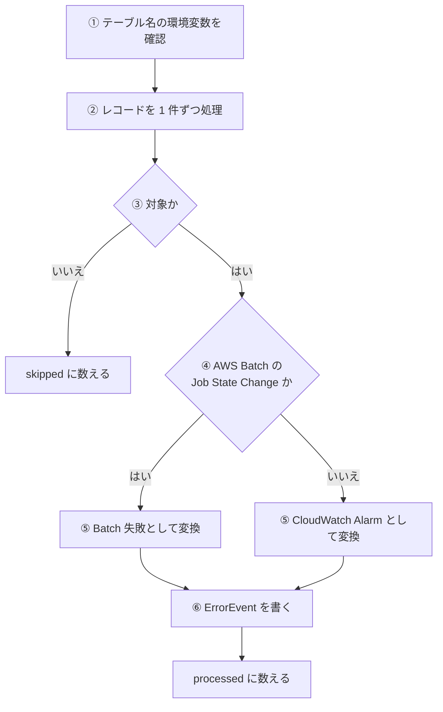
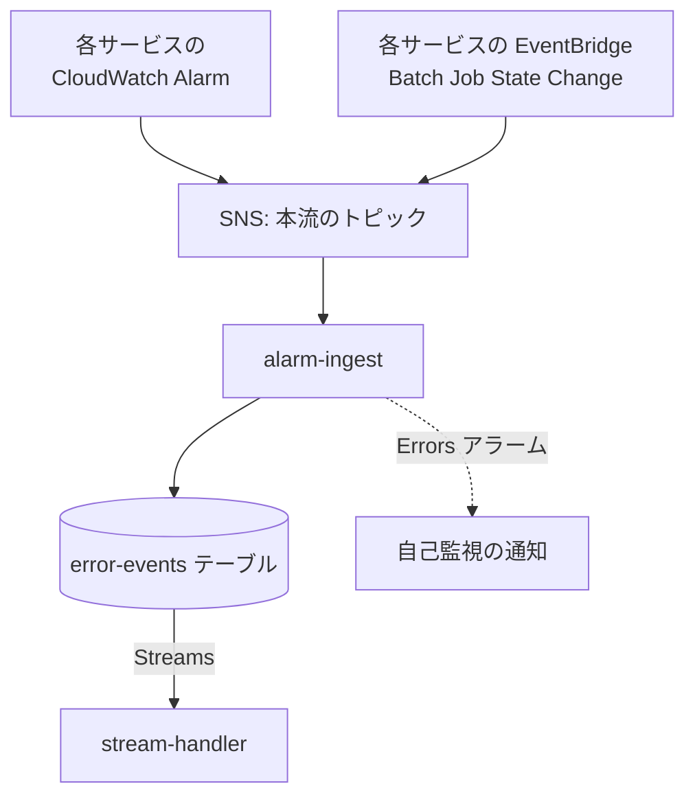

---
sources:
  - infra/admin/lib/batch-lambda-stack.ts
  - services/admin/batch/src/alarm-ingest.ts
sources_hash: 8876321bd64d1e46b00144213fe60e3b6eb823601645076d04c52ed09c15936f
---

# alarm-ingest

SNS で届いた CloudWatch Alarm と AWS Batch ジョブ失敗の通知を、[ErrorEvent](../../../../platform/specs/term/error-event.md) に変えて error-events テーブルに書く Lambda。書いたあとの通知は [stream-handler](./stream-handler.md) が受け持つ。経路の全体は[エラー通知の経路](../flow/error-notification.md)にある。

## 起点

- 本流の SNS トピック (`nagiyu-admin-alarms-{env}`) へのメッセージの発行 (Lambda の SNS サブスクリプション)。スケジュールはない
- 発行するのは、各サービスの CloudWatch Alarm のアクションと、AWS Batch の `Batch Job State Change` を流す EventBridge のルール。トピックが発行を許す相手は[アラームのトピック](../resource/alarm-topic.md)にある
- Lambda はコンテナイメージで動く。メモリ、タイムアウト、権限は[バッチの実行環境](../resource/batch-runtime.md)にある。書き込み先のテーブル名は環境変数 `ERROR_EVENTS_TABLE_NAME` で受け取る

## 対象から外れる条件

| 条件 | 外れる範囲 |
|---|---|
| レコードの `EventSource` が `aws:sns` でない | そのレコード |
| SNS の `Type` が `Notification` でない | そのレコード |
| メッセージ本文が JSON として読めない | そのレコード |
| AWS Batch のイベントで、ジョブの状態が `FAILED` でない | そのレコード |
| CloudWatch Alarm で、新しい状態 (`NewStateValue`) が `ALARM` でない (`OK`、`INSUFFICIENT_DATA`)、または `AlarmName` がない | そのレコード |

## 処理

届いたレコードを順に処理する。

- ④ は、本文の `detail-type` が `Batch Job State Change` で、`source` が `aws.batch` かで決める。それ以外は CloudWatch Alarm として読む

変換の規則。ほかのサービスが、自分のアラーム名やジョブ名からどの `serviceId` になるかを知るときは、ここを見る。

| 項目 | CloudWatch Alarm | AWS Batch ジョブ失敗 |
|---|---|---|
| `source` | `cloudwatch-alarm` | `batch-event` |
| `severity` | `error` | `critical` |
| `serviceId` | アラーム名から決める | ジョブ名から決める |
| `title` | `{AlarmName} ({NewStateValue})` | `AWS Batch ジョブ失敗: {jobName}` (ジョブ名がなければ「AWS Batch ジョブ失敗」) |
| `message` | `NewStateReason` (なければ空) | `statusReason` (なければ空) |
| `occurredAt` | `StateChangeTime` (なければ SNS の `Timestamp`) | イベントの `time` (なければ SNS の `Timestamp`) |

- `eventId` は書くたびに UUID を新しく作る。`context` は SNS のメッセージ本文をそのまま入れる
- `serviceId` は、名前を `-` で分け (空の要素は除く)、2 つ以上あれば先頭の 2 つを `-` でつなぐ。1 つならその 1 つ、何もなければ `unknown`。例: アラーム `livetalk-batch-acquire-errors-dev` は `livetalk-batch`。ジョブ名も同じ規則で決めるので、`{service}-{component}-...` の形の名前を付ける
- 戻り値は `{ processed, skipped }`

## 失敗したとき

- テーブル名の環境変数がなければ、レコードを読む前に例外を投げる
- 書き込みに失敗したときは、例外を投げて Lambda を失敗にする。それより前に書けたレコードは残り、あとのレコードは処理されない。時刻が日時として読めない通知も、書き込みの検証で例外になる
- 同じ通知が再配信されると、`eventId` が別なので、同じ内容が 2 件書かれる。重複は取り除かない
- 再試行の回数は指定していない (Lambda の既定に従う)
- この Lambda の失敗は、アプリの報告の骨格を通らないので、Admin の履歴には報告されない。Errors アラームが自己監視のトピックに送り、[SNS 受信 API](../api/notify-sns.md) から Web Push になる ([自己監視](../resource/self-monitoring.md))

## つながり

## 理由

- 変換は、特定のサービスの分岐を持たない形で書く。`serviceId` は名前の規約から決め、`source` と `severity` は経路の種類で決まる。Batch を使うサービスは、EventBridge のルールを足すだけで同じ経路に乗れる ([エラー通知の経路](../flow/error-notification.md))
