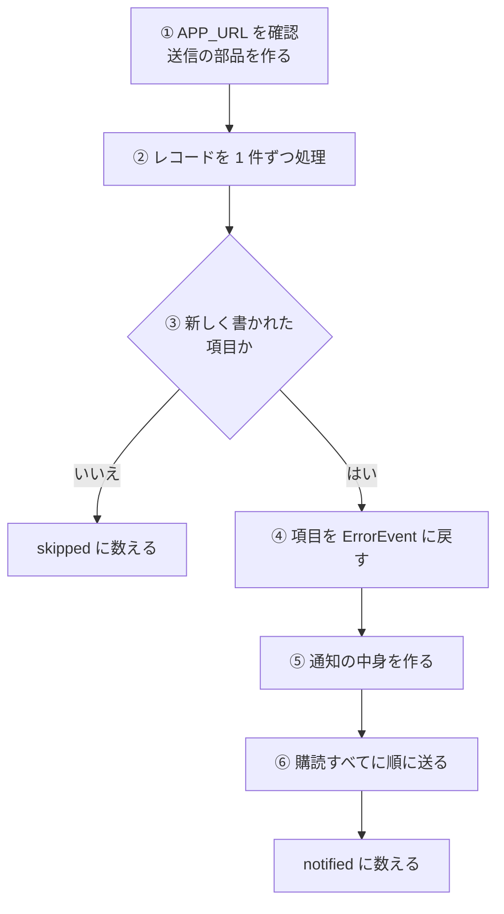
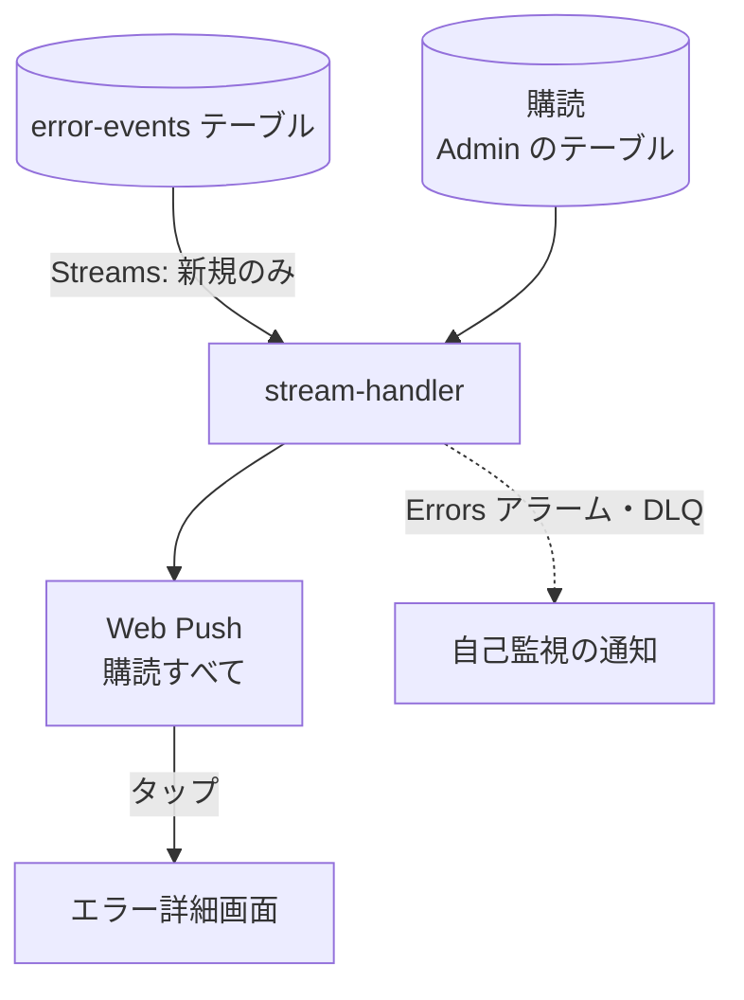

---
sources:
  - infra/admin/lib/batch-lambda-stack.ts
  - services/admin/batch/src/stream-handler.ts
  - services/admin/core/src/notify/web-push-sender.ts
  - services/admin/core/src/notify/subscription-repository.ts
sources_hash: 6d971a6c717a76e717fca1a0d408f9fc5bc82abd878311f4f8e4756a61be460f
---

# stream-handler

error-events テーブルに新しく書かれた [ErrorEvent](../../../../platform/specs/term/error-event.md) ごとに、Web Push を[購読](../term/push-subscription.md)すべてに送る Lambda。通知をタップすると、そのエラーの詳細画面が開く。経路の全体は[エラー通知の経路](../flow/error-notification.md)にある。

## 起点

- error-events テーブルの DynamoDB Streams (イベントソース)。スケジュールはない
    - 受け取りの単位は最大 100 件、または 5 秒の窓
    - 読み始めは最新の位置 (`LATEST`)。再試行は 2 回で、失敗したバッチは二分割して再試行する
- 関数に SQS の DLQ を付けている
- メモリ、タイムアウト、DLQ の保持期間、権限は[バッチの実行環境](../resource/batch-runtime.md)にある。環境変数は `APP_URL` (Admin 自身の URL)、`DYNAMODB_TABLE_NAME` (Admin のテーブル)、VAPID 鍵。この関数は error-events に書かないので、書き込みの環境変数と権限は付けない

## 対象から外れる条件

| 条件 | 外れる範囲 |
|---|---|
| レコードの種類が `INSERT` でない (更新、削除) | そのレコード |
| `INSERT` でも、新しい項目の内容 (`NewImage`) がない | そのレコード |

## 処理

| 段 | 内容 |
|---|---|
| ① | `APP_URL` がなければ例外。VAPID 鍵が空でも、送信の部品を作る時点で例外 |
| ④ | 必須の項目がない、`source` や `severity` が許可外のときは例外にする (読み飛ばすと、通知が出ないまま気づけないため) |
| ⑤ | 題名は `title`、本文は `message` (空なら「エラー通知を受信しました」)、アイコンは `/icon-192x192.png`。`data` に `url`、`eventId`、`tag` (`eventId` と同じ値) を入れる |
| ⑥ | 通知の `data.url` は `{APP_URL}/errors/{eventId}?at={発生時刻のミリ秒}&serviceId={serviceId}` ([エラー詳細のキー](../term/error-event-key.md))。購読がなければ何も送らない |

- 送り方と、無効な購読 (購読の失効、許可されない `endpoint`) の判定は [Web Push](../../../../platform/specs/lib/common/web-push.md) にある。無効と分かった購読は、送ったあとに削除する。削除に失敗しても、警告ログに残して続ける。それ以外の送信の失敗も、警告ログに残して次の購読へ進む
- `notified` は、通知の中身を作って送りに行った件数で、購読が 0 件でも数える
- 戻り値は `{ notified, skipped }`

## 失敗したとき

- 例外を投げると、バッチ全体が失敗になり、Streams が再試行する。先に送った分の通知は取り消せないので、再試行で同じ通知が重ねて届くことがある。Streams は少なくとも 1 回の配信なので、再試行がなくても、まれに重なる
- 購読の読み取りに失敗したときも、例外になる。読めない購読の項目は除いて続ける ([Web Push の購読](../term/push-subscription.md))
- 関数に DLQ を付けているが、再試行を使い切ったレコードの送り先 (`onFailure`) は設定していない
- Errors と DLQ の滞留は、自己監視アラームが別のトピックに送り、[SNS 受信 API](../api/notify-sns.md) から Web Push になる ([自己監視](../resource/self-monitoring.md))
- この Lambda の失敗は、Admin の履歴には報告されない

## つながり

## 理由

- 通知を、書き込みとは別の Lambda に切り出す。書く経路 (alarm-ingest、アプリの直接の書き込み) が増えても、通知を出す所はここ 1 つで済み、通知の失敗が書き込みに響かない ([エラー通知の経路](../flow/error-notification.md))
- 項目を戻せないときは、読み飛ばさず例外にする。読み飛ばすと、通知が出ないまま誰も気づけない。例外なら、Errors アラームで知らせられる
