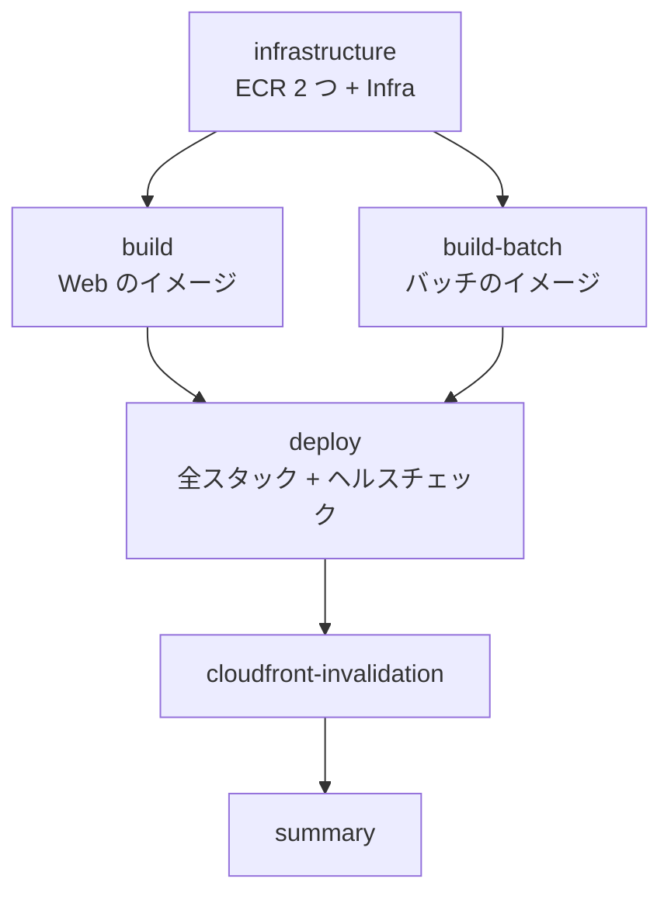

---
sources:
  - infra/admin/bin/admin.ts
  - infra/admin/lib/cloudfront-stack.ts
  - .github/workflows/admin-deploy.yml
sources_hash: 2725ab8e57733dfc5c277e411429b24f0fc8e244a486efcf62b2ba94366f724c
---

# Admin のデプロイ先

Admin は、Web アプリ (Lambda の Function URL を CloudFront で配信) と、アラームの取り込みと通知を行うバッチ Lambda を AWS に載せる。dev と prod の両方にデプロイする。

## ホスト名

| 環境 | ホスト名 |
|---|---|
| dev | `admin.dev.nagiyu.com` |
| prod | `admin.nagiyu.com` |

DNS レコードは、dev は CloudFront の基底スタックが、prod は shared の CNAME が作る。詳しくは [DNS レコードの作り方](../../../platform/specs/deploy.md#dns-レコードの作り方) を参照。

## スタック

`infra/admin/bin/admin.ts` が、次の順に作る。環境は CDK の context `env` (既定は `dev`) で決まり、`{Env}` は `Dev` または `Prod`。

| 順 | スタック | 役割 | 含むリソース |
|---|---|---|---|
| 1 | `NagiyuAdminECR{Env}` | Web アプリのイメージの置き場 | ECR リポジトリ |
| 2 | `NagiyuAdminLambda{Env}` | Web アプリの実行 | Lambda (Function URL つき) |
| 3 | `NagiyuAdminInfra{Env}` | データと通知の基盤 | SNS トピック、DynamoDB テーブル、Secrets Manager のシークレット |
| 4 | `NagiyuAdminBatchECR{Env}` | バッチ Lambda のイメージの置き場 | ECR リポジトリ |
| 5 | `NagiyuAdminBatchLambda{Env}` | アラームの取り込みと通知 | Lambda、SQS キュー |
| 6 | `NagiyuAdminSelfMonitoring{Env}` | バッチ系の自己監視 | CloudWatch アラーム |
| 7 | `NagiyuAdminCloudFront{Env}` | Web アプリの配信 | CloudFront、Route53 の ALIAS (dev のみ) |

- CloudFront のスタックは `us-east-1` に固定する (CloudFront の制約)。ほかのスタックのリージョンは、環境変数 `CDK_DEFAULT_REGION` で、未設定なら `us-east-1`。

## デプロイの流れ

`.github/workflows/admin-deploy.yml` が行う。

| 項目 | 内容 |
|---|---|
| トリガー | develop・`integration/**`・master への push (`services/admin/**`、`libs/**`、`configs/**`、`infra/admin/**`、`infra/common/**`、`package.json`、`package-lock.json`、このワークフローとヘルスチェック・ECR push のアクションが変わったとき)。手動実行 (dev か prod を選ぶ) |
| デプロイ先の環境 | [dev と prod の切り替え](../../../platform/specs/deploy.md#dev-と-prod-の切り替え) の規則 |
| 並行実行 | 環境ごとに直列化する。実行中の run は止めず、待機中は最新だけ残す |
| イメージのタグ | コミットの SHA |

| ジョブ | 内容 |
|---|---|
| `infrastructure` | CDK の Bootstrap の後、`NagiyuAdminECR{Env}`、`NagiyuAdminBatchECR{Env}`、`NagiyuAdminInfra{Env}` の順にデプロイする |
| `build` | Web アプリをビルドし、イメージを ECR に push する |
| `build-batch` | バッチのイメージを ECR に push する (`infrastructure` の後、`build` と並行) |
| `deploy` | Secrets Manager の値を取り出し、CDK で全スタックをデプロイする (`--all`)。そのあと Lambda の Function URL でヘルスチェックを行う ([ヘルスチェック](../../../platform/specs/deploy.md#ヘルスチェック)) |
| `cloudfront-invalidation` | CloudFront のキャッシュを全パス (`/*`) 削除し、完了を待つ。ディストリビューションの ID が取れなければ、削除を飛ばす |
| `summary` | 各ジョブの結果を要約に出す (`always`) |
