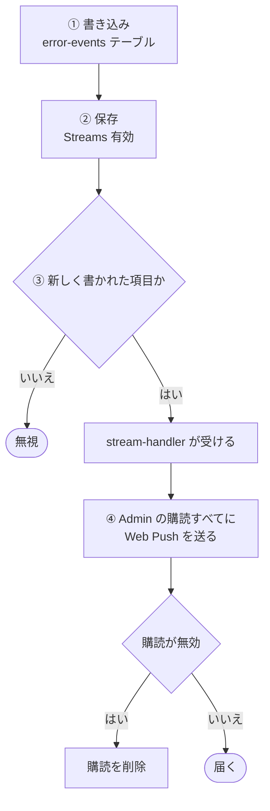
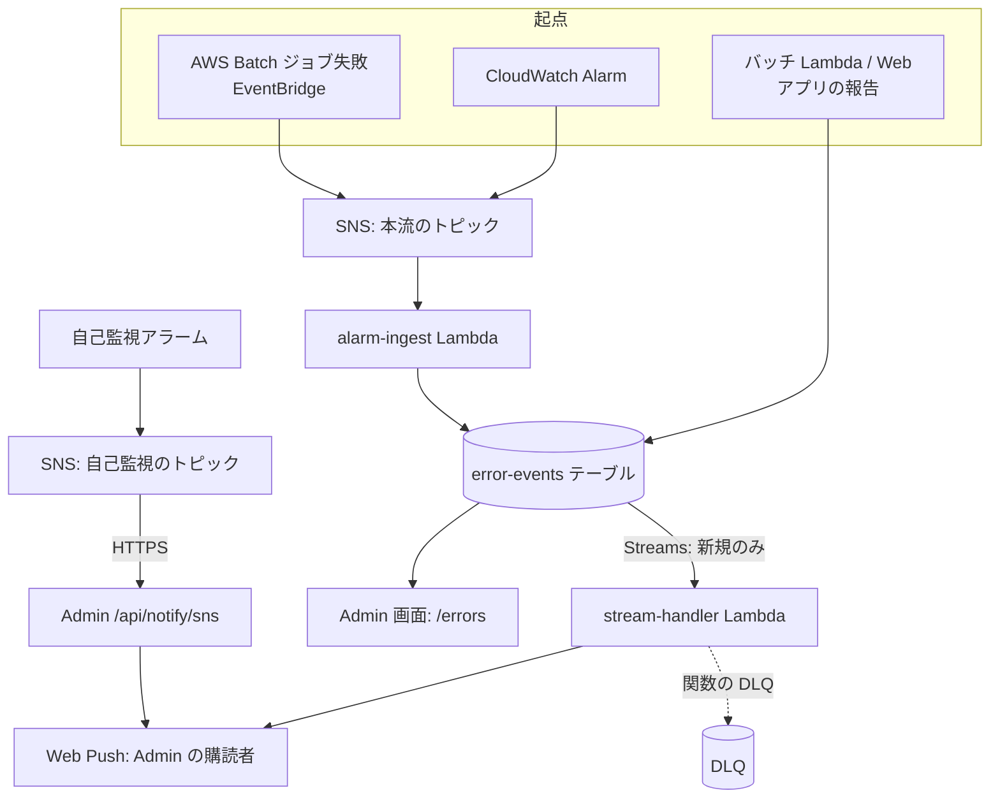

---
sources:
  - infra/admin/lib/sns-stack.ts
  - infra/admin/lib/batch-lambda-stack.ts
  - services/admin/batch/src/alarm-ingest.ts
  - services/admin/batch/src/stream-handler.ts
  - services/admin/web/src/app/api/notify/sns/route.ts
sources_hash: f66eda6fcc9773b8f3ccc1103b25a64bf3095eb6cda8e068472275794d00546f
---

# エラー通知の経路

バッチやサービスで失敗が起きてから、Admin の画面と Web Push に届くまでの流れ。[ErrorEvent](../../../../platform/specs/term/error-event.md) を共有のテーブルに集め、そこから通知を出す。

## 起点

失敗の集め方は 3 通りある。

| 経路 | 仕組み | source / severity |
|---|---|---|
| アプリの報告 | バッチ Lambda は、共通の骨格が例外を受けて自分で報告する ([定期実行 Lambda の骨格](../../../../platform/specs/lib/aws/scheduled-handler.md))。Web の API ルートも、例外を報告する ([API ルートのエラー報告](../../../../platform/specs/lib/nextjs/api-error-reporting.md))。報告の仕組みは[エラーの報告](../../../../platform/specs/lib/aws/error-reporting.md)にある | `application` / `error` (呼び出し側が変えられる) |
| CloudWatch Alarm | サービスの infra が定義したアラームが ALARM になり、本流のトピックに発行する | `cloudwatch-alarm` / `error` |
| AWS Batch のジョブ失敗 | EventBridge が失敗を検知して、同じトピックに発行する。検知のルールはサービス側の infra が持つ | `batch-event` / `critical` |

- バッチ Lambda は、報告したあとに元の例外を投げ直す。Lambda が失敗として扱われるので、Errors メトリクスが増え、アラームと DLQ も働く
- 本流のトピック (`nagiyu-admin-alarms-{env}`) の設定と、発行を許すポリシーは[アラームのトピック](../resource/alarm-topic.md)にある

## 経路

1. **書き込み**: error-events テーブルに、1 件ずつ書く。テーブルとキーの設計は[エラーイベントのテーブル](../../../../platform/specs/data/error-events.md)にある
    - アプリの報告: Lambda や Web が、直接書く
    - アラームと Batch の失敗: 本流のトピックから [alarm-ingest](../batch/alarm-ingest.md) が受け、書く。ALARM への遷移と、失敗した Batch のジョブ状態だけを書く
    - serviceId の決め方が経路で違う。アラームと Batch の失敗は、alarm-ingest が名前から決める (規則は [alarm-ingest](../batch/alarm-ingest.md))。アプリの報告は、報告する側が自分で指定した ID を使う
2. **保存**: テーブルは DynamoDB Streams (新しい項目の内容を流す) を有効にしている。保持期間もテーブルの仕様にある
3. **通知**: [stream-handler](../batch/stream-handler.md) が Streams を受ける。新しく書かれた項目だけを対象にし、更新と削除は無視する
4. **送信**: Admin に登録された Web Push の[購読](../term/push-subscription.md)すべてに送る。無効になった購読は削除する
    - 題名は ErrorEvent の title、本文は message (空なら固定の文)
    - タップすると、詳細画面が開く ([エラー詳細のキー](../term/error-event-key.md))

## 届く先

- **Web Push**: Admin の購読者全員
- **Admin の画面**: [エラー履歴一覧](../screen/errors.md)と[エラー詳細](../screen/error-detail.md)。見るには `errors:read` 権限が要る ([権限とロール](../term/permission.md))

## 失敗・取りこぼしのとき

- 報告の書き込みに失敗しても、アプリの本処理は止めない ([エラーの報告](../../../../platform/specs/lib/aws/error-reporting.md))
- 同じ失敗が、別の serviceId で 2 件届くことがある。アプリの報告 (serviceId は報告する側が指定する) と、同じ失敗を拾ったアラーム (serviceId はアラーム名から決まる) が、別の項目として記録されるため。どちらも Push になる
- プロセスが即死してアプリが報告できない失敗 (タイムアウトなど) は、アラームか Batch のイベントの経路が拾う
- Streams は少なくとも 1 回の配信で、まれに同じ通知が 2 通届く
- stream-handler の再試行と DLQ は[stream-handler](../batch/stream-handler.md)にある。再試行を使い切ったレコードの送り先 (`onFailure`) は設定していない
- Admin に購読がなければ、Push は送られない。テーブルと画面には残る
- 通知の仕組み自身の障害は、別のトピックで知らせる。このトピックは Admin の `/api/notify/sns` に HTTPS で送り、そこから Push を出す。記録は残さない。受け付けるのはこのトピックからのメッセージだけ。アラームとトピックは[自己監視](../resource/self-monitoring.md)にある

## つながり

## 理由

- **Push を Streams から出す**。alarm-ingest が書いた直後に Push まで送る形にしない。書き込みと通知を切り離して、書き込みを軽くするため。通知が失敗しても書き込みには響かない。書く経路が増えても (アプリが直接書く経路など)、通知を出す所が stream-handler 1 つで済む。代わりに、書いてから Push までの段が 1 つ増える。Streams は少なくとも 1 回の配信なので、同じ通知がまれに 2 通届く
- **AWS Batch の失敗を EventBridge で拾う**。タイムアウトなどでプロセスが即死すると、アプリの `try/catch` が走らず、アプリの報告は出ない。この失敗は CloudWatch Alarm でも拾えない。Batch はジョブの成否の CloudWatch メトリクスを持たず、タイムアウトはログにも何も残さないため。EventBridge のジョブ状態の変化は、プロセスの生死に依らず届く
- **検知のルールはサービスが持ち、変換は alarm-ingest が持つ**。ルールは、そのサービスのジョブキューに絞って、サービスの infra に置く。変換は、特定のサービスに依らない形で alarm-ingest が受け持つ。Batch を使うサービスは、ルールを 1 本足せば同じ経路に乗れる
- **同じ失敗が 2 件記録されるのを許す**。アプリが拾える失敗では、アプリの報告と Batch の失敗の 2 件が記録され、Push も 2 通になる。取りこぼすより 2 通届くほうがよいため
- **自己監視のトピックを分ける**。本流と同じ経路 (alarm-ingest、テーブル、stream-handler) で自己監視を通すと、その経路の障害を知らせる経路も止まる。自己監視は、テーブルを通らず `/api/notify/sns` から直接 Push を出す
