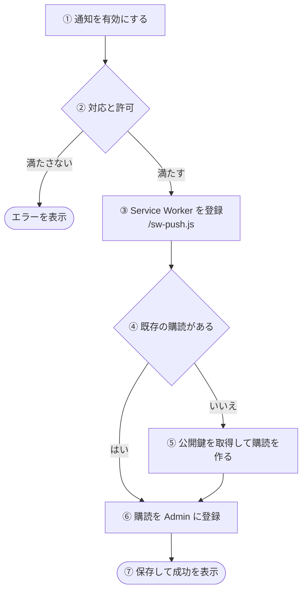
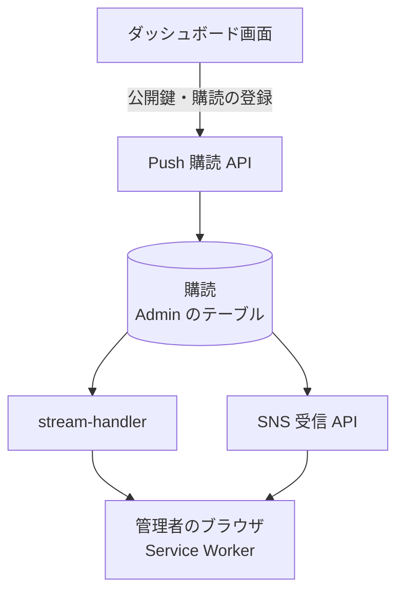

---
sources:
  - services/admin/web/src/components/notify/NotifyButton.tsx
  - services/admin/web/src/components/dashboard/DashboardRoleCards.tsx
  - services/admin/web/public/sw-push.js
  - services/admin/web/src/app/api/notify/subscribe/route.ts
  - services/admin/web/src/app/api/notify/vapid-key/route.ts
  - services/admin/core/src/notify/subscription-repository.ts
  - services/admin/core/src/notify/web-push-sender.ts
sources_hash: b67b7b174e9346071ea09b0fb816e9e735494bc645970a76f2e9f382872d715b
---

# Push 購読の経路

管理者のブラウザが [Web Push の購読](../term/push-subscription.md)を作って Admin に登録し、通知を受け取れるようになるまでの流れ。通知を出す側は[エラー通知の経路](./error-notification.md)にある。

## 起点

- 管理者が、ダッシュボードの「通知設定」カードの「通知を有効にする」を押す。カードは `notifications:write` を持つ利用者にだけ出る ([権限とロール](../term/permission.md))
- 購読の解除を呼ぶ画面はない。API だけがある ([Push 購読 API](../api/notify.md))
- Admin は、Service Worker の登録と購読の送り直しを layout では行わない。購読は、このボタンを押したときだけ作る

## 経路

購読の手続き (対応判定、許可、Service Worker の登録、購読の作成) はブラウザ側の共通部品が行う。手続きの詳細と失敗時のメッセージは [Web Push (ブラウザ側)](../../../../platform/specs/lib/browser/web-push.md)、状態を持つ hook は [Push 購読の React 部品](../../../../platform/specs/lib/react/push-subscription.md)、全体の流れは [Web Push](../../../../platform/specs/lib/common/web-push.md) にある。

Admin が共通部品に渡す設定は次のとおり。

| 項目 | 値 |
|---|---|
| 公開鍵を返す API | `/api/notify/vapid-key` |
| 購読を送る API | `/api/notify/subscribe` |
| 送る本文の形 | 購読の JSON をそのまま (`raw`) |
| Service Worker | `/sw-push.js` |

| 段 | 内容 |
|---|---|
| ⑤ | 公開鍵は環境変数 `VAPID_PUBLIC_KEY` から返す ([シークレット](../resource/secrets.md)) |
| ⑥ | 既存の購読があっても、押すたびにサーバーへ登録し直す。Admin は `notifications:write` を確かめて、購読を保存する。保存は、同じ `endpoint` なら上書き |
| ⑦ | 「通知を有効化しました」を出す |

## 届く先

- 購読は Admin 自身のテーブルに保存され ([Admin のテーブル](../data/main-table.md))、通知を出すときに全件が読まれる
    - 本流のエラー通知は [stream-handler](../batch/stream-handler.md)
    - 自己監視の通知は [SNS 受信 API](../api/notify-sns.md)
- 通知が届いたときは、Service Worker (`/sw-push.js`) が出す
    - 通知の本文は JSON で、題名・本文・アイコン・`data` を持つ。題名と本文を受け取った内容で出し、足りない項目は既定 (題名「Admin 通知」、本文「エラー通知を受信しました」) で補う
    - 中身が JSON として読めなければ、題名は「Admin 通知」のまま、本文に受け取った文字列を出す
    - タップすると、通知の `data.url` を開く。`data.url` がなければ `/dashboard`
    - URL が相対のパス (SNS 受信 API の通知の `/dashboard`) で、同じパスのタブがあれば、そのタブを前面に出す
    - エラー通知の URL は絶対 URL なので、同じパスのタブがあっても、毎回新しく開く

## 失敗・取りこぼしのとき

- ブラウザが対応していない、許可されない、または登録 API が失敗したときは、画面にエラー (「通知を有効にする」の下) を出す
- 登録 API は、権限がなくて 403 のときも、500 のときも、画面には共通部品の「サブスクリプションの登録に失敗しました」を出す。ブラウザ側の購読は残るので、もう一度押すと、その購読で登録し直す
- 送信のときに無効と分かった購読は、その場で削除される ([Web Push の購読](../term/push-subscription.md))。ブラウザ側が購読を取り消しても、サーバーには次の送信まで残る
- 購読が 1 件もなければ、通知は送られない

## つながり

