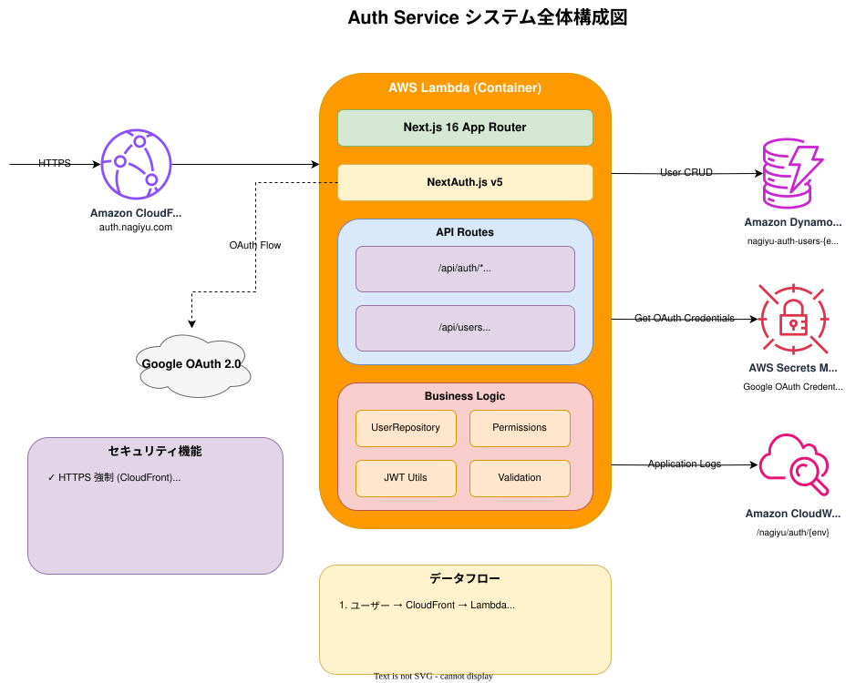
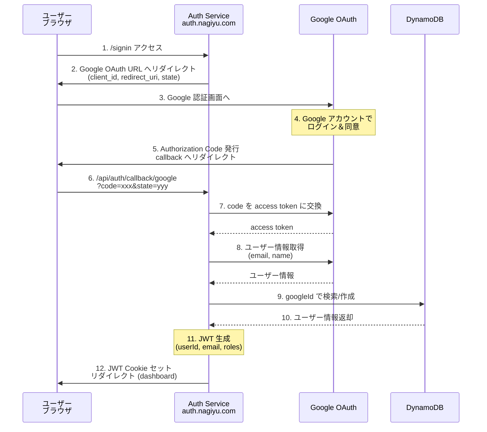
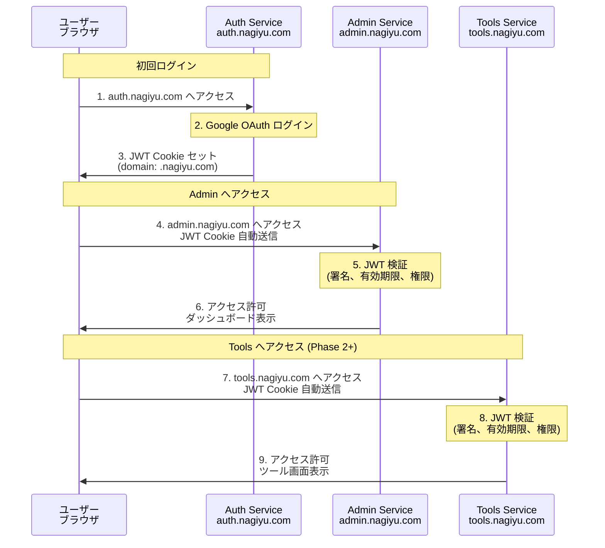

# Auth サービス アーキテクチャ設計書

本ドキュメントでは、Auth サービスのシステムアーキテクチャ、技術スタック、設計思想を説明します。

**関連ドキュメント**:
- [要件定義](./requirements.md) - ビジネス要件、機能要件、非機能要件
- [API 仕様](./api-spec.md) - API エンドポイント詳細
- [ロール・権限定義](./roles-and-permissions.md) - RBAC の詳細仕様
- [デプロイ・運用](./deployment.md) - デプロイ手順、CI/CD、監視
- [テスト仕様](./testing.md) - テスト戦略、カバレッジ目標

---

## 1. システム概要

### 1.1 全体構成図



#### 構成概要

```
ユーザー (ブラウザ)
    ↓ HTTPS
外部DNSサービス
    ↓ CNAME (auth.nagiyu.com → d123456.cloudfront.net)
CloudFront Distribution
    ↓ オリジン
Lambda Function URL (Next.js SSR + Lambda Web Adapter)
    ├─ Next.js App Router
    ├─ NextAuth.js (Google OAuth)
    ├─ Material UI コンポーネント
    └─ DynamoDB アクセス (ユーザー管理)
```

### 1.2 サービスの責務

Auth サービスは、nagiyu プラットフォームの **認証・認可の中核** を担います。

#### 主要責務

1. **認証 (Authentication)**
    - Google OAuth による外部認証
    - JWT トークンの発行・検証
    - セッション管理 (ステートレスJWT)

2. **ユーザー管理**
    - プラットフォーム共通ユーザー ID の管理
    - Google ID とプラットフォーム ID の紐付け
    - ユーザープロフィール情報の管理

3. **認可 (Authorization)**
    - ロールベースアクセス制御 (RBAC)
    - ユーザーへのロール割り当て
    - 権限情報の提供 (JWT に含める)

4. **シングルサインオン (SSO) 基盤**
    - domain: '.nagiyu.com' での JWT クッキー発行
    - 他サービス (admin など) への認証情報共有

5. **課金の権利の管理**
    - 課金で付くロール (課金の権利) の保持と、有効なロールの算出
    - Stripe との連携 (申し込み・契約の管理・通知の反映)
    - 課金に関する公開ページ (料金・特定商取引法に基づく表記)

#### スコープ外

スコープ外の詳細については [requirements.md](./requirements.md) を参照してください。

---

## 2. 設計思想

### 2.1 認証と認可の分離

- **認証 (Who are you?)**: NextAuth.js が OAuth フローを処理
- **認可 (What can you do?)**: ロール・権限システムをアプリケーション層で実装
- **利点**: OAuth プロバイダー変更時も認可ロジックは不変

### 2.2 ステートレス認証

- **JWT トークン**: ユーザー情報・ロールをトークンに含める
- **DynamoDB**: プロフィール更新時のみアクセス
- **利点**: Lambda コールドスタート時もデータベース接続不要、スケーラビリティ向上

### 2.3 最小権限の原則

- ロールは **必要最小限の権限セット**
- デフォルトは権限なし (明示的な割り当てが必要)
- 権限の命名規則: `{リソース}:{操作}` (Phase 1 例: `users:write`, `roles:assign`)
- 詳細は [roles-and-permissions.md](./roles-and-permissions.md) を参照

### 2.4 拡張性の確保

- **OAuth プロバイダー追加**: NextAuth.js の providers 配列に追加するだけ
- **独自認証への移行**: NextAuth.js を外して custom JWT 発行に切り替え可能
- **DynamoDB スキーマ**: Single Table Design で柔軟な属性追加が可能

---

## 3. 技術スタック

### 3.1 フロントエンド

| カテゴリ | 技術 | バージョン | 用途 |
|---------|------|----------|------|
| フレームワーク | Next.js | 16.x | React SSR フレームワーク |
| UI ライブラリ | Material UI (MUI) | 7.x | React コンポーネントライブラリ |
| 言語 | TypeScript | 5.x | 型安全な開発 |
| 認証ライブラリ | NextAuth.js | 5.x (beta) | OAuth + セッション管理 |
| 状態管理 | React Context / useState | - | ローカル状態管理 |

### 3.2 バックエンド

| カテゴリ | 技術 | バージョン | 用途 |
|---------|------|----------|------|
| ランタイム | Node.js | 22.x | JavaScript 実行環境 |
| フレームワーク | Next.js API Routes | 16.x | サーバーサイド処理 |
| Lambda Adapter | AWS Lambda Web Adapter | 0.8.x | Lambda で Web アプリ実行 |
| OAuth Provider | Google OAuth 2.0 | - | 外部認証 |
| 決済 | Stripe (Billing / Checkout / Customer Portal) | - | 定期課金 |

### 3.3 インフラ

| カテゴリ | 技術 | 用途 |
|---------|------|------|
| コンピューティング | AWS Lambda | Next.js 実行環境 (コンテナ) |
| データベース | Amazon DynamoDB | ユーザー情報管理 |
| シークレット管理 | AWS Secrets Manager | Google OAuth 認証情報、Stripe の鍵 |
| コンテナレジストリ | Amazon ECR | Docker イメージ保存 |
| CDN | Amazon CloudFront | コンテンツ配信、カスタムドメイン |
| SSL/TLS | AWS ACM | HTTPS 証明書 (共通基盤) |
| DNS | 外部DNSサービス | ドメイン管理 |
| IaC | AWS CDK (TypeScript) | インフラ定義 |
| CI/CD | GitHub Actions | 自動ビルド・デプロイ |

### 3.4 開発ツール

| カテゴリ | 技術 | 用途 |
|---------|------|------|
| パッケージマネージャ | npm | 依存関係管理 |
| リンター | ESLint | コード品質チェック |
| フォーマッター | Prettier | コード整形 |
| テスト (単体) | Jest + React Testing Library | ユニットテスト |
| テスト (E2E) | Playwright | ブラウザ自動化テスト |

---

## 4. 認証アーキテクチャ

### 4.1 OAuth 認証フロー



### 4.2 JWT トークン構造

```json
{
  "header": {
    "alg": "HS256",
    "typ": "JWT"
  },
  "payload": {
    "sub": "user_01234567890abcdef",  // userId
    "email": "user@example.com",
    "name": "山田太郎",
    "roles": ["admin"],
    "iat": 1703001234,  // 発行時刻
    "exp": 1705593234   // 有効期限 (30日後)
  },
  "signature": "..."
}
```

#### JWT 設計方針

- **最小限の情報**: ユーザーID、ロールのみ (詳細はDynamoDBから取得)
- **短期有効期限**: 30日 (セキュリティとUXのバランス)
- **自動更新**: NextAuth.js が自動的にトークンをリフレッシュ

### 4.3 セッション管理

#### ステートレスJWT戦略

- **保存場所**: 暗号化された HTTP-only クッキー
- **検証方法**: JWT 署名検証 (NEXTAUTH_SECRET)
- **有効期限**: 30日間 (アクセスごとに延長)

#### クッキー設定

NextAuth v5 (Auth.js) は認証フロー全体で複数のクッキー（`sessionToken`、`callbackUrl`、`csrfToken`、`state`、`pkceCodeVerifier`、`nonce`）を使用する。**すべてのクッキー**の `domain` とクッキー名のサフィックスを環境別に切り替えることで、ローカル開発・dev・prod の 3 環境を分離している（実装は `libs/nextjs/src/auth-config.ts`）。

**環境ごとの値:**

| 環境 | domain | クッキー名サフィックス |
|---|---|---|
| ローカル開発（`next dev`） | 未設定（`undefined`。localhost 専用） | なし |
| dev | `.dev.nagiyu.com` | `.dev` |
| prod | `.nagiyu.com` | なし |

- **SSO**: 同一 domain 配下では Cookie が共有されるため、dev は `auth.dev.nagiyu.com` / `admin.dev.nagiyu.com` / `stock-tracker.dev.nagiyu.com` などで、prod は `auth.nagiyu.com` / `admin.nagiyu.com` / `tools.nagiyu.com` などで SSO が成立する。
- **なぜクッキー名まで変えるか**: prod の Cookie（`Domain=.nagiyu.com`）は `*.dev.nagiyu.com` にも送られるため、`domain` を分けるだけでは dev 側で prod の Cookie と同名になって衝突する。**すべてのクッキー名**を環境別に変えることで、dev と prod の認証フロー全体が混同されないようにしている。`sessionToken` だけでなく `callbackUrl` 等も揃えて変える必要がある。

**dev/prod の判定に `NODE_ENV` ではなく実行時環境変数 `NAGIYU_ENV` を使う理由**: Next.js は `next build` 時に `process.env.NODE_ENV` をリテラル `'production'` へ静的に置換するため、デプロイ後のサーバーサイドでは `NODE_ENV` から dev/prod を判定できない（`NEXT_PUBLIC_` プレフィックスの環境変数も同様にビルド時にインライン化される）。実際、以前は `NODE_ENV === 'prod'` で本番を判定していたため判定が常に偽になり、prod も dev も `.dev` サフィックス付き・`Domain=.nagiyu.com` の同じ設定で動いていた。専用の実行時環境変数 `NAGIYU_ENV`（未設定時は安全側で prod 扱い）を導入することで、デプロイ後も正しく判定できるようにしている。`NODE_ENV === 'development'`（ローカル開発）の判定のみ、`next build` を経ないため引き続き `NODE_ENV` を使う。

**移行の影響**: 上記の是正により本番のクッキー名が変わるため、master リリース時に一度だけ全ユーザーの再ログインが必要になる。

### 4.4 他サービスとの認証共有 (SSO)



#### SSO の仕組み

Cookie 名・domain の環境ごとの値は [4.3 のクッキー設定](#43-セッション管理) を参照。

**メリット:**
- ✓ 一度のログインで全サービスにアクセス可能（dev 環境、prod 環境それぞれで）
- ✓ 各サービスは独立して JWT を検証（Auth Service への問い合わせ不要）
- ✓ 認証ロジックが Auth Service に集約され保守性向上
- ✓ クッキー名が異なるため、dev 環境と prod 環境でクッキーが混同されない（セキュリティ向上）

#### シナリオ: admin.nagiyu.com へのアクセス

```
1. ユーザーが admin.nagiyu.com にアクセス
    ↓
2. Admin サービスのミドルウェアがクッキーをチェック
    - domain: .nagiyu.com なので admin でも読み取れる
    ↓
3. クッキーがない場合
    → auth.nagiyu.com/api/auth/signin にリダイレクト
    → OAuth ログイン後、admin.nagiyu.com に戻る
    ↓
4. クッキーがある場合
    → JWT を検証 (NEXTAUTH_SECRET で署名確認)
    → payload から userId, roles を取得
    → 権限チェック (例: users:read が必要)
    → OK なら画面表示、NG なら 403 Forbidden
```

---

## 5. ユーザー管理アーキテクチャ

### 5.1 DynamoDB スキーマ設計

#### テーブル名

`nagiyu-auth-users-{env}`
- dev: `nagiyu-auth-users-dev`
- prod: `nagiyu-auth-users-prod`

#### Primary Key

| 属性名 | 型 | キータイプ | 説明 |
|--------|---|----------|------|
| userId | String | HASH (PK) | プラットフォーム共通ユーザーID (UUID v4) |

#### Global Secondary Index (GSI)

**Index 名**: `googleId-index`

| 属性名 | 型 | キータイプ | 説明 |
|--------|---|----------|------|
| googleId | String | HASH | Google OAuth ID |

**用途**: Google ID からユーザーを検索 (OAuth callback 時)

#### 属性

属性の名前と形式は、プラットフォーム共通の標準 ([データアクセス層](../../development/data-access-layer.md)) に従う。

- **キー属性は camelCase のまま据え置く**: テーブルのキー `userId` と GSI のキー `googleId` は、名前を変えるとテーブルの作り直しとデータの移し替えが要るため、標準の PascalCase に揃えない。
- **それ以外は PascalCase**: メールアドレス・表示名・プロフィール画像・ロール・各時刻を保存する。
- **時刻は数値のミリ秒**: 作成・更新・最終ログインの日時をエポックミリ秒で持つ。API の応答も同じ形にする。
- **旧形式も読める**: 以前の形式 (camelCase の属性名、ISO 8601 文字列の時刻) で書かれたユーザーも読める。更新で書き込むと、触った属性から新形式に置き換わる。
- **課金の権利と Stripe の顧客もユーザーの項目に持つ**: 別テーブルにしない理由は [ADR-003](#adr-003-課金の権利と-stripe-の顧客をユーザーの項目に持つ) を参照。

#### 設計方針

- **Single Table Design**: 将来的に拡張可能
- **GSI による高速検索**: googleId → userId の変換
- **ロール配列**: 複数ロール対応 (例: `["admin", "user-manager"]`)

### 5.2 ユーザーライフサイクル

#### 新規ユーザー作成

```
Google OAuth 初回ログイン
    ↓
NextAuth.js signIn callback
    ↓
DynamoDB Query (googleId-index)
    - 結果なし (新規ユーザー)
    ↓
userId 生成 (UUID v4)
    ↓
DynamoDB PutItem
    - userId, googleId, email, name
    - roles: [] (デフォルトは権限なし)
    - createdAt, updatedAt
    ↓
JWT 発行 (roles: [])
```

#### ユーザー情報更新

```
管理者が /users/{userId} で編集
    ↓
API Route: PUT /api/users/{userId}
    ↓
DynamoDB UpdateItem
    - 変更した項目と更新日時だけを書く (読んでから全体を書き直さない)
    ↓
次回ログイン時に新しい roles が JWT に反映
```

#### ロール変更の反映タイミング

- **即座には反映されない**: JWT は既に発行済み
- **反映タイミング**: 次回ログイン時、または JWT 有効期限切れ時
- **強制反映**: ユーザーにサインアウト → サインインを依頼

---

## 6. ロール・権限アーキテクチャ

Auth サービスは RBAC (Role-Based Access Control) を採用しています。

### 6.1 基本設計

- **ロール定義はコードで管理**: `libs/common/src/auth/roles.ts` に定義
- **権限の命名規則**: `{リソース}:{操作}` (例: `users:read`, `users:write`, `roles:assign`)
- **最小権限の原則**: デフォルトは権限なし、明示的な割り当てが必要
- **複数ロール対応**: ユーザーは複数のロールを持つことが可能

### 6.2 Phase 1 で定義されるロール

| ロールID | ロール名 | 権限 |
|---------|---------|------|
| `admin` | 管理者 | `users:read`, `users:write`, `roles:assign` |
| `user-manager` | ユーザー管理者 | `users:read`, `users:write` |

### 6.3 権限チェックの実装

**サーバーサイド** (必須):
```typescript
// API Route での権限チェック
const session = await auth();
if (!session || !hasPermission(session.user.roles, 'users:read')) {
    return NextResponse.json({ error: 'Forbidden' }, { status: 403 });
}
```

**クライアントサイド** (UI表示制御のみ):
```typescript
// UI コンポーネントでの表示制御
const canManageUsers = hasPermission(user.roles, 'users:write');
```

**詳細**: ロール・権限の詳細仕様、将来の拡張計画については [roles-and-permissions.md](./roles-and-permissions.md) を参照してください。

---

## 7. セキュリティ設計

### 7.1 OAuth セキュリティ

#### CSRF 対策

- **state パラメータ**: NextAuth.js が自動生成・検証
- **SameSite クッキー**: `sameSite: 'lax'` で CSRF 攻撃を防止

#### リダイレクト URI 検証

- Google OAuth Console で許可する URI を制限
- dev: `https://auth.dev.nagiyu.com/api/auth/callback/google`
- prod: `https://auth.nagiyu.com/api/auth/callback/google`

#### クライアントシークレットの管理

- **保存場所**: AWS Secrets Manager
- **取得タイミング**: Lambda 起動時に環境変数から取得
- **ローテーション**: 四半期ごとに手動更新 (将来自動化)

### 7.2 セッションセキュリティ

#### JWT 署名

- **アルゴリズム**: HS256 (HMAC + SHA-256)
- **秘密鍵**: `NEXTAUTH_SECRET` (32文字以上のランダム文字列)
- **保存場所**: Secrets Manager

#### クッキーセキュリティ

| 属性 | 値 | 目的 |
|------|---|------|
| httpOnly | true | JavaScript からのアクセス防止 (XSS 対策) |
| secure | true | HTTPS 通信のみ (中間者攻撃対策) |
| sameSite | lax | CSRF 攻撃防止 |
| domain | .nagiyu.com | サブドメイン全体で共有 (SSO) |
| path | / | 全パスでアクセス可能 |
| maxAge | 2592000 | 30日間 (秒単位) |

### 7.3 API セキュリティ

#### 認証チェック

すべての保護APIで `auth()` を呼び出し、セッション存在を確認

```typescript
const session = await auth();
if (!session) {
    return NextResponse.json({ error: 'Unauthorized' }, { status: 401 });
}
```

#### 権限チェック

操作ごとに必要な権限を確認

```typescript
if (!hasPermission(session.user.roles, 'users:write')) {
    return NextResponse.json({ error: 'Forbidden' }, { status: 403 });
}
```

#### 入力検証

- Zod スキーマで型安全なバリデーション
- SQLインジェクション対策 (DynamoDB は NoSQL だが、属性名の検証は実施)
- XSS 対策 (React の自動エスケープ + DOMPurify)

### 7.4 インフラセキュリティ

#### Lambda IAM ロール

最小権限の原則:

```yaml
Policies:
  - DynamoDBAccess:
      - dynamodb:GetItem
      - dynamodb:PutItem
      - dynamodb:UpdateItem
      - dynamodb:Query
      - dynamodb:Scan
    Resource: arn:aws:dynamodb:*:*:table/nagiyu-auth-users-*

  - SecretsManagerAccess:
      - secretsmanager:GetSecretValue
    Resource: arn:aws:secretsmanager:*:*:secret:nagiyu/auth/*
```

#### DynamoDB 暗号化

- **At Rest**: AWS KMS による暗号化
- **In Transit**: HTTPS 通信

---

## 8. 技術選定理由

### Next.js + NextAuth.js

**理由**:
- Next.js 16 による最新の React SSR 機能
- NextAuth.js による OAuth 実装の簡素化
- Material-UI との統合が容易

**代替案との比較**:
- **Express + Passport.js**: より柔軟だが、SSR の実装コストが高い
- **独自実装**: OAuth の実装が複雑、セキュリティリスクが高い

### AWS Lambda (コンテナ)

**理由**:
- サーバーレスで運用コストが低い
- 自動スケーリング
- Next.js のコンテナイメージをそのまま実行可能

**代替案との比較**:
- **ECS Fargate**: 常時起動のため、コストが高い
- **EC2**: 運用コストが高い、スケーリングが手動

### DynamoDB

**理由**:
- サーバーレスで運用不要
- オンデマンド課金で自動スケール
- Single Table Design で柔軟な拡張が可能

**代替案との比較**:
- **RDS**: 運用コストが高い、サーバーレスとの親和性が低い
- **Aurora Serverless**: コストが高い、Lambda のコールドスタートに不向き

---

## 9. 制約事項

### 9.1 技術的制約

- **OAuth プロバイダー**: Phase 1 は Google のみ (GitHub, メールアドレス認証は Phase 2 以降)
- **PWA**: Auth サービスは PWA 無効 (認証が必須のため)
- **JWT 有効期限**: 固定30日 (カスタマイズ不可)

### 9.2 運用制約

- **Google OAuth 認証情報**: 手動でSecrets Managerに登録
- **初期管理者**: デプロイ後、手動でDynamoDBに登録
- **ロール変更の即時反映**: 不可 (次回ログイン時に反映)

---

## 10. 将来拡張

### Phase 2 以降で検討

- GitHub OAuth 対応
- メールアドレス + パスワード認証
- 多要素認証 (MFA)
- パスワードリセット機能
- アカウント削除のセルフサービス
- 監査ログ (ログイン履歴、操作履歴)

---

## 11. アーキテクチャ決定記録 (ADR)

### ADR-001: 課金をロールの入口の一つとして扱う

**背景・問題**

プラットフォームには運営コストのかかる機能があり、その一部を有料プランで回収したい。各サービスはすでに、JWT に載ったロールから導かれる権限で認可している。課金の状態を各サービスに直接見せると、サービスごとに Stripe の状態の解釈がばらつく。

**決定**

課金の状態を各サービスに見せない。Auth サービスが課金の状態を「課金の権利」としてロールに変換し、既存のロール認可に載せる。

**根拠・トレードオフ**

- 各サービスは、有料ロールの権限を確かめるだけで出し分けを作れる。課金専用の判定をサービスに持たせない
- Stripe とやり取りするのは Auth サービスだけになる
- ロールの伝わり方の制約 (剥奪が遅れて反映される) を、課金もそのまま受ける (ADR-008)

---

### ADR-002: 課金の権利を手動ロールと分け、出どころと期限つきで持つ

**背景・問題**

課金で付くロールを手動ロールと同じ一覧に混ぜると、解約や期限切れで外すときに、管理者が手で付けたロールまで外しかねない。また、Stripe 以外で受けた支援 (pixiv FANBOX など) に手で有料ロールを付けると、外し忘れが起きる。

**決定**

- 課金で付くロールは、手動ロールとは別の「課金の権利」として持つ。権利はロール・出どころ (Stripe / 手動)・有効期限を持つ
- 有効なロールは、手動ロールと、期限内で取り消されていない課金の権利のロールを合わせたものとする
- 手動の権利では、有効期限を必須にする
- 取り消した権利は消さずに、取り消した印を付けて残す

**根拠・トレードオフ**

- 出どころを分けると、Stripe との同期は Stripe 由来の権利だけを書き換え、手動の付与に触れずに済む。Stripe 由来の権利は管理画面でも変更できなくし、Stripe 上の契約と食い違わないようにする
- 期限を必須にすると、手動の付与でも外し忘れが起きない
- 取り消した権利を残すのは、管理画面で経緯を読めるようにするため

---

### ADR-003: 課金の権利と Stripe の顧客をユーザーの項目に持つ

**背景・問題**

課金の権利と、Auth のユーザーと Stripe の顧客の対応を、どこに置くかを決める必要があった。制約は次のとおり。

- ユーザーのテーブルはユーザー ID だけをキーに持ち (ソートキーなし)、同じキーで別の種類の項目を並べられない
- 有効なロールの算出は、ログインとロールの再取得のたびに走る。そのときの読み取りを増やしすぎたくない
- Stripe の通知は顧客 ID を持ってくるため、顧客 ID からユーザーを引ける必要がある
- dev 環境では、develop の版と integration の版が後勝ちで上書きし合う

**決定**

- 課金の権利の一覧と Stripe の顧客 ID を、既存のユーザーの項目の属性として足す。別テーブルは作らない
- 顧客 ID の索引 (GSI) は作らない。Stripe の顧客にユーザー ID を持たせる。通知の顧客 ID からユーザーを引くときは、Stripe の顧客のユーザー ID を読み、そのユーザーの顧客 ID が通知と一致するかを確かめる
- 権利を書き換えるときは、読んだときの更新日時を条件にして書く (楽観ロック)。失敗したら読み直してやり直し、それでも解けなければ競合として返す

**根拠・トレードオフ**

- 有効なロールの算出で、読み取りが増えない。ログインと再取得で今読んでいるユーザーの項目 1 件に入っている
- dev で版が行き来しても壊れない。古い版は知らない属性を読み飛ばし、更新は属性ごとに書くので、課金の権利を消さない。別テーブルにすると、develop の版をデプロイするたびにテーブルが消える
- 同じテーブルに別の種類の項目を並べる案は採らない。ユーザー一覧はテーブル全体を読んでユーザーとして解釈するため、古い版の一覧が壊れる
- インフラを変えずに済み、ユーザーを削除すると権利も一緒に消える
- 索引を作らない代わりに、同期のたびに Stripe の顧客の取得が 1 回増える。同期では毎回 Stripe に問い合わせるので (ADR-006)、増えるのはその 1 回だけで、テーブルの定義を変えずに済む
- 楽観ロックのやり直しの読み取りは、強い整合性にしない。競合は同じユーザーへの書き込みがミリ秒単位で重なったときだけ起きる。失敗しても変更は失われず、管理者は再読み込みして保存し直せばよく、Stripe の通知は再送される
- Stripe との同期では、Stripe を読む前に読んだユーザーの更新日時を条件にする。競合したら、ユーザーと Stripe の両方を読み直してやり直す。Stripe を読んでいる間に別の通知が新しい状態を書いたとき、古い読み取りで上書きしないため
- ユーザーの削除は Stripe の契約に触れない。契約中のユーザーを消すときは、先に Stripe で解約する運用とする。削除は整合を取るための管理者の操作で、利用者からは使えないため

---

### ADR-004: 課金の権利の読み取りを厳格にし、出どころは読める版を先に出してから足す

**背景・問題**

課金の権利の出どころは、Stripe と手動のほかにも足せるようにしたい (支援サービスとの連携など)。一方で、dev 環境では版が行き来し、本番でもリリースの前後で、新しい出どころを知らない版が動きうる。知らない出どころの権利を読み飛ばすと、その版でユーザーを書き換えたときに、読めなかった権利が消える。

**決定**

- 課金の権利の読み取りは厳格にし、知らない出どころの権利があると、そのユーザーごと読めないようにする
- 出どころを足すときは、まず読めるようにするだけの版 (出どころの定義に足すだけ) を develop と本番に出す。その後に、その出どころで書き始める

**根拠・トレードオフ**

- 権利が黙って消えることを防ぐ。代わりに、読めない版ではそのユーザーを扱えなくなるため、書き始める前に、読める版を行き渡らせる手順を踏む

---

### ADR-005: Stripe を主軸にし、販売代行型を使わない

**背景・問題**

定期課金の決済手段を選ぶ必要があった。販売代行型 (Merchant of Record。Stripe Managed Payments、Paddle など) は、税の処理を代行する代わりに、追加の手数料がかかる。

**決定**

Stripe (Billing・Checkout・Customer Portal・通知) を使う。販売代行型は使わない。

**根拠・トレードオフ**

- 当面は国内の顧客が中心で、消費税は免税事業者の範囲に収まる。販売代行型の追加手数料 (Stripe Managed Payments で +3.5%) に見合う利点がない
- 日本の売り手の国内取引は、Stripe Managed Payments の税務代行の対象外でもある
- 決済画面・解約・支払い方法の変更・請求の履歴を Stripe が提供し、カード情報を Auth で扱わずに済む
- 定期課金で使えるのはカード (Apple Pay / Google Pay を含む) に限られる。PayPay とコンビニ決済は定期課金に使えない
- 見直す条件: 海外の顧客が増え、海外の税の処理が必要になったとき

---

### ADR-006: Stripe の通知を合図として扱い、毎回 Stripe から取り直して上書きする

**背景・問題**

Stripe の通知は、配信の順序が保証されず、同じ通知が重複して届くことがある。処理に失敗すると、最大 3 日間再送される。通知の中身を届いた順に適用すると、順序の入れ替わりや重複で、Stripe の状態と食い違う。

**決定**

- 通知の中身は「この顧客の何かが変わった」という合図としてだけ使う。署名を検証したら、その顧客の契約を Stripe から取り直し、Stripe 由来の課金の権利を、Stripe の状態に合わせて作る・期限を更新する・取り消す
- どの有料ロールが付くかは、契約の品目の価格の lookup_key で決める。lookup_key は有料ロールの ID と同じ文字列にする。有料ロールでない lookup_key は無視してログに残す。当初は商品に紐づけた機能 (Entitlements) の lookup_key で決めていたが、ADR-013 で価格に改めた
- 通知の受け口は Auth サービスに置く
- 決済を終えて戻った利用者は、プランの画面で同期してから、ロールの再取得へ送る

**根拠・トレードオフ**

- 重複・順序の入れ替わり・取りこぼし後の再送のいずれでも、最終的に Stripe の状態と一致する。通知の ID を記録して重複を除く仕組みが要らない。代わりに、通知のたびに Stripe への問い合わせが発生する
- lookup_key をロールの ID に揃えると、対応表を持たずに済み、プランと有料ロールの対応を Stripe の管理画面で変えられる
- 機能 (Entitlements) を使わないのは、商品の機能では 1 つの商品の中の段を区別できないため (ADR-013)
- 受け口を Auth に置くのは、利用者と課金の権利を持つのが Auth であり、通知を受けて権利を書き換えるのも Auth の責務だから
- 決済直後にロールの再取得へ直接戻すと、Stripe の通知より先に着いたとき、まだ権利がなくロールが切り替わらない。プランの画面で同期を挟み、通知の到着を待たずに反映する

---

### ADR-007: Stripe 由来の権利の期限を、請求期間の終わり + 3 日にする

**背景・問題**

Stripe 由来の権利に期限がないと、解約の通知を取りこぼしたとき (Stripe の再送は 3 日まで)、有料ロールが無期限に残る。「最終的に Stripe と一致する」を満たせない。

**決定**

契約の現在の請求期間の終わりに 3 日を足した日時を、Stripe 由来の権利の期限にする。同期のたびに期限を更新する。

**根拠・トレードオフ**

- 猶予の 3 日は、Stripe の通知の再送期間に合わせた
- 更新の通知を取りこぼすと、払っている利用者の権利が期限で切れうる。これに備え、ログイン中の利用者がプランの画面を開いたときにも、Stripe から取り直して同期する

---

### ADR-008: 課金の権利の期限切れ・解約の反映の遅れを許容する

**背景・問題**

ロールの剥奪は即時に反映されない。各サービスは JWT を読むだけで、ロールを読み直すのは Auth だけだから ([認証・認可の統合ガイド](../../development/authentication.md))。このままだと、解約した人や期限が切れた人が、Auth ドメインを通らない限り、最長でセッションの期限 (30 日) まで有料ロールを持ち続ける。

**決定**

これを許容する。期限切れの判定は、Auth が有効なロールを算出するとき (ログインとロールの再取得) にだけ行う。JWT に期限を載せて読む側で外す仕組みは作らない。

**根拠・トレードオフ**

- 漏れはおおむね「解約後にもう 1 か月使える」程度に収まる。その程度のために、全サービスが使う共通ライブラリのセッションの扱いを変えるほどではない
- 漏れが問題になったら、期限を JWT に載せて読む側で外す方式を検討する

---

### ADR-009: 有料ロールと契約をサービスごとにし、価格を Stripe 側に持つ

**背景・問題**

プランの単位と、価格の持ち方を決める必要があった。

**決定**

- 有料ロールと契約をサービスごとに持つ。利用者はサービスごとに申し込み、契約・更新日・解約もサービスごとに独立する。申し込めるかどうかは、同じサービスの有効な契約があるかで判定する
- 価格はコードに持たせず、Stripe の価格 (Price) で持つ。プランの画面は、lookup_key を有料ロールの ID に揃えた価格と、サービスと段の説明を、開くたびに Stripe から読んで表示する。説明の置き場所は ADR-013 で改めた (サービスの説明は商品、段の説明は価格)

**根拠・トレードオフ**

- 価格と説明の文言が Stripe の 1 か所になり、表示が Stripe と食い違わない。特定商取引法に基づく表記も金額を持たず、プランのページへ案内する
- コードが価格を持たないので、本番の価格は、Stripe の本番審査 (料金が本番のサイトに出ている必要がある) の前か、各サービスの出し分けを決めるときに決めればよい
- 複数のサービスに申し込むと、契約も請求もサービスの数だけ分かれる
- 1 サービスに複数の段を持たせる拡張は ADR-013 で扱う。契約の単位がサービスである点は変わらない

---

### ADR-013: 1 サービスに複数の有料の段を持たせ、段の切り替えを Customer Portal に任せる

**背景・問題**

有料ロールが 1 サービス 1 つでは、「基本の機能」と「さらに上の機能」のように、1 サービスで価格の違う段を売れない。段を足すには、ロールの名前、Stripe での持ち方、段の切り替え (上げ下げ) の扱いを決める必要があった。旧来の `{service}-premium` という名前では、段が増えたときに上下が読めない。

**決定**

- **ロールの名前と順位**: 有料ロールの ID は `{service}-{段名}` とする。サービスと段の上下は ID を解析せず、ロールの定義にサービスと順位を持つ。旧 `{service}-premium` は段名を `standard` に改めた
- **上の段は下の段の権限を含む**: 既存のロール (stock-user が stocks:read を含むなど) と同じ作りにする。手動の権利と契約が重なっても、サービスは上の権限から順に見れば段が決まる
- **Stripe の持ち方**: 1 サービス = 1 商品、段 = その商品の価格とする。付くロールは、契約の品目の価格の lookup_key (= ロール ID) で決め、商品の機能 (Entitlements) は使わない (ADR-006 を改める)。サービスの説明は商品の説明、段の説明は価格の metadata `description` に持つ。どちらも Stripe で管理し、文言を Stripe の 1 か所に置く方針 (ADR-009) を保つ
- **同じサービスで有効な契約は 1 つ**: 別の段への申し込みは断り、プランの画面の切り替えへ案内する
- **段の切り替えは Customer Portal の確認画面に任せる**: Auth が行き先の価格を決めて Portal に送る。日割りの表示・支払いの失敗・3D セキュアは Stripe が扱う
- **日割り**: 上げはすぐ効かせ、差額を日割りで即時に請求する。下げは請求期間の終わりに効かせ、返金しない (ADR-012 と揃える)。この扱いは Customer Portal の設定で決まる
- **下げの予約**: Customer Portal は下げを Subscription Schedule で予約する。予約が付いている間は、Portal で変更も解約もできない (Stripe の仕様)。そのためプランの画面に予約を表示し、Auth から予約を取り消せるようにする。取り消すと、契約は今の段のまま残る。予約中と解約予約中は、段の切り替えを出さない
- **支払いを確認できていない契約 (past_due) では、段の切り替えを断る**。権利は、請求のやり直しの間も残す (従来どおり)

**根拠・トレードオフ**

- 価格を同じ商品にまとめるのは、Customer Portal が下げを期末に効かせられるのが、同じ商品の価格どうしに限られるため。商品の機能では段を区別できない
- 価格の lookup_key は、プランの画面の価格の取得にも使っていたので、ロールとの対応が 1 か所にまとまる
- 行き先を Auth が決めるのは、Portal の一般のプラン変更に任せると、2 つ目のサービスが売り始めたとき、別サービスの商品へも切り替えられてしまうため
- 上の段の権限が下の段を含むので、サービスは「この権限があるか」だけで段の機能を出し分けられる
- 下げを予約中に Portal で何もできなくなる制約は Stripe 側にあり、Auth では解けない。プランの画面で予約の取り消しを持つことで補う
- past_due で上げると、未払いの請求に差額の請求が重なり、未払いのまま上の段が付きうる。それを避けるため断る
- ロールの改名で、版の行き来は壊れない。権利のロール ID は文字列として読まれ、知らないロール ID は権限の算出で無視されるだけだから。ADR-004 の「読める版を先に出す」手順は、出どころを足すときのもので、ロールの改名には要らない

---

### ADR-010: Stripe の鍵を専用のスタックに置く

**背景・問題**

Stripe の秘密鍵と通知の署名鍵は、人が Stripe の管理画面で発行して、秘密情報に入れる。dev 環境では、develop の版と integration の版が後勝ちで上書きし合う。新しい秘密情報を既存の秘密情報のスタックに足すと、それを持たない版をデプロイしたとき、スタックから秘密情報が外れ、人が入れた値が消える。削除されずに残る設定にしても、名前が固定のため、作り直しのときに名前の衝突で失敗しうる。

**決定**

- Stripe の鍵の秘密情報は、既存の秘密情報のスタックに足さず、専用のスタックに置く
- 秘密情報は CDK で作り、初期値は仮の値 (PLACEHOLDER) にする。値は人が書き換える
- デプロイは既存の秘密情報と同じく、デプロイ時に値を読み、CDK の context から Lambda の環境変数へ渡す
- 鍵が空か仮の値のままなら、課金を無効として扱う

**根拠・トレードオフ**

- デプロイは、その版に無いスタックには触れない。dev で版が行き来しても、秘密情報と入れた値が消えない
- 鍵はデプロイ時に読まれるので、値を変えたら Auth の再デプロイが要る
- 課金が無効の間は、プランの画面は準備中と表示し、課金の API は使えない旨を返す。本番の鍵を入れるまでの本番も、この状態で動く

---

### ADR-011: 課金の公開情報はサービスごとに置き、中身を共通部品にする

**背景・問題**

料金と特定商取引法に基づく表記を、どこに置くかを決める必要があった。プラットフォームには portal があるが、portal は技術記事のブログである。

**決定**

- 料金と特定商取引法に基づく表記は、課金を受けるサービスに置く。表記の中身 (データと表示部品) は `@nagiyu/ui` の共通部品にする
- 今は、申し込みの入口がある Auth に置く。他のサービスは、有料の案内を出すときに同じ共通部品で表記を置き、フッターから案内する
- portal には置かない

**根拠・トレードオフ**

- portal にサービスの料金や販売の情報を置くと、宣伝サイトになってしまう
- プライバシーポリシーと利用規約も、共通のデータと部品を各サービスが使う作りになっており、それに揃える。課金を受けるサービスが増えても、表記が食い違わない
- Stripe の本番審査では、表記のページの URL を登録する

---

### ADR-012: 特定商取引法に基づく表記と規約の文面

**背景・問題**

定期課金を始めるにあたり、特定商取引法に基づく表記と、共通の利用規約・プライバシーポリシーの文面を決める必要があった。運営者は個人で、本名・住所・電話番号をログインなしで見られる場所に出したくない。

**決定**

- 表記の販売事業者・運営責任者・所在地・電話番号は「請求があれば遅滞なく開示いたします」とする。別の行に、運営として屋号「なぎゆー」を載せる。共通の利用規約の「当方」と呼び名を揃えるため
- 表記の販売価格は金額を持たず、プランのページ (税込) へ案内する (ADR-009)
- 返金は「原則として返金せず、日割りの返金もしない。当方の責による不具合で使えなかった場合は、個別に相談に応じる」とする。返金は Stripe の管理画面から手で行い、仕組みは作らない
- 共通の利用規約は、「利用料金および支払方法」を有料プランの条 (定期契約と自動更新・Stripe による支払い・解約・返金・支払いを確認できないときの提供停止・価格の変更の事前通知) に置き換える。年 14.6% の遅延損害金の項は外す
- 共通のプライバシーポリシーに、決済に関する情報の取り扱いの条を足す (カード情報は Stripe が直接取得し当方は受け取らない、Stripe に識別子・メールアドレス・表示名を渡して契約の状態を受け取る、Stripe は米国の事業者)。個人情報の収集方法の例示から、クレジットカード番号と銀行口座番号を外す
- livetalk は独自の規約を持ち、共通の規約の課金の条項が届かない。申し込みは Auth のプランの画面で共通の規約のもとで行うので、livetalk の規約は、livetalk に有料機能の出し分けを入れるときに直す

**根拠・トレードオフ**

- 返金を「一切返金しない」としないのは、当方の落ち度でも返金しないと読め、消費者契約法で無効になるおそれがあるため
- 遅延損害金の項を外すのは、カードの前払いで支払いの遅れが起きず、決済に失敗したら提供を止めるため
- livetalk の規約を直すと規約の版が上がり、同意を取り直すことになる。有料機能を入れるときにまとめて行う
- 開示を請求に応じる形にしても、Stripe が送る領収書メールには、正式な事業者名 (個人では本名) とサポート用の住所が載る。払った本人にだけ見える範囲なので、許容している
