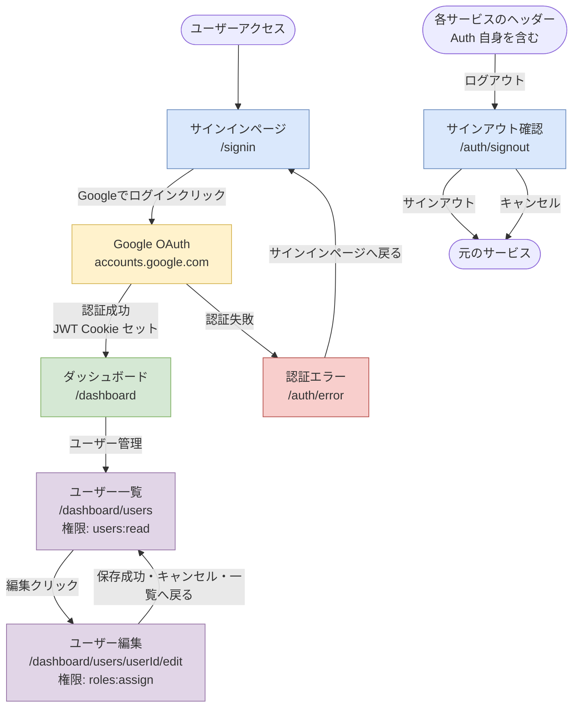
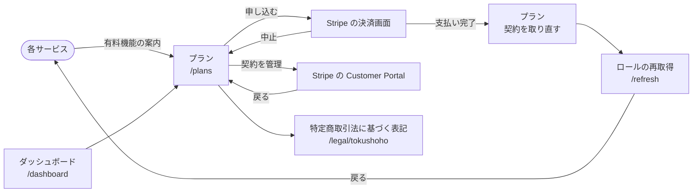

# Auth サービス 要件定義書

---

## 1. ビジネス要件

### 1.1 背景・目的

nagiyu プラットフォームは複数のサービス (admin, logs, tools 等) で構成されており、各サービスで統一された認証・認可機能が必要です。Auth サービスは、プラットフォーム全体の認証・認可を一元管理し、シームレスなユーザー体験を提供します。

**課題**:
- 各サービスで個別に認証機能を実装するとコストが増大
- 認証情報の一貫性が保てない
- セキュリティポリシーの統一管理が困難

**解決策**:
- Auth サービスで認証・認可を集約
- JWT トークンを用いたステートレス認証
- サブドメイン全体でのシングルサインオン (SSO)

**課金の入口**:

プラットフォームには、運営コストのかかる機能がある (外部の AI の呼び出し、動画の処理など)。一方で、収益の手段はなかった。認可はロール単位で行っているため、Auth サービスは課金を「ロールを付け外しする入口の一つ」として扱う。こうすると各サービスは、権限チェックの作りを変えずに、有料ユーザーの操作範囲を広げられる。各サービスで何を有料にするかは、Auth サービスでは扱わない。

### 1.2 対象ユーザー

#### プライマリーユーザー
- **プラットフォーム管理者**: ユーザー管理、ロール割り当てを行う。支援サービスなど Stripe 以外で受けた支援に、期限つきで有料ロールを付ける
- **エンドユーザー**: Google アカウントでログインし、各サービスを利用。有料プランに申し込む人もいる

#### セカンダリーユーザー
- **開発者**: Auth サービスのAPIを利用して他サービスを実装
- **運用担当者**: デプロイ、監視、障害対応を実施

### 1.3 ビジネスゴール

#### Phase 1 の目標
1. **認証基盤の確立**: Google OAuth による安全な認証機能を提供
2. **SSO 実現**: 一度のログインで全サービスにアクセス可能
3. **ユーザー管理**: プラットフォーム共通のユーザー情報管理
4. **ロール・権限管理**: 管理者とユーザーを区別し、適切なアクセス制御

#### Phase 2 以降の目標
- 複数 OAuth プロバイダー対応 (GitHub 等)
- パスワード認証の追加
- 多要素認証 (MFA) の実装
- 監査ログ機能

#### 課金の目標
1. **運営コストの回収**: 運営コストの一部を、利用者の課金で回収できるようにする
2. **出し分けの土台**: 各サービスが、有料ロールを見るだけで無料と有料の出し分けを作れるようにする
3. **手動の付与**: Stripe との連携とは別に、手動の付与でも有料の運用ができるようにする

---

## 2. 機能要件

### 2.1 ユースケース

#### UC-001: Google アカウントでログイン

- **概要**: ユーザーが Google アカウントを使用してプラットフォームにログインする
- **アクター**: エンドユーザー
- **前提条件**: ユーザーが Google アカウントを所持している
- **正常フロー**:
  1. ユーザーが `/signin` にアクセス
  2. 「Google でログイン」ボタンをクリック
  3. Google OAuth 認証画面にリダイレクト
  4. Google アカウントでログイン・同意
  5. Auth サービスにコールバック
  6. JWT トークンが発行され、クッキーにセット
  7. ダッシュボードにリダイレクト (Phase 2+)
- **代替フロー**: なし (Phase 1 では Google OAuth のみ)
- **例外フロー**: 
  - Google 認証失敗時: エラーページを表示
  - ユーザー作成失敗時: エラーページを表示

#### UC-002: 他サービスへのシングルサインオン

- **概要**: Auth サービスでログイン後、他サービスに自動的にログインできる
- **アクター**: エンドユーザー
- **前提条件**: Auth サービスでログイン済み (JWT クッキーが存在)
- **正常フロー**:
  1. ユーザーが `admin.nagiyu.com` にアクセス
  2. Admin サービスが JWT クッキーを検証
  3. 有効な場合、ダッシュボードを表示
  4. 無効な場合、Auth サービスのログインページにリダイレクト
- **代替フロー**: なし
- **例外フロー**: JWT 有効期限切れの場合、再ログインが必要

#### UC-003: ユーザー一覧の閲覧

- **概要**: 管理者がプラットフォームに登録されているユーザー一覧を閲覧する
- **アクター**: 管理者 (users:read 権限を持つユーザー)
- **前提条件**: ログイン済み、users:read 権限を所持
- **正常フロー**:
  1. 管理者が `/dashboard/users` にアクセス
  2. ユーザー一覧が表示される (名前、メールアドレス、ロール)
- **代替フロー**: なし
- **例外フロー**: 権限不足の場合、URL を変えずに権限なしの画面を表示する

#### UC-004: ユーザー情報の編集とロール割り当て

- **概要**: 管理者がユーザーのロールを変更する
- **アクター**: 管理者 (roles:assign 権限を持つユーザー)
- **前提条件**: ログイン済み、適切な権限を所持
- **正常フロー**:
  1. 管理者がユーザー一覧で対象ユーザーの「編集」をクリック
  2. ユーザー編集画面が表示
  3. ロールを変更
  4. 「保存」ボタンをクリック
  5. 変更が DynamoDB に保存される
  6. ユーザー一覧に戻る
- **代替フロー**: なし
- **例外フロー**: 
  - 権限不足の場合、URL を変えずに権限なしの画面を表示する
  - 対象のユーザーが存在しない場合、「ユーザーが見つかりません」を表示する
  - 自分自身のロールを変更しようとした場合、エラー

#### UC-005: サインアウト

- **概要**: ユーザーがログアウトする
- **アクター**: エンドユーザー
- **前提条件**: ログイン済み
- **正常フロー**:
  1. ユーザーが、いずれかのサービス (Auth 自身を含む) のヘッダーで「ログアウト」をクリック
  2. Auth サービスのサインアウト確認画面に遷移
  3. 「サインアウト」をクリック
  4. JWT クッキーが削除される
  5. ログアウトを始めたサービスに戻る
- **代替フロー**: 確認画面で「キャンセル」をクリックすると、サインアウトせずに元のサービスへ戻る
- **例外フロー**: 戻り先が nagiyu のサービス以外の URL の場合、その URL へは戻さず Auth サービスへ戻す

サインアウトは、クッキーの発行元である Auth サービスに集約する。各サービスは自前でサインアウトを受け付けず、Auth サービスのサインアウトへ遷移させる。

#### UC-006: 有料プランに申し込む

- **概要**: 利用者が自分で有料プランに申し込み、有料ロールを得る
- **アクター**: エンドユーザー (ログイン済み)
- **前提条件**: 申し込むサービスに、有効な契約がない (サービス内の別の段の契約も含む)
- **正常フロー**:
    1. 利用者が、各サービスの案内または Auth のダッシュボードからプランの画面を開く
    2. 「申し込む」をクリックする
    3. Stripe の決済画面 (Checkout) で支払い方法を入力し、支払う
    4. プランの画面に戻り、Stripe から契約を取り直して課金の権利に反映する
    5. ロールを再取得してから、元のサービスへ戻る。この時点で有料ロールが有効になっている
- **代替フロー**:
    - 決済画面で中止した場合は、何も変わらずプランの画面に戻る
    - 未ログインの場合は「ログインして申し込む」を表示し、ログインへ案内する
- **例外フロー**:
    - 同じサービスの有効な契約がある場合は、別の段でも新たに申し込ませず、プランの画面の段の切り替えへ案内する
    - 課金が有効になっていない場合は、価格と操作の代わりに準備中と表示する
    - 2 つのタブで決済画面を開き、両方で支払った場合に限り、同じプランの契約が 2 件できる。現実的に起きないものとして許容している

#### UC-007: 契約を管理する

- **概要**: 契約中の利用者が、解約・支払い方法の変更・請求の確認を自分で行う
- **アクター**: エンドユーザー (ログイン済み・Stripe の顧客を持つ)
- **正常フロー**:
    1. 利用者がプランの画面で「契約を管理」をクリックする
    2. Stripe の Customer Portal で、解約や支払い方法の変更を行う
    3. 解約した場合も、支払い済みの期間の終わりまでは有料ロールが有効なままになる
- **代替フロー**: なし
- **例外フロー**: Stripe の顧客を持たない利用者には「契約を管理」を表示しない

#### UC-008: 契約の変化が自動で反映される

- **概要**: 契約・更新・解約・支払い失敗が、利用者の操作なしに課金の権利へ反映される
- **アクター**: システム (Stripe からの通知)
- **正常フロー**:
    1. Stripe で契約の状態が変わり、通知が届く
    2. 通知の署名を検証し、通知から Stripe の顧客を特定する
    3. その顧客の最新の契約を Stripe から取り直し、Stripe 由来の課金の権利を書き換える
    4. 次のロール再取得のときに、利用者の有効なロールが変わる
- **代替フロー**: 通知の顧客が、Auth のユーザーと結びつかない場合は、何もせず成功を返す (再送されても結果は同じため)
- **例外フロー**:
    - 署名を検証できない通知は処理しない
    - 通知が遅れる・重複する・順序が入れ替わる・取りこぼされる場合も、最終的には Stripe 上の最新の状態に一致する
    - 書き換えに失敗した場合は失敗を返し、Stripe に再送させる

#### UC-009: 課金の権利を手動で付ける

- **概要**: 管理者が、Stripe 以外で受けた支援 (pixiv FANBOX など) に対し、期限つきで有料ロールを付ける
- **アクター**: 管理者 (roles:assign 権限を持つユーザー)
- **前提条件**: ログイン済み、roles:assign 権限を所持
- **正常フロー**:
    1. 管理者がユーザー編集画面を開く
    2. 付ける有料ロールと有効期限 (日付) を指定して、課金の権利を足す。期限はその日の終わり (日本時間) まで
    3. 必要なら、既存の手動の権利の期限を変える、または取り消す
    4. 「保存」をクリックすると、手動ロールの変更と一緒にまとめて保存される
- **代替フロー**: 期限が過ぎた権利は、管理者が何もしなくても無効になる
- **例外フロー**:
    - Stripe 由来の権利は表示だけで、変更できない。Stripe 上の契約と食い違わないようにするため
    - 取り消した権利は変更できない
    - 新しい期限が現在より前の場合は、エラー
    - 他の更新と競合した場合は、再読み込みを促す

期限の変更は、新しい期限が現在より後なら、延長・短縮・期限切れからの復活のいずれも許す。日付の入れ間違いを直せるようにし、支援を再開した人を同じ権利で扱えるようにするためである。途切れていた期間は記録に残らない。

#### UC-010: Stripe の顧客との対応を外す

- **概要**: Stripe で顧客を削除したとき、管理者がユーザーと Stripe の顧客の対応を外す
- **アクター**: 管理者 (roles:assign 権限を持つユーザー)
- **前提条件**: 対象のユーザーが Stripe の顧客と結びついている
- **正常フロー**:
    1. 管理者がユーザー編集画面で、Stripe の顧客との対応を外す
    2. 同じ書き込みで、Stripe 由来の有効な課金の権利も取り消す
- **代替フロー**: なし
- **例外フロー**: 対応がないユーザーの場合は、エラー

Stripe で顧客を削除すると、Auth には削除済みの顧客 ID が残り、その利用者の申し込みと契約の管理が失敗し続ける。これを解くための操作である。対応が外れると、この先の通知で権利を書き換えられなくなるため、Stripe 由来の権利も一緒に取り消す。Stripe 上の顧客と契約には触れない。

#### UC-011: 課金に関する公開情報を見る

- **概要**: 誰でも、ログインせずに料金と特定商取引法に基づく表記を確認できる
- **アクター**: エンドユーザー (ログイン不要)
- **正常フロー**:
    1. 利用者がプランの画面、または特定商取引法に基づく表記のページを開く
    2. プランの内容・価格・支払いと解約の条件を確認する
- **代替フロー**: なし
- **例外フロー**: 課金が有効になっていない間も、特定商取引法に基づく表記は表示する

#### UC-012: 契約の段を切り替える

- **概要**: 契約中の利用者が、同じサービスの別の段に変える
- **アクター**: エンドユーザー (ログイン済み・そのサービスに有効な契約がある)
- **正常フロー**:
    1. 利用者がプランの画面で、契約中のサービスの他の段の「この段に変える」をクリックする
    2. 上げの場合は、Stripe の Customer Portal の確認画面で日割りの金額を確認して確定する。すぐ上の段が有効になり、差額が日割りで即時に請求される。プランの画面に戻り、契約を取り直して反映する
    3. 下げの場合は、プランの画面で切り替わる日を確認して確定する。請求期間の終わりに下の段へ切り替わる予約ができ、返金はない。それまでは今の段のまま使える
- **代替フロー**: 確認画面で中止した場合は、何も変わらずプランの画面に戻る
- **例外フロー**:
    - 解約予約中、または下げの予約中は、段の切り替えを出さない
    - 支払いを確認できていない契約 (past_due) では、切り替えを断る。上げると未払いの請求に差額が重なり、未払いのまま上の段が付きうるため
    - 支払いの失敗や 3D セキュアは、Stripe の確認画面が扱う

#### UC-013: 下げの予約を取り消す

- **概要**: 下げを予約している利用者が、予約を取り消して今の段を続ける
- **アクター**: エンドユーザー (ログイン済み・下げの予約がある)
- **正常フロー**:
    1. 利用者がプランの画面で「予約を取り消す」をクリックする
    2. 予約が取り消され、契約は今の段のまま残る
- **例外フロー**: 予約が付いている間は Customer Portal で変更も解約もできない (Stripe の仕様) ため、解約や別の変更をしたいときは、先にこの操作で取り消す

### 2.2 機能一覧

| 機能ID | 機能名               | 説明                                                       | 優先度 |
| ------ | -------------------- | ---------------------------------------------------------- | ------ |
| F-001  | Google OAuth ログイン | Google アカウントを使用した認証                             | 高     |
| F-002  | JWT トークン発行      | ステートレスな認証トークンを発行                            | 高     |
| F-003  | セッション管理        | JWT クッキーによるセッション管理                            | 高     |
| F-004  | シングルサインオン    | サブドメイン全体での認証共有                                | 高     |
| F-005  | ユーザー一覧取得      | 登録ユーザーの一覧を取得する API                            | 高     |
| F-006  | ユーザー詳細取得      | 特定ユーザーの詳細情報を取得する API                        | 高     |
| F-007  | ユーザー情報更新      | ユーザーの名前やロールを更新する API                        | 高     |
| F-008  | ユーザー削除          | ユーザーを削除する API                                      | 中     |
| F-009  | ロール・権限管理      | ロールベースアクセス制御 (RBAC) の実装                      | 高     |
| F-010  | サインアウト          | JWT クッキーを削除してログアウト                            | 高     |
| F-011  | 課金の権利の保持      | ロール・出どころ・有効期限を持つ課金の権利を、手動ロールとは別に持つ | 高 |
| F-012  | 有効なロールの算出    | 手動ロールと、期限内の課金の権利のロールを合わせて、セッションのロールとする | 高 |
| F-013  | 課金の権利の手動管理  | 管理画面から、課金の権利を足す・期限を変える・取り消す      | 高     |
| F-014  | 申し込み              | ログイン中の利用者を Stripe の決済画面へ送り、支払いと Auth のユーザーを結びつける | 高 |
| F-015  | 契約の管理            | Stripe の顧客を持つ利用者を Stripe の Customer Portal へ送る | 高    |
| F-016  | Stripe の通知の反映   | 通知を受けて、Stripe 上の最新の契約を課金の権利に写す       | 高     |
| F-017  | 決済直後の即時反映    | 決済を終えて戻った利用者のロールを、再取得の間隔を待たずに切り替える | 中 |
| F-018  | Stripe の顧客の対応の解除 | 管理画面から、ユーザーと Stripe の顧客の対応を外す       | 中     |
| F-019  | 料金の表示            | プランの内容と価格を、ログインせずに見られるようにする      | 高     |
| F-020  | 特定商取引法に基づく表記 | 定期課金に必要な表示を載せた公開ページ                    | 高     |
| F-021  | 規約の課金条項        | 共通の利用規約とプライバシーポリシーに、課金に関する条項を持つ | 高   |
| F-022  | 段の切り替え          | 上げは Customer Portal の確認画面へ送り、下げは請求期間の終わりに切り替わる予約を作る。行き先は Auth が決める | 高 |
| F-023  | 下げの予約の取り消し  | 下げの予約を Auth から取り消し、契約を今の段のまま残す      | 中     |

---

## 3. 非機能要件

### 3.1 パフォーマンス要件

| 項目               | 要件                                    |
| ------------------ | --------------------------------------- |
| 応答時間           | 95パーセンタイルで 2秒以内              |
| OAuth ログイン時間 | 5秒以内 (Google API 依存)               |
| JWT 検証時間       | 100ms 以内 (署名検証のみ)               |
| DynamoDB 応答時間  | 100ms 以内 (オンデマンド課金)           |
| 課金の権利の反映   | 既存のロール再取得と同じ契機で反映される。決済直後は、元のサービスへ戻った時点で反映されている |
| Stripe の通知の処理 | Stripe が応答を待つ時間内に結果を返す  |

### 3.2 セキュリティ要件

#### 認証・認可
- **OAuth プロトコル**: OAuth 2.0 に準拠
- **JWT 署名**: HMAC-SHA256 (HS256) で署名
- **クッキー属性**: HttpOnly, Secure, SameSite=Lax
- **権限チェック**: サーバーサイドで必須実施

#### データ保護
- **DynamoDB 暗号化**: AWS KMS による暗号化 (At Rest)
- **通信暗号化**: HTTPS 通信 (In Transit)
- **シークレット管理**: AWS Secrets Manager で管理

#### セキュリティ対策
- **CSRF 対策**: state パラメータ、SameSite クッキー
- **XSS 対策**: React の自動エスケープ、DOMPurify
- **権限昇格防止**: 自分自身のロールを変更不可

#### 課金
- **カード情報**: Auth サービスでは受け取らない。入力は Stripe の決済画面と Customer Portal で行う
- **通知の検証**: Stripe からの通知は署名を検証してから処理する。検証できないものは処理しない
- **手動の変更**: 課金の権利の手動変更と、Stripe の顧客の対応の解除は、roles:assign 権限を持つ管理者に限る
- **鍵の管理**: Stripe の秘密鍵と通知の署名鍵は、既存の秘密情報と同じく Secrets Manager で管理し、リポジトリに置かない
- **本人の分だけ**: 申し込みと契約の管理は、ログイン中の本人の分だけを扱う。戻り先は nagiyu のサービスの URL に限る
- **本人に見せる範囲**: 本人向けのユーザー情報では、課金の権利のメモと、権利を付けた管理者を返さない

### 3.3 可用性要件

| 項目               | 要件                                    |
| ------------------ | --------------------------------------- |
| 稼働率             | 99.9% (AWS SLA に準拠)                  |
| Multi-AZ           | DynamoDB, Lambda は自動的に Multi-AZ    |
| 復旧目標時間 (RTO) | 30分以内                                |
| 復旧目標時点 (RPO) | 5分以内 (DynamoDB Point-in-Time Recovery) |
| Stripe の障害時    | すでに付いている課金の権利と、それに基づく有料ロールは影響を受けない |
| 通知の処理の失敗   | 失敗を返して Stripe に再送させ、最終的に反映される |

### 3.4 保守性・拡張性要件

#### コード品質
- TypeScript strict mode 必須
- テストカバレッジ 80%以上
- ESLint, Prettier による自動チェック

#### モジュール化
- ロール・権限定義はコードで管理 (`libs/common/src/auth/`)
- NextAuth.js を使用し、OAuth プロバイダー追加が容易

#### 拡張ポイント
- OAuth プロバイダーの追加 (GitHub, メールアドレス認証等)
- 新しいロール・権限の追加
- Phase 2 以降での監査ログ機能追加
- 課金の権利の出どころの追加 (Stripe と手動のほか、支援サービスとの連携など)
- 有料ロールと Stripe の商品の対応、価格は、コードを変えずに Stripe 側で変えられる
- 各サービスは、有料かどうかを既存の権限チェックで判定する。課金のための専用の判定をサービスに持たせない

### 3.5 その他の非機能要件

#### スケーラビリティ
- Lambda 同時実行数: 自動スケール (最大1000)
- DynamoDB: オンデマンド課金で自動スケール

#### データ保持
- ユーザーデータ: 無期限 (削除されるまで)
- CloudWatch Logs: 30日 (dev), 90日 (prod)

#### 互換性
- ブラウザ: Chrome, Safari, Firefox の最新版をサポート
- モバイル: iOS Safari, Android Chrome をサポート
- dev 環境は develop の版と integration の版が後勝ちで上書きし合う。どちらの版が動いても、もう一方の版が書いたデータでエラーにならない

#### プライバシー
- ログインせずに見られるページから、運営者の本名・住所・電話番号にたどり着けない。特定商取引法に基づく表記では、これらを「請求があれば遅滞なく開示いたします」とする
- Stripe が送る領収書メールには、正式な事業者名 (個人では本名) とサポート用の住所が必ず載る。払った本人にだけ見える範囲なので、許容している

---

## 4. UI/UX 要件

### 4.1 画面一覧

| 画面名           | パス                             | 説明                                       | 優先度 |
| ---------------- | -------------------------------- | ------------------------------------------ | ------ |
| サインインページ | `/signin`                        | Google OAuth ボタンを表示                  | 高     |
| ダッシュボード   | `/dashboard`                     | ログイン中のユーザー情報と管理機能への導線 | 高     |
| ユーザー一覧     | `/dashboard/users`               | 登録ユーザー一覧を表示 (users:read 必要)   | 高     |
| ユーザー編集     | `/dashboard/users/{userId}/edit` | ロール割り当て (roles:assign 必要)         | 高     |
| サインアウト確認 | `/auth/signout`                  | サインアウトするかを確認                   | 高     |
| 認証エラー       | `/auth/error`                    | 認証エラーを表示                           | 中     |
| プラン           | `/plans`                         | 料金・契約の状態・申し込み・段の切り替え・契約の管理 (料金はログイン不要) | 高 |
| 特定商取引法に基づく表記 | `/legal/tokushoho`       | 定期課金に必要な表示 (ログイン不要)        | 高     |

### 4.2 画面遷移図

権限が足りない場合は、URL を変えずにその画面の位置で権限なしの画面を表示する。

課金の画面遷移は次のとおり。

### 4.3 主要画面の UI 要件

#### サインインページ (/signin)

**概要**: Google OAuth ログインボタンを表示する最小限のページ

**主要UI要素**:
- Google ログインボタン (Material-UI Button コンポーネント)
- プラットフォームロゴ
- 簡単な説明文 (「nagiyu プラットフォームへようこそ」等)

**インタラクション**:
- ボタンクリック時: Google OAuth 認証画面にリダイレクト

**表示条件**: 常に表示 (ログイン済みの場合は別ページへリダイレクト)

#### ユーザー一覧ページ (/dashboard/users)

**概要**: 登録ユーザーをテーブル形式で表示

**主要UI要素**:
- データテーブル
    - カラム: 名前、メールアドレス、ロール、アクション
- ロールは ID ではなく名前で表示する。ID は管理者が読んでも意味を取りにくいため。定義に無い ID は表示が消えないよう ID のまま表示する

**インタラクション**:
- 「編集」ボタン: ユーザー編集ページへ遷移 (roles:assign 権限があるときだけ表示)

**表示条件**: users:read 権限が必要

#### ユーザー編集ページ (/dashboard/users/{userId}/edit)

**概要**: ユーザーへのロール割り当て

**主要UI要素**:
- 名前、メールアドレス、ユーザー ID (表示のみ)
- ロールのチェックボックス (ロール名と、そのロールでできることの説明)
- 課金の権利の一覧 (ロール、出どころ、有効期限、状態)。手動の権利の追加・期限の変更・取り消し
- Stripe の顧客との対応を外す操作 (対応があるときだけ)
- 保存ボタン、キャンセルボタン
- 「ユーザー一覧へ戻る」

**インタラクション**:
- 保存ボタンクリック: API 呼び出し、成功時にユーザー一覧へ戻る。課金の権利の変更も、手動ロールの変更と一緒にまとめて送る
- キャンセルボタンクリック: 編集内容を破棄してユーザー一覧へ戻る

**課金の権利を並べる理由**: 手動ロールの編集と同じ画面に置き、「このユーザーの有効なロールがなぜそうなっているか」を 1 画面で読めるようにする。Stripe 由来の権利は表示だけにする (API でも変更を拒否する)。

**取得に失敗したとき**:
- 見出しと「ユーザー一覧へ戻る」は表示したままにし、画面の文脈と戻り道を失わせない
- 対象のユーザーが存在しない場合は「ユーザーが見つかりません」、それ以外は取得の失敗として表示を分ける。再試行で直るかどうかが違うため

**表示条件**: roles:assign 権限が必要

#### サインアウト確認ページ (/auth/signout)

**概要**: 全サービスのログアウトが着地する、サインアウトの確認画面

**主要UI要素**:
- 「サインアウトしますか?」の確認文
- サインアウトボタン、キャンセルボタン

**インタラクション**:
- サインアウトボタンクリック: JWT クッキーを削除し、ログアウトを始めたサービスへ戻る
- キャンセルボタンクリック: サインアウトせずに、ログアウトを始めたサービスへ戻る

**確認を挟む理由**: 画面を開いただけでサインアウトする形にすると、リンクや埋め込まれた画像から利用者を勝手にサインアウトさせられる。このため、利用者がボタンを押したときだけサインアウトする。

**表示条件**: 常に表示 (未ログインでも開ける)

#### 認証エラーページ (/auth/error)

**概要**: 認証エラーの内容を表示

**主要UI要素**:
- エラーの種別に応じたメッセージ
- 「サインインページへ戻る」ボタン

**表示条件**: 常に表示。エラーの種別はクエリで任意の値を渡せるため、想定外の値には既定のメッセージを表示する

#### プランページ (/plans)

**概要**: 料金を示し、ログイン中の利用者が自分の契約の状態を確かめ、申し込みと契約の管理へ進む画面

**主要UI要素**:
- サービスごとの見出しと、その下に下の段から並べた段のカード (Stripe に価格がある段だけ)
    - 段の名前、段の説明、価格 (税込) と周期
    - 状態と操作: 未ログインなら「ログインして申し込む」、未契約なら「申し込む」、契約中なら次の更新日、解約予約中なら終了日
    - 契約中のサービスの他の段には「この段に変える」(下げは切り替わる日を示して確かめてから予約する)、下げの予約中は予約の内容と「予約を取り消す」
    - 手動で付いた課金の権利があれば、その期限 (Stripe の契約とは別に表示する)
- 「契約を管理」(Stripe の顧客を持つ人にだけ、画面に 1 つ)
- 更新の周期と解約の方法 (毎月自動で更新されること、解約は「契約を管理」から行うこと、解約しても期間の終わりまで使えること)
- 特定商取引法に基づく表記へのリンク

**インタラクション**:
- ログイン中の人が開いたときは、Stripe から契約を取り直して課金の権利を同期してから表示する
- 決済を終えて戻ったときは、同期してからロールの再取得へ送り、元の画面へ戻す

**判断根拠**:
- **Auth に置く**: 申し込みには、Auth のユーザーと Stripe の顧客を結びつける処理が要り、ユーザーを持つのは Auth だけだから
- **料金の画面を兼ねる**: 料金を見る画面と申し込む画面が分かれると、価格の表記が 2 か所になって食い違いやすい
- **価格と説明は Stripe から読む**: 価格と商品の説明は開くたびに Stripe から読み、文言を Stripe の 1 か所で管理する。説明が空なら出さない
- **価格が無い段は出さない**: 有料ロールはコードで定義するが、売るかどうかは Stripe に価格を作るかで決める。サービスを順に課金に載せるため、価格を作るまでは枠を出さない。ただし、その利用者が契約中か手動の権利を持っていれば、状態を確かめられるよう枠を出す。価格の取得に失敗したときは売っているか分からないため、全部の枠を出して取得できなかった旨を示す (Stripe の障害で画面が空にならないようにする)。出す段が無いサービスは、見出しごと出さない
- **サービスごとに見出しを置く**: 契約と更新日がサービス単位で、段はその中の選択肢だから。段を下から並べると、上げ下げの方向が読める
- **段の説明は商品に持つ**: 段ごとに商品を分けるので、商品の説明を段の説明にする。文言を Stripe の 1 か所に置く (ADR-013)
- **上げは Auth が行き先を決めて Portal の確認画面へ送る**: Portal の一般のプラン変更に任せると、別サービスの商品へも切り替えられてしまう。日割りの表示・支払いの失敗・3D セキュアは Stripe が扱う
- **下げの確認は Auth の画面で出す**: 下げは Portal ではなく Auth が予約する (ADR-013) ため、切り替わる日と返金が無いことをこの画面で示してから予約する
- **予約中・解約予約中は切り替えを出さない**: 予約が付いている間は Portal で変更も解約もできない (Stripe の仕様) ため、プランの画面に予約を表示して Auth から取り消せるようにする
- **支払いを確認できていない契約では切り替えを出さない**: 上げると未払いの請求に差額が重なるため
- **契約の管理は 1 つ**: Customer Portal は顧客の単位で開くため、プランごとではなく画面に 1 つだけ置く
- **解約・支払い方法の変更・請求の履歴は自作しない**: Stripe の Customer Portal に任せる。作る量を減らし、カード情報を Auth で扱わないため
- **開いたときにも同期する**: 更新の通知を取りこぼしたときの保険
- **戻り先は nagiyu のサービスに限る**: 各サービスは戻り先を付けてこの画面へ案内する。オープンリダイレクトを防ぐため、戻り先を検証する
- **表記へのリンクは準備中でも出す**: 決済事業者の審査が、表記の URL を確かめるため

**表示条件**: 常に表示 (未ログインでも開ける)。課金が有効になっていない間と、出す枠が 1 つも無いときは、価格と操作の代わりに準備中と表示する

#### 特定商取引法に基づく表記ページ (/legal/tokushoho)

**概要**: 定期課金に必要な表示を載せた公開ページ。中身は `@nagiyu/ui` の共通部品で描画する

**主要UI要素**:
- 事業者の情報 (氏名・住所・電話番号は「請求があれば遅滞なく開示いたします」とする)、連絡先のメールアドレス
- 販売価格 (金額は持たず、プランのページへ案内する)、支払いの時期と方法、提供の時期
- 契約期間と自動更新、解約の方法、返金の扱い

**判断根拠**:
- 定期課金では、申し込みの最終確認の段階で、金額・更新の周期・解約の方法が分かる必要がある (2022 年の特定商取引法の改正)。金額と周期は Stripe の決済画面が出し、解約の方法はプランのページとこの表記で補う
- 置き場所と文面の判断は [アーキテクチャ設計書](./architecture.md) の ADR を参照

**表示条件**: 常に表示 (未ログインでも開ける)。フッターと、プランのページから案内する

### 4.4 レスポンシブ対応要件

| デバイス     | 対応要件                                                                 |
| ------------ | ------------------------------------------------------------------------ |
| デスクトップ | 1920x1080 を基準に最適化                                                 |
| タブレット   | 768px 以上で表示可能 (テーブルは横スクロール可)                          |
| モバイル     | 375px 以上で表示可能 (テーブルはカード形式に変更)                        |

### 4.5 アクセシビリティ要件

- **WCAG 準拠レベル**: AA
- **キーボード操作**: Tab キーでフォーカス移動、Enter キーで実行
- **スクリーンリーダー対応**: aria-label, aria-describedby を適切に使用
- **カラーコントラスト**: 4.5:1 以上 (WCAG AA 準拠)

### 4.6 UI/UX ガイドライン

- **デザインシステム**: Material-UI 7.x を使用
- **カラーパレット**: Material-UI デフォルトテーマを基準
- **タイポグラフィ**: システムフォント (Geist は使用しない、ビルド環境の制約のため)
- **スペーシング**: Material-UI の spacing 関数を使用 (8px グリッド)

---

## 5. スコープ外

以下は Phase 1 で実装しない機能です:

- ❌ パスワード認証 (Phase 2 以降で検討)
- ❌ GitHub OAuth、その他 OAuth プロバイダー (Phase 2 以降で検討)
- ❌ 多要素認証 (MFA) (Phase 2 以降で検討)
- ❌ パスワードリセット機能 (パスワード認証実装後)
- ❌ アカウント削除のセルフサービス (Phase 2 以降で検討)
- ❌ 監査ログ閲覧 (logs サービスの責務、Phase 2 以降)
- ❌ PWA 対応 (Auth サービスは認証が必須のため、PWA は無効)

課金については、以下を Auth サービスで扱わない:

- ❌ 各サービスでの無料と有料の出し分け (どの機能を有料にするか、回数の上限など)。各サービスで扱う
- ❌ ログインしていない利用者の利用回数の制限
- ❌ 支援サービスとの自動連携 (コード入力・API 連携など)
- ❌ Stripe が送る領収書メールを止めて、自前で通知を送ること
- ❌ 海外の顧客向けの税の処理 (販売代行型の利用を含む)
- ❌ 返金の仕組み (返金は Stripe の管理画面から手で行う)

---

## 6. 用語集

| 用語          | 定義                                                                 |
| ------------- | -------------------------------------------------------------------- |
| SSO           | Single Sign-On。一度のログインで複数サービスにアクセスできる仕組み |
| JWT           | JSON Web Token。JSON 形式の署名付きトークン                          |
| RBAC          | Role-Based Access Control。ロールベースアクセス制御                  |
| OAuth 2.0     | 認可のためのオープン標準プロトコル                                   |
| DynamoDB      | AWS の NoSQL データベースサービス                                    |
| CloudFront    | AWS のコンテンツ配信ネットワーク (CDN)                               |
| NextAuth.js   | Next.js 用の認証ライブラリ                                           |
| ACM           | AWS Certificate Manager。SSL/TLS 証明書管理サービス                  |
| 手動ロール    | 管理者が管理画面から付けるロール                                     |
| 課金の権利    | 課金によって付くロール。手動ロールとは別に持ち、出どころと有効期限を持つ |
| 出どころ      | 課金の権利がどこから来たか (Stripe / 手動)                           |
| 有料ロール    | 課金の権利として付けられるロール                                     |
| 有効なロール  | 手動ロールと、期限内で取り消されていない課金の権利のロールを合わせたもの。セッションに載る |
| Checkout      | Stripe が提供する決済画面                                            |
| Customer Portal | Stripe が提供する、契約者自身が解約や支払い方法の変更を行う画面    |
| Subscription Schedule | Stripe の契約の予約。Auth は下げを、請求期間の終わりに効く予約として作る |
