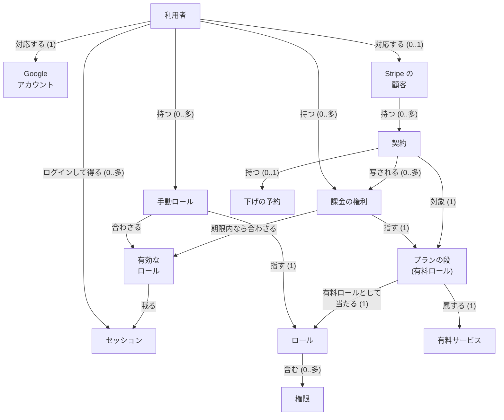

# ドメインモデル

利用者が Google アカウントでログインし、手動ロールと課金の権利から決まる有効なロールを、各サービスへ届けるまでに扱う概念。

## 概念

| 概念 | 意味 |
|---|---|
| 利用者 | プラットフォームを使う 1 人。Google アカウントで 1 人に 1 つ作られる |
| Google アカウント | ログインに使う、利用者の Google 側のアカウント |
| セッション | ログイン中の利用者の状態。有効なロールを載せ、全サービスで共有する ([セッションのロール](../specs/term/session-roles.md)) |
| ロール | 利用者に付く役割。権限の集まり ([ロールと権限](../../../platform/specs/lib/common/roles-and-permissions.md)) |
| 権限 | 操作の許可。各サービスはこれで判定する |
| 手動ロール | 管理者が管理画面から付けるロール。期限を持たない |
| 課金の権利 | 課金によって付く有料ロール。手動ロールとは別に持ち、出どころ (Stripe / 手動) と有効期限を持つ ([課金の権利](../specs/term/role-grant.md)) |
| 有料サービス | 有料の段を持つサービス。契約はサービスごとに持つ |
| プランの段 | 有料サービスの中の選択肢。1 つの段が 1 つの有料ロールに当たる ([プランの段](../specs/term/plan-tier.md)) |
| Stripe の顧客 | 決済代行の Stripe 側で、利用者に対応する顧客 |
| 契約 | Stripe の顧客がサービスの段に対して持つ定期課金 |
| 下げの予約 | 請求期間の終わりに、下の段へ切り替えるための予約 |
| 有効なロール | 手動ロールと、期限内で取り消されていない課金の権利のロールを合わせたもの |

## 関係

- 1 人の利用者は、手動ロールを 0 以上、課金の権利を 0 以上持つ。Stripe の顧客とは 0 または 1 つだけ対応する
- 課金の権利の出どころは、Stripe の契約か、管理者の手動の付与のどちらか。Stripe 由来の権利は、契約を写して作られ、管理者は個別に変えられない。管理者の操作で取り消されるのは、Stripe の顧客との対応を外したときに、まとめて取り消される場合だけ ([課金の権利の管理](functional/role-grants.md))
- 手動ロールには、有料ロールを入れられない。有料ロールは、期限つきの課金の権利としてだけ付く
- 有効なロールは、手動ロールと、期限内で取り消されていない課金の権利のロールを合わせたもの。セッションには、有効なロールが載る
- 1 つのサービスについて、有効な契約は通常 1 つだけ持つ。段の切り替えは、同じ契約の中で行う
