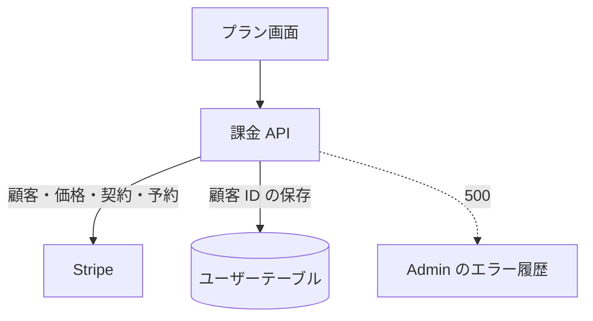

---
sources:
  - services/auth/web/src/app/api/billing/checkout/route.ts
  - services/auth/web/src/app/api/billing/plan-change/route.ts
  - services/auth/web/src/app/api/billing/portal/route.ts
  - services/auth/web/src/app/api/billing/scheduled-change/cancel/route.ts
  - services/auth/web/src/lib/billing-urls.ts
  - services/auth/web/src/lib/callback-url.ts
  - services/auth/web/src/lib/signout.ts
  - services/auth/web/src/lib/api-error-reporting.ts
  - services/auth/core/src/billing/checkout.ts
  - services/auth/core/src/billing/checkout-policy.ts
  - services/auth/core/src/billing/stripe-client.ts
  - services/auth/core/src/billing/sync.ts
  - libs/common/src/auth/roles.ts
sources_hash: 8dd9547af50a094ff362dfbc04b55dc62c9c79e5bb3deee2665a90d56cff205b
---

# 課金 API

プラン画面が使う、申し込み・段の切り替え・契約の管理・下げの予約の取り消し。Stripe の画面の URL を返すか、Stripe に予約を作る。

## エンドポイント

すべて POST で、ログインが要る。権限 ([ロールの権限](../../../../platform/specs/lib/common/roles-and-permissions.md)) は、申し込みの `billing:test` を除いて見ない。

| パス | 内容 |
|---|---|
| `/api/billing/checkout` | 申し込みの決済画面 (Stripe Checkout) の URL を返す |
| `/api/billing/plan-change` | 上げは確認画面 (Customer Portal) の URL を返し、下げは請求期間の終わりに切り替わる予約を作る |
| `/api/billing/portal` | 契約の管理画面 (Customer Portal) の URL を返す |
| `/api/billing/scheduled-change/cancel` | 下げの予約を取り消す |

## 入力と出力

| パス | 本文 | 出力 |
|---|---|---|
| checkout | `roleId` (有料ロール)、`callbackUrl` (任意) | `{ url }` |
| plan-change | `roleId` (有料ロール)、`callbackUrl` (任意) | 上げ: `{ url }`。下げ: `{ scheduled: true, startsAt }` (`startsAt` は切り替わる Unix ミリ秒) |
| portal | `callbackUrl` (任意。本文なしでもよい) | `{ url }` |
| scheduled-change/cancel | `serviceId` (有料のサービス) | `{ ok: true }` |

- `callbackUrl` は[戻り先](../term/callback-url.md)として検証し、許可されない値は無いものとして扱う。文字列以外ならエラー
- 申し込み: Stripe の顧客がなければ作ってユーザーに保存する。同じサービスの有効な契約が Stripe にあれば、段が違っても断る。価格は有料ロール ID をキーに Stripe から引く。決済のあとの戻り先は `/plans?checkout=success` (`callbackUrl` があれば引き継ぐ)、中止の戻り先は `/plans`
- 段の切り替え: 契約は Stripe から取り直して判定する。上げは、行き先の価格へ切り替える確認画面へ送り、確認のあとは申し込みと同じ `/plans?checkout=success` へ戻る。下げは、今の期間の終わりに下の段へ切り替わる予約を作り、返金や日割りのクレジットは出さない。予約の作成に失敗したら予約を元に戻す
- 契約の管理: 戻り先は `/plans` (`callbackUrl` があれば引き継ぐ)
- 取り消し: 本人の契約に付いた予約だけを Stripe から引いて外す。契約は今の段のまま残る
- 戻り先の基準 (自サービスの origin) は、環境変数 `AUTH_URL` (なければ `NEXTAUTH_URL`)、なければリクエストのヘッダーから決める

## エラー

形は[認証 API のエラー応答](../term/api-error.md)。

| 条件 | 状態 | `error` | 対象 |
|---|---|---|---|
| 未ログイン | 401 | 認証が必要です | 全部 |
| 本番以外で `billing:test` がない | 403 | この環境では、テスト用のロールを持つ人だけが申し込めます | checkout |
| 課金が無効 (鍵が空か仮の値) | 503 | 課金は有効になっていません | 全部 |
| `roleId` が有料ロールでない、または本文が JSON のオブジェクトでない | 400 | 申し込めないプランです / 切り替えられないプランです | checkout / plan-change |
| `callbackUrl` が文字列でない | 400 | リクエストの内容が正しくありません | checkout、plan-change、portal |
| `serviceId` が有料のサービスでない、または本文が JSON のオブジェクトでない | 400 | 取り消せない対象です | scheduled-change/cancel |
| ユーザーが DB にいない | 404 | ユーザーが見つかりません | 全部 |
| 契約の管理で Stripe の顧客がない | 404 | 契約の情報がありません | portal |
| 同じサービスに有効な契約がある | 409 | このサービスは既に契約中です。段の変更はプランの画面から行えます | checkout |
| そのサービスの契約がない | 409 | このサービスは契約していません | plan-change |
| 今の段と同じ | 409 | 既にこのプランを契約中です | plan-change |
| 解約を予約中 | 409 | 解約を予約中のため切り替えられません。解約の取り消しは「契約を管理」から行えます | plan-change |
| 支払いを確認できていない (`past_due`) | 409 | 支払いを確認できていないため段を変えられません。「契約を管理」から支払い方法を更新してください | plan-change |
| 下げの予約が付いている | 409 | 変更を予約中のため切り替えられません。先に予約を取り消してください | plan-change |
| 取り消せる予約がない | 409 | 取り消せる予約がありません | scheduled-change/cancel |
| Stripe に行き先の価格がない | 503 | プランの価格を取得できませんでした | checkout、plan-change |
| 想定外の失敗 | 500 | 申し込みの準備に失敗しました など、経路ごとの固定の文 | 全部 |

- portal は、本文が JSON のオブジェクトでないときも、本文なしとして扱い、エラーにしない
- 申し込みの `billing:test` の確認は、Stripe に顧客や決済画面を作る前に行う。plan-change、portal、cancel にはこの制限がない

## つながり

## 理由

- 上げは Customer Portal の確認画面で確定し、行き先の価格は Auth が決める。即時の請求で起きる支払いの失敗や 3D セキュアを、自作せずに Stripe に扱わせるため。行き先を Auth が決めるのは、Portal の一般のプラン変更に任せると、別のサービスが売り始めたとき、そのサービスの商品へも切り替えられてしまうため
- 下げは Auth が請求期間の終わりに切り替わる予約を作り、日割りのクレジットも返金も出さない。Customer Portal の下げは、別の商品の間ではすぐに効いて日割りのクレジットが出るので、期末から・返金なしという案内と食い違うため。予約にはメタデータ `createdBy` の印を書くが、取り消しは本人の契約に付いた予約を印で絞らずに外す
- 予約が付いている間は、Customer Portal で変更も解約もできない (Stripe の仕様)。そのため取り消しを Auth の API に持つ。取り消しても契約は今の段のまま残る
- 解約を予約中・予約中の下げ・`past_due` では、段の切り替えを断る。`past_due` で上げると、未払いの請求に差額の請求が重なり、未払いのまま上の段が付きうるため。権利は、請求のやり直しの間も残る
- 同じサービスで有効な契約は 1 つ。段が違う申し込みも断り、段の切り替えへ案内する
- 本番以外では、申し込みを `billing:test` を持つ人に限る。dev は Stripe のサンドボックスにつながり、誰でもログインできるので、テスト用カードで無料のまま有料の段が付くのを防ぐため。`billing:test` は管理者の権限と分けたロール (`billing-tester`) に持たせ、テスト用の別アカウントへ管理者権限を渡さずに付けられるようにする
    - 制限を外すのは、環境の値 (`NAGIYU_ENV`) が `prod` と明示されたときだけ。値が無い・想定外なら制限をかける側に倒す (fail-closed)。本番の誤設定なら誰も買えずすぐ気づくが、dev の誤設定で無料の段が付いても気づけないため。Cookie のドメイン判定は未設定を本番扱いにしていて向きが逆だが、あちらは本番で dev のドメインになる事故を避けるためのもので、守るものが違う
    - 判定は 1 か所の関数 (`services/auth/core/src/billing/checkout-policy.ts`) に置く。API と画面が別々に判定すると、見えるのに押すと断られる、または見えないのに API は通る状態になるため
    - 絞るのは新規の申し込みだけ。契約の管理・段の変更・予約の取り消し・同期は絞らない。制限前に申し込んだ人の解約や段の変更を妨げる理由がないため

## 手順

下げの予約が残っているときの対処は、[Stripe の運用](../resource/stripe.md)にある。
