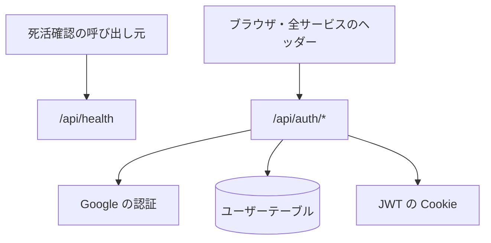

---
sources:
  - services/auth/web/src/app/api/health/route.ts
  - services/auth/web/src/app/api/auth/[...nextauth]/route.ts
  - services/auth/web/src/lib/auth/auth.ts
  - services/auth/web/src/lib/auth/session.ts
  - services/auth/web/src/middleware.ts
sources_hash: df8fef40b279c214adf9aea7439129191dd8ba41d6a0a2352f0367ceaa2fbe1b
---

# システム系の API

死活確認と、認証ライブラリ (next-auth) の受け口。サインイン・サインアウト・セッションの取得はここを通る。

## エンドポイント

| メソッド | パス | 権限 |
|---|---|---|
| GET | `/api/health` | なし |
| GET、POST | `/api/auth/*` | なし (ログインの状態を扱う) |

`/api/auth/*` のうち使われるもの

| パス | 内容 |
|---|---|
| `/api/auth/signin`、`/api/auth/signin/google` | サインインの開始。Google の認証へ送る |
| `/api/auth/callback/google` | Google からの戻りを受ける。ユーザーを保存して JWT の Cookie を発行する |
| `/api/auth/session` | ログインの状態 (ユーザー ID、メール、名前、画像、ロール) を返す。全画面のヘッダーが使う |
| `/api/auth/csrf` | CSRF トークンを返す (サインアウト確認画面が使う) |
| `/api/auth/signout` | GET は確認画面へ移す。POST (CSRF トークン付き) でサインアウトする |

## 入力と出力

- 死活確認は[ヘルスチェックのルート](../../../../platform/specs/lib/nextjs/health-route.md)で、`service` は `auth`。`version` は環境変数 `APP_VERSION`、なければ `1.0.0`
- 認証の画面は `/signin`、`/auth/error`、`/auth/signout` に差し替えてある ([サインイン画面](../screen/signin.md)など)
- Google の認証には、ログインのたびに `prompt=consent`、`access_type=offline` を付ける
- セッションは JWT 方式で、Auth.js の既定のまま暗号化して Cookie に入れる (署名だけの JWT ではない)。有効期間 30 日と、Cookie の名前・ドメイン・属性は[NextAuth の設定](../../../../platform/specs/lib/nextjs/auth-config.md)にある。全サービスがこの Cookie を読んで SSO する ([サインインの経路](../flow/sign-in.md))
- JWT に入れるのは、ユーザー ID、Google のアカウント ID、メール、名前、画像、ロール、ロールを最後に読んだ時刻。ロールの扱いは[セッションのロール](../term/session-roles.md)
- 環境変数 `SKIP_AUTH_CHECK` が `true` のときのテストセッションは[セッション取得とテストセッション](../../../../platform/specs/lib/nextjs/session.md)にある。Auth ではミドルウェアも未ログインを通す。`/api/auth/session` は、`createClientSessionGetHandler` で包んでいないので、この設定でも本物の認証ライブラリの応答を返す (テスト用のセッションにならない)

## エラー

- 死活確認はエラーを決めていない
- 認証の失敗は、[認証エラー画面](../screen/auth-error.md)へ移す
- ミドルウェア ([認証ミドルウェア](../../../../platform/specs/lib/nextjs/auth-middleware.md)) は `/api`、`_next`、`favicon.ico`、`/auth` 配下を対象にしない。`/signin`、`/plans`、`/legal` 配下は通し、それ以外の画面は未ログインだと `/signin?callbackUrl=<パスと検索語>` へ移す

## つながり

