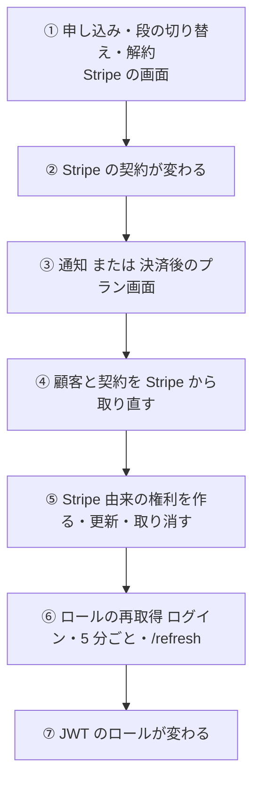
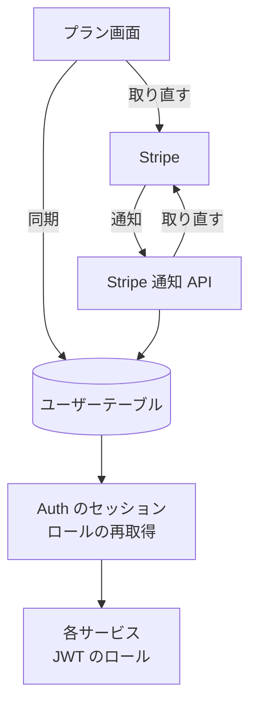

---
sources:
  - services/auth/web/src/app/plans/page.tsx
  - services/auth/web/src/app/api/billing/webhook/route.ts
  - services/auth/web/src/app/refresh/page.tsx
  - services/auth/web/src/lib/plans-data.ts
  - services/auth/web/src/lib/billing-urls.ts
  - services/auth/web/src/lib/auth/auth.ts
  - services/auth/core/src/billing/sync.ts
  - services/auth/core/src/billing/grant-diff.ts
  - services/auth/core/src/billing/checkout.ts
  - services/auth/core/src/repositories/user-repository.ts
  - libs/common/src/auth/role-grants.ts
sources_hash: b51d3f67983b8f4001298f174c9faba6fbf148a0d872d44b2b62d47b2f447245
---

# 契約がロールになる経路

Stripe での申し込み・更新・解約が、[課金の権利](../term/role-grant.md)を通って、各サービスが読むロールになるまでの流れ。

## 起点

| きっかけ | 同期のしかた |
|---|---|
| 決済を終えてプラン画面へ戻る (`checkout=success`) | プラン画面がその場で同期し、`/refresh` へ送る |
| Stripe の通知 (契約の作成・更新・解約など) | [Stripe 通知 API](../api/billing-webhook.md)が同期する |
| ログイン中の利用者がプラン画面を開く | Stripe の顧客があれば、取り直して同期する (通知の取りこぼしの保険) |

## 経路

| 段階 | 内容 |
|---|---|
| ④ 取り直し | 通知の中身は合図としてだけ使い、毎回 Stripe から取り直す。顧客のメタデータの `userId` が指すユーザーが、同じ顧客 ID を持っていなければ何もしない (顧客が削除済み、ユーザーがいない場合も同じ) |
| ④ 対象の契約 | 状態が `active`、`trialing`、`past_due` の契約の品目のうち、価格の `lookup_key` が有料ロール ID のもの。ほかの `lookup_key` は無視して警告を出す |
| ⑤ 権利の期限 | 契約の今の請求期間の終わり + 3 日 |
| ⑤ 権利の作り方 | 有料ロールごとに、期限が最も遅い契約 (同じなら契約 ID の小さい方) の 1 件にそろえる。今ある有効な Stripe 由来の権利は、契約が残っていれば期限と契約 ID を更新し、なければ取り消す。契約はあるが権利がなければ作る。手動の権利には触れない |
| ⑤ 書き込み | 読んだときの更新日時を条件にして書く。競合したらユーザーも Stripe も読み直してやり直す (最大 3 回)。変化がなければ書かない |
| ⑥ 再取得 | ログイン時、前回から 5 分を過ぎたとき、`/refresh` の更新のときに、Auth がセッションを読む際に DB から読み直す。[セッションのロール](../term/session-roles.md)を参照 |

- 申し込み前に、Stripe の顧客がなければ作ってユーザーに保存する。顧客のメタデータにユーザー ID を持たせる ([課金 API](../api/billing.md))
- 決済直後は、通知より先に戻ることがあるので、プラン画面が同期してから `/refresh` へ送る。戻り先は `callbackUrl` か、プラン画面
- 手動の権利は管理画面から付ける ([ユーザー編集画面](../screen/user-edit.md))。ロールの算出では Stripe 由来と同じに扱う

## 届く先

- ユーザーテーブルの課金の権利 (属性 `RoleGrants`。[ユーザーテーブル](../data/users.md))
- 利用者の JWT のロール。各サービスは有料ロールの権限を確かめるだけで出し分ける

## 失敗・取りこぼしのとき

- 同期が失敗したら、通知 API は 500 を返して Stripe に再送させ、Admin のエラー履歴へ報告する。プラン画面の同期は失敗しても画面を壊さない
- 解約や期限切れの反映は遅れうる。権利の期限は ⑤ のとおり期間の終わり + 3 日で、ロールの外れは次の再取得のときになる。Auth の外のサービスは JWT を読むだけで、DB を読み直さない
- 更新の通知を取りこぼしても、3 日の猶予の間にプラン画面の同期か次の通知で追いつく

## つながり

## 理由

- 課金をロールの入口の一つとして扱う。Consumer (Auth 以外のサービス) は課金を知らず、有料ロールの権限を確かめるだけで機能を出し分ける。Stripe とやり取りするのは Auth だけになり、サービスごとに Stripe の状態の解釈がばらつかない。ロールの伝わり方の制約 (剥奪が遅れて反映される) は、課金もそのまま受ける ([セッションのロール](../term/session-roles.md))
- Stripe の通知は合図としてだけ使い、毎回 Stripe から取り直して権利を上書きする。通知は配信の順序が保証されず、重複して届くことがあり、処理に失敗すると最大 3 日間再送される。中身を届いた順に適用すると、順序の入れ替わりや重複で Stripe の状態と食い違う。取り直せば、重複・順序の入れ替わり・取りこぼし後の再送のどれでも最終的に Stripe と一致し、通知の ID を記録して重複を除く仕組みが要らない。代わりに、通知のたびに Stripe への問い合わせが発生する。受け口は署名を検証してから処理する
- どの有料ロールが付くかは、契約の品目の価格の `lookup_key` で決める。`lookup_key` を有料ロール ID にそろえる理由と、商品の機能 (Entitlements) を使わない理由は[プランの段](../term/plan-tier.md)にある
- 通知の受け口を Auth に置く。利用者と課金の権利を持つのが Auth で、通知を受けて権利を書き換えるのも Auth の責務だから
- 決済直後は、プラン画面が同期してから `/refresh` へ送る。直接 `/refresh` に戻すと、Stripe の通知より先に着いたとき、まだ権利がなくロールが切り替わらない
- 通知の顧客 ID からユーザーを引く索引は持たず、顧客のメタデータの `userId` で引いて照合する。索引を持たない理由は[ユーザーテーブル](../data/users.md)の理由にある
- 権利は、Stripe を読む前に読んだユーザーの更新日時を条件にして書く (楽観ロック。最大 `ROLES_AND_GRANTS_MAX_ATTEMPTS` 回)。競合したら、ユーザーと Stripe の両方を読み直してやり直す。Stripe を読んでいる間に別の通知が新しい状態を書いたとき、古い読み取りで上書きしないため
- Stripe 由来の権利の期限を、請求期間の終わり + 3 日 (`GRACE_PERIOD_MS`、`services/auth/core/src/billing/sync.ts`) にする。期限がないと、解約の通知を取りこぼしたとき有料ロールが無期限に残り、「最終的に Stripe と一致する」を満たせない。猶予の 3 日は Stripe の通知の再送期間に合わせた。更新の通知を取りこぼすと払っている利用者の権利が期限で切れうるので、ログイン中の利用者がプラン画面を開いたときにも取り直して同期する
