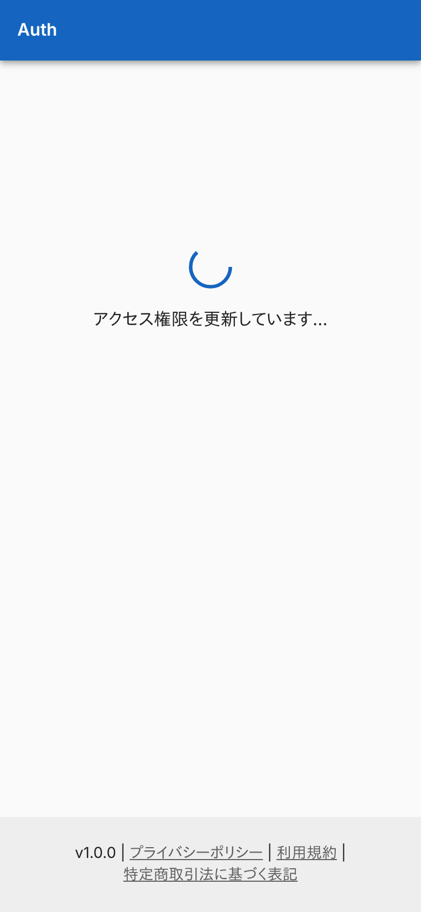
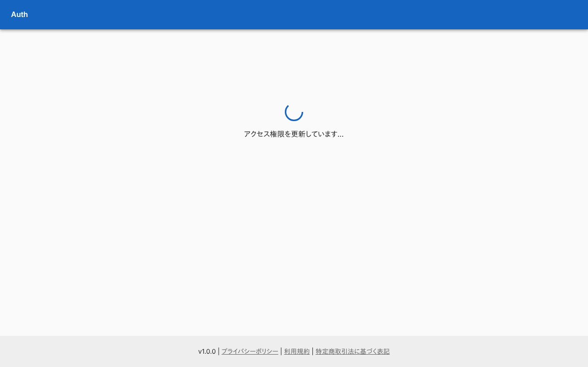
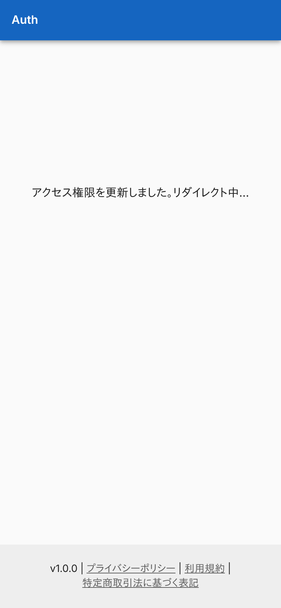
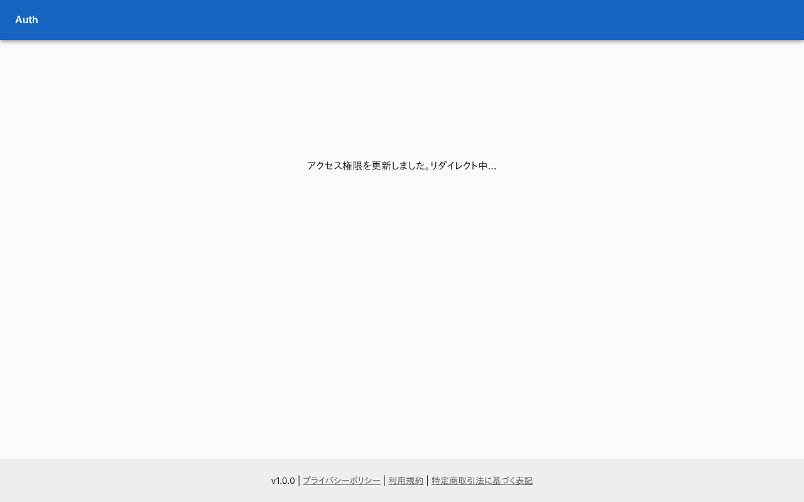
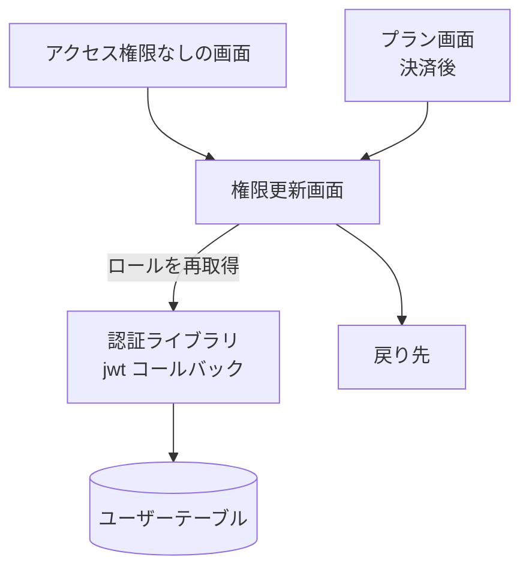

---
sources:
  - services/auth/web/src/app/refresh/page.tsx
  - services/auth/web/src/lib/refresh-callback.ts
  - services/auth/web/src/lib/navigate.ts
  - services/auth/web/src/lib/auth/auth.ts
sources_hash: 4ee3e91dcba4dcb67edd4b6b251ee9f63194303cb2651796a196f2869edb1536
---

# 権限更新画面

セッションのロールを DB から読み直し、元の画面へ戻す中継画面。管理者がロールを付けたあと、利用者が最新のロールを受け取るために使う。

## 入口

- パスは `/refresh?callbackUrl=<戻る先>`。次のところから来る
    - 各画面の「アクセス権限がありません」([共通の権限なしの画面](../../../../platform/specs/lib/ui/feedback-views.md)) の「アクセスを更新」
    - 決済を終えたあとのプラン画面 ([課金の経路](../flow/billing-entitlement.md))
- ログインが要る (ミドルウェアが未ログインをサインインへ送る)

## 表示するもの

| 状態 | 文 |
|---|---|
| 更新中 | 読み込みの印と「アクセス権限を更新しています…」 |
| 更新できた | 「アクセス権限を更新しました。リダイレクト中…」 |
| 更新に失敗した | 「更新中にエラーが発生しましたが、リダイレクト先へ移動します…」 |

## 操作

| 操作 | 結果 |
|---|---|
| 画面を開く | セッションの読み込みが終わってから、ロールの更新を 1 回呼び、終わったら戻り先へ移る。操作する部品はない |

- セッションの読み込みが終わってから、1 回だけ更新を呼ぶ。更新はロールの強制再取得を起こす ([セッションのロール](../term/session-roles.md))
- 更新が終わったら、成功でも失敗でも[戻り先](../term/callback-url.md)へ移る。`callbackUrl` が同一オリジンか nagiyu.com 配下の絶対 URL、または Auth 内の相対パス (絶対 URL にして使う) でなければ、Auth のトップ (`/`。そこからダッシュボード) へ移る
- 更新の通信が失敗しても、認証ライブラリがその失敗を握るので、画面は「更新できた」になる (「失敗した」の文は、更新の呼び出しが例外を投げたときだけ出る)

## 画面の見た目

### 更新中

更新の応答を待っている。

| スマホ | PC |
|---|---|
|  |  |

### 更新できたとき

移動の直前の表示。

| スマホ | PC |
|---|---|
|  |  |

## つながり

## 理由

- 認証ライブラリ (next-auth v5) の `update()` は、引数なしで呼ぶと GET になり、ロールを再取得させる `trigger: 'update'` が発火しない。引数つきで呼んで POST にする。引数の中身はサーバー側で読まない
- `SessionProvider` の読み込み中 (`status === 'loading'`) に `update()` を呼ぶと、内部で即 return して何も起きない。そのため読み込みが終わってから呼ぶ。どちらかを欠くと再取得が効かず、ロールの TTL が切れるまで反映されない
- 読み込み状態の変化で処理が複数回走っても更新は 1 回にするため、実行済みの印を持つ
