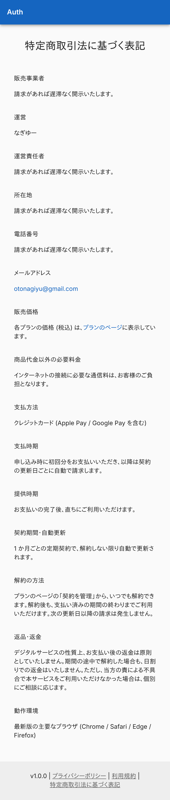
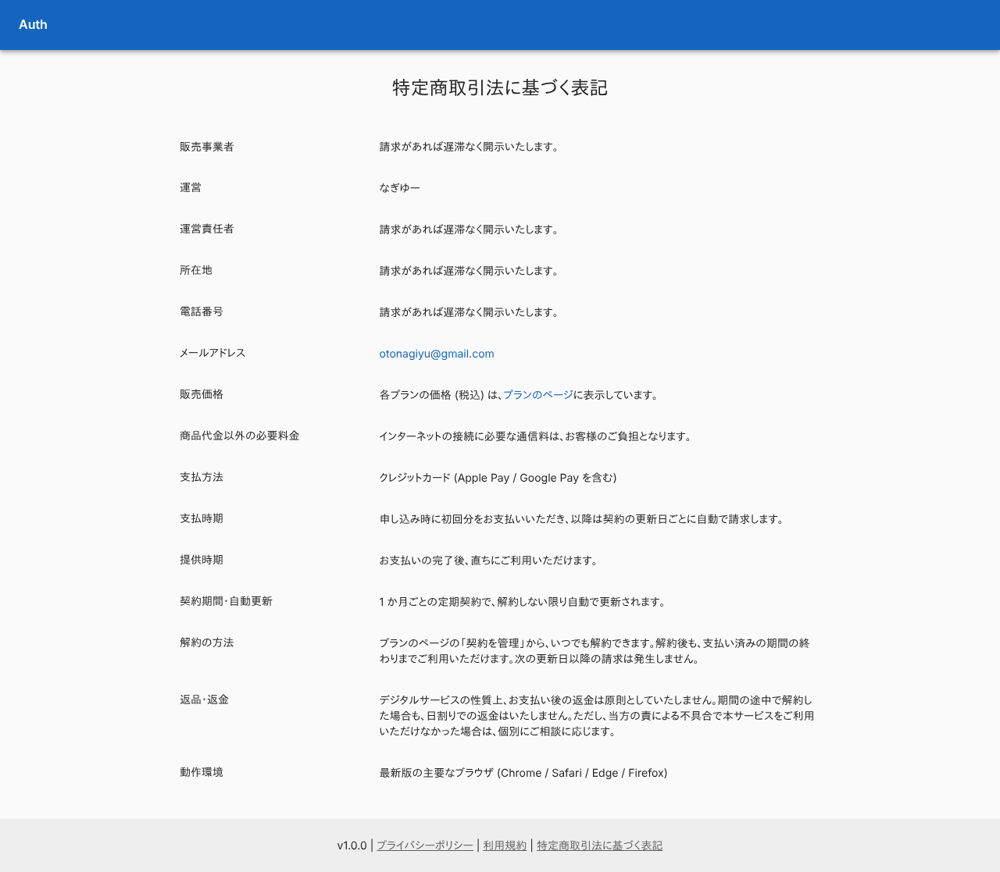
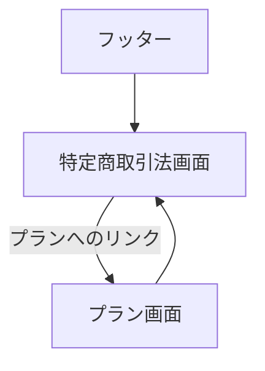

---
sources:
  - services/auth/web/src/app/legal/tokushoho/page.tsx
  - services/auth/web/src/app/layout.tsx
sources_hash: 7da474c113b6a02d723831e560e951390b23be3cd4477a0f250e8ac17a82ca23
---

# 特定商取引法画面

有料プランの販売に必要な「特定商取引法に基づく表記」を載せた公開ページ。

## 入口

- パスは `/legal/tokushoho`。ログインなしで開ける (ミドルウェアが `/legal` 配下を通す)
- 全画面のフッターの「特定商取引法に基づく表記」と、[プラン画面](./plans.md)のリンクから来る

## 表示するもの

- 見出し「特定商取引法に基づく表記」と、項目名と内容の表。表は共通の部品で描く。項目の文面と部品の振る舞いは[法務の文書](../../../../platform/specs/lib/ui/legal.md)にあり、この画面は部品を置いて `plansHref` に `/plans` を渡すだけ
- 表の中のプランへのリンクは `/plans` を指す

## 操作

| 操作 | 結果 |
|---|---|
| プランへのリンク | [プラン画面](./plans.md)を開く |

## 画面の見た目

### 通常表示

項目名と内容の表。

| スマホ | PC |
|---|---|
|  |  |

## つながり

## 理由

- 公開ページを置くのは、定期課金では申し込みの最終確認の段階で、金額・更新の周期・解約の方法が分かる必要があるため (2022 年の特定商取引法の改正)。金額と周期は Stripe の決済画面が出し、解約の方法は[プラン画面](./plans.md)とこの表記で補う
- 表記は金額を持たず、プラン画面 (税込) へ案内する。価格は Stripe の 1 か所で管理しており、表記にも書くと食い違うため
- 課金を受けるサービスに置き、portal には置かない。portal は技術記事のブログで、サービスの料金や販売の情報を置くと宣伝サイトになってしまうため。申し込みの入口があるのは Auth なので、Auth に置く
- Stripe の本番審査では、この表記のページの URL を登録する
