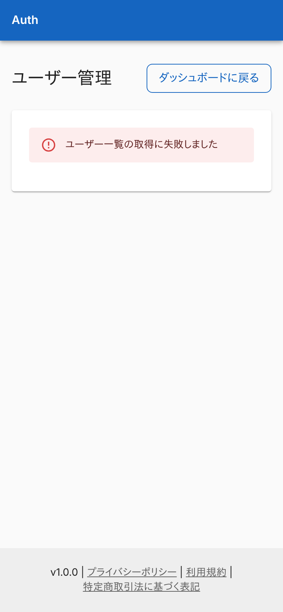
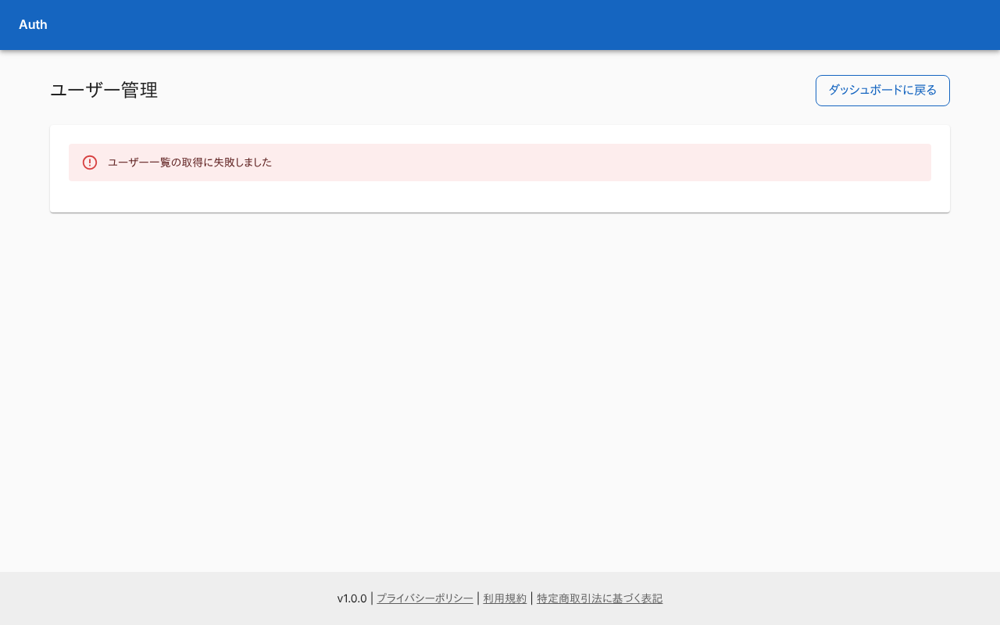
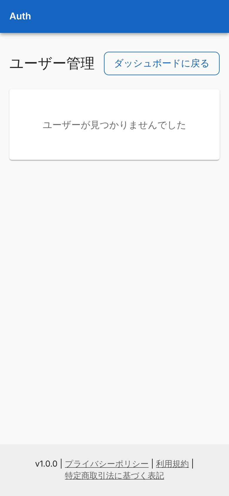
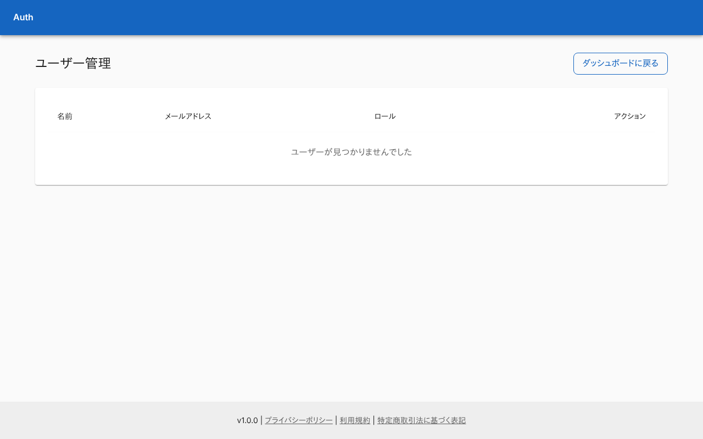
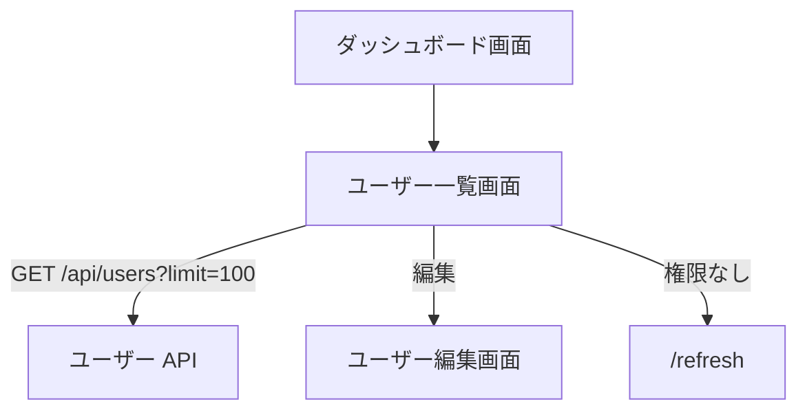

---
sources:
  - services/auth/web/src/app/dashboard/users/page.tsx
  - services/auth/web/src/app/dashboard/users/users-table.tsx
  - libs/common/src/auth/roles.ts
  - libs/common/src/auth/permissions.ts
  - libs/ui/src/components/feedback/AccessDeniedView.tsx
sources_hash: ec55f2eb8f7b8f1739b6b02a0e66dfa5769cc0b56d3686ab1edc30c531c1b298
---

# ユーザー一覧画面

登録されているユーザーを表で一覧し、ロールの編集へ進む管理画面。

## 入口

- パスは `/dashboard/users`。[ダッシュボード](./dashboard.md)の「ユーザー管理」と、[ユーザー編集画面](./user-edit.md)の「ユーザー一覧へ戻る」から来る
- セッションがなければ[サインイン画面](./signin.md)へリダイレクトする

## 表示の条件

- `users:read` を持つ利用者だけ。権限がなければ URL を変えずに「アクセス権限がありません」(共通の [`AccessDeniedView`](../../../../platform/specs/lib/ui/feedback-views.md)) を出す ([ロールと権限](../../../../platform/specs/lib/common/roles-and-permissions.md))。画面には「アクセスを更新」([権限更新画面](./refresh.md)へ) と「再ログイン」(サインアウトへ) のボタンが付く

## 表示するもの

| 列 | 内容 |
|---|---|
| 名前 | ユーザー名 |
| メールアドレス | 長いアドレスは折り返す |
| ロール | 手動ロールだけを名前の札で出す (課金の権利のロールは出ない)。手動ロールがなければ「なし」。定義にないロール ID は ID のまま出す |
| アクション | 「編集」。`roles:assign` を持つ利用者にだけ出す |

- 一覧は[ユーザー API](../api/users.md)から 1 回で最大 100 件まで読む。次のページを読む操作はなく、100 件を超えた分は出ない。並び順は DB の読み出し順で、画面では並べ替えない
- 画面の右上に「ダッシュボードに戻る」がある
- 幅が 600px 未満 (スマホ) では表の代わりにカードで出す。ユーザー 1 人に 1 枚で、名前・メールアドレス・ロール (項目名つき)・「編集」を載せる。「編集」は表と同じく `roles:assign` を持つ利用者にだけ出す。長いメールアドレスはカードの中で折り返す
- 600px 以上 (PC) は上の表のまま。どちらを出すかは CSS の幅の指定で切り替える

## 状態

- 読み込み中は表の位置にインラインの表示を出す
- 0 件のときは一覧の位置に「ユーザーが見つかりませんでした」(PC では空の表の下、スマホではカードがないのでこの文だけ)
- 取得に失敗したときはエラーの帯を出す。文は応答の `error` ではなく、「ユーザー一覧の取得に失敗しました」(応答の形が不正なときは「不正なレスポンス形式です」)

## 操作

| 操作 | 結果 |
|---|---|
| 編集 | [ユーザー編集画面](./user-edit.md)を開く |
| ダッシュボードに戻る | [ダッシュボード](./dashboard.md)を開く |

## 画面の見た目

### 通常表示 (`admin`)

「編集」が出る。スマホはカード、PC は表で写している。

| スマホ | PC |
|---|---|
|  |  |

### `roles:assign` がないとき (`user-manager`)

「編集」が出ない。

| スマホ | PC |
|---|---|
|  |  |

### 取得に失敗したとき

一覧の取得に失敗した旨を出す。

| スマホ | PC |
|---|---|
|  |  |

### ユーザーがいないとき

0 件の表示。

| スマホ | PC |
|---|---|
|  |  |

### 権限がないとき (`stock-viewer`)

一覧を読まずに権限なしを出す。

| スマホ | PC |
|---|---|
|  |  |

## つながり

## 理由

- スマホでは表をカードに替える。表のままだと横スクロールしないとロールと「編集」が見えないため、横スクロールせずにロールと編集まで見えるようにする
- 表とカードの切り替えは、幅の判定を JS で行わず CSS で行う。初回の描画でちらつかせないため。両方を描画し、片方を隠す
- ロールは ID ではなく名前で出す。ID は管理者が読んでも意味を取りにくいため。定義にない ID は、表示が消えないよう ID のまま出す
