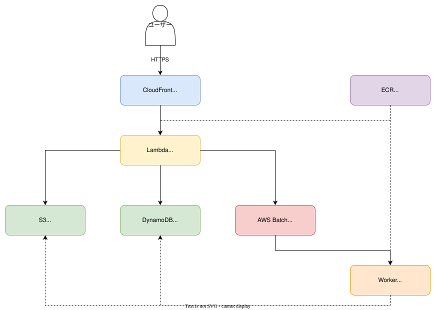

# アーキテクチャ設計

この文書は、構成と設計判断の理由 (なぜ) を書く。今どう動くかは[仕様カード](../../specs/README.md)にあり、各節からリンクする。

## システム概要

Codec Converterは、サーバーレスアーキテクチャを採用した動画変換サービスです。
フロントエンドはNext.jsをLambdaで実行し、変換処理はAWS Batchで行います。

### 主要コンポーネント

| コンポーネント | 役割                               | 技術                                       |
| -------------- | ---------------------------------- | ------------------------------------------ |
| **CloudFront** | CDN、SSL/TLS終端、カスタムドメイン | AWS CloudFront                             |
| **Lambda**     | Next.js SSR、API                   | AWS Lambda (コンテナ) + Lambda Web Adapter |
| **S3**         | 動画ファイルストレージ             | Amazon S3                                  |
| **DynamoDB**   | ジョブ管理                         | Amazon DynamoDB                            |
| **Batch**      | 動画変換処理                       | AWS Batch (Fargate) + FFmpeg               |
| **ECR**        | コンテナイメージレジストリ         | Amazon ECR                                 |

### 共有パッケージ: `@nagiyu/codec-converter-core`

Next.js Lambda (`web`) と Batch Worker (`batch`) で共通して使う TypeScript パッケージ。型定義・定数・入力の検証・ジョブ定義の選択ロジックなど、両者の解釈がずれると壊れるものを 1 か所に置くために分けている。

**配置場所**: `services/codec-converter/core/`

**注**: このパッケージは `services/` 配下に配置されており、Codec Converter サービス専用である。プラットフォーム全体で共有するライブラリは `libs/` 配下に配置する。

### プラットフォーム共有ライブラリ

codec-converter-web は、プラットフォーム全体で共有される以下のライブラリを使用します：

#### `@nagiyu/common`

**役割**: フレームワーク非依存の共通ユーティリティライブラリ

**使用方法**: 
- `@nagiyu/ui` → `@nagiyu/browser` → `@nagiyu/common` という依存関係により、間接的に使用
- 将来的には、構造化ログ（`logger`）、API 型定義（`api`）、バリデーション（`validation`）などを直接使用することも検討

**提供機能**:
- 構造化ログ機能（`logger`）
- 共通バリデーション（`validation`）
- API 型定義（`api`）
- 認証・認可ユーティリティ（`auth`）

#### `@nagiyu/browser`

**役割**: ブラウザ API 依存の共通ユーティリティライブラリ

**使用方法**: 
- `@nagiyu/ui` を通じて間接的に使用
- ブラウザ API（Clipboard、localStorage など）へのアクセスが必要な場合に使用

**依存関係**: `@nagiyu/common`

#### `@nagiyu/ui`

**役割**: Next.js + Material-UI ベースの共通 UI コンポーネントライブラリ

**使用方法**: 
- Header、Footer、Theme などの共通 UI コンポーネントを提供
- codec-converter-web で直接インポートして使用

**使用例**:
```typescript
import { theme, Header, Footer } from '@nagiyu/ui';
```

**依存関係**: `@nagiyu/browser`、Next.js、Material-UI

---

## システム構成図



---

## データフロー

動画の転送は、Lambda を通さず、ブラウザと S3 の間で署名付き URL を使って直接行う。アップロード・変換・ダウンロードの各段階の手順は[変換の経路](../../specs/codec-converter/flow/conversion.md)、変換バッチの処理は[変換バッチ](../../specs/codec-converter/batch/convert.md)を参照する。署名付き URL を使う理由は、後述の「S3 Presigned URL」にある。

---

## API設計

エンドポイントの入出力・エラーは[ジョブ API](../../specs/codec-converter/api/jobs.md)を参照する。

---

## データモデル

### DynamoDBテーブル: `codec-converter-jobs-{env}`

**主キー**: `jobId` (String)

保存形式はプラットフォームのデータアクセス層の標準に従う。項目の中身と保存形式は[ジョブとステータス](../../specs/codec-converter/term/job.md)を参照する。

- 主キーの `jobId` だけは camelCase のまま据え置く。キー属性の名前は、テーブルを作り直さないと変えられないため。

**TTL設定**: `TTL` 属性 (ジョブ作成から 24 時間後)

### S3バケット: `codec-converter-storage-{env}`

**構造**:

```
codec-converter-storage-{env}/
├── uploads/
│   └── {jobId}/
│       └── input.mp4
└── outputs/
    └── {jobId}/
        └── output.{mp4|webm}
```

**設定**:

- 暗号化: SSE-S3
- Lifecycle Policy: すべてのオブジェクトを24時間後に削除
- バージョニング: 無効
- 公開アクセス: ブロック（Presigned URLのみ）

---

## インフラ構成

### AWS Batch

**Compute Environment**:

- タイプ: Fargate
- 最大vCPU: 16（複数サイズのジョブ定義を同時に動かすため）
- サブネット: パブリックサブネット（プラットフォーム共通VPC: `nagiyu-{env}-vpc`）

**Job Queue**:

- スケジューリング: デフォルト（投入順に処理）
- 優先度: 1

**Job Definition**:

ファイルサイズと出力コーデックに応じてリソースを使い分けるため、vCPU とメモリの異なるジョブ定義を 4 サイズ (`small`、`medium`、`large`、`xlarge`) 用意する。サイズ別の値と選び方は[ジョブ定義のサイズ](../../specs/codec-converter/term/job-definition-size.md)、投入時の扱いは[ジョブ API](../../specs/codec-converter/api/jobs.md)を参照する。

#### 動的リソース配分

軽い処理に大きなリソースを割り当てるとコストが無駄になり、重い処理に小さなリソースを割り当てると処理時間が延びる。そこで、ファイルサイズと出力コーデックから、最適なサイズのジョブ定義を投入時に選ぶ。

- 選べないとき、または選んだ定義での投入が失敗したときは、既定の `medium` で続ける。既存のジョブを失敗させないための後方互換のため
- 値は AWS Fargate の vCPU とメモリの組み合わせの制約 (1 vCPU は 2048〜8192 MB、2 vCPU は 4096〜16384 MB、4 vCPU は 8192〜30720 MB) の範囲に収める。参考: [AWS Batch Fargate ドキュメント](https://docs.aws.amazon.com/batch/latest/userguide/fargate.html)
- Compute Environment の最大 vCPU を 16 にしているのは、小さいサイズなら複数、大きいサイズなら少数を同時に動かせるようにするため

#### Batch Worker 実装詳細

処理の手順・失敗時の扱い・FFmpeg の設定は[変換バッチ](../../specs/codec-converter/batch/convert.md)と[出力コーデック](../../specs/codec-converter/term/output-codec.md)を参照する。

**ベースイメージ**: `node:26-slim`。FFmpeg は apt で入れる。

**リトライ戦略**:

- リトライは AWS Batch に任せ、Worker 内部ではリトライロジックを実装しない。失敗の報告と再試行の責務を分けるため

### Lambda

**設定**:

- ランタイム: コンテナイメージ
- メモリ: 1024 MB
- タイムアウト: 30秒
- 環境変数:
  - `DYNAMODB_TABLE_NAME`: `codec-converter-jobs-{env}`
  - `S3_BUCKET`: `codec-converter-storage-{env}`
  - `BATCH_JOB_QUEUE`: Batch Job Queue名
  - `BATCH_JOB_DEFINITION_PREFIX`: Batch Job Definition名のプレフィックス（動的リソース配分用）
  - `AWS_REGION`: リージョン

**Function URL**:

- 認証: NONE（パブリックアクセス）
- CORS: 有効

### CloudFront

**設定**:

- オリジン: Lambda Function URL
- ビヘイビア:
  - デフォルト: Lambda（キャッシュ無効、すべてのHTTPメソッド許可）
  - `/api/*`: Lambda（キャッシュ無効）
  - `/_next/static/*`: Lambda（キャッシュ有効、1年）
  - `/favicon.ico`: Lambda（キャッシュ有効、1日）
- カスタムドメイン: `codec-converter.{domain}`（ACM証明書使用）
- 圧縮: 有効（Gzip, Brotli）

---

## セキュリティ設計

### データ暗号化

**転送時**:

- すべての通信でHTTPS使用
- CloudFront → Lambda: TLS 1.2以上
- Lambda → S3/DynamoDB: TLS 1.2以上

**保存時**:

- S3: SSE-S3（サーバー側暗号化）
- DynamoDB: デフォルト暗号化（AWS管理キー）

### アクセス制御

**S3バケット**:

- パブリックアクセス: すべてブロック
- アクセス方法: Presigned URLのみ
- CORS設定:
  ```json
  {
    "AllowedOrigins": ["https://codec-converter.{domain}"],
    "AllowedMethods": ["PUT", "GET"],
    "AllowedHeaders": ["*"],
    "MaxAgeSeconds": 3600
  }
  ```

**DynamoDB**:

- アクセス方法: IAMロールのみ
  - Lambda実行ロール: GetItem, PutItem, UpdateItem
  - Batch実行ロール: GetItem, UpdateItem

**IAMロール設計**:

CDK スタック内で責務ごとに分離された構成:

- `lib/policies/app-runtime-policy.ts`: アプリケーション実行権限（Lambda 実行ロールが使用）
- `lib/roles/lambda-execution-role.ts`: Lambda 実行ロール
- `lib/roles/batch-job-role.ts`: Batch Job 実行ロール

**AppRuntimePolicy** (Lambda 実行ロールが使用):

- S3: GetObject, PutObject, DeleteObject, ListBucket（Presigned URL 生成用）
- DynamoDB: GetItem, PutItem, UpdateItem, DeleteItem, Query, Scan
- Batch: SubmitJob, DescribeJobs, TerminateJob

**LambdaExecutionRole**:

- AWSLambdaBasicExecutionRole（CloudWatch Logs への書き込み）
- AppRuntimePolicy（上記の共有ポリシー）

**BatchJobRole** (コンテナランタイム用):

- S3: GetObject, PutObject（実際のファイル操作）
- DynamoDB: GetItem, UpdateItem（ステータス更新）

### セキュリティヘッダー

CloudFront の Response Headers Policy で付けているのは `X-Robots-Tag: noindex, nofollow` だけである。`Strict-Transport-Security` や `Content-Security-Policy` などのセキュリティヘッダーは、設計上の方針としては付ける想定だが、現状は設定していない。

---

## CI/CD パイプライン

### 環境構成

| 環境     | ブランチ                                 | デプロイタイミング     | 用途           |
| -------- | ---------------------------------------- | ---------------------- | -------------- |
| **dev**  | `integration/codec-converter`, `develop` | マージ時に自動デプロイ | 開発・検証環境 |
| **prod** | `master`                                 | マージ時に自動デプロイ | 本番環境       |

**リソース命名規則**:

- S3バケット: `codec-converter-storage-{env}`
- DynamoDBテーブル: `codec-converter-jobs-{env}`
- Lambda関数: `codec-converter-{env}`
- Batchジョブ定義: `nagiyu-codec-converter-{env}-{サイズ}`
- Batchジョブキュー: `nagiyu-codec-converter-{env}`
- CloudFrontドメイン:
  - dev: `codec-converter.dev.{domain}` (例: `codec-converter.dev.example.com`)
  - prod: `codec-converter.{domain}` (例: `codec-converter.example.com`)

### GitHub Actions ワークフロー

#### 1. Verify (`.github/workflows/codec-converter-verify.yml`)

**トリガー**: `integration/**`, `develop` ブランチへのPull Request

1 本で、PR の向き先によって Fast / Full を出し分ける。Fast は integration 向けで E2E は chromium-mobile のみ、Full は develop 向けで E2E は 3 デバイス (chromium-mobile + chromium-desktop + webkit-mobile) に加えてカバレッジチェック (80%以上) を行う。

**目的**: integration では開発中の素早いフィードバック、develop では本番マージ前の完全な品質チェック

#### 2. Deploy (`.github/workflows/codec-converter-deploy.yml`)

**トリガー**: `integration/codec-converter`, `develop`, `master` ブランチへのマージ完了時

**実行内容**:

1. 環境判定
   - `integration/codec-converter` → `dev`
   - `develop` → `dev`
   - `master` → `prod`
2. 共通ライブラリのビルド（依存関係順: common → browser → ui）
3. Lambda コンテナイメージのビルド・プッシュ（ECR）
4. Batch Worker コンテナイメージのビルド・プッシュ（ECR）
5. Lambda関数の更新（イメージ URI 更新）
6. Batchジョブ定義の更新

### テスト戦略

テストデバイス構成・E2E シナリオ・カバレッジ目標は[テスト仕様書](./testing.md)を参照する。

### 共通ライブラリのビルド順序

**依存関係**:

- `@nagiyu/common`: フレームワーク非依存（他に依存なし）
- `@nagiyu/browser`: `@nagiyu/common` に依存
- `@nagiyu/ui`: `@nagiyu/browser` と Next.js + Material-UI に依存
- アプリケーション: `@nagiyu/ui` に依存

**重要な制約**:

- 並列ビルド（`npm run build --workspaces`）は依存関係を考慮しないため使用禁止
- 必ず依存関係順に逐次ビルドすること（common → browser → ui → アプリケーション）

**注**: Codec Converter と Codec Converter Worker の共通処理（AWS SDKラッパーなど）は `services/codec-converter/src/lib/shared/` のようにサービス内に配置し、Dockerfileで両方のコンテナに含める。`libs/` 配下には配置しない。

### 開発環境セットアップ

ローカルから dev 環境の AWS リソースへアクセスする場合は、IAM Identity Center（SSO）の一時認証情報を使う（[AWS アカウント構成とアクセス管理](../../infra/aws-accounts.md)・[インフラのセットアップ](../../infra/setup.md) を参照）。サービス固有の IAM ユーザーは用意していない。

#### AWS SDK の依存注入 (DI)

**方針**:

- S3, DynamoDB, Batch などの AWS SDK クライアントは依存注入パターンを採用
- テスト時にモック実装を注入可能にする
- ビジネスロジックを AWS サービスから切り離してテスト容易性を確保

**実装方針**:

- AWS SDK ラッパー関数（`services/codec-converter/src/lib/shared/aws/`）でクライアントを受け取る設計
- ユニットテスト: モックオブジェクトを注入
- E2Eテスト: 実際の AWS SDK クライアント、または localstack を使用
- 本番: 実際の AWS SDK クライアントを注入

**モック環境**:

- ユニットテスト: Jest のモック機能を使用
- E2Eテスト: AWS SDK の実クライアントを使用（dev 環境のリソースに接続）
- ローカル開発: 必要に応じて localstack を使用（オプション）

#### ログ出力

**方針**:

- 構造化ログ形式（JSON）を採用
- CloudWatch Logs に出力
- ログレベル: INFO 以上（DEBUG はローカル開発時のみ）

**ログフォーマット**:

```json
{
  "level": "INFO",
  "timestamp": "2024-01-01T12:00:00.000Z",
  "service": "codec-converter",
  "jobId": "550e8400-e29b-41d4-a716-446655440000",
  "message": "Job status updated",
  "details": {
    "previousStatus": "PENDING",
    "newStatus": "PROCESSING"
  }
}
```

**ログレベル**:

- **ERROR**: エラー発生時（FFmpeg 失敗、AWS SDK エラーなど）
- **WARN**: 警告（リトライ発生など）
- **INFO**: 重要なイベント（ジョブステータス変更、ファイルアップロード完了など）
- **DEBUG**: デバッグ情報（ローカル開発時のみ）

### 環境変数管理

#### Lambda環境変数

| 環境変数                      | 説明                              | 例                            |
| ----------------------------- | --------------------------------- | ----------------------------- |
| `DYNAMODB_TABLE_NAME`         | DynamoDBテーブル名                | `codec-converter-jobs-dev`    |
| `S3_BUCKET`                   | S3バケット名                      | `codec-converter-storage-dev` |
| `BATCH_JOB_QUEUE`             | Batchジョブキュー名               | `nagiyu-codec-converter-dev`  |
| `BATCH_JOB_DEFINITION_PREFIX` | Batchジョブ定義名のプレフィックス | `nagiyu-codec-converter-dev`  |
| `AWS_REGION`                  | AWSリージョン                     | `us-east-1`                   |

**注**: Phase 2 で `BATCH_JOB_DEFINITION_PREFIX` に変更。アプリケーションはこのプレフィックスに `-small`, `-medium`, `-large`, `-xlarge` を付加してジョブ定義を選択します。

#### Batch Worker環境変数

起動ごとに変わる値だけを `containerOverrides` で渡し、テーブル名・バケット名・リージョンはジョブ定義の environment が持つ。名前と検証は `core` の `batch-job-input` を web と batch で共有する。各変数の中身は[変換バッチ](../../specs/codec-converter/batch/convert.md)を参照する。

### デプロイ手順とロールバック

#### 手動デプロイ（緊急時のみ）

Lambda関数を特定のイメージURIで更新する。

#### ロールバック

Lambda関数は以前のバージョンへ即座にロールバック可能:

- AWS CLI: 以前のイメージタグを指定して関数コードを更新
- Lambda コンソール: "Previous version" を選択して復元

---

## 技術選定理由

### Next.js + Lambda Web Adapter

**理由**:

- SSRでSEO対応可能（将来的に必要になる可能性）
- API Routesで簡単にAPIを実装
- Lambda Web Adapterで簡単にLambdaにデプロイ可能
- コンテナイメージで依存関係を統一管理

**代替案との比較**:

- Static Export + API Gateway: SSRが不要ならこちらも選択肢だが、将来の拡張性を考慮
- ECS/Fargate: 常時起動のためコスト高（Phase 1では不採用）

### AWS Batch (Fargate)

**理由**:

- 長時間処理（最大2時間）に対応
- キュー管理が組み込み（FIFO）
- Fargateでサーバー管理不要
- 同時実行数の制御が容易

**代替案との比較**:

- Lambda: 15分制限があり、長時間動画に対応できない
- ECS Service: Batchよりも複雑、キュー管理を自前で実装する必要がある
- EC2: サーバー管理が必要、オートスケーリングの実装が複雑

### DynamoDB

**理由**:

- サーバーレス、自動スケール
- TTLで24時間後に自動削除（運用コスト削減）
- オンデマンド課金で小規模運用に最適
- シンプルなキーバリューストアで十分（複雑なクエリ不要）

**代替案との比較**:

- RDS: オーバースペック、コスト高、サーバー管理が必要
- ElastiCache: TTLは可能だが永続化が課題、障害時にデータ消失

### S3 Presigned URL

**理由**:

- Lambdaのペイロードサイズ制限（6MB）を回避
- ユーザーからS3へ直接アップロード/ダウンロード
- Lambdaの帯域コストを削減
- 実装がシンプル

**代替案との比較**:

- Lambda経由: 500MBのファイルには対応不可
- CloudFront Signed URL: S3 Presigned URLで十分

### AWS CDK (TypeScript)

**理由**:

- プラットフォームの主要言語がTypeScriptで統一性が高い
- 型安全性とIDE補完による開発効率向上
- プログラマティックな記述で複雑なインフラ構成を柔軟に表現可能
- AWS公式サポート、活発なコミュニティ、豊富なドキュメント

**代替案との比較**:

- CloudFormation (YAML): 本プラットフォームの標準だが、複雑な構成では冗長になりやすい
- Terraform: マルチクラウド対応だが、今回はAWS専用で十分
- Pulumi: CDKと同等の機能だが、AWSエコシステムではCDKが主流

**IaC構成**:

- CDKプロジェクトは `infra/codec-converter/` に配置
- 環境ごとのスタック (dev/prod) を分離
- CI/CDからCDKデプロイを実行

### AWS リージョン選定（us-east-1）

**理由**:

- CloudFront との親和性が高い（同一リージョン）
- API リクエストの大半はキャッシュされないため、Lambda へのアクセスが頻繁
- CloudFront → Lambda の通信レイテンシーを最小化
- CloudFront の ACM 証明書は us-east-1 での発行が推奨

**トレードオフ**:

- Lambda/Batch → DynamoDB/S3 の通信は us-east-1 内で完結
- データ保存場所は米国東部（日本国内ではない）
- 日本ユーザーからの体感速度は CloudFront のエッジキャッシュで補完

### CloudFront

**理由**:

- カスタムドメイン対応
- SSL/TLS証明書（ACM）の簡単な設定
- 静的アセット（\_next/static/\*）のキャッシュで高速化
- DDoS保護（AWS Shield Standard）

**代替案との比較**:

- Lambda Function URL直接: カスタムドメイン未対応、キャッシュなし

---

## スケーラビリティ設計

### フロントエンド（Lambda）

- Lambdaの同時実行数: デフォルト1000（リージョンごと）
- アカウントレベルの制限内で自動スケール
- 想定同時ユーザー数: 小規模（具体的な数値設定なし）

### 変換処理（AWS Batch）

- 同時に動かせる量は、Compute Environment の最大 vCPU (16) で決まる。ジョブ数そのものは制御しない
- キューに蓄積されたジョブは順次処理

**将来の拡張**:

- 最大vCPUを増やすことで同時実行数を増加可能
- ジョブの優先度設定（Phase 2以降）

### ストレージ（S3, DynamoDB）

- S3: 自動スケール、容量制限なし
- DynamoDB: オンデマンドモードで自動スケール

---

## 運用設計

### ログ管理

**CloudWatch Logs**:

- Lambda: 自動的に出力、保持期間30日
- Batch Worker: 標準出力をCloudWatch Logsに送信、保持期間7日
- ロググループ:
  - `/aws/lambda/nagiyu-codec-converter-{env}`
  - `/aws/batch/job/codec-converter-{env}`

### モニタリング

**CloudWatch メトリクス**:

- Lambda: 実行時間、エラー率、同時実行数
- Batch: ジョブ数（成功/失敗）、実行時間
- DynamoDB: 読み込み/書き込みユニット消費量
- S3: リクエスト数、データ転送量

**アラーム** (Phase 2以降):

- Batchジョブ失敗率が高い場合
- Lambdaエラー率が高い場合

### データライフサイクル

**自動削除**:

- S3オブジェクト: Lifecycle Policyで24時間後に削除
- DynamoDBレコード: TTLで24時間後に削除

**削除タイミングの詳細**:

- ジョブ作成時に、作成から 24 時間後を `TTL` 属性に設定
- DynamoDB TTLは遅延する可能性があるが、ユーザー影響は軽微（ダウンロード期限は別途Presigned URLの有効期限で制御）

### コスト管理

**主なコスト要素**:

- Lambda: リクエスト数 + 実行時間
- Batch (Fargate): vCPU時間 + メモリ時間
- S3: ストレージ + リクエスト + データ転送
- DynamoDB: 読み込み/書き込みリクエスト（オンデマンド）
- CloudFront: リクエスト + データ転送

**コスト見積もり** (Phase 1, 月間100ジョブ想定):

- Lambda: ~$1
- Batch: ~$5（平均15分/ジョブ × 100ジョブ）
- S3: ~$1（24時間保持のため少量）
- DynamoDB: ~$1
- CloudFront: ~$1
- 合計: ~$10/月
