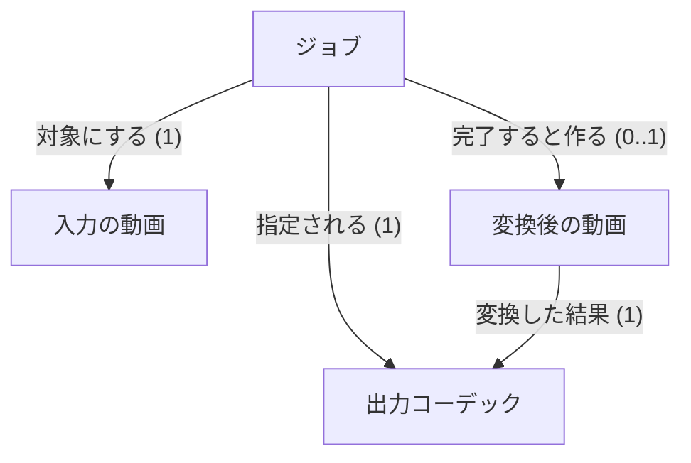

# ドメインモデル

利用者が入力の動画とコーデックを選んでジョブを作り、ジョブの結果として変換後の動画を受け取るまでに扱う概念。

## 概念

| 概念 | 意味 |
|---|---|
| ジョブ | 1 回の変換の依頼。状態を持ち、一定期間で消える ([ジョブ](../specs/term/job.md)) |
| 入力の動画 | 利用者が変換を頼む MP4 の動画 |
| 出力コーデック | 利用者が選ぶ、変換先のコーデック。H.264 (MP4)、VP9 (WebM)、AV1 (WebM) の 3 つ ([出力コーデック](../specs/term/output-codec.md)) |
| 変換後の動画 | 入力の動画を出力コーデックに変換した結果の動画 |

## 関係

- 1 つのジョブは、1 つの入力の動画と 1 つの出力コーデックを持つ
- 変換後の動画は、ジョブが完了したときだけできる。失敗したジョブには無い ([変換](functional/conversion.md))
- ジョブ、入力の動画、変換後の動画は、一定期間で消える ([データの保持](non-functional/data-retention.md))
