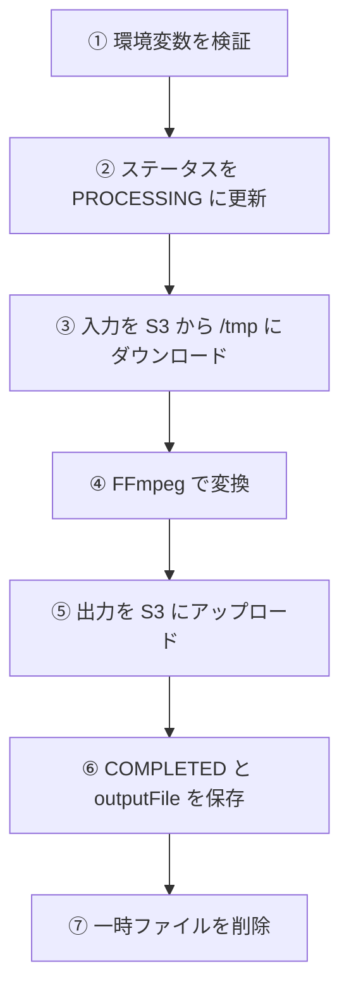
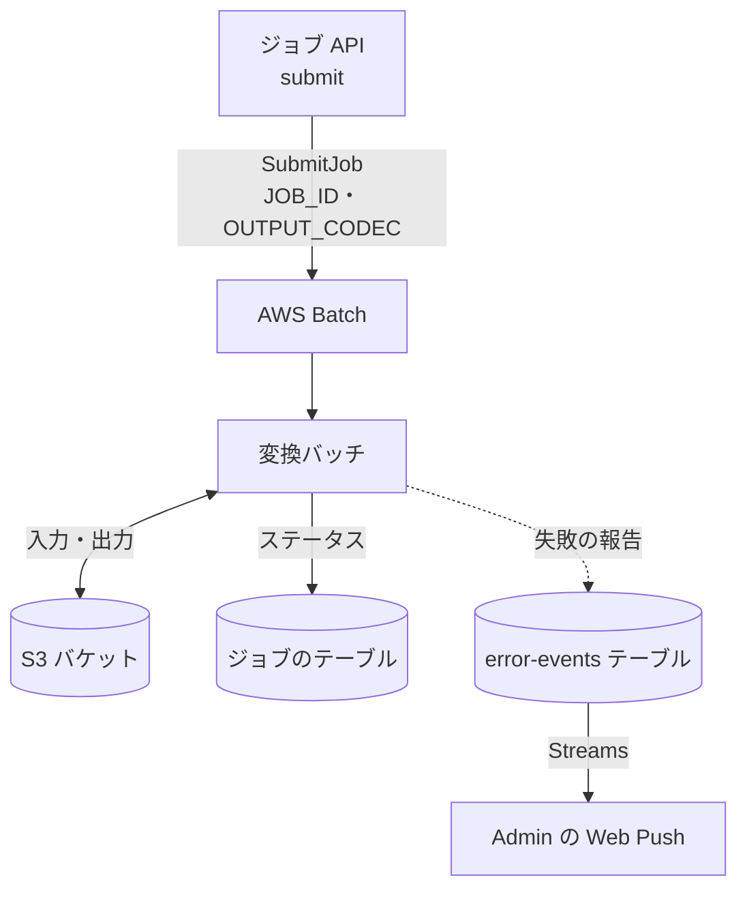

---
sources:
  - services/codec-converter/batch/src/index.ts
  - services/codec-converter/core/src/batch-job-input.ts
  - services/codec-converter/core/src/constants.ts
  - services/codec-converter/core/src/mappers/job.mapper.ts
  - services/codec-converter/core/src/repositories/dynamodb-job.repository.ts
  - infra/codec-converter/lib/codec-converter-stack.ts
  - libs/aws/src/error-events/with-error-reporting.ts
  - libs/aws/src/error-events/report.ts
sources_hash: eb1e8df39cb00137ed99ae2862bae48188337fb024dab8c5a60b3c0823edb432
---

# 変換バッチ (convert)

S3 に置かれた動画を FFmpeg で[出力コーデック](../term/output-codec.md)へ変換し、結果を S3 に書いて[ジョブ](../term/job.md)のステータスを更新するコンテナ。1 回の起動で 1 ジョブを処理する。

## 起点

- スケジュールはない。[ジョブ API](../api/jobs.md) の投入 (`POST /api/jobs/{jobId}/submit`) が、AWS Batch にジョブを 1 件投入して起動する
- 起動ごとに渡す値は、環境変数 `JOB_ID` と `OUTPUT_CODEC` の 2 つだけ。ほかは[ジョブ定義](../term/job-definition-size.md)が持つ

| 環境変数 | 出どころ | 内容 |
|---|---|---|
| `JOB_ID`、`OUTPUT_CODEC` | 投入時の指定 | 前後の空白を除いて読む。どちらかが空なら起動時に例外。コーデックが許可外でも例外 |
| `S3_BUCKET`、`DYNAMODB_TABLE_NAME`、`AWS_REGION` | ジョブ定義 | 必須。なければ起動時に例外 |
| `ERROR_EVENTS_TABLE_NAME` | ジョブ定義 | エラー履歴の報告先。なければ報告だけができない |
| `JOB_DEFINITION_NAME` | 任意 | あればログに出す。インフラのジョブ定義は設定しないので、ログでは `unknown` になる |

- 実行基盤は Fargate の Batch ([Batch の実行環境](../resource/batch-runtime.md))。ジョブ定義は 4 サイズで、イメージ、リトライ (2 回まで試行)、タイムアウト (7,200 秒) は共通
- ジョブ定義のログ出力先は CloudWatch Logs `/aws/batch/nagiyu-codec-converter-{env}` (保持 1 週間)
- 同時に動かせる大きさは、コンピュート環境の最大 16 vCPU で決まる

## 処理

②〜⑦ は、処理の開始から 6,900 秒 (7,200 秒から余裕の 300 秒を引いた値) までに終える。超えると、その場で打ち切って失敗の扱いにする ([時間切れ](#時間切れ))。

| 手順 | 内容 |
|---|---|
| ③ 入力 | `uploads/{JOB_ID}/input.mp4` を `/tmp/input-{JOB_ID}.mp4` に保存する。期限が来たら取得を打ち切る |
| ④ 変換 | `ffmpeg -i {入力} -c:v {動画} -c:a {音声} {品質の引数} -y {出力}`。コーデックごとの値は[出力コーデック](../term/output-codec.md)。標準エラー出力に `time=` を含む行があれば、進捗としてログに出す。期限が来たら FFmpeg を強制終了する (SIGKILL) |
| ⑤ 出力 | `/tmp/output-{JOB_ID}.{拡張子}` を `outputs/{JOB_ID}/output.{mp4 か webm}` に保存する。期限が来たらアップロードを打ち切る |
| ⑥ 更新 | `status` を `COMPLETED`、`outputFile` を出力のキーにする。空の `outputFile`、`errorMessage` は保存しない |

- 起動時に、ジョブ定義名と、ECS のタスクメタデータから取れた CPU とメモリの上限をログに出す。メタデータが取れなくても処理は続ける
- 更新は、更新前のステータスを条件にしない。`undefined` の項目は変更しないので、再試行で `PROCESSING` に戻しても、前の失敗の `errorMessage` は消えない

## 失敗したとき

処理 (②〜⑦) のどこかで例外になると、次を行う。

| 順 | 内容 | 報告 |
|---|---|---|
| 1 | 例外の内容 (終了コード・標準エラー出力・S3 のエラー文を含む) をログに出し、処理の失敗を報告する | 処理の失敗を報告 (critical) |
| 2 | ステータスを `FAILED`、`errorMessage` を失敗した段の決まった文言にして保存する (下の表) | 保存できなければ報告 (error) |
| 3 | 一時ファイルを削除する。ないファイルは無視する | 削除に失敗したら報告 (warning) |
| 4 | 例外を投げ直す | ― |

`errorMessage` は画面と API 応答にそのまま出るので、技術的な内容を含めず、失敗した段ごとの文言だけを保存する。詳細は、ログと報告の本文 (例外のメッセージ) にだけ残す。

| 失敗した段 | `errorMessage` |
|---|---|
| ③ 入力のダウンロード | 動画ファイルの取得に失敗しました。しばらくしてからもう一度お試しください |
| ④ FFmpeg の変換 (終了コードが 0 以外) | 動画の変換に失敗しました。ファイルが壊れているか、対応していない形式の可能性があります |
| ⑤ 出力のアップロード | 変換後のファイルの保存に失敗しました。しばらくしてからもう一度お試しください |
| 期限を超えた (②〜⑥ のどこで超えても。段ごとの文言より優先する) | 変換が制限時間 (2 時間) 内に終わりませんでした。ファイルを短くするか、別のコーデックでお試しください |
| 上以外 (② と ⑥ のステータス更新、⑦ の削除、④ で FFmpeg を起動できなかったとき) | 変換中にエラーが発生しました。しばらくしてからもう一度お試しください |

- FFmpeg の標準エラー出力は、末尾 4,000 文字だけを保持する。長い変換で溜まり続けないようにするためで、失敗の理由は末尾に出るので末尾を残す

- 例外を投げ直したあと、起動の骨格がもう一度報告 (critical) し、終了コード 1 でプロセスを終える。このため、1 回の失敗につき critical が 2 件記録される。題名は「Batchジョブが失敗しました」と「コーデック変換バッチが起動時に失敗しました」
- 起動時の検証の失敗 (環境変数の不足など) は、ステータスを更新せず、後者だけを報告して終了する。この場合ジョブは `PENDING` のまま
- 終了コードが 0 でないので、AWS Batch が 2 回まで試行する。再試行で最初から処理し直し、報告も試行ごとに増える
- 失敗したときに消すのは、コンテナ内の一時ファイルだけである。S3 のファイルは消さず、バケットのライフサイクル ([ストレージ](../resource/storage.md)) が作成から 1 日で消す。失敗のあとに S3 に残るのは入力と、⑤ のあとで失敗したときの出力である
- ⑥ の `COMPLETED` の保存が失敗したときも、同じ失敗の扱いになる。`FAILED` の保存も失敗すれば、ステータスは `PROCESSING` のまま残る
- ⑦ の一時ファイルの削除は、処理の `try` の中にある。削除に失敗する (ないファイル以外の理由) と、`COMPLETED` にしたあとでも失敗の扱いになり、`FAILED` で上書きする
- Batch のタイムアウト (7,200 秒) は、ワーカーの期限 (6,900 秒) の外側の安全網として残る。ワーカーが自分で打ち切れなかったとき、たとえばプロセスが外から即死させられたときは、ステータスを更新できず、ジョブは `PROCESSING` のまま残りうる。Batch の失敗を拾う EventBridge のルールや CloudWatch Alarm は、codec-converter のインフラには定義されていない ([エラー通知の経路](../../../admin/specs/flow/error-notification.md)の `batch-event` の対象にならない)
- 報告の書き込みに失敗しても、例外は伝えない。ログだけを残す

## 時間切れ

変換は 2 時間で打ち切り、そのジョブは失敗にする ([変換の要件](../../requirements/functional/conversion.md))。

| 項目 | 内容 |
|---|---|
| 期限 | ワーカーの処理開始 (② の直前) から 6,900 秒。7,200 秒から、後始末の余裕 300 秒を引く |
| 対象 | ②〜⑦ の全体 |
| 止め方 | ③ のダウンロードと ⑤ のアップロードは、S3 への要求と書き込みを中止する。④ は FFmpeg の子プロセスを SIGKILL で止める。ステータスの更新 (② と ⑥) は中止できないので、完了を待ち、次の段に進む前に期限を確かめる |
| 失敗の扱い | 上の「失敗したとき」と同じ。報告の本文は時間切れの例外 (経過秒数を含む) で、`errorMessage` には時間切れの文言だけを保存する。期限後の保存・報告・削除は、期限では打ち切らない |
| 再試行 | 終了コード 1 なので、Batch が 2 回まで試行する。再試行でも最初から 6,900 秒を数える。2 回とも時間切れなら、最終的に `FAILED` で終わる |

- 余裕を取るのは、Batch のタイムアウトより先にワーカー側で打ち切り、`FAILED` の保存・報告・一時ファイルの削除を終える時間を残すため
- 正常に終わったときも、ほかの理由で失敗したときも、期限のタイマーは解除する。タイマーはプロセスの終了を妨げない
- 時間切れになったあとに別の例外で落ちても、時間切れとして扱う。中断された操作は様々な例外で終わるため、期限が来たかどうかで判定する

## つながり

## 理由

- 失敗したときに S3 のファイルを消さない。FFmpeg はコンテナ内に書き出し、変換が終わってから 1 回の PUT で S3 に上げるので、変換の途中のファイルは S3 に生じない。⑤ のあとで失敗したときの出力は、`FAILED` のジョブには API がダウンロード用 URL を返さないので利用者から取れず、ライフサイクルで消える
- 再試行は AWS Batch に任せ、ワーカーの中では再試行しない。ワーカーは失敗を報告して異常終了するだけにして、失敗の報告と再試行の責務を分けるため
