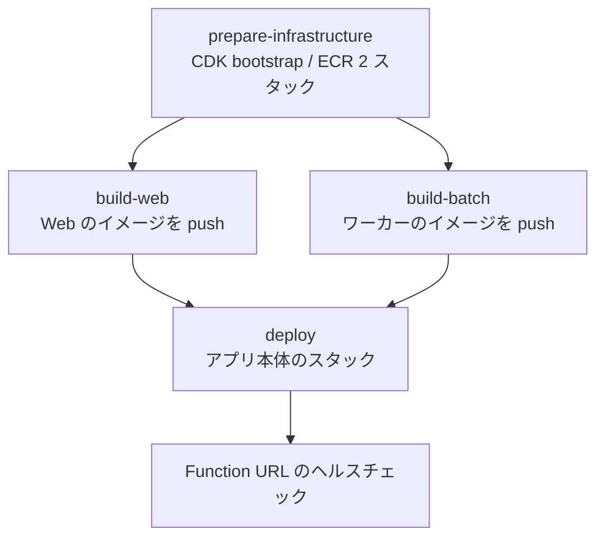

---
sources:
  - infra/codec-converter/bin/codec-converter.ts
  - infra/codec-converter/lib/codec-converter-stack.ts
  - infra/codec-converter/lib/ecr-stacks.ts
  - .github/workflows/codec-converter-deploy.yml
sources_hash: 51dbe8e2f8965cd1781673dddde3b7bd1d1163d5e843269c40d234501e588f12
---

# Codec Converter のデプロイ先

Codec Converter の Web は Lambda (コンテナイメージ) の Function URL を CloudFront の背後に置いて公開する。変換の実行は AWS Batch (Fargate) が行う。アプリ本体のリソースは 1 つのスタックにまとまっている。

## ホスト名

| 環境 | ホスト名 |
|---|---|
| dev | `codec-converter.dev.nagiyu.com` |
| prod | `codec-converter.nagiyu.com` |

ホスト名は、共通のホスト名の組み立て関数ではなく、SSM のドメイン名 (`ACM_DOMAIN_NAME`) の値の前に `codec-converter.` を付けて作る (`infra/codec-converter/lib/codec-converter-stack.ts`)。SSM の値はアカウントごとに違い、dev アカウントでは `dev.nagiyu.com`、prod アカウントでは `nagiyu.com` が入る。そのため dev と prod で分岐せず同じ式で足りる。CORS の許可オリジンの既定値も同じ式で作る。

DNS レコードは、dev だけ `NagiyuCodecConverterDev` が自分のスタックで ALIAS を作る。prod は shared の CNAME 一覧に入っており、このスタックでは作らない。共通のしくみは [デプロイ先 (platform)](../../../platform/specs/deploy.md) を参照する。

## スタック

`infra/codec-converter/bin/codec-converter.ts` が、次の順に作る。`{Env}` は `Dev` / `Prod` で、環境は CDK の context `env` (既定は `dev`) で決まる。

| 順 | スタック | 役割 | 含む主なリソース |
|---|---|---|---|
| 1 | `NagiyuCodecConverterECR{Env}` | Web のイメージの置き場 | ECR リポジトリ |
| 2 | `NagiyuCodecConverterBatchECR{Env}` | 変換ワーカーのイメージの置き場 | ECR リポジトリ |
| 3 | `NagiyuCodecConverter{Env}` | アプリ本体 | S3 バケット (入出力ファイル)、DynamoDB のジョブテーブル (キーは `jobId`、TTL 属性 `TTL`)、Lambda (1024 MB、タイムアウト 30 秒)、Function URL、Batch (Fargate のコンピューティング環境・ジョブキュー・サイズ別のジョブ定義)、CloudFront、dev のみ Route53 の ALIAS |

ECR のスタックを本体と分けるのは、本体より先にデプロイしてイメージを push できる状態にするためである。本体は ECR リポジトリを名前で参照する。

## デプロイの流れ

`.github/workflows/codec-converter-deploy.yml` が行う。

| 項目 | 内容 |
|---|---|
| トリガー | develop・`integration/**`・master への push (サービス・infra・libs・configs などのパスが変わったとき)。手動実行 (dev / prod を選ぶ) |
| デプロイ先の環境 | 手動実行は入力値。master への push は prod。それ以外は dev |
| 並行実行 | 環境ごとに直列化する。実行中の run は止めず、待機中は最新だけ残す |
| イメージのタグ | コミットの SHA |

| ジョブ | 内容 |
|---|---|
| `prepare-infrastructure` | CDK の bootstrap を実行し、ECR の 2 スタックをデプロイする |
| `build-web` | Web のイメージをビルドして ECR に push する |
| `build-batch` | ワーカーのイメージをビルドして ECR に push する (`build-web` と並行) |
| `deploy` | アプリ本体のスタックをデプロイし、スタックの出力から Lambda の Function URL を取り出して `/api/health` のヘルスチェックを行う。CloudFront 経由のヘルスチェックはしない |
