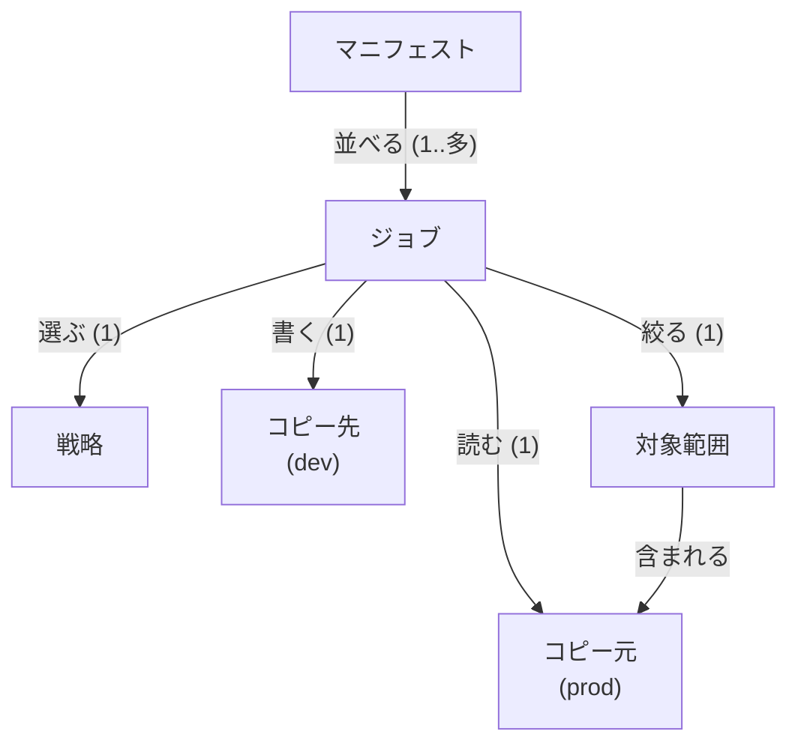

# ドメインモデル

prod のデータを dev へ写す 1 回の仕事 (ジョブ) と、それを宣言するマニフェスト、写し方を決める戦略、写す範囲を決めるコピー元 / コピー先と対象範囲。

## 概念

| 概念 | 意味 |
|---|---|
| ジョブ | 1 つのコピー元から 1 つのコピー先へ、決めた戦略で写す 1 件の仕事。定期に実行され、手動でも実行できる |
| マニフェスト | ジョブの一覧を宣言したもの。同期の対象を足すのは、ここに足すこと |
| 戦略 | 写し方の種類。prod の削除を dev に映すか、直近だけを写すかで選ぶ ([同期戦略](../specs/term/sync-strategy.md)) |
| コピー元 | 写す元の prod のテーブル。読むだけで、書き換えない |
| コピー先 | 写す先の dev のテーブル。dev に限る |
| 対象範囲 | ジョブが写す、コピー元の中のアイテムの範囲。範囲に入らないアイテムは触らない |

## 関係

- 1 つのジョブは、1 つのコピー元と 1 つのコピー先を持つ。同じコピー元のテーブルから、対象範囲の違う複数のジョブを作れる ([同期](functional/sync.md))
- ジョブは、定期の実行と手動の実行のどちらでも、同じ結果になる ([同期](functional/sync.md))
