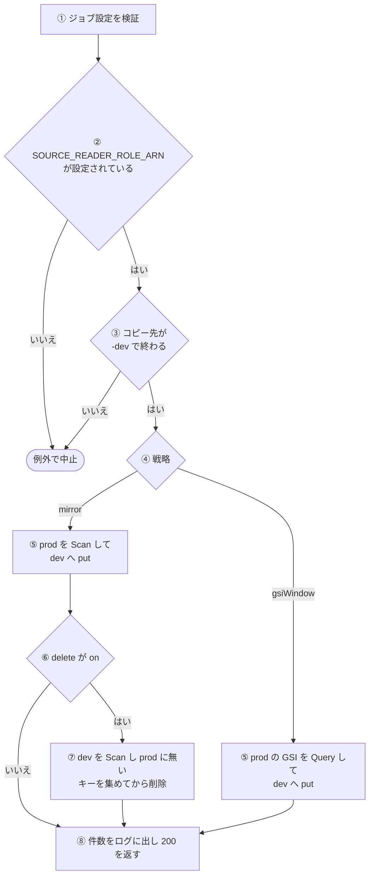
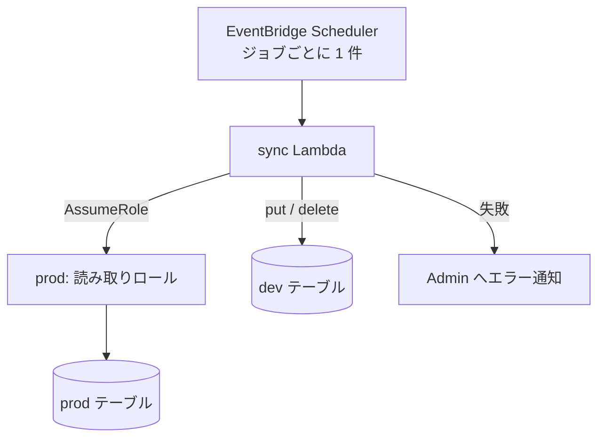

---
sources:
  - services/dev-sync/batch/src/sync-handler.ts
  - services/dev-sync/batch/src/lib/copy-logic.ts
  - services/dev-sync/batch/src/lib/types.ts
  - services/dev-sync/batch/src/lib/errors.ts
  - services/dev-sync/batch/src/lib/source-reader-client.ts
  - services/dev-sync/batch/src/lib/dynamo-store-adapter.ts
  - libs/aws/src/lambda/scheduled-handler.ts
sources_hash: 380ce558c173f3805b1703eea0f4b267cda1fe0fba1c7260a01a8192f9d290d0
---

# 同期バッチ (sync)

prod アカウントの DynamoDB テーブルを、dev アカウントの `-dev` テーブルへコピーする汎用の Lambda。1 回の実行で 1 つのジョブ (コピー元・コピー先・戦略) を処理する。

## 起点

- ジョブごとの EventBridge Scheduler のスケジュール。Lambda には、スケジュールの input に埋め込んだジョブ設定 (JSON) がそのまま渡される
- スケジュール、ジョブの一覧、Lambda の設定は[同期の実行環境](../resource/batch-runtime.md)にある
- 手で起動するには、同じ形のジョブ設定を渡して Lambda を呼ぶ (下の「手順」)

## 対象から外れる条件

コピーの対象は、ジョブ設定の `scope` (mirror) か `gsi` (gsiWindow) で決まる。戦略の意味と選び方は[同期戦略](../term/sync-strategy.md)にある。

| 戦略 | 対象 |
|---|---|
| `mirror` | `scope.pkPrefix` で始まる PK のアイテム。`scope.skPrefix` があれば SK もそのプレフィックスで絞る。`pkPrefix` が空文字なら PK では絞らない |
| `gsiWindow` | 指定した GSI を、パーティションキー `gsi.pkValue` で引き、ソートキーが下限以降のアイテム |

- 絞り込みは `Scan` の `FilterExpression` で行う。DynamoDB は絞り込む前に全件を読むので、読む量は対象の件数ではなくテーブル全体の大きさで決まる
- 上の範囲に入らないアイテムは、コピーも削除もしない

## 処理



| 段 | 内容 |
|---|---|
| ① | 下の検証に通らなければ例外 (`イベント入力のバリデーションに失敗しました: ...`) |
| ② | 環境変数 `SOURCE_READER_ROLE_ARN` がなければ例外にする。同じアカウントのテーブルを読むような代替はしない |
| ③ | コピー先テーブル名が `-dev` で終わらなければ、読み書きの前に例外で止める。同じ検査を、戦略ごとの処理の先頭でも行う |
| ⑤ mirror | 1 ページずつ `Scan` し、アイテムを 1 件ずつ `put` で dev に書く (同じキーは上書き)。prod のキー (`PK#SK`) は覚えておく。prod は読むだけ |
| ⑤ gsiWindow | `#pk = :pkValue AND #sk >= :skFrom` で GSI を 1 ページずつ `Query` し、アイテムを 1 件ずつ `put` で dev に書く |
| ⑦ | 先に dev を同じ絞り込み (`pkPrefix`・`skPrefix`) で最後まで `Scan` して、prod に無いキーを集める。`Scan` が終わってから、集めたキーを 1 件ずつ `delete` する |
| ⑧ | `upserted` (put した件数)、`deleted` (削除した件数。gsiWindow は常に 0)、`scanned` (絞り込み (`FilterExpression`) の後に prod から返った件数) をログに出し、`statusCode: 200` と結果を返す。戻り値の件数は、`body` の JSON 文字列の中の `result` にある |

ジョブ設定の検証。

| 項目 | 条件 |
|---|---|
| `sourceTable`、`destTable` | 1 文字以上 |
| `strategy` | `mirror` か `gsiWindow` |
| `delete` | `on` か `off` |
| `mirror` のとき | `scope` が必須。`gsi` は指定できない |
| `gsiWindow` のとき | `gsi` が必須。`delete` は `on` にできない |
| `scope` | `pkPrefix` は必須の文字列 (空文字でもよい)。`skPrefix` は省略できる |
| `gsi` | `indexName`・`pkAttributeName`・`pkValue`・`skAttributeName` は 1 文字以上。`windowDays` は正の整数。`skPrefix`・`dateGranularity` (`date` か `datetime`) は省略できる |

`gsiWindow` のウィンドウの下限 (`skFrom`) は次のとおり。

- 今から `windowDays` 日前の日時を、`dateGranularity` が `date` なら `YYYY-MM-DD`、省略または `datetime` なら ISO 8601 の日時 (`YYYY-MM-DDTHH:mm:ss.sssZ`) にする
- その先頭に `gsi.skPrefix` (省略時は付けない) を付ける

### prod の読み取り

prod の読み取りは、dev の Lambda が環境変数 `SOURCE_READER_ROLE_ARN` のロールを引き受けて (`AssumeRole`) 行う。ロールの名前・信頼ポリシー・許す操作は[dev-sync の読み取りロール](../../../../platform/specs/resource/dev-sync-source-reader.md)にある。

- セッション名は `nagiyu-dev-sync`。一時認証情報は期限が近づくと SDK が取り直す
- dev の書き込みは、Lambda 実行ロール自身の認証情報で行う
- AssumeRole で認証情報が得られなければ、例外にする。読み取りロールの許可にないテーブルを読もうとしたときも、DynamoDB の権限エラーで例外になる (読み取りロールの一覧へ足す手順は[同期の実行環境](../resource/batch-runtime.md)の「手順」)

## 失敗したとき

- 入力の検証、`-dev` の検査、`SOURCE_READER_ROLE_ARN` の欠落、AssumeRole で認証情報が得られない、DynamoDB の読み書きの失敗は、いずれも例外になる
- 共通の骨格 ([定期実行 Lambda の骨格](../../../../platform/specs/lib/aws/scheduled-handler.md)) が、`バッチ失敗` をログに出し、[ErrorEvent](../../../../platform/specs/term/error-event.md) を報告してから、元の例外を再送出して Lambda を失敗にする
    - 報告の `serviceId` は `dev-sync`、重大度は `error`、タイトルは `dev-sync ジョブ失敗`、メッセージは例外のメッセージ
    - `context` には、`sourceTable`・`destTable`・`strategy`・`delete` (入力から取れたもの) と例外の情報を入れる。入力が不正でも、取れた項目だけで報告する
    - 報告先のテーブル名と書き込み権限は、Lambda を作る共通部品が付ける ([同期の実行環境](../resource/batch-runtime.md))。Admin に届くまでの経路は[エラー通知の経路](../../../admin/specs/flow/error-notification.md)
- 途中で失敗しても、それまでに書いた dev のアイテムは戻さない。mirror で削除の段に入る前に失敗したら、削除は行われない。どの段で失敗しても、次の実行で同じ処理をやり直すと同じ結果になる
- 再試行の設定は、コードでは指定していない (Lambda の `retryAttempts` も、スケジュールの再試行方針も未指定)。再試行の方針は AWS の既定に従う
- この Lambda に CloudWatch Alarm は定義していない

## つながり



## 理由

- コピーの処理は、生の DynamoDB のアイテムを素通しで扱い、各サービスの mapper や entity に依存しない。サービスの内部表現に依存すると、サービスごとにコピーの処理が要り、サービスの変更のたびに追従が要る。素通しにすれば、1 つの処理で全サービスを賄え、サービスを載せる作業はマニフェストへの追加だけで済む
- コピー (upsert) を先に終えてから、差分を削除する。全消しを先にすると、コピーが終わるまで dev が空になる時間ができる。この順なら、途中で失敗しても、dev にはその前の内容が残る
- 削除の対象は、先に dev を最後まで `Scan` して集めてから、まとめて削除する。`Scan` のページを進めながら同じテーブルから削除すると、読み飛ばしが起きうる
- 同じ検査を、入口のほか戦略ごとの処理の先頭でも行う。戦略ごとの処理を直接呼ばれても、守られるようにするため
- 冪等にしてあり、何回・いつ流しても同じ結果になる。スケジュールでも手でも、安全に流せる

## 手順

### ジョブを手で流す

初回の埋め直しや、失敗したジョブの再実行で、スケジュールを待たずに流す。ジョブ設定の JSON を渡して、dev の Lambda `nagiyu-dev-sync-dev` を呼ぶ。

実行できるのは、dev アカウントで Lambda を呼べる人と、Claude の `nagiyu-claude` ロールである ([Claude の AWS アクセス](../../../../platform/specs/resource/claude-access.md)。この関数には Invoke だけを許す)。AWS CLI には `--profile nagiyu-dev` を付ける。

```bash
aws lambda invoke \
  --profile nagiyu-dev \
  --region us-east-1 \
  --function-name nagiyu-dev-sync-dev \
  --cli-binary-format raw-in-base64-out \
  --cli-read-timeout 0 \
  --payload '{
    "sourceTable": "nagiyu-stock-tracker-main-prod",
    "destTable": "nagiyu-stock-tracker-main-dev",
    "strategy": "mirror",
    "scope": { "pkPrefix": "TICKER#" },
    "delete": "on"
  }' \
  response.json
cat response.json
```

- 成功すると `statusCode: 200` と、`upserted`・`deleted`・`scanned` の件数が返る。失敗すると、関数のエラーが返り、エラー履歴にも報告される
- `--cli-read-timeout 0` は、CLI の読み取りのタイムアウトを無効にして、関数が終わるまで待つため。件数が多い初回は時間がかかる。関数のタイムアウトと同じ値にすると、境界で CLI が再試行しうる (関数のタイムアウトは[同期の実行環境](../resource/batch-runtime.md)にある)
- ジョブ設定は、[同期の実行環境](../resource/batch-runtime.md)の「ジョブ」の行を、そのまま JSON にしたものでよい。マニフェストにあるジョブを手で流すときは、同じ設定を使う
- 実行ロールの権限は、マニフェストのコピー先から決まる。マニフェストにないコピー先や、削除 `on` のジョブが 1 つもないコピー先に対する削除は、権限エラーになる。読み取りも、読み取りロールの対象のテーブルに限る (足す手順は[同期の実行環境](../resource/batch-runtime.md)の「手順」)

戦略ごとの流し方。

| 戦略 | 流し方 |
|---|---|
| `mirror` | 初回も定常も同じ処理。初回は件数が多く、時間がかかるだけ |
| `gsiWindow` | 初回だけ `windowDays` を大きくして過去分を取り込む |
