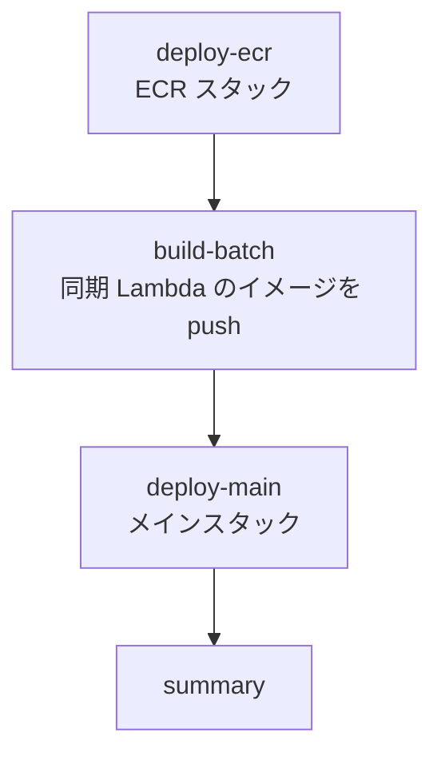

---
sources:
  - infra/dev-sync/bin/dev-sync.ts
  - infra/dev-sync/lib/dev-sync-stack.ts
  - infra/dev-sync/lib/ecr-stack.ts
  - .github/workflows/dev-sync-deploy.yml
sources_hash: cba6cb35d8fe370c2ee883661f2eb1a14cc8d5fa378554b8e3a70c39694ce950
---

# dev-sync のデプロイ先

dev-sync は、prod の DynamoDB テーブルの内容を dev のテーブルへ写す Lambda と、それを定期的に起動する EventBridge Scheduler である。dev にしかデプロイしない。

## ホスト名

なし。dev-sync は公開ホストを持たない。HTTP の入口がなく、Lambda を EventBridge Scheduler が起動するだけだからである。CloudFront も DNS レコードも作らない。

## スタック

`infra/dev-sync/bin/dev-sync.ts` が、次の順に作る。環境は CDK の context `env` (既定は `dev`) で決まり、`{Env}` は `Dev` である。

| 順 | スタック | 役割 | 含む主なリソース |
|---|---|---|---|
| 1 | `NagiyuDevSyncECR{Env}` | 同期 Lambda のイメージの置き場 | ECR リポジトリ |
| 2 | `NagiyuDevSync{Env}` | 同期の実行と起動 | 同期 Lambda (コンテナイメージ、256 MB、タイムアウト 15 分)、Lambda の実行ロール、EventBridge Scheduler のスケジュール (ジョブのマニフェストの 1 エントリにつき 1 つ)、Scheduler 用のロール |

マニフェストは `infra/dev-sync/lib/manifest.ts` にあり、コピー元・コピー先のテーブル、戦略、削除の有無、スケジュールを持つ。実行ロールには、prod アカウントの読み取り専用ロール (`nagiyu-dev-sync-source-reader`、shared が作る) を引き受ける権限と、コピー先テーブルへの書き込み権限を付ける。prod のテーブルへの直接の読み取り権限は付けない。コピー先のテーブル名が `-dev` で終わらないマニフェストは、合成の時点でエラーにして、prod のテーブルへの書き込み権限を作らせない。

## デプロイの流れ

`.github/workflows/dev-sync-deploy.yml` が行う。

| 項目 | 内容 |
|---|---|
| トリガー | develop・`integration/**` への push (サービス・infra・libs などのパスが変わったとき)。手動実行 (選べる環境は dev だけ)。master への push では動かない |
| デプロイ先の環境 | 常に dev |
| 並行実行 | dev で直列化する。実行中の run は止めず、待機中は最新だけ残す |
| イメージのタグ | コミットの SHA |

| ジョブ | 内容 |
|---|---|
| `deploy-ecr` | ECR のスタックをデプロイする |
| `build-batch` | 同期 Lambda のイメージをビルドして ECR に push する |
| `deploy-main` | メインスタックをデプロイする。ヘルスチェックはない |
| `summary` | 各ジョブの結果を要約に出す (`always`) |
