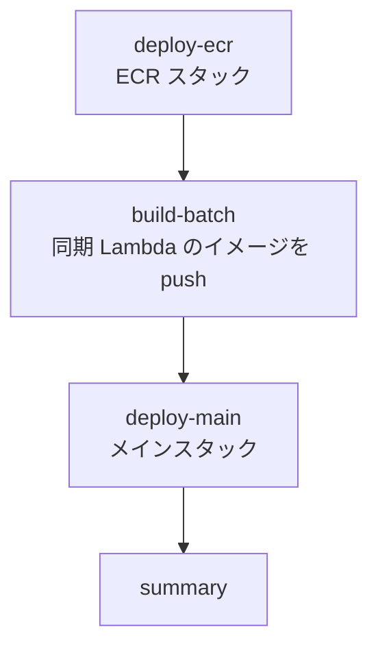

---
sources:
  - infra/dev-sync/bin/dev-sync.ts
  - .github/workflows/dev-sync-deploy.yml
sources_hash: f3a0d038d53be6f0c8dfd33cd80b1e0020c6cc9aa34c5b166abdcc667239ccdb
---

# dev-sync のデプロイ先

dev-sync は、prod の DynamoDB テーブルの内容を dev のテーブルへ写す Lambda と、それを定期的に起動する EventBridge Scheduler である。ワークフローは dev にしかデプロイしない。

## ホスト名

なし。dev-sync は公開ホストを持たない。HTTP の入口がなく、Lambda を EventBridge Scheduler が起動するだけだからである。CloudFront も DNS レコードも作らない。

## スタック

`infra/dev-sync/bin/dev-sync.ts` が、次の順に作る。環境は CDK の context `env` (既定は `dev`) で決まり、`{Env}` は `Dev` / `Prod` を受け付ける。dev だけに限っているのはワークフローで、実際に作られるのは `Dev` のスタックである。

| 順 | スタック | 役割 | 含むリソース |
|---|---|---|---|
| 1 | `NagiyuDevSyncECR{Env}` | 同期 Lambda のイメージの置き場 | ECR リポジトリ |
| 2 | `NagiyuDevSync{Env}` | 同期の実行と起動 | Lambda、EventBridge Scheduler のスケジュール |

## デプロイの流れ

`.github/workflows/dev-sync-deploy.yml` が行う。

| 項目 | 内容 |
|---|---|
| トリガー | develop・`integration/**` への push (サービス・infra・libs などのパスが変わったとき)。手動実行 (選べる環境は dev だけ)。master への push では動かない |
| デプロイ先の環境 | 常に dev。トリガーが dev の起点に限られ、GitHub Environment も dev に固定する ([dev と prod の切り替え](../../../platform/specs/deploy.md#dev-と-prod-の切り替え)) |
| 並行実行 | dev で直列化する。実行中の run は止めず、待機中は最新だけ残す |
| イメージのタグ | コミットの SHA |

| ジョブ | 内容 |
|---|---|
| `deploy-ecr` | ECR のスタックをデプロイする |
| `build-batch` | 同期 Lambda のイメージをビルドして ECR に push する |
| `deploy-main` | メインスタックをデプロイする。ヘルスチェックはない |
| `summary` | 各ジョブの結果を要約に出す (`always`) |
