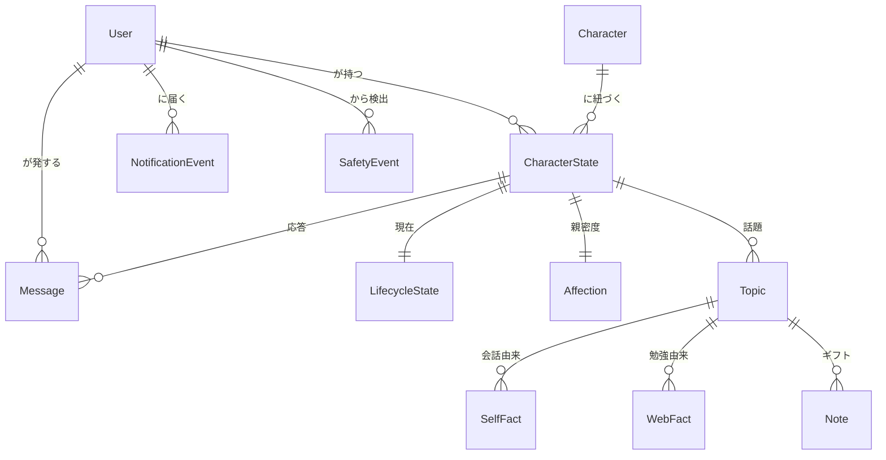

# リブトーク（LiveTalk）外部設計書

この文書は、画面と概念データモデルを設計した理由・方針を書く。画面や API が今どう動くかは[仕様カード](../../specs/README.md)にある。

## 1. 画面設計

### 1.1 画面一覧

各画面の入口・表示するもの・操作・状態は、画面の仕様カードを参照する。この文書には、画面を設計した理由と、画面をまたぐ方針だけを書く。

| 画面 ID | 画面名 (仕様カード) | 対応ユースケース | 備考 |
| ------- | ------------------- | ---------------- | ---- |
| SCR-001 | [チャット画面](../../specs/livetalk/screen/home.md) | UC-001, UC-005 | ホーム画面。キャラクター選択 (SCR-010) と退会・データ削除 (SCR-011) のダイアログを含む |
| SCR-002 | [利用規約・年齢同意](../../specs/livetalk/screen/home.md) | - | ホーム画面の同意のダイアログ |
| SCR-003 | [オンボーディング (PWA 追加誘導)](../../specs/livetalk/screen/home.md) | - | ホーム画面の案内 |
| SCR-004 | [記憶閲覧・削除画面](../../specs/livetalk/screen/memory.md) | UC-004 | - |
| SCR-005 | [ノート一覧](../../specs/livetalk/screen/notes.md) | - | - |
| SCR-006 | [ノート詳細](../../specs/livetalk/screen/note-detail.md) | - | - |
| SCR-007 | 法務ページ: [利用規約](../../specs/livetalk/screen/terms.md)、[プライバシーポリシー](../../specs/livetalk/screen/privacy.md) | - | - |
| SCR-008 | [セーフティ介入画面](../../specs/livetalk/screen/home.md) | UC-006 | ホーム画面のダイアログ |
| SCR-009 | [ステータス画面](../../specs/livetalk/screen/status.md) | UC-008 | 運用者向け |
| SCR-010 | [キャラクター選択](../../specs/livetalk/screen/home.md) | - | ホーム画面のダイアログ |
| SCR-011 | [退会・データ削除](../../specs/livetalk/screen/home.md) | UC-007 | ホーム画面のダイアログ |
| - | [権限なし画面](../../specs/livetalk/screen/forbidden.md) | - | - |

### 1.2 画面ごとの設計判断

#### SCR-001: チャット画面（メイン）

**設計判断（通知タップ時のプリフィル）**: 自動送信せずプリフィルに留めるのは、VOICEVOX 音声の再生に「送信時の user gesture による AudioContext の unlock」が必要なため。自動送信だと user gesture が無く音声が鳴らない。プリフィル + 手動送信なら、その送信タップが user gesture となり音声が確実に再生され、誤タップでの意図しない送信も防げる。サジェスト発話は通知生成時にサーバ側で `NotificationEvent.SuggestedReply` として生成・保存し、通知タップ由来（URL の `from=push`）の起動時のみ入力欄へ反映する。

#### SCR-004: 記憶閲覧・削除画面

Ani / Replika 等で問題となった「誤情報の永続化」への配慮として削除手段を提供する。裏では複数 Topic の SELF fact を横断集約して表示する。

**設計判断（なぜ）**

- **Tier 別タブ（A/B/C）とピン留めを廃止する**。想起を関連度で行う（ADR-2.24）ため、ユーザーに Tier の概念や常時想起のピンを見せる必要がない。常時想起は関連度＋（必要なら）極小のコアプロフィールで代替する。
- キャラが調べた知識（WEB fact）はこの画面に**出さない・削除対象にしない**（混入禁止）。この画面は「私について覚えていること」に限定する。

**補足**: **編集機能は提供しない**。訂正は会話で行うか削除する（前向き整合）。削除は物理削除で、所属 Topic の要約を即時再生成するため、削除内容は以降の応答にも導出物にも残らない（決定的忘却、ADR-2.24）。

#### SCR-005 / SCR-006: ノート一覧・詳細

**設計判断（なぜ）**

- 従来の「事実報告書」から「SELF を根拠に WEB を贈る手紙」に変える。同一 Topic に SELF/WEB が同居する（ADR-2.24）ため、「なぜ調べたか」を根拠付きで語れる。
- 贈った瞬間（一回性）は共有ログとして不変に保ち、中身は生きた Topic を参照する。ノートはキャラの proactive なギフト専用で、ユーザーが会話で依頼した調べ物の結果は会話で返す。

#### SCR-008: セーフティ介入画面（モーダル）

**設計判断（なぜ）**: 危険発言の検出時は、**機械的なホットライン番号の貼り付けを避ける**。キャラの口調で心配を表明したうえで、専門機関への案内を添える。

#### 退会・データ削除（SCR-011）と設定画面

独立した設定画面を持たない方針のため、退会・データ削除は、チャット画面フッターの利用規約・プライバシー導線の近くから開くダイアログにする。削除は不可逆で、データエクスポートはセルフサービスでは提供しない (ADR-2.21)。

### 1.3 レスポンシブ方針

- **モバイル（スマートフォン）**: プライマリ。縦長レイアウト、Live2D が画面上部、入力欄が下部固定
- **タブレット / デスクトップ**: モバイルレイアウトを拡大表示（中央寄せ）。本サービスはモバイル前提

### 1.4 アクセシビリティ方針

- WCAG 2.1 Level AA を目標
- 文字サイズはユーザー設定可能（OS 設定に追従）
- スクリーンリーダー対応：応答テキストは独立した領域で読み上げ可能
- 色覚配慮：色のみに依存しない情報伝達
- 音声 OFF 時もテキストで完結する設計（電車内利用配慮）

---

## 2. 概念データモデル

### 2.1 主要エンティティ一覧

| エンティティ      | 説明                       | 主要な属性（概念レベル）                               |
| ----------------- | -------------------------- | ------------------------------------------------------ |
| User              | サービスを利用するユーザー | ユーザー ID、作成日時、最終起動時刻                    |
| Character         | キャラクター定義           | キャラ ID、名前、性格、嗜好、生活サイクル設定          |
| CharacterState    | ユーザー × キャラの状態    | 親密度、最終接触日時                                   |
| LifecycleState    | キャラの現在のサイクル状態 | 就寝時刻、起床時刻、現在状態、ユーザー活動プロファイル |
| Message           | 会話 1 件（集約前の元データ） | 発言者、本文、タイムスタンプ                        |
| Topic             | 話題の集約体               | 話題名、要約、カテゴリ、care、想起用の座標             |
| SELF fact         | 会話由来のユーザー事実     | 本文、出所メモ、作成日時                               |
| WEB fact          | 勉強由来の知識             | 本文、ソース URL、揮発性、再確認期限、観測日時 (Topic あたり区分ごとに件数の上限あり) |
| Note（共有ログ）  | 贈ったギフトの記録         | 見出し（SELF フック＋WEB 合成）、参照 Topic、共有日時、感想 |
| StudyTopic        | 勉強の依頼                 | 話題の文言、優先度、状態（待ち・処理中・済み）         |
| 集約カーソル      | 集約の進捗                 | ストリーム別のウォーターマーク                        |
| Affection         | 親密度                     | 値、変動履歴（累積接触量として保持。現状は体験へ未反映、ADR-2.23） |
| NotificationEvent | 通知配信履歴               | 通知元キャラ、種別、時刻、本文、サジェスト発話、消化状態 |
| SafetyEvent       | セーフティ検出ログ         | 検出パターン、時刻、応答内容                           |

### 2.2 エンティティ関係図

> 知識・記憶は Topic を集約単位とし、同一話題に SELF fact（会話由来）と WEB fact（勉強由来）を同居させる（ADR-2.24）。関連（related）は事前計算せず、想起時に埋め込み近傍でその場算出する。

物理データモデル（DynamoDB Single Table 設計、SK パターン）は実装（`services/livetalk/core/src/mappers/keys.ts`、`entities/`）を参照する。設計判断は [architecture.md](./architecture.md) を参照。

---

## 3. 設計上の決定事項（ADR）

> 主要な ADR は [architecture.md](./architecture.md) に集約している。本セクションでは外部設計フェーズで確定した画面・データ構造に関わる判断の索引のみを示す。

| ADR         | タイトル                                 | 参照先          |
| ----------- | ---------------------------------------- | --------------- |
| ADR-001     | Live2D クライアント描画                  | architecture.md |
| ADR-002     | DynamoDB Single Table 設計               | architecture.md |
| ADR-003     | VOICEVOX 文単位パイプライン              | architecture.md |
| ADR-005     | 親密度は上昇のみ                         | architecture.md |
| ADR-006     | 睡眠状態はスタイル変調                   | architecture.md |
| ADR-007     | メモリ階層 + 編集機能撤去（Tier は #3696 で撤廃・ADR-2.24 へ） | architecture.md |
| ADR-009     | セーフティ自前実装                       | architecture.md |
| ADR-011     | 通知設計（バックオフ + 時間帯）          | architecture.md |
| ADR (#3491) | 通知のキャラクター単位化（マルチキャラ） | architecture.md |
| ADR-2.21    | 退会・データ削除（即時ハード削除）       | architecture.md |
| ADR-2.22    | セーフティ横断レビュー（sparse GSI + admin） | architecture.md |
| ADR-2.23    | 親密度は保持のみで体験へ未反映（現状明文化） | architecture.md |
| ADR-2.24    | 知識・記憶を Topic 中心モデルに再設計       | architecture.md |
| ADR-2.25    | 勉強の利用者単位の 1 日の回数の上限と 3 日ルール | architecture.md |
| ADR-2.26    | 鮮度は使われたときだけ確認、WEB fact は件数で保つ | architecture.md |
| ADR-2.27    | 重要通知の重複抑止と停止                   | architecture.md |
| ADR-2.28    | 自発リサーチの探索化                       | architecture.md |
| ADR-2.29    | ノート生成の見送り判断の記録               | architecture.md |

---

## 4. 関連ドキュメント

- [requirements.md](./requirements.md): 要件定義
- [architecture.md](./architecture.md): アーキテクチャ設計決定記録（ADR）
- [roadmap.md](./roadmap.md): Phase 6+ 将来拡張ロードマップ
- プラットフォーム認証: [../../development/authentication.md](../../development/authentication.md)
- プラットフォーム PWA: [../../development/pwa.md](../../development/pwa.md)
- ブランチ戦略: [../../branching.md](../../branching.md)
