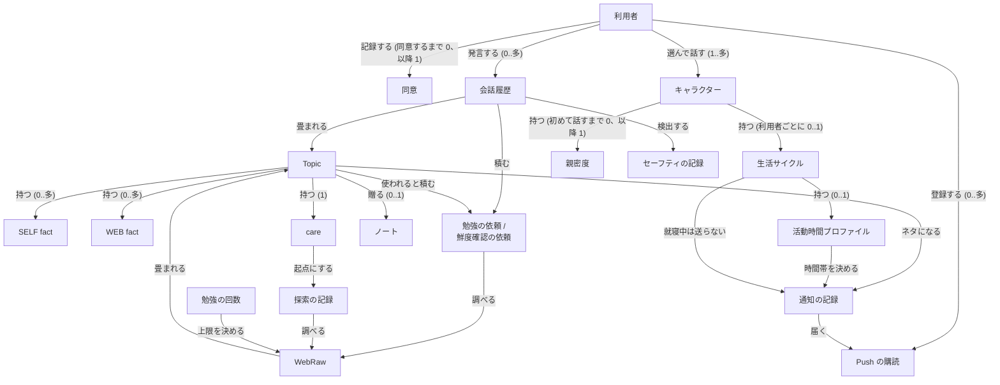

# ドメインモデル

利用者がキャラクターと話し、その会話が話題 (Topic) として記憶され、キャラクターが調べたことと合わさってノートや通知になるまでに扱う概念。記憶・ノート・通知・生活サイクルは、利用者 × キャラクターごとに独立して持つ。属性とキーは[メインテーブル](../specs/data/main-table.md)にある。

## 概念

| 概念 | 意味 |
|---|---|
| 利用者 | リブトークを使う人。同意の記録を持つ ([同意](../specs/term/consent.md)、[権限とロール](../specs/term/permission.md)) |
| キャラクター | 利用者が話す相手。複数の中から選ぶ ([キャラクター](../specs/term/character.md)) |
| 会話履歴 | 利用者の発言とキャラクターの応答。記憶の元データになる ([会話の経路](../specs/flow/conversation.md)) |
| Topic (話題) | 話題 1 つぶんの記憶と知識の集まり ([Topic](../specs/term/topic.md)) |
| SELF fact | 利用者自身についての事実。利用者が削除できる ([SELF fact](../specs/term/self-fact.md)) |
| WEB fact | Web で調べた外部の事実 ([WEB fact](../specs/term/web-fact.md)) |
| care | 話題への注目度。調べる話題・ノート・通知の選び方に使う ([care](../specs/term/care.md)) |
| WebRaw | Web から取ってきた生の内容。Topic に畳む前の元データ ([WebRaw](../specs/term/webraw.md)) |
| 勉強の依頼 | 会話で知らない話題が出たときに積む、調べものの依頼 ([勉強の依頼](../specs/term/study-topic.md)) |
| 鮮度確認の依頼 | 使われた Topic の古い WEB fact を調べ直す依頼 ([鮮度確認の依頼](../specs/term/freshness-check-request.md)) |
| 探索の記録 | 自発的に調べるときに、起点の話題から広げた角度と時刻の記録 ([探索の記録](../specs/term/exploration.md)) |
| 勉強の回数 | 利用者が 1 日に使った、調べものの回数。上限の判定に使う ([勉強バッチ](../specs/batch/acquire.md)) |
| ノート | キャラクターが利用者に贈る手紙。Topic を参照する ([ノート](../specs/term/note.md)) |
| 生活サイクル | キャラクターの就寝・起床時刻。利用者の活動時間に合わせて寄る ([生活サイクル](../specs/term/lifecycle.md)) |
| 活動時間プロファイル | 利用者がよく話しかける時間帯 ([活動時間プロファイル](../specs/term/user-activity-profile.md)) |
| 親密度 | 利用者とキャラクターの接触量の累積。上がるだけで、今は体験に使っていない ([親密度](../specs/term/affection.md)) |
| Push の購読 | 利用者の端末が Push 通知を受け取るために登録するもの ([購読の API](../specs/api/push.md)) |
| 通知の記録 | キャラクターから送った通知の記録。開いたときの第一声になる ([通知の記録](../specs/term/notification-event.md)) |
| セーフティの記録 | 危険な発言を検出した記録 ([セーフティ](../specs/term/safety.md)) |

## 関係

- 記憶・ノート・通知・生活サイクル・親密度は、利用者 × キャラクターごとに独立する。別のキャラクターの記憶が会話に混ざることはない ([キャラクター](functional/characters.md))
- 会話履歴と WebRaw は、集約バッチが Topic に畳む。Topic と、その配下の fact を作る・更新するのは集約バッチだけである ([記憶](functional/memory.md))
- 勉強の依頼は会話で知らない話題が出たときに、鮮度確認の依頼は Topic が会話や通知で使われたときに積まれる。care が高い Topic は、探索の起点になる ([勉強](functional/study.md))
- ノートは Topic を参照し、1 つの Topic につき 1 つまで作られる ([ギフトノート](functional/gift-note.md))
- 通知は、利用者の購読すべてに送られる。キャラクターが就寝中のときは送らない ([Push 通知](functional/push-notification.md))
- セーフティの記録は、退会しても利用者から切り離して残る ([退会とデータの削除](functional/account-deletion.md))
