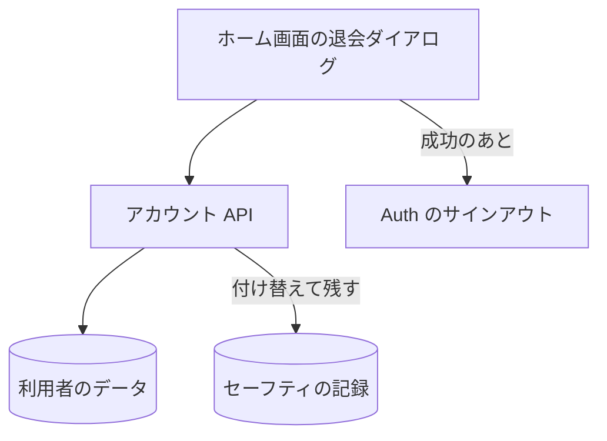

---
sources:
  - services/livetalk/web/src/app/api/account/route.ts
  - services/livetalk/web/src/app/api/account/constants.ts
  - services/livetalk/core/src/repositories/dynamodb-account-deletion.repository.ts
sources_hash: 7085fa97f68f0202c2e4e047caac7168adc37ed0bb3e5f5a566060c3e22ccca6
---

# アカウント API

退会の処理。利用者自身のリブトークのデータをすぐに削除する。

## エンドポイント

| メソッド | パス | 権限 |
|---|---|---|
| DELETE | `/api/account` | `livetalk:chat` |

## 入力と出力

- 本文は要らない。対象はセッションの利用者だけで、他の利用者のデータには触れない
- 利用者の持つ項目 (保存先で利用者の ID の配下にあるものすべて) を、25 件ずつまとめて削除する。削除しきれなかった分が残れば、成功にせず失敗にする
- [セーフティ](../term/safety.md)の検出の記録だけは消さず、利用者から切り離した匿名の持ち主に付け替えて残す。同じ回に付け替える記録は、すべて同じ匿名の持ち主になる。記録の削除期限 (検出から 3 年) は付け直さず、そのまま引き継ぐ
- 成功は `{ deleted: true }`。削除した件数や、匿名にした件数は返さない

## エラー

| 条件 | 状態 | `error` |
|---|---|---|
| 削除の失敗 | 500 | `DELETE_FAILED` |

- 権限の不足は 401 / 403。形は [API のエラー応答](../term/api-error.md)

## つながり

## 理由

- **保存先の項目を走査して消す**。利用者のキーの配下を全件読み、セーフティの記録以外を消す。項目の種別を列挙しないので、種別が増えても削除の漏れが出ない
- **論理削除と猶予期間を設けない**。サービスの規模に対して過剰で、実装も整合性も複雑になる。代わりに、削除は戻せないので、画面で確認を取る ([ホーム画面](../screen/home.md))
- **途中で失敗しても成功にしない**。削除しきれなかった項目が残れば失敗として返し、押し直しで残りを消せる。削除全体を 1 つの操作にはできず、押し直しで収束させる
- **セーフティの記録だけは匿名にして残す**。自傷や希死念慮の検出の記録は、開発者の防御の証跡として残す。Character.AI などの訴訟事例が、このセーフティを自前で持つ動機になっている ([セーフティ](../term/safety.md))。残すときは、利用者の ID などの個人を識別できる値を切り離す
- **匿名にする持ち主の ID は、利用者の ID から導かず、ランダムに作る**。利用者の ID から決まる値 (擬似匿名化) だと、もとの利用者を辿れる。同じ回の記録をまとめられる便利さより、個人を切り離すことを優先する。同じ回の記録は同じ持ち主にまとめるが、途中で失敗して押し直したときの残りには別の持ち主が付くことがある
- **匿名にしても保持期間は引き継ぐ**。保持は検出から 3 年で、退会の時点から数え直さない。ステータス画面の横断レビューでは、匿名にした記録も同じ並びで読める ([ステータス画面](../screen/status.md))
- **サインアウトは Auth の側で行う**。Cookie を発行するのは Auth で、リブトークはサインアウトを受け付けない。退会に成功したら、画面が Auth のサインアウトへ移る ([サインアウト画面](../../../auth/specs/screen/signout.md))
- 退会の対象は、リブトークのデータだけ。Google アカウントや、ほかのサービスのデータは消さない

## 手順

退会しても、利用者のロール (`livetalk-user`) は外れない。外すときは、Auth のユーザー編集画面で人が行う ([ユーザー編集画面](../../../auth/specs/screen/user-edit.md))。
