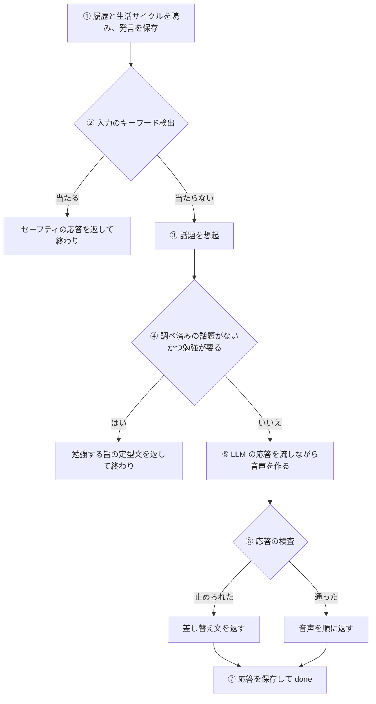
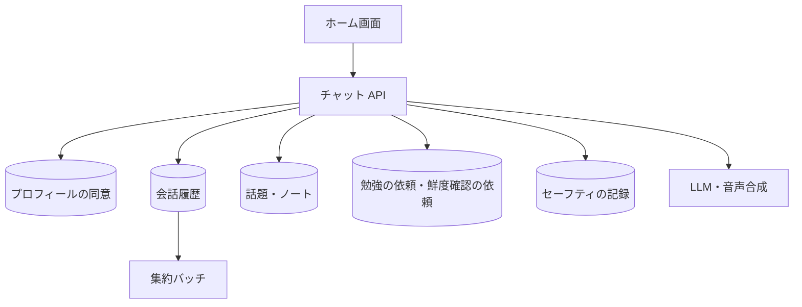

---
sources:
  - services/livetalk/web/src/app/api/chat/route.ts
  - services/livetalk/web/src/app/api/chat/constants.ts
  - services/livetalk/web/src/lib/server/consent.ts
  - services/livetalk/core/src/usecases/chat-usecase.ts
  - services/livetalk/core/src/study/knowledge-gate.ts
  - services/livetalk/core/src/constants.ts
  - services/livetalk/core/src/repositories/chat-guard-counting.ts
  - services/livetalk/core/src/lib/chat-guard-window.ts
  - libs/aws/src/dynamodb/counter/try-increment-in-order.ts
sources_hash: eed010e48715d26932a3a2b42f1f4b9c0bc5b19c6dbee73af6ac43161b9d63a0
---

# チャット API

利用者の発言を受け取り、キャラクターの応答を[チャットのイベント](../term/chat-event.md)の流れ (NDJSON) で返す。

## エンドポイント

| メソッド | パス | 権限 |
|---|---|---|
| POST | `/api/chat` | `livetalk:chat` ([権限とロール](../term/permission.md)) |

## 入力と出力

| 項目 | 条件 |
|---|---|
| `text` | 必須。前後の空白を除いて 1〜200 文字 |
| `characterId` | 任意。登録のある[キャラクター](../term/character.md)。省略すると `hiyori` |
| `knowledgeId` | 任意の文字列。受け取るが使わない |

- 成功は 200。`Content-Type: application/x-ndjson`、`Cache-Control: no-store`。本文は 1 行 1 イベントで、`text` が先に流れ、LLM が終わったあとに `sentence` が文の順に並び、最後に `done`
- 流れが始まったあとの失敗は、状態を変えられないので `error` イベントで伝える
- 入力を確かめたあと、ロックとレートリミットより前に、利用者の[同意](../term/consent.md)が有効かを確かめる。有効でなければ断り、ロックもレートリミットも数えない。同意を読めないときは通さず、500 で返す
- 同じ利用者の同時の呼び出しは 1 本まで。ロックは 600 秒で自動的に外れる
- 呼び出しの回数は、1 分あたり 10 回、1 時間あたり 100 回まで。1 分、1 時間の順に、上限に達していなければ 1 つ数える。断った呼び出しは、どちらの窓も数えない (1 時間で断ったときは、数えた 1 分を戻す)
- 断ったときは `Retry-After` (断った窓の次の窓までの秒数) を付けて返す
- 1 分を戻せなかったときは、1 回多く数えたまま、報告する (warning、題名は「チャットの 1 分の回数を戻せませんでした (1 回分多く数えたまま)」)
- ロックとレートリミットの保存先が使えないときは、数えずに通す (障害時に会話を止めない)

## 処理

| 段階 | 内容 |
|---|---|
| ① | 履歴は、集約バッチが進めたカーソル (未集約の分) 以降。カーソルがなければ全件。ユーザー発言を保存する。就寝中かどうかを決め、通常の流れの先頭で `lifecycle` を返す |
| ② | 当たったら、LLM も想起も使わず、固定文を文字と音声で返し、`safety` (相談先つき) を返す。検出の記録を残し、応答も保存する ([セーフティ](../term/safety.md)) |
| ③ | 発言との類似度 0.4 以上の[話題](../term/topic.md)を上位 5 件。そのうち類似度 0.8 以上の関連する話題を最大 2 件足す。会話に使うのは話題ごとに新しい WEB fact 5 件まで。直接想起した話題のうち、期限切れの WEB fact を持つものは[鮮度確認の依頼](../term/freshness-check-request.md)を記録する |
| ④ | 想起した話題に WEB fact があれば、この段階を飛ばす。なければ LLM で「調べるべき外部の話題か」を判定し、必要なら[勉強の依頼](../term/study-topic.md) (優先度 10、30 日で失効、同じ話題の待ちがあれば足さない) を登録して、定型文 (3 種からひとつ) を返す |
| ⑤ | 直近 7 日に贈った[ノート](../term/note.md)を最大 3 件、想起した話題とともにプロンプトへ入れる。文の区切りごとに音声合成を並行して始める |
| ⑥ | Moderation で応答を検査する。止められたら、検出の記録を残し、`safety` (差し替え文つき) のあと、差し替え文の音声だけを返す。元の応答の音声は返さない |
| ⑦ | 応答 (止めたときは差し替え文) を保存する。新しい活動日なら親密度を加算する |

- 想起・鮮度確認の記録・知識ゲート・ノートの取得・Moderation が失敗しても、会話は続ける

## エラー

| 条件 | 状態 | `error` |
|---|---|---|
| 本文が JSON のオブジェクトでない、`text` が文字列でない、`characterId` が登録外 | 400 | `INVALID_REQUEST` |
| `text` が空 (空白のみ) | 400 | `EMPTY_TEXT` |
| `text` が 200 文字を超える | 400 | `TEXT_TOO_LONG` |
| [同意](../term/consent.md)が有効でない (記録がない、規約・プライバシーポリシーの版が古い、18 歳以上の自己申告がない) | 403 | `CONSENT_REQUIRED` |
| 同じ利用者の別の呼び出しが処理中 | 429 | `CONCURRENT_REQUEST` |
| 1 分または 1 時間の上限を超えた (ロックは外す) | 429 | `RATE_LIMIT_EXCEEDED` |

- 権限の不足は 401 / 403。形は [API のエラー応答](../term/api-error.md)

## つながり

## 理由

- **保護はアプリ側に持ち、保存先は既存のテーブルに相乗りする**。認証を通れば 1 回の呼び出しごとに LLM と音声合成が走り、再送やクライアントのバグだけでも利用額が膨らむため、利用者ごとの回数とロックで抑える。回数とロックの状態は、新しいテーブルを作らず、利用者のキーの配下の項目として持つ。IAM も増やさずに済む。利用額そのものの上限は、AWS 側では決められず OpenAI 側の設定になる ([OpenAI の使い方](../resource/openai.md))
- **回数は固定窓で数え、上限未満のときだけ条件付きで加算する**。判定と加算を 1 回の操作で行えるため、同時の呼び出しでも上限を超えない。窓の項目は TTL で自動的に消える
- **1 時間の窓で断ったときは、数えた 1 分の分を戻す**。断られた呼び出しまで数えると、1 分の窓で断られ続けるあいだに 1 時間の窓が埋まり、短い連打だけで 1 時間使えなくなる
- **1 分の窓を先に数える**。断る理由の大半は 1 分の窓の使い切りで、そのときは 1 時間の窓に触れず、戻しも要らない。戻しに失敗しても 1 回多く数えたままになるだけで、止める側にずれるので、元の結果 (断り) を優先して続け、失敗は報告する
- **同時の呼び出しは、キャンセルせず 2 本目以降を拒否する**。メッセージの生成は繰り返しても結果が変わらない処理 (冪等) ではなく、前の呼び出しを途中で止めるより、あとから来たほうを断るほうが安全なため
- **ロック → 回数の順に判定する**。同時の呼び出しとして断った呼び出しが、回数の枠を使わないようにするため。回数で断るときは、取ったロックを外す
- **ロックの有効期間は 600 秒にする**。応答の流れが続く最長の時間 (OpenAI のクライアントの既定のタイムアウト、約 10 分) に合わせ、長い応答の途中でロックを奪われないようにする。通常は応答が終わった時点で外すので、この期間は、クラッシュやハングのときに外れるための粗い保険。失効は項目の有効期限で判定し、TTL による物理的な削除の遅れには頼らない。外すのは、取ったときの持ち主の印と一致するときだけで、ほかの呼び出しのロックを消さない
- **サーバー側で応答に期限を設けない**。外側に期限を置く方式は、生成が本当に止まったときには働かず、働いたように見えて誤解を招く。上流のクライアント (OpenAI、VOICEVOX) のタイムアウトに任せる
- **回数もロックも、保存先の障害のときは通す (フェイルオープン)**。会話を止めるより、止める仕組みの障害で使えなくならないことを優先する。障害のあいだは上限が効かず、報告する。一方、同意の確認は規約上の門なので、障害のときも通さない
- 応答中に利用者が画面を閉じても、上流の処理は止まらず、その間ロックを保持する。閉じた直後の再送が `CONCURRENT_REQUEST` になるのはこのため
