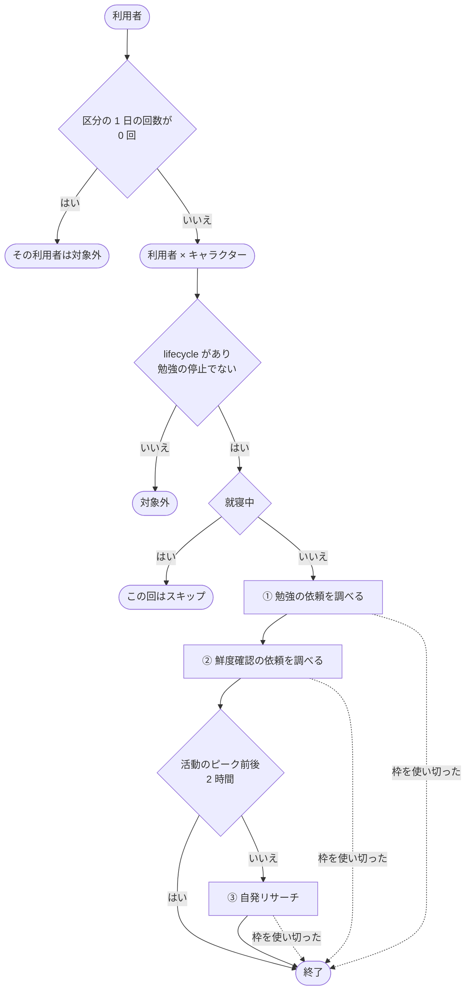
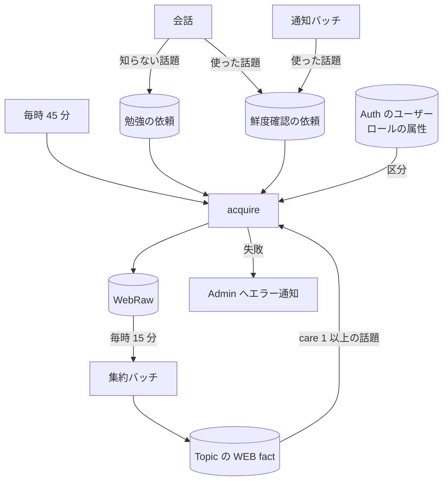

---
sources:
  - infra/livetalk/lib/batch-stack.ts
  - services/livetalk/batch/src/handlers/acquire.ts
  - services/livetalk/batch/src/usecases/acquire.usecase.ts
  - services/livetalk/core/src/usecases/acquire.usecase.ts
  - services/livetalk/core/src/study/active-window.ts
  - services/livetalk/core/src/study/research-allowance.ts
  - services/livetalk/core/src/study/study-plan.ts
  - services/livetalk/core/src/study/freshness-check.ts
  - services/livetalk/core/src/repositories/study-usage-counting.ts
  - services/livetalk/core/src/lifecycle/state-resolver.ts
  - services/livetalk/core/src/constants.ts
  - libs/aws/src/dynamodb/counter/try-increment-in-order.ts
sources_hash: f3bb6187ae99550c4b9ebd7b7c6f4310ecd365c1cb1e5626baab1f021fb78507
---

# 勉強バッチ (acquire)

キャラクターが Web で調べものをして、結果を [WebRaw](../term/webraw.md) に書くバッチ。[Topic](../term/topic.md) への畳み込みは[集約バッチ](./consolidate-conversations.md)が行う。

## 起点

- 毎時 45 分 (EventBridge: `cron(45 * * * ? *)`)
- 全利用者 × 全キャラクター (hiyori、ageha) を順に処理する
- Lambda は最長 15 分。時刻の判定は日本時間
- 会話から登録される勉強の依頼と鮮度確認の依頼は、[会話の経路](../flow/conversation.md)にある
- 利用者の区分を決めるため、Auth のユーザーのテーブル (`nagiyu-auth-users-{env}`) を読む。テーブル名は環境変数 `AUTH_USERS_TABLE_NAME` で渡し、読むのはロールの属性だけ ([auth のユーザー](../../../../platform/specs/lib/aws/auth-users.md)、[Auth のユーザーテーブル](../../../auth/specs/data/users.md))

## 対象から外れる条件

| 条件 | 外れる範囲 |
|---|---|
| 区分の 1 日の回数が 0 回 (お試しを過ぎた無料の利用者。[上限](#上限)) | その利用者の全部。キャラクターを見ず、回数も数えない |
| [lifecycle](../term/lifecycle.md) がない (週次の活動時間学習バッチが作る) | 全部。勉強中の人数にも数えない |
| [勉強の停止](../term/study-pause.md) (利用者の最後の発話から 72 時間以上、または発話なし) | 全部。勉強中の人数にも数えない |
| キャラクターが就寝中 | その回の全部。勉強中の人数には数える |
| 利用者の活動のピーク (朝・夕) の前後 2 時間 ([活動時間プロファイル](../term/user-activity-profile.md)が学習済みのときだけ) | 自発リサーチだけ |

## 処理

利用者ごとに、まず区分と 1 日の回数を決める ([上限](#上限))。そのあと利用者 × キャラクターごとに、次の流れで進む。

- 就寝中のキャラクターも、勉強中の人数には数える
- ピーク前後の判定は、活動時間プロファイルが学習済みのときだけ行う
- 調べた結果は WebRaw に書く。Topic への畳み込みは集約バッチが行う
- バッチの結果と完了のログに、区分ごとの人数 (`tierUsers`: 運営者 `operator`、スタンダード `standard`、お試し中の無料 `freeTrial`、お試しを過ぎた無料 `freeExpired`) を出す。区分を判定できなかった利用者は含まない。お試しを過ぎた無料の利用者は、スキップした利用者 (`skippedUsers`) にも数える

| 段 | 対象 | 検索語 | 書くもの |
|---|---|---|---|
| ① | [勉強の依頼](../term/study-topic.md) (pending) を優先度の高い順、同じなら古い順に | 依頼の文言そのまま | WebRaw (origin: request)。依頼は done にする |
| ② | [鮮度確認の依頼](../term/freshness-check-request.md)を古い順に | 「{主題} 最新情報」。主題がすでに「最新情報」で終わるなら足さない | 変化があったときだけ WebRaw (origin: stale) |
| ③ | 自発リサーチ。[care](../term/care.md) 1 以上の Topic を高い順に、上位 20 件を候補に | LLM が作る探索の角度。作れなければ「{主題} 最新情報」 | WebRaw (origin: auto) |

- 依頼 (①): 失敗したときと、上限で止まったときは pending に戻して次の回に回す。依頼が消えていたら飛ばす
- 鮮度確認 (②)
    - Topic ごとに検索は 1 回にまとめる。対象は、その Topic の新しい側 20 件の [WEB fact](../term/web-fact.md) のうち確認が要るもの。対象がなければ依頼だけ消す
    - 既存の事実と取得結果を LLM で比べ、変化があったときだけ WebRaw を書く
    - 変化の有無や失敗にかかわらず、対象の WEB fact の再確認期限を延ばす (high 1 日、medium 7 日、low 30 日)。依頼も消す
    - 上限で止まったときは、依頼を消さずに残す
- 自発リサーチ (③)
    - [探索の記録](../term/exploration.md)の時刻、または起点の最新の WEB fact の観測日時が 24 時間以内なら飛ばす
    - 検索の成否にかかわらず、探索の記録を残す (時刻と、最近の角度 5 件)
    - 角度を作るのは、枠を使えると決まった後である

## 上限

| 上限 | 値 |
|---|---|
| 1 回の実行・1 キャラクターあたりの検索 | 3 回 (①②③の合計。失敗した検索も 1 回に数える) |
| 1 日・利用者 1 人あたり | 区分ごとの回数 (下の表。日本時間の暦日。全キャラクターの合計) |
| 1 日・キャラクターあたり | 利用者の 1 日の回数 ÷ 勉強中のキャラクター数 (切り捨て) |
| 1 日・全利用者の合計 | 200 回 (日本時間の暦日) |

利用者の区分と 1 日の回数は、次のとおり。

| 区分 | 決め方 | 1 日の回数 |
|---|---|---|
| 運営者 | 有効なロールが権限 `livetalk:operator` を持つ。`livetalk:standard` も持つときも運営者 | 20 回 |
| スタンダード | 有効なロールが権限 `livetalk:standard` を持つ | 20 回 |
| 無料 (お試し中) | それ以外で、Profile の作成時刻から 7 日 (168 時間) たっていない | 20 回 |
| 無料 (お試しを過ぎた) | それ以外で、Profile の作成時刻からちょうど 7 日たった時刻以降 | 0 回 (勉強しない) |

- 有効なロールは、Auth のユーザーの手動のロールと課金の権利から、実行の時刻で求める ([ロールと権限](../../../../platform/specs/lib/common/roles-and-permissions.md)、[課金の権利](../../../../platform/specs/lib/common/role-grants.md))。Auth にユーザーがいなければ、ロールなし (無料) として扱う
- Profile は、利用者が最初に同意したときに作られる ([同意](../term/consent.md))。お試しの判定は無料の利用者にだけ行う
- 回数は区分ごとの表に持ち、区分ごとに別々に変えられる。お試しのあいだの無料の回数も、お試しを過ぎたあとの 0 回とは別に持つ
- 勉強中のキャラクターは、lifecycle があり、勉強の停止になっていないもの。就寝中も数える
- 枠は検索の直前に 1 回分ずつ数え、失敗しても戻さない。枠を使い切ったら、その組はその回の残りの検索を止める
- 回数の記録に失敗したときも、上限を守れないので勉強を止める
- 枠は、キャラクターあたり → 利用者 1 人あたり → 全利用者の合計の順に数える。あとの枠で断られたら、通った前の枠を 1 回ずつ戻す。戻せなければ、その枠を 1 回多く数えたまま続け、報告する (warning、題名は「勉強回数を戻せませんでした (1 回分多く数えたまま)」)
- 全利用者の合計の枠で断られたら、その回の勉強を打ち切る。その利用者の残りのキャラクターと、残りの利用者は、勉強もせず回数も数えない。打ち切った残りの利用者はスキップした利用者 (`skippedUsers`) に数え、区分ごとの人数には入れない。結果の `globalLimitReached` を true にし、warn のログ「全体の勉強の上限に達したため、この回の勉強を打ち切りました」を出す

## 失敗したとき

- 個々の検索の失敗は握って次へ進む。Lambda は失敗にしない
- キャラクターごとの処理が例外で終わったときと、回数の記録に失敗したときは、その利用者を失敗として数える。他のキャラクターと他の利用者は続ける
- 区分を判定できないとき (Auth のユーザーや Profile の読み取りに失敗したとき、無料なのに Profile がないとき) は、その利用者を勉強させず、失敗として数える。他の利用者は続ける
- 環境変数 `AUTH_USERS_TABLE_NAME` がないときは、どの利用者も勉強せず、起動の時点で Lambda を失敗にする
- 失敗した利用者が 1 人でもいると、最後に Lambda を失敗にする。1 日の上限 (全利用者の合計を含む) に達しただけでは失敗にしない
- 失敗は Admin にエラーとして届く ([エラー通知の経路](../../../admin/specs/flow/error-notification.md))
- 失敗した利用者がいると例外で終わるため、Lambda の再試行で、15 分の処理と OpenAI の呼び出しが繰り返されうる。再試行と DLQ は[バッチの実行環境](../resource/batch-runtime.md)、監視は[監視](../resource/monitoring.md)にある

## つながり

## 理由

- 鮮度の再取得は、Topic 単位に束ねる。再確認の期限は WEB fact ごとに持つが、同じ Topic で期限切れの事実が複数あっても、検索は 1 回にして、それらの期限をまとめて延ばす。検索の語は Topic から作るので、事実ごとに取ると同じ検索を重ねるだけになる。dev では、鮮度切れの再取得の約 3 割が、同じ実行の中の重複した検索だった
- 確認の依頼の理由は[鮮度確認の依頼](../term/freshness-check-request.md)、自発リサーチの起点と角度の理由は[探索の記録](../term/exploration.md)にある
- 1 日の上限は、利用者単位で、回数で数える。区分で回数を変えることと、全利用者の合計の上限を置くことの要件は[勉強](../../requirements/functional/study.md)にある
    - 利用者単位にするのは、勉強の原価が、利用者の話すキャラクターの数だけ増えるのを防ぐためである。費用の約 7 割は Web 検索で、リサーチ 1 回で何回検索するかはモデル任せなので、検索の回数をリサーチごとにログへ出し、上限の値を実測で直せるようにしている
    - 回数で数えるのは、1 回の重さのばらつきが小さいため。リサーチ 1 回は約 2 円
    - 期間は日本時間の暦日にする。月で数えると、月の初めに使い切って、残りの期間ずっと勉強が止まりうる。時刻と日付の判定は、コードで日本時間を明示して求めるので、実行環境のタイムゾーンに依存しない
    - 枠は、勉強中のキャラクターで等分する。キャラクター別の回数と、利用者の合計の回数の両方を数えるのは、勉強中の人数が日の途中で減ると、キャラクター別の枠だけでは合計が上限を超えるためである。1 人のキャラクターだけが活発でも、勉強中のキャラクターが多いと、その枠は小さい
    - 枠を狭い順 (キャラクター別 → 利用者の合計 → 全利用者の合計) に数えるのは、断る理由の大半が狭い枠の使い切りで、そのときは広い枠に触れず、戻しも要らないためである
    - カウンターが使えないときと、区分を判定できないときは、その利用者の勉強を止める。数えられないまま、または区分がわからないまま勉強すると、原価の上限を守れないためである。会話のロックとレートリミットが障害時に通す ([チャット API](../api/chat.md)) のとは逆になる
- 区分ごとの回数
    - 1 日 20 回は、ふだんの使い方 (1 日 12 回ほど) を上回り、本番の実測の 7 日間で上限に当たった日はなかった。上限いっぱいで 1 人あたり月約 1,200 円
    - 運営者にも上限を置く。回数はスタンダードと同じで期限はないが、上限なしにはしない。暴走や不具合で勉強が回り続けたときに原価を止めるため
    - お試しは、Profile の作成からの時間で数え、勉強が止まっている日も減る。残りの日数を利用者がひと目でわかる数え方を優先した
- 全利用者の合計の上限
    - お試しは新しい登録ごとに約 200 円かかり、登録が急に増えたときに、利用者ごとの上限では原価が止まらない。200 回/日は月最大で約 1.2 万円で、ふだんの使い方の 15 人分ほどにあたる
    - 当たったら、その回の勉強を打ち切る。全体の枠は他の利用者にも効くので、残りの利用者の回数を数えに行っても断られるだけである。ログは利用者ごとの上限と分けて出す。運営が原価の点で知りたい事象だから
    - 採らない案: OpenAI の管理画面の利用額の上限。当たると、有料の利用者の会話まで止まる。勉強だけを止めれば、会話は残せる
    - 全体の上限に当たった日は、スタンダードと運営者の勉強も、その日の残りは止まる
    - 全体の回数は `USER#` の配下の外に置く ([テーブル](../data/main-table.md))。退会で消えず、利用者の回数と混ざらないようにするため
- Auth のユーザーのテーブルを直接読むのは、バッチが利用者のログインの情報 (セッション) を持たないためである。項目の形を知るのは `@nagiyu/aws` の reader に任せ、Auth のパッケージには依存しない ([auth のユーザー](../../../../platform/specs/lib/aws/auth-users.md))
- 3 日話しかけていないキャラクターの勉強を止める理由は、[勉強の停止](../term/study-pause.md)にある
- 集約と取得を別のバッチに分けるのは、取得 (Web アクセス) の失敗や遅延と、畳み込みの整合性 (カーソルを進めること) を、独立に扱うためである。畳み込みは[集約バッチ](./consolidate-conversations.md)にある
