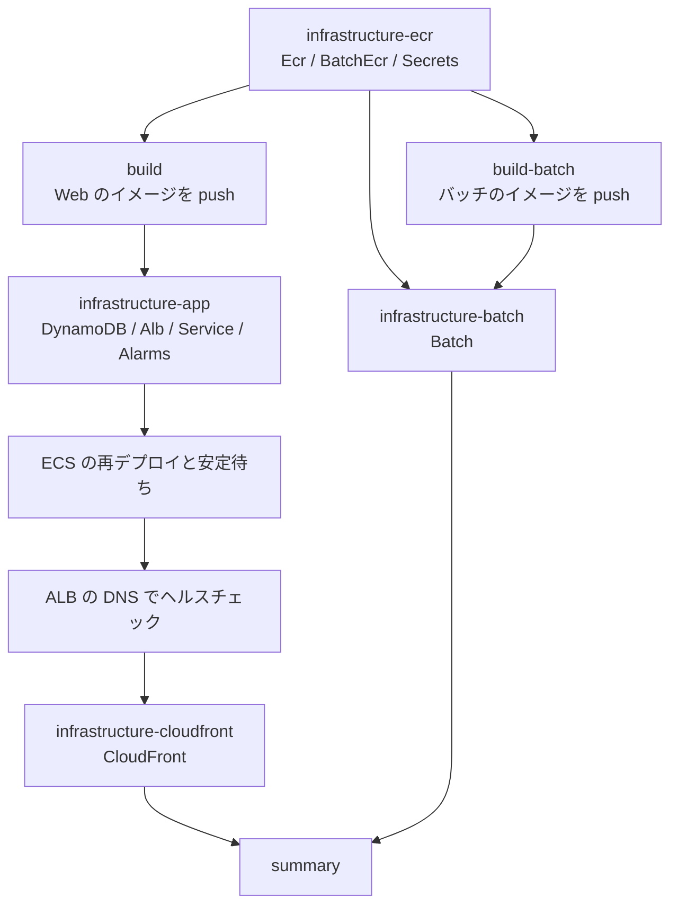

---
sources:
  - infra/livetalk/bin/livetalk.ts
  - infra/livetalk/lib/cloudfront-stack.ts
  - .github/workflows/livetalk-deploy.yml
sources_hash: a10a8c1b710397daa53e26df1242f9c36862bd755419703749f04dd5eef8b22f
---

# LiveTalk のデプロイ先

LiveTalk の Web は共有の ECS クラスター上の Fargate サービスとして動き、専用の ALB を経由して CloudFront から公開される。バッチは Lambda + EventBridge で動く。スタックはすべて `us-east-1` に作られる。

## ホスト名

| 環境 | ホスト名 |
|---|---|
| dev | `live-talk.dev.nagiyu.com` |
| prod | `live-talk.nagiyu.com` |

サービスのディレクトリ名は `livetalk` だが、サブドメインは dev も prod も `live-talk` である。`infra/livetalk/lib/cloudfront-stack.ts` が `live-talk` を直接書き、CloudFront のカスタムドメインと Route53 の ALIAS の相対名を決める。ホスト名の組み立ては [デプロイ先 (platform)](../../../platform/specs/deploy.md) に従う。

DNS レコードは、環境によらず `NagiyuLiveTalkCloudFront{Env}` が自分のスタックで ALIAS を作る。shared の prod 用 CNAME 一覧には入っていない。

## スタック

`infra/livetalk/bin/livetalk.ts` が、次の順に作る。環境は環境変数 `ENVIRONMENT` (既定は `dev`) で決まり、`{Env}` は `Dev` / `Prod` である。

| 順 | スタック | 役割 | 含むリソース |
|---|---|---|---|
| 1 | `NagiyuLiveTalkEcr{Env}` | Web のイメージの置き場 | ECR リポジトリ |
| 2 | `NagiyuLiveTalkBatchEcr{Env}` | バッチのイメージの置き場 | ECR リポジトリ |
| 3 | `NagiyuLiveTalkSecrets{Env}` | シークレット | Secrets Manager のシークレット |
| 4 | `NagiyuLiveTalkAlb{Env}` | Web の入口 | ALB |
| 5 | `NagiyuLiveTalkDynamoDB{Env}` | データの保存先 | DynamoDB テーブル |
| 6 | `NagiyuLiveTalkService{Env}` | Web の実行 | 共有クラスター上の ECS サービス (Fargate) |
| 7 | `NagiyuLiveTalkCloudFront{Env}` | 公開の入口と DNS | CloudFront、S3 バケット、Route53 の ALIAS |
| 8 | `NagiyuLiveTalkBatch{Env}` | 定期バッチ | Lambda、EventBridge ルール |
| 9 | `NagiyuLiveTalkAlarms{Env}` | 監視 | CloudWatch アラーム |

## デプロイの流れ

`.github/workflows/livetalk-deploy.yml` が行う。

| 項目 | 内容 |
|---|---|
| トリガー | develop・`integration/**`・master への push (サービス・infra・libs・configs などのパスが変わったとき)。手動実行 (dev / prod を選ぶ) |
| デプロイ先の環境 | [dev と prod の切り替え](../../../platform/specs/deploy.md#dev-と-prod-の切り替え) の規則 |
| 並行実行 | 環境ごとに直列化する。実行中の run は止めず、待機中は最新だけ残す |
| イメージのタグ | コミットの SHA |

| ジョブ | 内容 |
|---|---|
| `infrastructure-ecr` | ECR 2 つと Secrets のスタックをデプロイする |
| `build` | Web のイメージをビルドして ECR に push する |
| `build-batch` | バッチのイメージをビルドして ECR に push する (`build` と並行) |
| `infrastructure-app` | DynamoDB・ALB・Service・Alarms をデプロイし、ECS サービスを強制的に再デプロイして安定するまで待つ。そのあと、ALB の DNS 名に対してヘルスチェックを行う ([ヘルスチェック](../../../platform/specs/deploy.md#ヘルスチェック)) |
| `infrastructure-batch` | Secrets Manager の値を取り出し、Batch をデプロイする (`infrastructure-ecr` と `build-batch` の後) |
| `infrastructure-cloudfront` | `infrastructure-app` の後に CloudFront をデプロイする。CloudFront 経由のヘルスチェックはしない |
| `summary` | 結果を要約に出す (`always`) |
