---
sources:
  - infra/livetalk/bin/livetalk.ts
  - infra/livetalk/lib/cloudfront-stack.ts
  - infra/livetalk/lib/ecs-service-stack.ts
  - infra/livetalk/lib/alb-stack.ts
  - .github/workflows/livetalk-deploy.yml
sources_hash: f3597c47d488f8bcd57b7d68181d239891535cc47526aa88844ab4f0616523b7
---

# LiveTalk のデプロイ先

LiveTalk の Web は共有の ECS クラスタ上の Fargate サービス (Web + VOICEVOX の 2 コンテナ) として動き、専用の ALB を経由して CloudFront から公開される。バッチは Lambda + EventBridge で動く。スタックはすべて `us-east-1` に作られる。

## ホスト名

| 環境 | ホスト名 |
|---|---|
| dev | `live-talk.dev.nagiyu.com` |
| prod | `live-talk.nagiyu.com` |

サービスのディレクトリ名は `livetalk` だが、サブドメインは dev も prod も `live-talk` である。次の 2 か所が `live-talk` を直接書いている。

| 場所 | 決めるもの |
|---|---|
| `infra/livetalk/lib/cloudfront-stack.ts` | CloudFront のカスタムドメイン (`getCloudFrontDomainName('live-talk', environment)`) と、Route53 に作る ALIAS の相対名 |
| `infra/livetalk/lib/ecs-service-stack.ts` | Web コンテナの環境変数 `APP_URL` (`getServiceUrl('live-talk', environment)`) |

ホスト名の組み立ては [デプロイ先 (platform)](../../../platform/specs/deploy.md) に従う。

DNS レコードは、環境によらず `NagiyuLiveTalkCloudFront{Env}` が自分のスタックで ALIAS を作る。shared の prod 用 CNAME 一覧には入っていない。

## スタック

`infra/livetalk/bin/livetalk.ts` が、次の順に作る。`{Env}` は `Dev` / `Prod` である。

| 順 | スタック | 役割 | 含む主なリソース |
|---|---|---|---|
| 1 | `NagiyuLiveTalkEcr{Env}` | Web のイメージの置き場 | ECR リポジトリ |
| 2 | `NagiyuLiveTalkBatchEcr{Env}` | バッチのイメージの置き場 | ECR リポジトリ |
| 3 | `NagiyuLiveTalkSecrets{Env}` | API キーの入れ物 | Secrets Manager (OpenAI の API キー、VAPID の鍵ペア)。初回は `PLACEHOLDER` で作られ、実値は手で入れる |
| 4 | `NagiyuLiveTalkAlb{Env}` | Web の入口 | 専用 ALB、ターゲットグループ (ポート 3000、ヘルスチェック `/api/health`)、HTTP 80 のリスナー、セキュリティグループ |
| 5 | `NagiyuLiveTalkDynamoDB{Env}` | データの保存先 | シングルテーブル (キーは `PK` / `SK`、オンデマンド課金、PITR、TTL 属性 `TTL`)、GSI。prod は削除時に保持、dev は削除される |
| 6 | `NagiyuLiveTalkService{Env}` | Web の実行 | 共有クラスタ上の Fargate サービス (希望数 1)、タスク定義、タスクロール。dev は Fargate Spot、prod はオンデマンド |
| 7 | `NagiyuLiveTalkCloudFront{Env}` | 公開の入口と DNS | CloudFront ディストリビューション、Live2D モデル用の private S3 バケット (`/assets/*` を配信)、Route53 の ALIAS |
| 8 | `NagiyuLiveTalkBatch{Env}` | 定期バッチ | Lambda 4 本 (学習・通知・集約・取得)、EventBridge ルール、DLQ、IAM ロール |
| 9 | `NagiyuLiveTalkAlarms{Env}` | 監視 | CloudWatch アラーム (バッチのエラーと DLQ、ALB の 5xx と不健全ホスト、DynamoDB のスロットル) |

スタック間の依存は次のとおりで、ALB の値は SSM 経由で受け渡される。

- Service・CloudFront・Alarms は ALB に依存する。
- ECR・Secrets・DynamoDB・Batch は、名前を組み立てて参照するため、ほかのスタックとの順序の依存がない。

## デプロイの流れ

`.github/workflows/livetalk-deploy.yml` が行う。

| 項目 | 内容 |
|---|---|
| トリガー | develop・`integration/**`・master への push (サービス・infra・libs・configs などのパスが変わったとき)。手動実行 (dev / prod を選ぶ) |
| デプロイ先の環境 | 手動実行は入力値。master への push は prod。それ以外は dev |
| 並行実行 | 環境ごとに直列化する。実行中の run は止めず、待機中は最新だけ残す |
| イメージのタグ | コミットの SHA |

```mermaid
flowchart TD
    A[infrastructure-ecr<br/>Ecr / BatchEcr / Secrets] --> B[build<br/>Web のイメージを push]
    A --> C[build-batch<br/>バッチのイメージを push]
    B --> D[infrastructure-app<br/>DynamoDB / Alb / Service / Alarms]
    D --> E[ECS の再デプロイと安定待ち]
    E --> F[ALB の DNS でヘルスチェック]
    F --> G[infrastructure-cloudfront<br/>CloudFront]
    A --> H[infrastructure-batch<br/>Batch]
    C --> H
    G --> I[summary]
    H --> I
```

| ジョブ | 内容 |
|---|---|
| `infrastructure-ecr` | ECR 2 つと Secrets のスタックをデプロイする |
| `build` | Web のイメージをビルドして ECR に push する |
| `build-batch` | バッチのイメージをビルドして ECR に push する (`build` と並行) |
| `infrastructure-app` | DynamoDB・ALB・Service・Alarms をデプロイし、ECS サービスを強制的に再デプロイして安定するまで待つ。そのあと、SSM に保存された ALB の DNS 名に対して `/api/health` のヘルスチェックを行う |
| `infrastructure-batch` | Secrets Manager から OpenAI の API キーと VAPID の鍵を取り出し、Batch をデプロイする (`infrastructure-ecr` と `build-batch` の後) |
| `infrastructure-cloudfront` | `infrastructure-app` の後に CloudFront をデプロイする。CloudFront 経由のヘルスチェックはしない |
| `summary` | 結果を要約に出す (`always`) |
