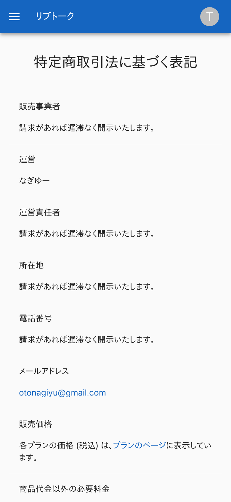
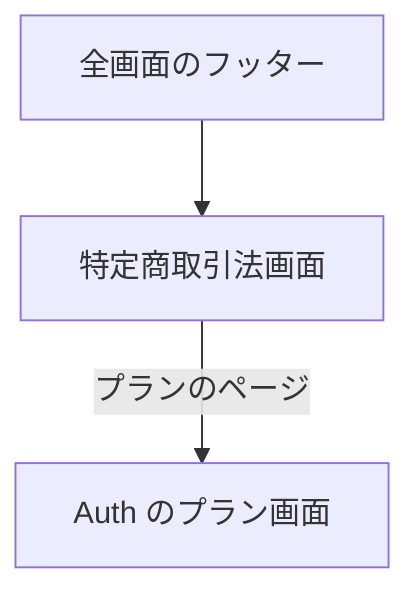

---
sources:
  - services/livetalk/web/src/app/legal/tokushoho/page.tsx
  - services/livetalk/web/src/app/layout.tsx
  - services/livetalk/web/src/middleware.ts
sources_hash: ab4f231649f3c3174da5e5980ad4b5d49bb8d027a0c7fb54f41daef67ac552ab
---

# 特定商取引法画面

有料プランの販売に必要な「特定商取引法に基づく表記」を載せた公開ページ。[Auth の同名の画面](../../../auth/specs/screen/tokushoho.md)と、同じ共通の表を使う。

## 入口

- パスは `/legal/tokushoho`。ログインなしで開ける (ミドルウェアが `/legal/` 配下を通す)
- 全画面のフッターの「特定商取引法に基づく表記」から来る。ブラウザのタブの題名は「特定商取引法に基づく表記 | リブトーク」

## 表示するもの

- 見出し「特定商取引法に基づく表記」(中央寄せ) と、項目名と内容の表。表は共通の部品で描き、項目の文面と部品の振る舞い (狭い画面での並びを含む) は[法務の文書](../../../../platform/specs/lib/ui/legal.md)にある。内容は Auth の同名の画面と同じ
- 表の中の「プランのページ」は、Auth サービスの[プラン画面](../../../auth/specs/screen/plans.md) (`{NEXT_PUBLIC_AUTH_URL}/plans`。末尾の `/` は除く) へのリンク。連絡先は `mailto:` のリンク

## 操作

| 操作 | 結果 |
|---|---|
| 「プランのページ」 | Auth サービスのプラン画面を開く |
| メールアドレス | メールの作成を開く |

## 画面の見た目

### 通常表示

画面の上部。項目名と内容の表。

| スマホ |
|---|
|  |

## つながり

## 理由

- 表記の文面は、画面ごとには持たず、共通のデータで持つ。課金を受けるサービスで表記が食い違わないようにするため ([Auth の同名の画面](../../../auth/specs/screen/tokushoho.md)にも同じ文面を出す)
- 「プランのページ」のリンク先は、ページを描くときにサーバーの実行時の環境変数から決める。Auth の URL をビルドのときの値に固定しないため、動的に描画する
